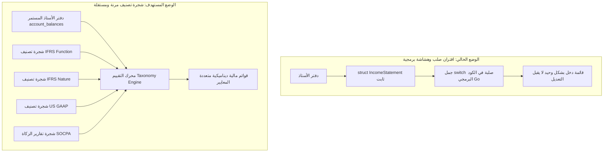
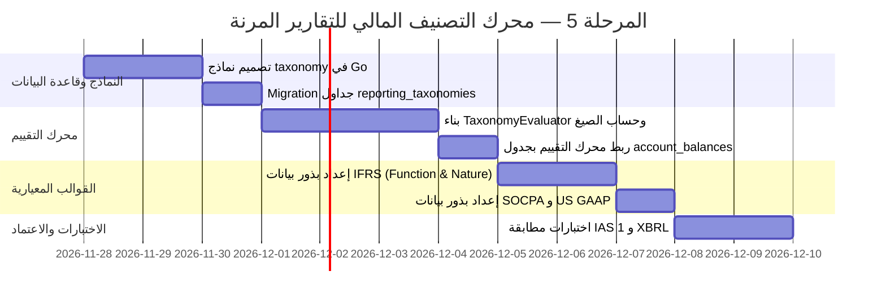

# المرحلة 5: بناء محرك شجرة التصنيف المالي للتقارير المرنة

## Phase 5: Configurable Financial Reporting Taxonomy Engine (IFRS / US GAAP / SOCPA)

**القرار المعماري:** القرار 5 — كيف نفصل بين المحاسبة المالية والتقارير المالية؟  
**الأولوية:** 🟡 استراتيجية (Strategic Priority)  
**التبعيات:** المرحلة 1 (جدول `account_balances`) والمرحلة 4 (المصالحة والتطابق)  
**المراجع المعيارية:**

| المعيار | الصلة |
| :--- | :--- |
| **IAS 1** — عرض القوائم المالية | خيارات العرض: بحسب الوظيفة (By Function) وبحسب الطبيعة (By Nature) |
| **ASC 205 (US GAAP)** | متطلبات عرض القوائم المالية في البيئة الأمريكية |
| **XBRL / iXBRL Taxonomies** | الهياكل الشجرية المعيارية لتصنيف الحسابات وعقد القوائم المالية عالمياً |
| **IAS 7** — التدفقات النقدية | تصنيف الأنشطة التشغيلية والاستثمارية والتمويلية عبر عقد ديناميكية |
| **SOCPA / ZATCA** | متطلبات القوائم المالية النظامية والزكوية للشركات في المملكة العربية السعودية |

---

## 1. الأهداف (Objectives)

1. **الفصل المعماري الكامل بين المحاسبة والتقارير**:
   - إزالة الاقتران الصلب (`Hardcoded Coupling`) في ملفات `balance_sheet.go` و `income_statement.go` حيث تم حصر القوائم في هياكل ثابتة وجمل `switch` على حقول نصية هشة (`account.SubClassification`).
   - تحويل الأستاذ العام إلى **نواة حسابية مستقلة محايدة (Neutral Accounting Ledger)** تسجل الحركات بأمان، بينما تتولى طبقة التقارير تمثيل القوائم المالية وتنسيقها.
2. **بناء محرك شجرة التصنيف المالي (`Taxonomy Engine`)**:
   - تمكين تعريف شجرة تقارير مرنة (`ReportNode Hierarchy`) تتألف من عقد: تجميعية (`Summary`)، نطاق حسابات (`AccountMapping`)، وصيغ حسابية (`FormulaNode`).
   - دعم التبديل الفوري بين الأطر المحاسبية المتعددة لنفس شجرة الحسابات (IFRS مقابل US GAAP مقابل متطلبات الزكاة SOCPA).
3. **توفير قوالب معيارية مسبقة التهيئة (Pre-Configured Standard Templates)**:
   - قالب المعايير الدولية **IFRS (Presentation by Function)**.
   - قالب المعايير الدولية **IFRS (Presentation by Nature)**.
   - قالب المعايير الأمريكية **US GAAP**.
   - قالب الهيئة السعودية للمحاسبين القانونيين **SOCPA / ZATCA**.

---

## 2. المقارنة المعمارية بين الوضع الراهن والمستهدف



---

## 3. المعالجة التقنية المفصلة (Technical Implementation)

### 3.1 تعريف نماذج شجرة التصنيف المالي (Taxonomy Domain Models)

**مجلد جديد:** `internal/reporting/taxonomy/`  
**ملف:** `internal/reporting/taxonomy/models.go`

```go
package taxonomy

import (
    "time"

    "github.com/google/uuid"
    "github.com/shopspring/decimal"
)

type ReportingFramework string

const (
    FrameworkIFRS   ReportingFramework = "IFRS"
    FrameworkUSGAAP ReportingFramework = "US_GAAP"
    FrameworkSOCPA  ReportingFramework = "SOCPA"
)

type StatementType string

const (
    StatementBalanceSheet   StatementType = "BALANCE_SHEET"
    StatementIncome         StatementType = "INCOME_STATEMENT"
    StatementCashFlow       StatementType = "CASH_FLOW"
    StatementEquityMovement StatementType = "EQUITY_STATEMENT"
)

type NodeType string

const (
    NodeHeader         NodeType = "HEADER"          // عنوان قسم فقط دون مبالغ
    NodeAccountRange   NodeType = "ACCOUNT_RANGE"   // يجمع الحسابات من رمز كذا إلى كذا
    NodeAccountTag     NodeType = "ACCOUNT_TAG"     // يجمع الحسابات التي تحمل وسماً معيناً
    NodeFormula        NodeType = "FORMULA"         // معادلة رياضية (e.g., GROSS_PROFIT = REV - COGS)
    NodeSubtotal       NodeType = "SUBTOTAL"        // مجموع الأبناء المباشرين
)

// ReportNode يمثل عقدة واحدة في شجرة القوائم المالية
// مستوحى من مواصفات XBRL International Taxonomies
type ReportNode struct {
    ID             uuid.UUID
    DefinitionID   uuid.UUID
    ParentID       *uuid.UUID
    Code           string     // معرف العقدة الفريد (e.g., "GROSS_PROFIT", "CURRENT_ASSETS")
    TitleAr        string     // الاسم باللغة العربية (e.g., "مجمل الربح")
    TitleEn        string     // الاسم باللغة الإنجليزية (e.g., "Gross Profit")
    NodeType       NodeType
    DisplayOrder   int
    SignMultiplier int        // +1 أو -1 لضبط إشارة العرض في القائمة
    AccountFrom    string     // بداية نطاق الحسابات (e.g., "1100")
    AccountTo      string     // نهاية نطاق الحسابات (e.g., "1199")
    AccountTags    []string   // وسوم الحسابات المطابقة
    FormulaExpr    string     // الصيغة الحسابية للعقد التجميعية
    Children       []*ReportNode
}

// FinancialReportDefinition يمثل تعريف التقرير المالي المعياري الكامل
type FinancialReportDefinition struct {
    ID          uuid.UUID
    CompanyID   *uuid.UUID          // Nil للقوالب العامة المعيارية
    Code        string              // e.g. "IFRS_IS_FUNCTION_2026"
    Name        string
    Framework   ReportingFramework
    Type        StatementType
    RootNodes   []*ReportNode
    Version     int
    CreatedAt   time.Time
}
```

---

### 3.2 محرك تقييم القوائم المالية (`TaxonomyEvaluator`)

**ملف:** `internal/reporting/taxonomy/evaluator.go`

```go
package taxonomy

import (
    "context"
    "fmt"
    "time"

    "accounting_engine/internal/reporting"
    "github.com/google/uuid"
    "github.com/shopspring/decimal"
)

type EvaluatedLine struct {
    Code         string
    TitleAr      string
    TitleEn      string
    Level        int             // عمق العقدة في الشجرة للتنسيق البصري
    Amount       decimal.Decimal
    IsSubtotal   bool
    DrilldownIDs []uuid.UUID     // الحسابات المساهمة في هذا الرقم
}

type EvaluatedStatement struct {
    DefinitionCode string
    Framework      ReportingFramework
    Type           StatementType
    AsOfDate       time.Time
    Currency       string
    Lines          []EvaluatedLine
    GeneratedAt    time.Time
}

type TaxonomyEvaluator struct {
    balancesRepo reporting.BalanceReader
}

func NewTaxonomyEvaluator(repo reporting.BalanceReader) *TaxonomyEvaluator {
    return &TaxonomyEvaluator{balancesRepo: repo}
}

// EvaluateStatement يحسب القائمة المالية ديناميكياً من شجرة التصنيف والأرصدة المستمرة
// المرجع: IAS 1 / XBRL Calculation Linkbase
func (e *TaxonomyEvaluator) EvaluateStatement(
    ctx context.Context,
    companyID uuid.UUID,
    def FinancialReportDefinition,
    periodID uuid.UUID,
    currency string,
) (*EvaluatedStatement, error) {
    // 1. قراءة الأرصدة المستمرة اللحظية للفترة من account_balances (المرحلة 1)
    balances, err := e.balancesRepo.GetPeriodBalances(ctx, companyID, periodID, currency)
    if err != nil {
        return nil, fmt.Errorf("read period balances: %w", err)
    }

    // 2. خريطة القيم المحسوبة للعقد لدعم صيغ الـ Formula
    computedValues := make(map[string]decimal.Decimal)
    var lines []EvaluatedLine

    // 3. مسح شجرة العقد العودية وحساب القيم
    for _, rootNode := range def.RootNodes {
        subLines, err := e.evaluateNodeRecursive(rootNode, balances, computedValues, 0)
        if err != nil {
            return nil, err
        }
        lines = append(lines, subLines...)
    }

    return &EvaluatedStatement{
        DefinitionCode: def.Code,
        Framework:      def.Framework,
        Type:           def.Type,
        Currency:       currency,
        Lines:          lines,
        GeneratedAt:    time.Now().UTC(),
    }, nil
}
```

---

### 3.3 هجرة قاعدة البيانات لجداول التصنيف المالي

**ملف:** `storage/postgres/migrations/202611100012_reporting_taxonomies.sql`

```sql
-- المرحلة 5: جداول شجرة التصنيف المالي للتقارير المرنة
-- المرجع: XBRL International / IAS 1 / US GAAP ASC 205

CREATE TABLE IF NOT EXISTS reporting_taxonomies (
    id          UUID PRIMARY KEY DEFAULT gen_random_uuid(),
    company_id  UUID REFERENCES companies(id) ON DELETE CASCADE, -- NULL للقوالب العامة
    code        VARCHAR(64) NOT NULL UNIQUE,
    name        VARCHAR(255) NOT NULL,
    framework   VARCHAR(32) NOT NULL CHECK (framework IN ('IFRS', 'US_GAAP', 'SOCPA')),
    statement_type VARCHAR(32) NOT NULL CHECK (statement_type IN ('BALANCE_SHEET', 'INCOME_STATEMENT', 'CASH_FLOW', 'EQUITY_STATEMENT')),
    version     INT NOT NULL DEFAULT 1,
    created_at  TIMESTAMPTZ NOT NULL DEFAULT NOW()
);

CREATE TABLE IF NOT EXISTS reporting_taxonomy_nodes (
    id             UUID PRIMARY KEY DEFAULT gen_random_uuid(),
    taxonomy_id    UUID NOT NULL REFERENCES reporting_taxonomies(id) ON DELETE CASCADE,
    parent_id      UUID REFERENCES reporting_taxonomy_nodes(id) ON DELETE CASCADE,
    code           VARCHAR(64) NOT NULL,
    title_ar       VARCHAR(255) NOT NULL,
    title_en       VARCHAR(255) NOT NULL,
    node_type      VARCHAR(32) NOT NULL CHECK (node_type IN ('HEADER', 'ACCOUNT_RANGE', 'ACCOUNT_TAG', 'FORMULA', 'SUBTOTAL')),
    display_order  INT NOT NULL DEFAULT 100,
    sign_multiplier SMALLINT NOT NULL DEFAULT 1 CHECK (sign_multiplier IN (1, -1)),
    account_from   VARCHAR(32),
    account_to     VARCHAR(32),
    account_tags   TEXT[],
    formula_expr   TEXT,
    created_at     TIMESTAMPTZ NOT NULL DEFAULT NOW(),
    UNIQUE (taxonomy_id, code)
);

CREATE INDEX IF NOT EXISTS idx_taxonomy_nodes_lookup
    ON reporting_taxonomy_nodes(taxonomy_id, parent_id, display_order);
```

**ملف التراجع:** `storage/postgres/migrations/202611100012_reporting_taxonomies.down.sql`

```sql
DROP TABLE IF EXISTS reporting_taxonomy_nodes;
DROP TABLE IF EXISTS reporting_taxonomies;
```

---

### 3.4 القوالب المعيارية الأولية المدمجة (Seed Data)

يتم تزويد النظام ببيانات أولية (Seed) تتضمن قوالب الإفصاح المعتمدة:

1. **قالب `IFRS_IS_FUNCTION_2026` (قائمة الدخل بحسب الوظيفة - IAS 1.99):**
   - الإيرادات التشغيلية (`Revenue`)
   - تكلفة المبيعات (`Cost of Sales`)
   - **مجمل الربح** (`Gross Profit = Revenue - Cost of Sales`)
   - مصاريف البيع والتوزيع (`Selling Expenses`)
   - المصاريف العمومية والإدارية (`Administrative Expenses`)
   - **الربح التشغيلي** (`Operating Profit`)
   - تكاليف التمويل (`Finance Costs`)
   - ضريبة الدخل والزكاة (`Income Tax & Zakat`)
   - **صافي ربح الفترة** (`Net Profit`)
   - بنود الدخل الشامل الآخر (`Other Comprehensive Income - OCI`)
   - **إجمالي الدخل الشامل** (`Total Comprehensive Income`)

2. **قالب `IFRS_IS_NATURE_2026` (قائمة الدخل بحسب الطبيعة - IAS 1.102):**
   - الإيرادات
   - التغير في مخزون الإنتاج التام
   - المواد الخام المستهلكة
   - تكاليف منافع الموظفين
   - مصاريف الاستهلاك والإطفاء
   - المصاريف التشغيلية الأخرى

3. **قالب `SOCPA_ZAKAT_STATUTORY_2026`:**
   - يدمج حسابات وعاء الزكاة الشرعية وتفاصيل الاستقطاعات الضريبية المعتمدة لدى هيئة الزكاة والضريبة والجمارك (ZATCA).

---

## 4. خطة الاختبارات (Test Plan)

| # | سيناريو الاختبار | النوع | المعيار المرجعي | معيار القبول |
| :---: | :--- | :--- | :--- | :--- |
| T5.1 | حساب قائمة الدخل وفق تصنيف الوظيفة (By Function) | Unit | IAS 1.99 | حساب مجمل الربح والربح التشغيلي بدقة |
| T5.2 | حساب نفس البيانات وفق تصنيف الطبيعة (By Nature) لنفس الشركة | Unit | IAS 1.102 | صافي الربح متطابق تماماً في القائمتين |
| T5.3 | تقييم عقدة صيغة رياضية معقدة (`FormulaNode`) مثل EBITDA | Unit | XBRL Calc | القيمة تساوي ناتج المعادلة الرياضية |
| T5.4 | تعديل شجرة التصنيف (إضافة بند جديد) دون أي تعديل في كود Go | Integration | Architecture | ظهور البند الجديد فوراً في القائمة |
| T5.5 | التحقق من أن توازن الميزانية العمومية محقق في شجرة IFRS | Integration | IAS 1 | $\text{Assets} = \text{Liabilities} + \text{Equity}$ |
| T5.6 | استخراج القوائم بعدة لغات (العربية والإنجليزية) من نفس الشجرة | Unit | i18n | نصوص العناوين تظهر باللغة المطلوبة |

---

## 5. تسلسل المهام والجدول الزمني



---

## 6. معايير الاكتمال (Definition of Done)

- [ ] اكتمال حزمة `internal/reporting/taxonomy` بنماذجها ومحرك التقييم.
- [ ] فصل الأستاذ العام تماماً عن شكل التقارير وإلغاء جمل `switch` الصلبة.
- [ ] إنشاء جداول `reporting_taxonomies` و `reporting_taxonomy_nodes` في Postgres.
- [ ] توفير 3 قوالب معيارية مسبقة التهيئة على الأقل (IFRS Function, IFRS Nature, SOCPA).
- [ ] قدرة المستخدم على تخصيص شجرة التقرير وعرض الحسابات دون تعديل أي ملف في كود Go.
- [ ] جميع اختبارات T5.1 — T5.6 تمر بنجاح بنسبة 100%.
