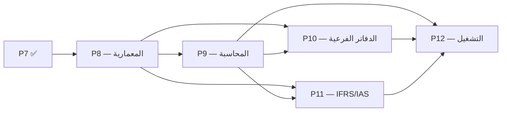

# الخطة التنفيذية التكميلية — Accounting Engine P8–P12

- **نوع الخطة:** accounting_engine_completion
- **الغرض:** معالجة جميع الفجوات والنواقص التي كشفها تقرير التحليل الشامل لـ v0.1.0، واستكمال الاكتمال المحاسبي والتشغيلي للمحرك
- **المرجع:** [تقرير التحليل](file:///home/osm/.gemini/antigravity/brain/f63151d5-0052-482d-9328-5804e00ab002/accounting_engine_analysis.md) + [الخطة الحالية P0–P7](file:///home/osm/StudioProjects/cashflow_system/accounting_engine/docs/accounting_engine_impl_plan.md)
- **تاريخ الإنشاء:** 2026-11-16
- **آخر تحديث:** 2026-11-16

> [!IMPORTANT]
> هذه الخطة **امتداد** للخطة الحالية (P0–P7) وليست بديلاً عنها. جميع المهام السابقة وتقارير ARD الخاصة بها تبقى سارية. تبدأ هذه الخطة من P8 وتنتهي عند P12.

---

## قاعدة معمارية ملزمة: استقلال المصادقة والتفويض

> [!CAUTION]
> المحرك المحاسبي **مستقل تماماً** عن عمليات المصادقة والتفويض التجاري. لا تُضف أي من الآتي داخل المحرك:
>
> - User Management أو Identity Provider
> - RBAC أو Roles/Permissions تجارية
> - Authentication Middleware إلزامية داخل SDK
>
> المحرك يفرض: Execution Context، Company/Tenant Isolation، الثوابت المحاسبية، وAuditability.
> النظام المضيف يملك: Authentication، Authorization التجاري، عضوية المستخدمين.
>
> المرجع: [ADR-0004](file:///home/osm/StudioProjects/cashflow_system/accounting_engine/docs/adr/ADR-0004-auth-and-company-context.md) + القسم ٧.١ من الخطة الحالية.

---

## ملخص الفجوات المكتشفة في التحليل

| # | الفجوة | الحالة الحالية | الأثر | المرحلة |
| --- | -------- | --------------- | ------- | --------- |
| 1 | StandardModule يعتمد على `legacy.CoreLedgerStore` | مكتملة جزئياً | يمنع المسار الحديث من دعم IFRS | `P8` |
| 2 | `sync.Mutex` في posting engine | مكتملة جزئياً | bottleneck محتمل | `P8` |
| 3 | `AccountTypeRevenue = "income"` | مكتملة جزئياً | التباس دلالي | `P8` |
| 4 | لا إقفال سنوي تلقائي | غير منفذة | فجوة محاسبية حرجة | `P9` |
| 5 | لا قائمة تدفقات نقدية (IAS 7) | غير منفذة | قائمة مالية أساسية مفقودة | `P9` |
| 6 | قيود التسوية بدون workflow تلقائي | مكتملة جزئياً | دورة محاسبية ناقصة | `P9` |
| 7 | إعادة فتح الفترات جزئية | مكتملة جزئياً | تحتاج تحقق | `P9` |
| 8 | لا إطار للإيضاحات/الملاحظات | غير منفذة | إفصاح ناقص | `P9` |
| 9 | الدفاتر الفرعية كلها `internal/` | مكتملة جزئياً | المستهلك لا يصل إليها | `P10` |
| 10 | IAS 21 — أرباح/خسائر صرف | تحتاج تحقق فعلي | صحة محاسبية | `P10` |
| 11 | IFRS 15 — فجوات متعددة | مكتملة جزئياً | نطاق محدود جداً | `P11` |
| 12 | IFRS 9 — فجوات متعددة | مكتملة جزئياً | ECL فقط بدون classification | `P11` |
| 13 | IFRS 16 — فجوات متعددة | مكتملة جزئياً | مستأجر فقط | `P11` |
| 14 | IAS 12 — فجوات متعددة | مكتملة جزئياً | بدون uncertain tax | `P11` |
| 15 | PITR لم يُختبر فعلياً | غير مكتملة | خطر استرداد | `P12` |
| 16 | لا rate limiting | غير منفذة | ثغرة OWASP | `P12` |
| 17 | لا benchmarks أداء | غير منفذة | لا إثبات أداء | `P12` |

---

## المراحل الجديدة

| المرحلة | الهدف | عدد المهام | الاعتماديات |
| --------- | ------- | ----------- | ------------- |
| `P8` | معالجة الفجوات المعمارية الحرجة وترحيل StandardModule | 3 | اكتمال `P7` واعتمادها |
| `P9` | الاكتمال المحاسبي الأساسي للنواة | 5 | `P8` |
| `P10` | رفع الدفاتر الفرعية إلى الواجهات العامة وإكمال IAS 21 | 4 | `P8`، `P9` (جزئياً) |
| `P11` | إكمال نطاق وحدات المعايير المحاسبية (IFRS/IAS) | 5 | `P8`، `P9` |
| `P12` | التصلب التشغيلي والأداء وجاهزية الإنتاج | 5 | `P9`، `P10`، `P11` |

---

## حالة المهام (جميع المراحل)

| المهمة | المرحلة | الحالة | الاعتماديات | سبب الحجب/الإجراء المطلوب | ملف ARD |
| -------- | --------- | -------- | ------------- | -------------------------- | --------- |
| `P8-01` | `P8` | معلقة | `P7` | — | — |
| `P8-02` | `P8` | معلقة | لا شيء | — | — |
| `P8-03` | `P8` | معلقة | لا شيء | — | — |
| `P9-01` | `P9` | معلقة | `P8-01` | — | — |
| `P9-02` | `P9` | معلقة | `P8-01` | — | — |
| `P9-03` | `P9` | معلقة | `P8-01` | — | — |
| `P9-04` | `P9` | معلقة | `P8-01` | — | — |
| `P9-05` | `P9` | معلقة | `P9-01`، `P9-02` | — | — |
| `P10-01` | `P10` | معلقة | `P8-01`، `P9-01` | — | — |
| `P10-02` | `P10` | معلقة | `P8-01`، `P9-01` | — | — |
| `P10-03` | `P10` | معلقة | `P8-01`، `P9-01` | — | — |
| `P10-04` | `P10` | معلقة | `P8-01`، `P9-01` | — | — |
| `P11-01` | `P11` | معلقة | `P8-01`، `P9-01`، `P9-05` | — | — |
| `P11-02` | `P11` | معلقة | `P8-01`، `P9-01`، `P9-05` | — | — |
| `P11-03` | `P11` | معلقة | `P8-01`، `P9-01`، `P9-05` | — | — |
| `P11-04` | `P11` | معلقة | `P8-01`، `P9-01`، `P9-05` | — | — |
| `P11-05` | `P11` | معلقة | `P11-01`–`P11-04` | — | — |
| `P12-01` | `P12` | معلقة | `P9-01` | — | — |
| `P12-02` | `P12` | معلقة | لا شيء | — | — |
| `P12-03` | `P12` | معلقة | `P8-03` | — | — |
| `P12-04` | `P12` | معلقة | `P10-01`، `P11-05` | — | — |
| `P12-05` | `P12` | معلقة | `P12-01`–`P12-04` | — | — |

---

## خريطة الاعتماديات

| المهمة | تعتمد على |
| -------- | ----------- |
| `P8-01` | `P7` (اكتمال جميع مهامها واعتماد المرحلة) |
| `P8-02` | لا شيء (مستقلة داخل P8) |
| `P8-03` | لا شيء (مستقلة داخل P8) |
| `P9-01` | `P8-01` |
| `P9-02` | `P8-01` |
| `P9-03` | `P8-01` |
| `P9-04` | `P8-01` |
| `P9-05` | `P9-01`، `P9-02` |
| `P10-01` | `P8-01`، `P9-01` |
| `P10-02` | `P8-01`، `P9-01` |
| `P10-03` | `P8-01`، `P9-01` |
| `P10-04` | `P8-01`، `P9-01` |
| `P11-01` | `P8-01`، `P9-01`، `P9-05` |
| `P11-02` | `P8-01`، `P9-01`، `P9-05` |
| `P11-03` | `P8-01`، `P9-01`، `P9-05` |
| `P11-04` | `P8-01`، `P9-01`، `P9-05` |
| `P11-05` | `P11-01`، `P11-02`، `P11-03`، `P11-04` |
| `P12-01` | `P9-01` |
| `P12-02` | لا شيء |
| `P12-03` | `P8-03` |
| `P12-04` | `P10-01`، `P11-05` |
| `P12-05` | `P12-01`، `P12-02`، `P12-03`، `P12-04` |

---

## مجموعات التنفيذ المتوازي المرشحة

| المجموعة | المهام | الشرط | حالة السماح |
| --------- | -------- | ------- | ------------- |
| H | `P8-01`، `P8-02`، `P8-03` | `P8-01` تعدّل SPI، والباقي لا يتداخل | مسموح بعد تجميد SPI لـ P8-01 |
| I | `P9-01`، `P9-02`، `P9-03`، `P9-04` | كلها بعد `P8-01`، مناطق منفصلة | مسموح — كل مهمة في ملفاتها |
| J | `P10-01`، `P10-02`، `P10-03`، `P10-04` | مناطق subledger منفصلة | مسموح — كل subledger مستقل |
| K | `P11-01`، `P11-02`، `P11-03`، `P11-04` | وحدات IFRS مستقلة | مسموح — كل وحدة في ملفاتها |
| L | `P12-01`، `P12-02`، `P12-03` | مناطق تشغيلية مختلفة | مسموح |

---

## ملفات المراحل التفصيلية

| المرحلة | الملف |
| --------- | ------- |
| P8 | [execution_plan_P8.md](file:///home/osm/.gemini/antigravity/brain/f63151d5-0052-482d-9328-5804e00ab002/execution_plan_P8.md) |
| P9 | [execution_plan_P9.md](file:///home/osm/.gemini/antigravity/brain/f63151d5-0052-482d-9328-5804e00ab002/execution_plan_P9.md) |
| P10 | [execution_plan_P10.md](file:///home/osm/.gemini/antigravity/brain/f63151d5-0052-482d-9328-5804e00ab002/execution_plan_P10.md) |
| P11 | [execution_plan_P11.md](file:///home/osm/.gemini/antigravity/brain/f63151d5-0052-482d-9328-5804e00ab002/execution_plan_P11.md) |
| P12 | [execution_plan_P12.md](file:///home/osm/.gemini/antigravity/brain/f63151d5-0052-482d-9328-5804e00ab002/execution_plan_P12.md) |

---

## بوابات الإصدار الإضافية (Release Gates v2)

تُضاف إلى البوابات G1–G8 القائمة:

| البوابة | شرط النجاح | المهام التي تثبتها |
| --------- | ------------ | ------------------- |
| G9 — Year-End Closing | workflow إقفال يولّد قيود الإقفال والافتتاح ذرياً ويُقفل الفترة | `P9-01` |
| G10 — Cash Flow Statement | قائمة تدفقات نقدية تتصالح مع الميزانية | `P9-02` |
| G11 — Standards Posting | كل وحدة معيارية مفعلة تُرحّل عبر Application Layer | `P11-05` |
| G12 — Subledger Accessibility | الدفاتر الفرعية الأساسية قابلة للاستخدام من مستهلك خارجي | `P10-01`–`P10-03` |

---

## سجل اعتماد المراحل

| المرحلة | الحالة | تاريخ التحقق | الأدلة والنتائج | النواقص/المخاطر |
| --------- | -------- | ------------- | ---------------- | ---------------- |
| `P8` | غير معتمدة | — | — | لم تُنفذ بوابة التحقق بعد |
| `P9` | غير معتمدة | — | — | لم تُنفذ بوابة التحقق بعد |
| `P10` | غير معتمدة | — | — | لم تُنفذ بوابة التحقق بعد |
| `P11` | غير معتمدة | — | — | لم تُنفذ بوابة التحقق بعد |
| `P12` | غير معتمدة | — | — | لم تُنفذ بوابة التحقق بعد |

## سجل تغييرات الخطة

| المعرّف | التاريخ | التغيير وسببه | الأثر | الموافقة | الحالة |
|---------|---------|--------------|-------|---------|--------|
| `CHG-001` | 2026-11-16 | إنشاء الخطة التكميلية P8–P12 بناءً على تقرير التحليل | خطة جديدة مكملة لـ P0–P7 | مطلوبة | مقترح |

---

## المراجع

- [تقرير التحليل الشامل](file:///home/osm/.gemini/antigravity/brain/f63151d5-0052-482d-9328-5804e00ab002/accounting_engine_analysis.md)
- [الخطة الحالية P0–P7](file:///home/osm/StudioProjects/cashflow_system/accounting_engine/docs/accounting_engine_impl_plan.md)
- [IFRS Conceptual Framework](https://www.ifrs.org/issued-standards/list-of-standards/conceptual-framework/)
- ISO/IEC 25010:2023 — Product Quality Model
- ISO/IEC/IEEE 42010:2022 — Architecture Description
- Go Modules Design Guidelines
- PostgreSQL Transaction & Integrity Documentation
- Semantic Versioning 2.0.0
- OWASP ASVS 5.0
