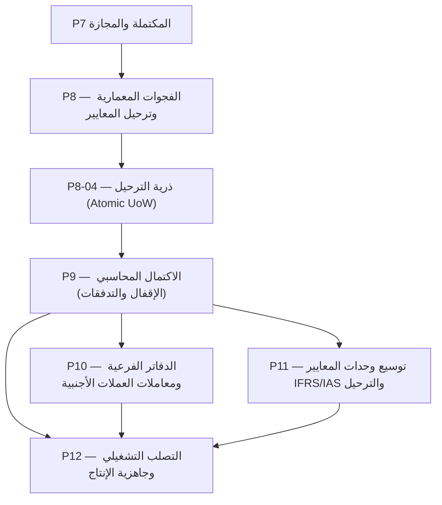
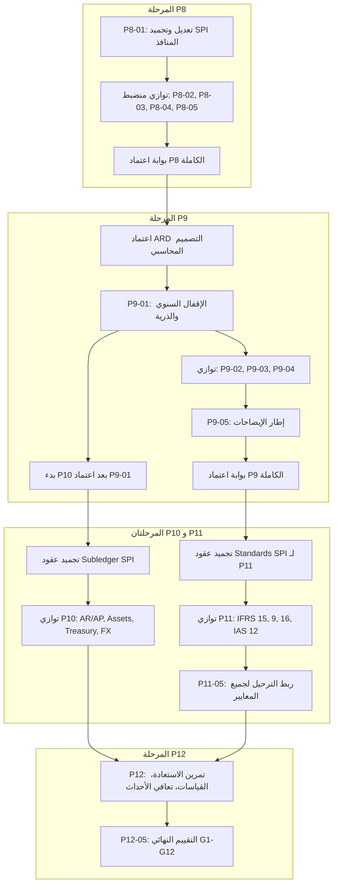

# الخطة التنفيذية التكميلية المحدثة — Accounting Engine P8–P12

- **نوع الخطة:** accounting_engine_completion
- **الغرض:** معالجة جميع الفجوات والنواقص المعمارية والمحاسبية والتشغيلية التي كشفها تقرير التحليل الشامل لـ v0.1.0، واستيعاب قرارات التدقيق المعماري والمحاسبي والتشغيلي.
- **المرجع:** [تقرير التحليل الشامل](file:///home/osm/.gemini/antigravity/brain/f63151d5-0052-482d-9328-5804e00ab002/accounting_engine_analysis.md) + [الخطة الحالية P0–P7](file:///home/osm/StudioProjects/cashflow_system/accounting_engine/docs/accounting_engine_impl_plan.md)
- **تاريخ الإنشاء:** 2026-11-16
- **آخر تحديث:** 2026-11-17 (تنفيذ `P11-02` برمجياً لتوسيع IFRS 9؛ المراجعة المحاسبية والمالية المستقلة معلقة)

> [!IMPORTANT]
> هذه الخطة **امتداد تكميلي رسمي** للخطة الحالية (P0–P7) وليست بديلاً عنها. جميع المهام السابقة وتقارير ARD الخاصة بها سارية ومستمرة. تبدأ هذه الخطة من P8 وتنتهي عند P12، بإجمالي **24 مهمة تفصيلية**.

---

## القواعد المعمارية والمحاسبية الحاكمة

### 1. استقلال المصادقة والتفويض التجاري (Authentication & Commercial Authorization Independence)
>
> [!CAUTION]
> المحرك المحاسبي **مستقل تماماً** عن عمليات المصادقة والتحقق من الهوية وإدارة المستخدمين والتفويض التجاري.
>
> - يُمنع منعاً باتاً إضافة جداول أو كيانات للمستخدمين (Users) أو مزودي الهوية (IDPs).
> - يُمنع إضافة أدوار وصلاحيات تجارية (RBAC / Commercial Roles) داخل المحرك.
> - يُمنع فرض Middleware للمصادقة داخل النواة المدمجة (Embedded SDK Core).
> - **المحرك يفرض:** سياق التنفيذ (`ExecutionContext`)، عزل الشركات والمستأجرين (`Tenant Isolation via RLS`)، الثوابت المحاسبية للدفتر المزدوج، وسجل التدقيق المشفر.
> - **النظام المضيف يملك:** المصادقة، الصلاحيات الإدارية والتجارية، وعضوية المستخدمين في الشركات.
> - المرجع الإلزامي: [ADR-0004](file:///home/osm/StudioProjects/cashflow_system/accounting_engine/docs/adr/ADR-0004-auth-and-company-context.md).

### 2. حدود Rate Limiting (Infrastructure Protection Boundary)
>
> [!NOTE]
> خاصية **Rate Limiting ليست جزءاً من النواة المحاسبية (Embedded SDK Core)**، ولا تُفرض على التطبيقات المضيفة التي تستدعي الـ SDK مباشرة داخل نفس المعالج (In-Process). بل تنحصر حصرياً في طبقة النقل لخادم الخدمة المستقلة (`cmd/accounting-service/`) لحماية المنافذ الشبكية (HTTP / gRPC) من إساءة الاستخدام وهجمات استنزاف الموارد.

### 3. مبدأ سلامة Bootstrap والاعتماديات
>
> [!IMPORTANT]
> قاعدة معمارية صارمة: `Enabled(Capability) ⟹ Available(Required_Dependencies)`.
> يفشل الـ Builder فوراً وبوضوح (Fail-Fast) عند محاولة تفعيل أي ميزة دون توفير مخازنها واعتمادياتها الإلزامية. لا يُسمح بتشغيل المحرك في وضع "يعمل جزئياً" دون علم المستهلك.

### 4. اشتراطات الذرية المحاسبية (Atomic Unit of Work)
>
> [!IMPORTANT]
> كافة عمليات الترحيل المحاسبي، وخصوصاً دورة الإقفال السنوي والافتتاح، يجب أن تُنفذ بالكامل داخل **معاملة ذرية واحدة موحدة (Single Unit of Work)** تضمن تراجع كافة الآثار المحاسبية وسجلات التدقيق والتسلسلات عند فشل أي خطوة وسيطة.

---

## ملخص المراحل الجديدة (P8–P12)

| المرحلة | عنوان المرحلة والهدف | عدد المهام | الاعتماديات المسبقة |
| --------- | --------------------- | ----------- | -------------------- |
| `P8` | معالجة الفجوات المعمارية، ترحيل المعايير، ذرية الترحيل، وسلامة Bootstrap | 5 | اكتمال واعتماد `P7` |
| `P9` | الاكتمال المحاسبي الأساسي للنواة (الإقفال السنوي، التدفقات النقدية، الإيضاحات) | 5 | `P8-01`، و `P8-04` |
| `P10` | رفع الدفاتر الفرعية (AR/AP, Assets, Treasury) ومحاسبة العملات الأجنبية | 4 | `P8-01`، `P8-04`، و `P9-01` |
| `P11` | إكمال نطاق المعايير المحاسبية (IFRS 15, 9, 16, IAS 12/IFRIC 23) والترحيل | 5 | `P8-01`، `P8-04`، `P9-01`، و `P9-05` |
| `P12` | التصلب التشغيلي، تمرين الاستعادة الفعلي، القياسات، وتقييم G1–G12 | 5 | `P8`، `P9`، `P10`، و `P11` |

---

## جدول حالة المهام الشامل (24 مهمة)

| المهمة | المرحلة | العنوان الملخص | الحالة | الاعتماديات المباشرة | مخرجات التوثيق والـ ARD |
| -------- | --------- | ---------------- | -------- | --------------------- | -------------------------- |
| `P8-01` | `P8` | ترحيل واجهة StandardModule إلى `storage.Ports` | مكتملة | `P7` | `docs/ard/ARD-P8-01.md` |
| `P8-02` | `P8` | توثيق Deprecation لـ `AccountTypeRevenue` كـ Alias | مكتملة | لا شيء | `docs/adr/ADR-0008-account-type-revenue-alias.md` |
| `P8-03` | `P8` | استبدال `sync.Mutex` بتزامن Advisory Locks على DB | مكتملة | لا شيء | `docs/ard/ARD-P8-03.md` |
| `P8-04` | `P8` | ضمان ذرية الترحيل عبر Ports في Single UoW | مكتملة | `P8-01` | `docs/ard/ARD-P8-04.md` |
| `P8-05` | `P8` | فرض سلامة Bootstrap وتحقق الاعتماديات Fail-Fast | مكتملة | `P8-01` | `docs/ard/ARD-P8-05.md` |
| `P9-01` | `P9` | الإقفال السنوي التلقائي الذري وتوليد قيود الافتتاح | مكتملة | `P8-01`, `P8-04` | `docs/ard/ARD-P9-01-accounting-closing-design.md` |
| `P9-02` | `P9` | قائمة التدفقات النقدية بالطريقتين (IAS 7 / IFRS 18) | مكتملة | `P8-01`, `P8-04` | `docs/ard/ARD-P9-02.md` |
| `P9-03` | `P9` | سير عمل وضوابط قيود التسوية (Adjusting Entries) | مكتملة | `P8-01`, `P8-04` | `docs/ard/ARD-P9-03.md` |
| `P9-04` | `P9` | دورة حياة إعادة فتح الفترات وسجل التدقيق | مكتملة | `P8-01`, `P8-04` | `docs/ard/ARD-P9-04.md` |
| `P9-05` | `P9` | إطار الإيضاحات والملاحظات المهيكل متعدد النسخ | مكتملة | `P9-01`, `P9-02` | `docs/ard/ARD-P9-05.md` |
| `P10-01` | `P10` | رفع الذمم المدينة والدائنة (AR/AP) لـ Public SPI | مكتملة | `P8-01`, `P8-04`, `P9-01` | `docs/ard/ARD-P10-01.md` |
| `P10-02` | `P10` | رفع الأصول الثابتة (Fixed Assets) لـ Public SPI | مكتملة | `P8-01`, `P8-04`, `P9-01` | `docs/ard/ARD-P10-02.md` |
| `P10-03` | `P10` | رفع الخزينة (Treasury) والمطابقة لـ Public SPI | مكتملة | `P8-01`, `P8-04`, `P9-01` | `docs/ard/ARD-P10-03.md` |
| `P10-04` | `P10` | محاسبة المعاملات بالعملات الأجنبية وإعادة قياس البنود | مكتملة | `P8-01`, `P8-04`, `P9-01` | `docs/ard/ARD-P10-04.md` |
| `P11-01` | `P11` | توسيع IFRS 15 (المقابل المتغير وتعديل العقود) | معلقة | `P8-01`, `P8-04`, `P9-01`, `P9-05` | `docs/ard/ARD-P11-01.md` |
| `P11-02` | `P11` | توسيع IFRS 9 (التصنيف و ECL وتأجيل التحوط) | منفذة برمجياً؛ المراجعة المحاسبية والمالية المستقلة معلقة | `P8-01`, `P8-04`, `P9-01`, `P9-05` | مصفوفة النطاق `docs/accounting/ifrs9_compliance_matrix.md`؛ اختبارات `internal/ifrs9`, `modules/ifrs9` |
| `P11-03` | `P11` | توسيع IFRS 16 (محاسبة المؤجر وإعفاءات الإيجار) | مكتملة | `P8-01`, `P8-04`, `P9-01`, `P9-05` | `docs/ard/ARD-P11-03.md` |
| `P11-04` | `P11` | تصحيح وتوسيع IAS 12 / IFRIC 23 للمراكز غير المؤكدة | منفذة برمجياً؛ المراجعة المهنية معلقة | `P8-01`, `P8-04`, `P9-01`, `P9-05` | `docs/ard/ARD-P11-04.md` |
| `P11-05` | `P11` | ربط مسار الترحيل الآلي بـ Idempotency لكل المعايير | معلقة | `P11-01`–`P11-04` | `docs/ard/ARD-P11-05.md` |
| `P12-01` | `P12` | تمرين استعادة فعلي (PITR Drill) ورفع NO-GO | معلقة | `P9-01` | `docs/ard/ARD-P12-01.md` |
| `P12-02` | `P12` | حماية خادم الخدمة المستقلة بـ Rate Limiting | معلقة | لا شيء | `docs/ard/ARD-P12-02.md` |
| `P12-03` | `P12` | القياسات المرجعية للأداء وتقرير خط الأساس | معلقة | `P8-03`, `P8-04` | `docs/ard/ARD-P12-03.md` |
| `P12-04` | `P12` | التحقق من تعافي تدفق الأحداث وعدم فقدانها | معلقة | `P8-04`, `P10-01`, `P11-05` | `docs/ard/ARD-P12-04.md` |
| `P12-05` | `P12` | تقرير الجاهزية الشامل ومصفوفة بوابات G1–G12 | معلقة | كافة مهام P8–P12 | `docs/release_readiness_v0.2.0.md` |

---

## بروتوكول مجموعات التنفيذ والتوازي المنضبط

لتفادي تضارب تعديل الملفات المشتركة، يُلزم الفرق البرمجية باتباع تسلسل التجميد والتحقق التالي:

### تفاصيل مجموعات التوازي والشروط

| المجموعة | المهام | شروط البدء والتوازي | بروتوكول التنسيق وحظر التضارب |
| --------- | -------- | --------------------- | ------------------------------- |
| **Group H (P8)** | `P8-02`, `P8-03`, `P8-04`, `P8-05` | اكتمال تجميد `ModulePorts` في `P8-01` | `P8-04` تملك تعديل خط أنابيب الترحيل في `internal/posting/`. مهام `P8-03` تنسق معها لتفادي تعارض الأقفال مع المعاملة. |
| **Group I (P9)** | `P9-02`, `P9-03`, `P9-04` | اكتمال واعتماد `P9-01` بالكامل | `P9-01` تضع أساس الذرية وتحدد حسابات الإقفال. بعدها تتفرع `P9-02` (التقارير) و `P9-03` (فترات التسوية) و `P9-04` (إعادة الفتح) دون تضارب. |
| **Group J (P10)** | `P10-01`, `P10-02`, `P10-03`, `P10-04` | اكتمال `P9-01` واعتماد عقود `pkg/spi/subledger/` | يبدأ التوازي بعد اعتماد `P9-01`؛ تملك `P10-01` تعديل عقود API/SPI وBuilder، والمهام الأخرى تستهلك العقود المجمدة دون تعديلها. |
| **Group K (P11)** | `P11-01`, `P11-02`, `P11-03`, `P11-04` | توفر واجهات `ModulePorts` و `DisclosureProvider` | كل وحدة معيارية مستقلة تماماً داخل حزمتها الخاصة في `internal/` و `modules/`. |
| **Group L (P12)** | `P12-01`, `P12-02`, `P12-03`, `P12-04` | جاهزية كود النواة للاختبارات | `P12-02` معزولة في خادم `cmd/`. البقية تجري تجاربها على بيئات اختبار مستقلة. |

---

## مصفوفة متطلبات الأدلة الصارمة لاعتماد أي مرحلة (Evidence Requirements Matrix)

لا تُعتبر أي مرحلة معتمدة ولا يُسمح بالانتقال للمرحلة التالية إلا بتقديم حزمة الأدلة العشرة التالية:

| # | نوع الدليل (Evidence Type) | متطلبات الاستيفاء |
| --- | --------------------------- | ------------------- |
| 1 | **Code Implementation** | كود مصاغ وفق معايير المشروع وخالٍ من أي التفاف أو تسريب لواجهات `internal/`. |
| 2 | **Unit Tests** | تغطية اختبارات وحدة لكافة المسارات المنطقية والحالات الحدية (Edge cases). |
| 3 | **Integration Tests** | اختبارات تكامل تربط بين Application Layer ومنافذ التخزين وتدفق البيانات. |
| 4 | **Contract Parity Tests** | تطابق تام للسلوك والنتائج المحاسبية بين محول PostgreSQL ومحول الذاكرة (In-Memory). |
| 5 | **Database Integrity Tests** | التحقق من توازن القيود، قيود RLS، صحة التسلسل، ومنع التكرار على PostgreSQL حقيقية. |
| 6 | **Fault Injection Tests** | اختبارات حقن الفشل (انقطاع اتصال، انهيار وسيط) وإثبات التراجع الكامل (Full Rollback). |
| 7 | **Concurrency Tests** | اختبارات أحمال متزامنة لإثبات خلو النظام من Deadlocks وسلامة التسلسل المحاسبي. |
| 8 | **Accounting Review** | مراجعة محاسبية مهنية مستقلة تثبت مطابقة المخرجات للمعايير المعتمدة (IFRS/IAS). |
| 9 | **Operational Evidence** | سجلات تشغيل فعلية، تقرير تمرين الاستعادة، مقاييس الأداء المرجعية، وأدلة Runbooks. |
| 10 | **Documentation & ARD** | توثيق قرارات العمارة والتصميم، تحديث مصفوفات الامتثال، وتحديث ملاحظات الإصدار. |

---

## بوابات الإصدار الشاملة (Release Gates G1–G12)

| البوابة | المسمى والمجال | معيار النجاح القاطع | المهمة المسؤولة |
| --------- | ---------------- | --------------------- | ----------------- |
| **G1** | Tenant Isolation | عزل تام للشركات عبر RLS واختبارات منع الاختراق بين المستأجرين | `P2-01` |
| **G2** | Double-Entry Balance | توازن تام لكل قيد مرحّل: $\sum Debit = \sum Credit$ بالعملات المختلفة | `P1-02` |
| **G3** | Idempotency | منع قاطع لتكرار ترحيل أي معاملة أو حدث يحمل نفس المفتاح | `P1-04` |
| **G4** | Audit Chain | سلامة تسلسل التجزئة المشفر بسجل التدقيق (Tamper-evident Hash Chain) | `P1-03` |
| **G5** | Contract Parity | تكافؤ بنسبة 100% في نتائج الاختبارات بين PostgreSQL و Memory Adapter | `P3-03` |
| **G6** | Public API Purity | خلو Public API من أي استيراد لـ `internal/` أو تفاصيل SQL | `P8-01`, `P10-01` |
| **G7** | Test Coverage | اجتياز حزمة الاختبارات بالكامل مع اختبارات التزامن وحقن الفشل | `P7-02`, `P12-04` |
| **G8** | Versioning & Deprecation | التزام صارم بـ SemVer 2.0.0 وتوثيق توجيهات الإهمال | `P8-02`, `P12-05` |
| **G9** | **Atomic Year-End Close** | **إقفال سنوي ذري يرصّد الحسابات الاسمية ويولّد قيود الافتتاح ويقفل الفترة** | `P9-01` |
| **G10** | **Cash Flow Dual-Method** | **قائمة تدفقات نقدية بالطريقتين المباشرة وغير المباشرة وتوافق IFRS 18** | `P9-02` |
| **G11** | **Automated Standards Posting** | **ترحيل آلي بـ Idempotency لكافة مخرجات قياس وحدات IFRS المفعلة** | `P11-05` |
| **G12** | **Subledgers & Recovery Drill** | **دفاتر فرعية متاحة خارجياً مع نجاح تمرين الاستعادة الفعلي ورفع NO-GO** | `P10-01`–`P10-03`, `P12-01` |

---

## سجل تغييرات الخطة التنفيذية (Plan Change Log)

| المعرّف | التاريخ | التغيير وسببه | الأثر على الخطة | الحالة |
| --------- | --------- | -------------- | ----------------- | -------- |
| `CHG-001` | 2026-11-16 | إنشاء مسودة الخطة التكميلية P8–P12 بناءً على تقرير التحليل الشامل | إضافة 5 مراحل و 22 مهمة تكميلية | معتمد |
| `CHG-002` | 2026-11-16 | تحديث الخطة وفق قرارات المستخدم وملاحظات التدقيق المعماري والمحاسبي والتشغيلي:  1. اعتماد `AccountTypeRevenue` كـ Alias مع Deprecation دون ترحيل بيانات. 2. إلزام دعم الطريقتين المباشرة وغير المباشرة للتدفقات النقدية مع مراعاة IFRS 18. 3. تأجيل محاسبة التحوط (Hedge Accounting) صراحة لخارطة طريق مستقبلية. 4. إضافة المهمة `P8-04` لضمان ذرية الترحيل عبر Ports في Single UoW. 5. إضافة المهمة `P8-05` لفرض سلامة تفعيل القدرات في Bootstrap. 6. تصحيح خطأ منطق IFRIC 23 في `P11-04` ليعتمد خطوات المعيار السليمة. 7. فصل العمليات الإدارية عن الأحداث المحاسبية في دفاتر `P10`. 8. حصر Rate Limiting في خادم الخدمة المستقلة فقط دون النواة المدمجة. 9. إعادة هيكلة بروتوكول مجموعات التوازي لمنع تضارب تعديل الملفات. | ارتفاع عدد المهام إلى 24 مهمة، وتحديث خريطة الاعتماديات ومصفوفة متطلبات الأدلة | **معتمد ومحدث** |
| `CHG-003` | 2026-11-17 | تنفيذ محرك IFRIC 23 محدود النطاق للطريقتين، وإعادة التقييم، وإيضاح تسوية معدل الضريبة عبر `DisclosureProvider`، وإضافة ARD وأدلة الاختبار لـ `P11-04` | اكتمال التنفيذ البرمجي؛ اعتماد المهمة الكامل متوقف على مراجعة ضريبية ومحاسبية مهنية مستقلة | **التنفيذ موثق؛ المراجعة معلقة** |
| `CHG-004` | 2026-11-17 | تنفيذ توسعة IFRS 9 لـ `P11-02`: التصنيف المعتمد من النظام المضيف، القياس اللاحق وEIR، EAD/مراحل ECL حسب الفئة، الترحيل عبر Application، وتوثيق تأجيل محاسبة التحوط | اجتازت اختبارات `internal/ifrs9` و`modules/ifrs9`؛ المراجعة المحاسبية والمالية المستقلة ما زالت مطلوبة | **منفذة برمجياً؛ المراجعة معلقة** |

---

## المراجع والوثائق التفصيلية

- [ملف المرحلة P8 التفصيلي](file:///home/osm/StudioProjects/cashflow_system/accounting_engine/docs/execution_plan_P8.md)
- [ملف المرحلة P9 التفصيلي](file:///home/osm/StudioProjects/cashflow_system/accounting_engine/docs/execution_plan_P9.md)
- [ملف المرحلة P10 التفصيلي](file:///home/osm/StudioProjects/cashflow_system/accounting_engine/docs/execution_plan_P10.md)
- [ملف المرحلة P11 التفصيلي](file:///home/osm/StudioProjects/cashflow_system/accounting_engine/docs/execution_plan_P11.md)
- [ملف المرحلة P12 التفصيلي](file:///home/osm/StudioProjects/cashflow_system/accounting_engine/docs/execution_plan_P12.md)
- [تقرير التحليل الشامل للمحرك](file:///home/osm/.gemini/antigravity/brain/f63151d5-0052-482d-9328-5804e00ab002/accounting_engine_analysis.md)
- [الخطة الأساسية P0–P7](file:///home/osm/StudioProjects/cashflow_system/accounting_engine/docs/accounting_engine_impl_plan.md)
