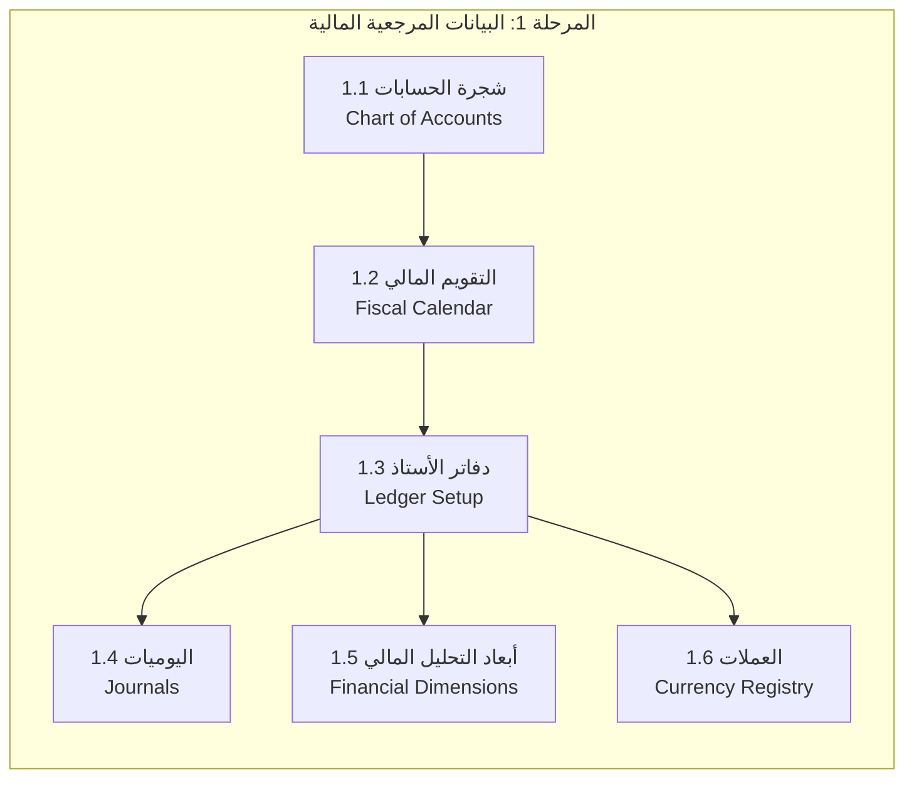
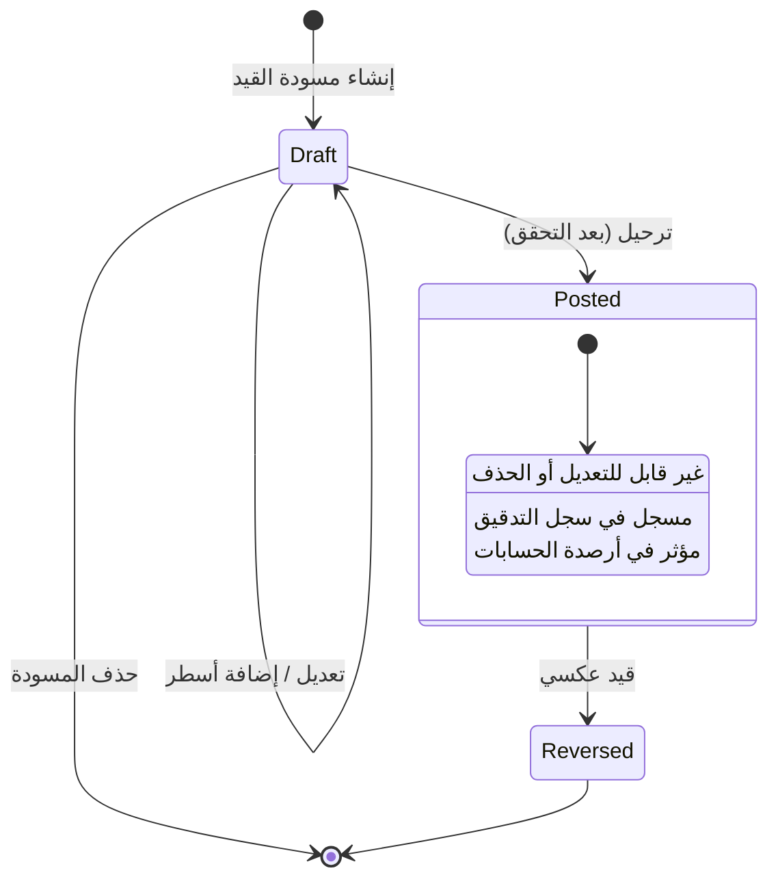
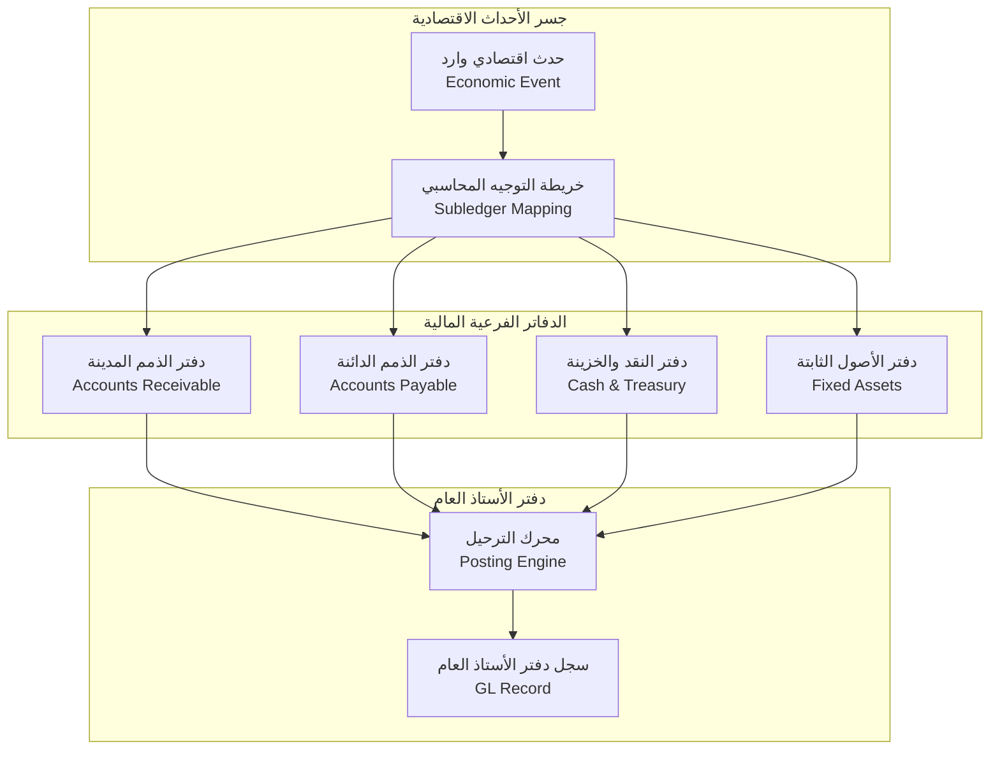
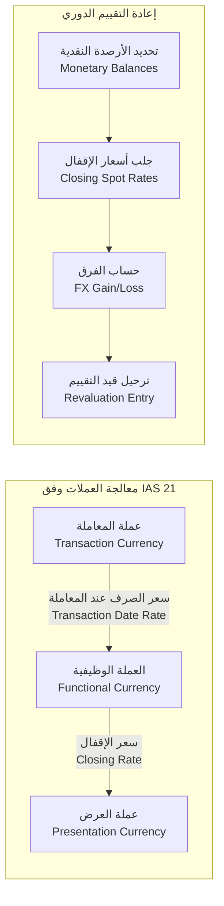
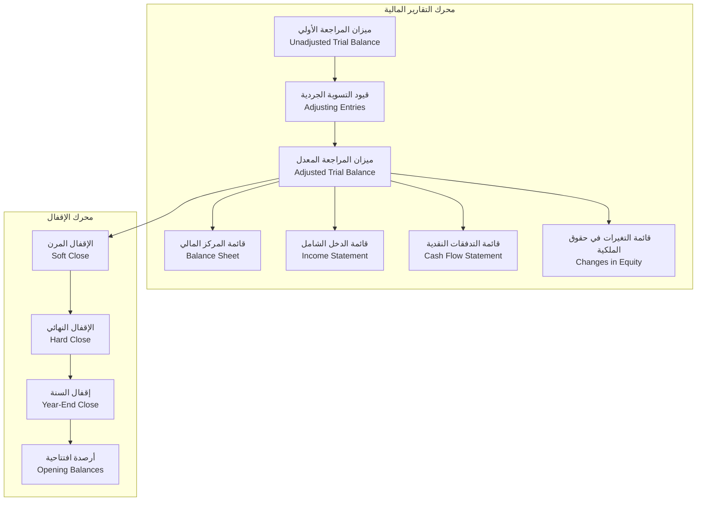
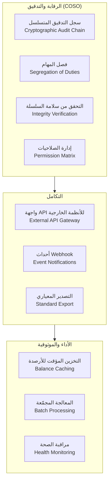

# الخطة التنفيذية الشاملة لبناء النظام المالي المحاسبي

# Comprehensive Implementation Plan — Pure Financial Accounting Engine

> **مرجع معماري:** [`financial_accounting_system_architecture.md`](./financial_accounting_system_architecture.md)
> **لغة التنفيذ:** Go 1.26 · PostgreSQL · Clean Architecture (Feature-Based)
> **تاريخ الإعداد:** 2026-11-09

---

## الرؤية العامة وخريطة المراحل (Phases Roadmap)

الخطة مقسمة إلى **7 مراحل متسلسلة** يعتمد كل منها على سابقه. كل مرحلة تحتوي على:

- **الأهداف** (Objectives)
- **المخرجات التقنية** (Deliverables) بمستوى الملفات والحزم
- **معايير القبول** (Acceptance Criteria) للتحقق من اكتمال المرحلة
- **الاعتماديات** (Dependencies) على المراحل السابقة

```mermaid
flowchart LR
    P0["المرحلة 0\nالأساس والبنية التحتية\nFoundation"]
    P1["المرحلة 1\nالبيانات المرجعية المالية\nFinancial Master Data"]
    P2["المرحلة 2\nمحرك القيد المزدوج\nDouble-Entry Engine"]
    P3["المرحلة 3\nالدفاتر الفرعية المالية\nFinancial Subledgers"]
    P4["المرحلة 4\nالتقويم والعملات\nValuation & FX"]
    P5["المرحلة 5\nالتقارير والإقفال\nReporting & Closing"]
    P6["المرحلة 6\nالرقابة والتدقيق والتكامل\nGovernance & Integration"]

    P0 --> P1 --> P2 --> P3 --> P4 --> P5 --> P6

    style P0 fill:#1a1a2e,stroke:#e94560,color:#fff
    style P1 fill:#16213e,stroke:#0f3460,color:#fff
    style P2 fill:#0f3460,stroke:#533483,color:#fff
    style P3 fill:#533483,stroke:#e94560,color:#fff
    style P4 fill:#e94560,stroke:#f38181,color:#fff
    style P5 fill:#f38181,stroke:#fce38a,color:#000
    style P6 fill:#fce38a,stroke:#95e1d3,color:#000
```



---

## المرحلة 0: الأساس والبنية التحتية (Foundation & Infrastructure)

### الأهداف

تأسيس الهيكل المعماري للمشروع `accounting_engine` كوحدة مستقلة (Go Module) تحتوي على بنية نظيفة قابلة للتوسع، مع تأسيس طبقة قاعدة البيانات وأدوات الهجرة (Migration) والبنية التحتية المشتركة.

### البنية المستهدفة للمجلدات

```text
accounting_engine/
├── cmd/
│   └── server/
│       └── main.go                     # نقطة الدخول
├── internal/
│   ├── domain/                         # الكيانات والقيم والقواعد المالية البحتة
│   │   ├── account.go                  # كيان الحساب (Account Entity)
│   │   ├── account_type.go             # أنواع الحسابات (Value Objects)
│   │   ├── fiscal_calendar.go          # السنة والفترة المالية
│   │   ├── journal.go                  # كيان اليومية
│   │   ├── journal_entry.go            # القيد المحاسبي (AccountMove + Lines)
│   │   ├── journal_entry_line.go       # سطر القيد
│   │   ├── currency.go                 # كيان العملة والعملة الوظيفية
│   │   ├── ledger.go                   # دفتر الأستاذ (Primary/Secondary)
│   │   ├── financial_dimension.go      # أبعاد التحليل (مراكز التكلفة)
│   │   ├── audit_log.go               # كيان سجل التدقيق
│   │   ├── money.go                    # Value Object للمبالغ المالية (Precision-safe)
│   │   ├── errors.go                   # أخطاء النطاق المالي (Domain Errors)
│   │   └── rules/                      # قواعد العمل المحاسبية
│   │       ├── balance_rule.go         # قاعدة التوازن الحتمي
│   │       ├── period_rule.go          # قاعدة فحص حالة الفترة
│   │       ├── immutability_rule.go    # قاعدة عدم قابلية التعديل بعد الترحيل
│   │       └── account_posting_rule.go # قاعدة منع الترحيل لحسابات تجميعية
│   ├── ports/                          # المنافذ (Interfaces) — لا تعتمد على أي بنية تحتية
│   │   ├── repository.go              # واجهة المستودع (Repository Port)
│   │   ├── fx_provider.go             # واجهة مزود أسعار العملات
│   │   ├── event_publisher.go         # واجهة نشر الأحداث
│   │   └── audit_signer.go            # واجهة التوقيع والتحقق التسلسلي
│   ├── usecases/                       # حالات الاستخدام (Application Services)
│   │   ├── master_data/               # إدارة البيانات المرجعية
│   │   ├── posting/                   # الترحيل والقيد المزدوج
│   │   ├── subledger/                 # الدفاتر الفرعية
│   │   ├── valuation/                 # التقويم والعملات
│   │   ├── reporting/                 # التقارير المالية
│   │   └── closing/                   # الإقفال الدوري والسنوي
│   ├── adapters/                       # التنفيذات الخارجية (Adapters)
│   │   ├── postgres/                  # تنفيذ PostgreSQL للمستودع
│   │   │   ├── repository.go
│   │   │   ├── queries.go
│   │   │   ├── migrations/
│   │   │   │   ├── 000001_foundation.up.sql
│   │   │   │   ├── 000001_foundation.down.sql
│   │   │   │   └── embed.go
│   │   │   └── migrator.go
│   │   ├── fx/                        # تنفيذ مزود أسعار العملات
│   │   └── http/                      # معالجات HTTP (Handlers)
│   │       ├── router.go
│   │       ├── middleware/
│   │       └── handlers/
│   └── wiring/                         # تجميع الاعتماديات (Dependency Injection)
│       └── wire.go
├── docs/
├── go.mod
└── go.sum
```

### المخرجات التقنية

| # | المخرج | الوصف |
| --- | -------- | ------- |
| 0.1 | `go.mod` مُحدّث | إضافة الاعتماديات الأساسية: `pgx/v5`, `shopspring/decimal`, `google/uuid`, `golang-migrate` |
| 0.2 | طبقة `domain/money.go` | Value Object يغلف `decimal.Decimal` مع ضبط الدقة (Precision 28,4) ومنع القيم السالبة |
| 0.3 | طبقة `domain/errors.go` | جميع أخطاء النطاق المالي كـ Sentinel Errors مع رسائل واضحة |
| 0.4 | هجرة `000001_foundation.up.sql` | إنشاء الامتدادات (`uuid-ossp` أو `pgcrypto`) والإعدادات الأساسية |
| 0.5 | `adapters/postgres/migrator.go` | أداة تشغيل الهجرات عبر `golang-migrate` |
| 0.6 | `cmd/server/main.go` | نقطة الدخول مع اتصال قاعدة البيانات والتهيئة الأساسية |

### معايير القبول

- [x] `go build ./...` يكتمل بنجاح بدون أخطاء
- [x] الاتصال بقاعدة البيانات يعمل وهجرة التأسيس تنفذ بنجاح
- [x] `domain/money.go` يجتاز اختبارات الوحدة للدقة والتقريب ومنع السالب
- [x] لا يوجد أي استيراد مباشر من `adapters` في طبقة `domain`

---

## المرحلة 1: البيانات المرجعية المالية (Financial Master Data Management)

### الأهداف

بناء المكون الأول من النواة المحاسبية: إدارة البيانات المرجعية التي يعتمد عليها كل مكون لاحق. يشمل: شجرة الحسابات (COA)، التقويم المالي والفترات، دفاتر الأستاذ، واليوميات.



### المهام التفصيلية

#### 1.1 شجرة الحسابات (Chart of Accounts — COA)

| # | المهمة | الملف | الوصف |
| --- | -------- | ------- | ------- |
| 1.1.1 | كيان الحساب | `domain/account.go` | تعريف `Account` struct مع الحقول: ID, Code, Name, Type (العناصر الخمسة), NormalBalance, CurrencyID, ParentID (للتسلسل الشجري), IsReconcilable, IsActive, SubClassification, IFRSCategory, DisplayOrder |
| 1.1.2 | أنواع الحسابات | `domain/account_type.go` | تعريف `AccountType` كـ Value Object يقبل فقط: `asset`, `liability`, `equity`, `income`, `expense`. تعريف `NormalBalance` كـ `debit` أو `credit`. تعريف `SubClassification` لتصنيف IFRS الدقيق |
| 1.1.3 | قاعدة منع الترحيل | `domain/rules/account_posting_rule.go` | منع الترحيل المباشر إلى حسابات تجميعية (Header/Parent Accounts) — يُسمح فقط بالترحيل إلى الحسابات الورقية (Leaf Accounts) |
| 1.1.4 | قاعدة حماية الثبات | `domain/rules/immutability_rule.go` | منع تغيير نوع الحساب (Type) أو كوده (Code) بعد وجود قيود مرحّلة عليه |
| 1.1.5 | هجرة قاعدة البيانات | `migrations/000002_chart_of_accounts.up.sql` | إنشاء جدول `accounts` مع القيود والفهارس |
| 1.1.6 | تنفيذ المستودع | `adapters/postgres/account_repo.go` | تنفيذ CRUD: `CreateAccount`, `UpdateAccount`, `GetAccountByID`, `GetAccountByCode`, `ListAccounts`, `ListAccountsTree` |
| 1.1.7 | حالات الاستخدام | `usecases/master_data/account_usecases.go` | `CreateAccount`, `UpdateAccount`, `ListAccounts`, `GetAccountTree` مع التحقق من القواعد |
| 1.1.8 | معالجات HTTP | `adapters/http/handlers/account_handler.go` | نقاط النهاية: `POST /accounts`, `PUT /accounts/{id}`, `GET /accounts`, `GET /accounts/tree` |
| 1.1.9 | اختبارات الوحدة | `domain/account_test.go`, `usecases/master_data/account_usecases_test.go` | تغطية 100% لقواعد التحقق والتسلسل الشجري |

#### 1.2 التقويم المالي والفترات (Fiscal Calendar & Periods)

| # | المهمة | الملف | الوصف |
| --- | -------- | ------- | ------- |
| 1.2.1 | كيان السنة والفترة | `domain/fiscal_calendar.go` | تعريف `FiscalYear` و `FiscalPeriod` مع حالات الفترة الثلاث: `open`, `soft_closed`, `hard_closed` |
| 1.2.2 | قاعدة انتقال الحالة | `domain/rules/period_rule.go` | State Machine: `open → soft_closed → hard_closed` (لا يمكن الرجوع). التحقق من أن جميع الفترات الأسبق مغلقة قبل إقفال فترة لاحقة |
| 1.2.3 | هجرة قاعدة البيانات | `migrations/000003_fiscal_calendar.up.sql` | جداول `fiscal_years` و `fiscal_periods` |
| 1.2.4 | تنفيذ المستودع | `adapters/postgres/fiscal_repo.go` | `CreateFiscalYear` (مع التوليد التلقائي لـ 12 فترة شهرية + فترات تسوية)، `GetPeriodByDate`, `UpdatePeriodState` |
| 1.2.5 | حالات الاستخدام | `usecases/master_data/fiscal_usecases.go` | `CreateFiscalYear`, `ListFiscalYears`, `ChangePeriodState` |
| 1.2.6 | معالجات HTTP | `adapters/http/handlers/fiscal_handler.go` | نقاط النهاية: `POST /fiscal-years`, `GET /fiscal-years`, `PUT /periods/{id}/state` |

#### 1.3 دفاتر الأستاذ (Ledger Setup)

| # | المهمة | الملف | الوصف |
| --- | -------- | ------- | ------- |
| 1.3.1 | كيان دفتر الأستاذ | `domain/ledger.go` | تعريف `Ledger` مع التمييز بين Primary و Secondary. كل Ledger مرتبط بعملة أساسية ومعيار محاسبي وتقويم مالي |
| 1.3.2 | هجرة قاعدة البيانات | `migrations/000004_ledgers.up.sql` | جدول `ledgers` مع ربطه بالتقويم المالي |
| 1.3.3 | تنفيذ المستودع | `adapters/postgres/ledger_repo.go` | CRUD لدفاتر الأستاذ |

#### 1.4 اليوميات المحاسبية (Journals)

| # | المهمة | الملف | الوصف |
| --- | -------- | ------- | ------- |
| 1.4.1 | كيان اليومية | `domain/journal.go` | تعريف `Journal` مع: Code, Name, Type (`general`, `bank`, `cash`, `sale`, `purchase`), SequencePrefix, NextNumber |
| 1.4.2 | مولد التسلسل | `domain/journal.go` | آلية توليد أرقام القيود المتسلسلة (Sequential Numbering) مع القفل التنافسي |
| 1.4.3 | هجرة قاعدة البيانات | `migrations/000005_journals.up.sql` | جدول `journals` |
| 1.4.4 | تنفيذ المستودع | `adapters/postgres/journal_repo.go` | CRUD + `GetNextSequenceWithLock` باستخدام `SELECT ... FOR UPDATE` |
| 1.4.5 | حالات الاستخدام | `usecases/master_data/journal_usecases.go` | `CreateJournal`, `UpdateJournal`, `ListJournals` |

#### 1.5 أبعاد التحليل المالي (Financial Dimensions)

| # | المهمة | الملف | الوصف |
|---|--------|-------|-------|
| 1.5.1 | كيان البُعد المالي | `domain/financial_dimension.go` | تعريف `FinancialDimension`: مركز التكلفة (Cost Center)، وحدة الأعمال (Business Unit)، المشروع (Project) |
| 1.5.2 | هجرة قاعدة البيانات | `migrations/000006_dimensions.up.sql` | جدول `financial_dimensions` و `cost_centers` |

#### 1.6 سجل العملات (Currency Registry)

| # | المهمة | الملف | الوصف |
|---|--------|-------|-------|
| 1.6.1 | كيان العملة | `domain/currency.go` | تعريف `Currency` مع: Code (ISO 4217), Name, DecimalPlaces, IsActive. تعريف `FunctionalCurrency` و `PresentationCurrency` |
| 1.6.2 | هجرة قاعدة البيانات | `migrations/000007_currencies.up.sql` | جدول `currencies` مع بذر العملات الأساسية |

### معايير القبول — المرحلة 1

- [ ] إنشاء شجرة حسابات متعددة المستويات والتنقل فيها شجرياً
- [ ] إنشاء سنة مالية بـ 12 فترة شهرية + فترة تسوية (period 13)
- [ ] التحقق من عمل State Machine للفترات المالية
- [ ] منع إنشاء حساب بكود مكرر
- [ ] منع تغيير نوع حساب عليه قيود (يختبر لاحقاً في المرحلة 2)
- [ ] جميع اختبارات الوحدة تمر بنجاح

---

## المرحلة 2: محرك القيد المزدوج والترحيل (Double-Entry Posting Engine)

### الأهداف

بناء القلب النابض للنظام المحاسبي: محرك الترحيل الذي يضمن التوازن الحتمي وعدم قابلية التعديل ومسار التدقيق.



### المهام التفصيلية

#### 2.1 كيان القيد المحاسبي (Journal Entry — AccountMove)

| # | المهمة | الملف | الوصف |
| --- | -------- | ------- | ------- |
| 2.1.1 | كيان القيد | `domain/journal_entry.go` | تعريف `JournalEntry` (AccountMove) كـ Aggregate Root مع الحقول: ID, Name, JournalID, PeriodID, Date, State (`draft`/`posted`/`reversed`), Ref, ReversedMoveID, HashSignature, PostedAt, PostedBy, CreatedBy, Lines |
| 2.1.2 | كيان سطر القيد | `domain/journal_entry_line.go` | تعريف `JournalEntryLine` مع: AccountID, PartnerID, Debit, Credit, AmountCurrency, CurrencyID, CostCenterID, MatchingNumber |
| 2.1.3 | قاعدة التوازن | `domain/rules/balance_rule.go` | تطبيق $\sum \text{Debits} = \sum \text{Credits}$ بدقة. التحقق من: حد أدنى سطرين، لا قيم سالبة، لا أسطر صفرية |

#### 2.2 محرك الترحيل (Posting Engine)

| # | المهمة | الملف | الوصف |
| --- | -------- | ------- | ------- |
| 2.2.1 | حالة الاستخدام: إنشاء مسودة | `usecases/posting/create_draft.go` | إنشاء قيد بحالة `draft` — قابل للتعديل والحذف |
| 2.2.2 | حالة الاستخدام: تعديل المسودة | `usecases/posting/update_draft.go` | تعديل أسطر القيد (إضافة، حذف، تغيير مبالغ) — فقط إذا كان `draft` |
| 2.2.3 | حالة الاستخدام: حذف المسودة | `usecases/posting/delete_draft.go` | حذف مسودة القيد بالكامل — فقط إذا كان `draft` |
| 2.2.4 | حالة الاستخدام: ترحيل القيد | `usecases/posting/post_entry.go` | **العملية الأهم:** التحقق من التوازن → فحص حالة الفترة → فحص صلاحية الحسابات → توليد رقم تسلسلي → توليد Hash Signature → ترحيل ذري (Atomic) مع سجل التدقيق → تحويل الحالة إلى `posted` |
| 2.2.5 | حالة الاستخدام: القيد العكسي | `usecases/posting/reverse_entry.go` | إنشاء قيد جديد يعكس المبالغ (Debit ↔ Credit) مع ربطه بالقيد الأصلي عبر `ReversedMoveID` |
| 2.2.6 | حالة الاستخدام: ترحيل مجمّع | `usecases/posting/bulk_post.go` | ترحيل عدة قيود دفعة واحدة ضمن معاملة قاعدة بيانات واحدة |
| 2.2.7 | فحص Maker-Checker | `usecases/posting/post_entry.go` | فصل المهام: إذا تجاوز المبلغ حداً معيناً، يجب أن يكون المرحّل مختلفاً عن المنشئ |

#### 2.3 طبقة البيانات

| # | المهمة | الملف | الوصف |
| --- | -------- | ------- | ------- |
| 2.3.1 | هجرة القيود | `migrations/000008_journal_entries.up.sql` | جدولا `account_moves` و `account_move_lines` مع جميع القيود والفهارس |
| 2.3.2 | تنفيذ المستودع | `adapters/postgres/entry_repo.go` | `SaveDraftMove`, `DeleteDraftMove`, `GetMoveByID`, `ListMoves`, `PostMoveAtomic` (معاملة ذرية: INSERT lines + UPDATE state + INSERT audit + UPDATE sequence), `ReverseMoveAtomic` |
| 2.3.3 | التوقيع التسلسلي | `adapters/postgres/audit_chain.go` | حساب `SHA-256 Hash` لكل قيد مرحّل يعتمد على hash القيد السابق (Blockchain-style Audit Chain) |

#### 2.4 معالجات HTTP

| # | المهمة | الملف | الوصف |
|---|--------|-------|-------|
| 2.4.1 | معالج القيود | `adapters/http/handlers/entry_handler.go` | `POST /entries` (draft), `PUT /entries/{id}` (update draft), `DELETE /entries/{id}` (delete draft), `POST /entries/{id}/post`, `POST /entries/{id}/reverse`, `GET /entries`, `GET /entries/{id}` |

### معايير القبول — المرحلة 2

- [ ] إنشاء قيد مزدوج متوازن وترحيله بنجاح
- [ ] رفض ترحيل قيد غير متوازن مع رسالة خطأ واضحة
- [ ] رفض ترحيل قيد في فترة مغلقة
- [ ] عدم إمكانية تعديل أو حذف قيد مرحّل
- [ ] القيد العكسي ينشئ قيداً جديداً متوازناً ويربطه بالأصلي
- [ ] سلسلة التدقيق (Hash Chain) تعمل وقابلة للتحقق
- [ ] Maker-Checker يمنع المنشئ من ترحيل قيده فوق الحد المعين

---

## المرحلة 3: الدفاتر الفرعية المالية (Financial Subledgers)

### الأهداف

بناء الدفاتر المساعدة الأربعة التي تدير السجلات المالية التفصيلية وتغذي دفتر الأستاذ العام بالمجاميع.



### المهام التفصيلية

#### 3.1 جسر الأحداث الاقتصادية (Subledger Event Bridge)

| # | المهمة | الملف | الوصف |
| --- | -------- | ------- | ------- |
| 3.1.1 | كيان خريطة التوجيه | `domain/subledger_mapping.go` | تعريف `SubledgerEventMapping`: EventType → JournalID + DebitAccountID + CreditAccountID. تسمح بتوجيه الأحداث الاقتصادية الواردة تلقائياً |
| 3.1.2 | حالة الاستخدام: استقبال حدث | `usecases/subledger/ingest_event.go` | استقبال حدث اقتصادي (مثلاً: `invoice_confirmed`, `payment_received`) → البحث عن خريطة التوجيه → توليد قيد يومية تلقائي → ترحيله عبر محرك القيد المزدوج. **Idempotency** عبر `idempotency_key` |
| 3.1.3 | هجرة قاعدة البيانات | `migrations/000009_subledger_mappings.up.sql` | جدول `subledger_event_mappings` + جدول `subledger_processed_events` |

#### 3.2 دفتر الذمم المدينة (Accounts Receivable — AR)

| # | المهمة | الملف | الوصف |
| --- | -------- | ------- | ------- |
| 3.2.1 | كيان حركة المدين | `domain/receivable.go` | تتبع الاستحقاقات المالية المرتبطة بحسابات العملاء: المبلغ المستحق، تاريخ الاستحقاق، المبلغ المسدد، الرصيد المتبقي |
| 3.2.2 | محرك التقادم | `usecases/subledger/ar_aging.go` | حساب جداول التقادم (Aging Buckets): Current, 1-30, 31-60, 61-90, 90+ يوماً |
| 3.2.3 | مخصص الخسائر الائتمانية | `usecases/subledger/ar_ecl.go` | حساب ECL (Expected Credit Loss) وفق IFRS 9 بناءً على نسب التقادم |
| 3.2.4 | تقارير AR | `usecases/reporting/ar_report.go` | تقرير أعمار الذمم المدينة + كشف حساب العميل |

#### 3.3 دفتر الذمم الدائنة (Accounts Payable — AP)

| # | المهمة | الملف | الوصف |
| --- | -------- | ------- | ------- |
| 3.3.1 | كيان حركة الدائن | `domain/payable.go` | تتبع التزامات المنشأة تجاه الموردين |
| 3.3.2 | محرك التقادم | `usecases/subledger/ap_aging.go` | جداول تقادم الذمم الدائنة |
| 3.3.3 | تقارير AP | `usecases/reporting/ap_report.go` | تقرير أعمار الذمم الدائنة + كشف حساب المورد |

#### 3.4 دفتر النقد والخزينة (Cash & Treasury)

| # | المهمة | الملف | الوصف |
| --- | -------- | ------- | ------- |
| 3.4.1 | كيان الحساب البنكي | `domain/bank_account.go` | تعريف الحساب البنكي والصندوق النقدي مع ربطهما بحسابات دفتر الأستاذ |
| 3.4.2 | محرك التسوية البنكية | `usecases/subledger/bank_reconciliation.go` | مطابقة حركات الخزينة الداخلية مع كشف البنك الخارجي: المطابقة التلقائية والمطابقة اليدوية |
| 3.4.3 | حالة الاستخدام: المقاصة | `usecases/subledger/reconcile_lines.go` | مقاصة أسطر القيود المتقابلة (Matching/Reconciliation) على نفس الحساب والعملة |

#### 3.5 دفتر الأصول الثابتة (Fixed Assets)

| # | المهمة | الملف | الوصف |
| --- | -------- | ------- | ------- |
| 3.5.1 | كيان الأصل الثابت | `domain/fixed_asset.go` | تعريف الأصل مع: القيمة الأصلية، القيمة المتبقية، طريقة الاستهلاك، العمر الإنتاجي، تاريخ بدء الاستهلاك |
| 3.5.2 | محرك الاستهلاك | `usecases/subledger/depreciation_engine.go` | حساب الاستهلاك الدوري وفق طرق مختلفة (خط مستقيم Straight-Line، القسط المتناقص Declining Balance) وفق IAS 16 |
| 3.5.3 | فحص انخفاض القيمة | `usecases/subledger/impairment_check.go` | تسجيل انخفاض القيمة وفق IAS 36 وتوليد قيد الانخفاض تلقائياً |
| 3.5.4 | التخلص من الأصل | `usecases/subledger/asset_disposal.go` | قيود بيع أو شطب الأصل مع حساب الربح/الخسارة |

### معايير القبول — المرحلة 3

- [ ] استقبال حدث اقتصادي وتوليد قيد يومية تلقائي من خريطة التوجيه
- [ ] ضمان Idempotency: إرسال نفس الحدث مرتين لا ينتج قيدين
- [ ] تقرير تقادم الذمم المدينة يعرض الأرصدة في الشرائح الزمنية الصحيحة
- [ ] محرك الاستهلاك يولد قيود استهلاك شهرية صحيحة بطريقة الخط المستقيم
- [ ] التسوية البنكية تطابق الحركات وتظهر الفروقات

---

## المرحلة 4: محرك التقويم والعملات المتعددة (Valuation & Multi-Currency Engine)

### الأهداف

بناء محرك العملات المتعددة وإعادة التقييم الدوري وفق معيار IAS 21.



### المهام التفصيلية

#### 4.1 إدارة أسعار الصرف

| # | المهمة | الملف | الوصف |
| --- | -------- | ------- | ------- |
| 4.1.1 | كيان سعر الصرف | `domain/exchange_rate.go` | تعريف `ExchangeRate`: FromCurrency, ToCurrency, Rate, EffectiveDate, Source |
| 4.1.2 | جدول الأسعار | `migrations/000010_exchange_rates.up.sql` | جدول `exchange_rates` مع فهرس فريد على (from, to, date) |
| 4.1.3 | واجهة مزود الأسعار | `ports/fx_provider.go` | `FXClosingRateProvider` interface: `GetClosingRate(ctx, foreignCurrency, baseCurrency, asOf)` |
| 4.1.4 | تنفيذ مزود ثابت | `adapters/fx/static_provider.go` | تنفيذ يقرأ من جدول `exchange_rates` في قاعدة البيانات |

#### 4.2 محرك التحويل عند المعاملة

| # | المهمة | الملف | الوصف |
|---|--------|-------|-------|
| 4.2.1 | تحويل العملة عند الترحيل | `usecases/valuation/transaction_conversion.go` | عند ترحيل قيد بعملة مختلفة عن العملة الوظيفية: تسجيل `amount_currency` بالعملة الأصلية + تسجيل `debit`/`credit` بالعملة الوظيفية باستخدام سعر الصرف في تاريخ المعاملة |

#### 4.3 محرك إعادة التقييم الدوري (FX Revaluation)

| # | المهمة | الملف | الوصف |
| --- | -------- | ------- | ------- |
| 4.3.1 | جلب الأرصدة النقدية | `usecases/valuation/fx_revaluation.go` | تحديد جميع الحسابات النقدية والذمم المقومة بعملات أجنبية وحساب أرصدتها الحالية |
| 4.3.2 | حساب فروق التقييم | `usecases/valuation/fx_revaluation.go` | لكل رصيد: `FX Diff = (Foreign Balance × Closing Rate) − Current Functional Carrying Amount` |
| 4.3.3 | توليد قيد التقييم | `usecases/valuation/fx_revaluation.go` | توليد قيد يومية تلقائي: المدين/الدائن = حساب FX Gain أو FX Loss (حسب الإشارة) مقابل الحساب النقدي |
| 4.3.4 | تكوين الحسابات | `domain/accounting_config.go` | إعداد `AccountingConfiguration`: حساب أرباح/خسائر فروق العملات، حساب الأرباح المبقاة، العملة الوظيفية |

### معايير القبول — المرحلة 4

- [ ] ترحيل قيد بعملة أجنبية يسجل المبلغ بالعملتين (المعاملة والوظيفية)
- [ ] إعادة التقييم تولد قيد FX Gain/Loss صحيح بناءً على سعر الإقفال
- [ ] إعادة التقييم لا تؤثر على الأرصدة بالعملة الأجنبية، فقط على العملة الوظيفية
- [ ] عدم وجود فروق عملات لحسابات مقومة بالعملة الوظيفية (يتم تخطيها)

---

## المرحلة 5: محرك التقارير المالية والإقفال (Financial Reporting & Closing Engine)

### الأهداف

بناء محرك التقارير المالية الإلزامية وفق IAS 1 ومحرك الإقفال الدوري والسنوي.



### المهام التفصيلية

#### 5.1 ميزان المراجعة (Trial Balance)

| # | المهمة | الملف | الوصف |
|---|--------|-------|-------|
| 5.1.1 | ميزان المراجعة الأولي | `usecases/reporting/trial_balance.go` | تجميع أرصدة جميع الحسابات (Initial + Period Movements + Ending) لفترة محددة. التحقق من التساوي الرياضي: $\sum \text{Ending Debits} = \sum \text{Ending Credits}$ |
| 5.1.2 | ميزان المراجعة المعدل | `usecases/reporting/trial_balance.go` | نفس الميزان لكن بعد تسجيل قيود التسوية وإعادة تقييم العملات |

#### 5.2 القوائم المالية الإلزامية (IAS 1)

| # | المهمة | الملف | الوصف |
| --- | -------- | ------- | ------- |
| 5.2.1 | قائمة المركز المالي | `usecases/reporting/balance_sheet.go` | تصنيف الأرصدة إلى: أصول متداولة / غير متداولة، التزامات متداولة / غير متداولة، حقوق ملكية. استخدام `SubClassification` لتحديد البنود. حساب مجاميع كل قسم والتحقق: $\text{Assets} = \text{Liabilities} + \text{Equity}$ |
| 5.2.2 | قائمة الدخل الشامل | `usecases/reporting/income_statement.go` | هيكلة: الإيرادات التشغيلية → تكلفة المبيعات → إجمالي الربح → المصروفات التشغيلية → ربح التشغيل → الإيرادات والمصروفات المالية → الربح قبل الضريبة → ضريبة الدخل → صافي الربح → بنود الدخل الشامل الآخر (OCI) → الدخل الشامل الكلي |
| 5.2.3 | قائمة التدفقات النقدية | `usecases/reporting/cash_flow.go` | **الطريقة غير المباشرة (Indirect Method):** البدء من صافي الربح → إضافة/خصم البنود غير النقدية (الاستهلاك، المخصصات) → التغيرات في رأس المال العامل → صافي التدفقات من الأنشطة التشغيلية. التصنيف وفق IAS 7: أنشطة تشغيلية / استثمارية / تمويلية |
| 5.2.4 | قائمة التغيرات في حقوق الملكية | `usecases/reporting/equity_statement.go` | عرض التغيرات في كل مكون من مكونات حقوق الملكية: رأس المال، الاحتياطيات، الأرباح المبقاة، OCI |
| 5.2.5 | حزمة القوائم الكاملة | `usecases/reporting/statement_bundle.go` | توليد جميع القوائم المالية دفعة واحدة لفترة محددة |
| 5.2.6 | تقرير دفتر الأستاذ العام | `usecases/reporting/general_ledger.go` | عرض جميع حركات حساب معين مع الرصيد الجاري (Running Balance) |
| 5.2.7 | النسب المالية | `usecases/reporting/financial_ratios.go` | حساب النسب المالية الأساسية: نسبة التداول، نسبة السيولة السريعة، هامش الربح، العائد على حقوق الملكية |

#### 5.3 محرك الإقفال (Closing Engine)

| # | المهمة | الملف | الوصف |
| --- | -------- | ------- | ------- |
| 5.3.1 | الإقفال المرن (Soft Close) | `usecases/closing/soft_close.go` | تحويل حالة الفترة إلى `soft_closed`: منع الترحيل لغير المفوضين مع إمكانية إعادة الفتح من قبل المدير المالي |
| 5.3.2 | الإقفال النهائي (Hard Close) | `usecases/closing/hard_close.go` | تحويل حالة الفترة إلى `hard_closed`: منع أي تعديل نهائياً |
| 5.3.3 | إقفال السنة المالية | `usecases/closing/year_end_close.go` | **العملية الأكثر حرجية:** (1) التحقق من أن جميع الفترات مقفلة نهائياً. (2) توليد قيد الإقفال: إقفال جميع حسابات الإيرادات والمصروفات (الحسابات المؤقتة/الاسمية) في حساب الأرباح المبقاة (Retained Earnings). (3) توليد قيد الأرصدة الافتتاحية: تدوير أرصدة الحسابات الدائمة (الأصول، الالتزامات، حقوق الملكية) كأرصدة افتتاحية في أول يوم من السنة الجديدة. (4) إنشاء السنة المالية الجديدة مع فتراتها. (5) قفل السنة المنتهية نهائياً |

#### 5.4 معالجات HTTP

| # | المهمة | الملف | الوصف |
|---|--------|-------|-------|
| 5.4.1 | معالج التقارير | `adapters/http/handlers/report_handler.go` | `GET /reports/trial-balance`, `GET /reports/balance-sheet`, `GET /reports/income-statement`, `GET /reports/cash-flow`, `GET /reports/equity-changes`, `GET /reports/general-ledger/{accountId}`, `GET /reports/financial-ratios`, `GET /reports/statement-bundle` |
| 5.4.2 | معالج الإقفال | `adapters/http/handlers/closing_handler.go` | `POST /fiscal-years/{id}/close`, `PUT /periods/{id}/state` |

### معايير القبول — المرحلة 5

- [ ] ميزان المراجعة يتساوى فيه مجموع المدين مع مجموع الدائن
- [ ] قائمة المركز المالي تتحقق فيها المعادلة: الأصول = الالتزامات + حقوق الملكية
- [ ] قائمة التدفقات النقدية تتساوى مع التغير في حساب النقد
- [ ] إقفال السنة ينتج قيد إقفال + قيد أرصدة افتتاحية + سنة جديدة
- [ ] بعد الإقفال السنوي: أرصدة حسابات الإيرادات والمصروفات = صفر في السنة الجديدة
- [ ] أرصدة الحسابات الدائمة تنتقل كأرصدة افتتاحية صحيحة

---

## المرحلة 6: الرقابة والتدقيق والتكامل (Governance, Audit & Integration)

### الأهداف

تطبيق طبقة الرقابة الداخلية وفق إطار COSO، وبناء واجهات التكامل مع الأنظمة الخارجية، وتعزيز الأمان والأداء.



### المهام التفصيلية

#### 6.1 سجل التدقيق المتسلسل (Cryptographic Audit Chain)

| # | المهمة | الملف | الوصف |
| --- | -------- | ------- | ------- |
| 6.1.1 | كيان سجل التدقيق | `domain/audit_log.go` | تعريف `FinancialAuditLog`: EntityType, EntityID, Action, ActorID, PayloadBefore, PayloadAfter, IPAddress, PreviousLogHash, CurrentLogHash, Timestamp |
| 6.1.2 | خوارزمية التسلسل | `adapters/postgres/audit_chain.go` | `CurrentLogHash = SHA-256(PreviousLogHash + EntityType + EntityID + Action + ActorID + PayloadAfter + Timestamp)` — أي تلاعب يكسر السلسلة |
| 6.1.3 | فحص سلامة السلسلة | `usecases/closing/verify_audit.go` | `VerifyAuditIntegrity`: إعادة حساب كل Hash والتحقق من تطابقه مع المخزن |
| 6.1.4 | تقرير سجل التدقيق | `usecases/reporting/audit_report.go` | استعراض سجل التدقيق مع فلترة حسب الكيان، الفاعل، والفترة الزمنية |

#### 6.2 فصل المهام والصلاحيات (Segregation of Duties)

| # | المهمة | الملف | الوصف |
| --- | -------- | ------- | ------- |
| 6.2.1 | مصفوفة الصلاحيات | `domain/permission.go` | تعريف الأدوار والصلاحيات: `accountant` (إنشاء مسودات)، `senior_accountant` (ترحيل)، `financial_controller` (إقفال فترات)، `cfo` (إقفال سنوي) |
| 6.2.2 | Middleware الصلاحيات | `adapters/http/middleware/auth.go` | التحقق من صلاحية الفاعل قبل تنفيذ العمليات الحساسة |
| 6.2.3 | فحص Maker-Checker المتقدم | `usecases/posting/maker_checker.go` | قواعد إضافية: فصل مُنشئ التسوية عن مُعتمد التسوية، فصل مُنفذ الإقفال عن مُدقق الإقفال |

#### 6.3 التكامل مع الأنظمة الخارجية

| # | المهمة | الملف | الوصف |
| --- | -------- | ------- | ------- |
| 6.3.1 | واجهة نشر الأحداث | `ports/event_publisher.go` | `EventPublisher` interface: `Publish(ctx, eventName, payload)` — لإشعار الأنظمة الخارجية بالأحداث المحاسبية |
| 6.3.2 | أنواع الأحداث | `domain/events.go` | تعريف الأحداث: `entry.posted`, `entry.reversed`, `period.closed`, `year.closed`, `revaluation.completed` |
| 6.3.3 | واجهة API الخارجية | `adapters/http/handlers/integration_handler.go` | نقاط نهاية مخصصة للأنظمة الخارجية مع مصادقة API Key |
| 6.3.4 | التصدير المعياري | `usecases/reporting/export.go` | تصدير القوائم المالية بصيغ معيارية: JSON, CSV, XBRL (المعيار الدولي لتبادل التقارير المالية) |

#### 6.4 الأداء والموثوقية

| # | المهمة | الملف | الوصف |
| --- | -------- | ------- | ------- |
| 6.4.1 | تخزين الأرصدة المجمعة مؤقتاً | `adapters/postgres/balance_cache.go` | جدول `account_balance_snapshots`: أرصدة مجمعة لكل حساب في نهاية كل فترة مقفلة — يُسرّع استخراج التقارير |
| 6.4.2 | المعالجة المجمّعة | `usecases/posting/batch_processor.go` | معالجة آلاف القيود دفعة واحدة مع التحكم في حجم الدُفعة ومعالجة الأخطاء |
| 6.4.3 | مراقبة الصحة | `adapters/http/handlers/health_handler.go` | نقطة نهاية `/health` للتحقق من صحة النظام: اتصال قاعدة البيانات، سلامة سلسلة التدقيق |

### معايير القبول — المرحلة 6

- [ ] سلسلة التدقيق تكشف أي تلاعب في السجلات
- [ ] Maker-Checker يمنع نفس الشخص من إنشاء وترحيل قيد فوق الحد
- [ ] واجهة API الخارجية تستقبل أحداث اقتصادية وتحولها لقيود
- [ ] تصدير القوائم المالية بصيغة JSON/CSV يعمل بشكل صحيح
- [ ] اختبارات الأداء: ترحيل 10,000 قيد في أقل من 30 ثانية

---

## مخطط دورة حياة المعاملة المالية الكامل (Full Financial Transaction Lifecycle)

يوضح هذا المخطط التسلسلي المسار الكامل للمعاملة المالية عبر جميع مكونات النظام ومراحل دورة الحياة:

```mermaid
sequenceDiagram
    autonumber
    participant EXT as النظام الخارجي / المستخدم
    participant API as واجهة API
    participant AUTH as طبقة الصلاحيات
    participant MD as البيانات المرجعية
    participant PE as محرك الترحيل
    participant SL as الدفاتر الفرعية
    participant GL as دفتر الأستاذ العام
    participant FX as محرك العملات
    participant AUDIT as سجل التدقيق
    participant RPT as محرك التقارير
    participant CLOSE as محرك الإقفال

    rect rgb(30, 40, 60)
        Note over EXT,API: المرحلة 1 — نشأة الحدث المالي
        EXT->>API: حدث اقتصادي (فاتورة مؤكدة / دفعة مستلمة)
        API->>AUTH: التحقق من هوية وصلاحيات الفاعل
        AUTH-->>API: مفوّض
    end

    rect rgb(40, 50, 80)
        Note over API,PE: المرحلة 2 — التحقق والتوجيه
        API->>MD: البحث عن خريطة التوجيه المحاسبي
        MD-->>API: JournalID + DebitAccountID + CreditAccountID
        API->>MD: فحص حالة الفترة المالية
        MD-->>API: الفترة مفتوحة
        API->>PE: إنشاء مسودة قيد (draft)
    end

    rect rgb(50, 60, 100)
        Note over PE,GL: المرحلة 3 — الترحيل (الأثر المالي الحاسم)
        PE->>PE: التحقق من التوازن (Debit = Credit)
        PE->>PE: التحقق من صلاحية الحسابات (Leaf Only)
        PE->>PE: فحص Maker-Checker
        PE->>FX: تحويل العملة إن لزم (IAS 21)
        FX-->>PE: المبلغ بالعملة الوظيفية
        
        par ترحيل ذري (Atomic Transaction)
            PE->>SL: تسجيل الحركة في الدفتر الفرعي (AR/AP/Cash/FA)
            PE->>GL: ترحيل القيد إلى دفتر الأستاذ العام
            PE->>AUDIT: تسجيل سجل التدقيق مع Hash متسلسل
        end
        
        PE-->>API: تم الترحيل — رقم السند: JV-2026-00142
    end

    rect rgb(60, 70, 120)
        Note over GL,RPT: المرحلة 4 — التسويات والتقارير (نهاية الفترة)
        CLOSE->>RPT: طلب ميزان المراجعة الأولي
        RPT->>GL: تجميع الأرصدة
        GL-->>RPT: ميزان المراجعة الأولي (متوازن)
        
        CLOSE->>PE: قيود التسوية الجردية (استحقاقات / استهلاك)
        PE->>GL: ترحيل قيود التسوية
        
        CLOSE->>FX: إعادة تقييم أرصدة العملات الأجنبية
        FX->>PE: قيود فروق العملات (FX Gain/Loss)
        PE->>GL: ترحيل قيود فروق العملات
        
        CLOSE->>RPT: طلب ميزان المراجعة المعدل
        RPT->>GL: تجميع الأرصدة بعد التسويات
        GL-->>RPT: ميزان المراجعة المعدل (متوازن)
    end

    rect rgb(70, 80, 140)
        Note over RPT,CLOSE: المرحلة 5 — القوائم المالية والإقفال
        RPT-->>EXT: قائمة المركز المالي (Balance Sheet)
        RPT-->>EXT: قائمة الدخل الشامل (P&L)
        RPT-->>EXT: قائمة التدفقات النقدية (Cash Flow)
        RPT-->>EXT: قائمة التغيرات في حقوق الملكية
        
        CLOSE->>MD: إقفال الفترة (soft_closed → hard_closed)
        CLOSE->>PE: قيد إقفال الحسابات الاسمية (إقفال سنوي)
        CLOSE->>PE: قيد الأرصدة الافتتاحية للسنة الجديدة
        CLOSE->>MD: إنشاء السنة المالية الجديدة وفتراتها
        CLOSE->>AUDIT: تسجيل عملية الإقفال في سجل التدقيق
    end
```



---

## ملحق: مصفوفة التتبع بين مكونات البحث المعماري ومراحل التنفيذ

| المكون المعماري (من البحث) | المرحلة التنفيذية | الحالة |
| --- | --- | --- |
| **2.1** محرك البيانات المرجعية المالية (FMDM) | المرحلة 0 + المرحلة 1 | ⬜ لم يبدأ |
| **2.2** محرك الترحيل والقيد المزدوج | المرحلة 2 | ⬜ لم يبدأ |
| **2.3** دفاتر الأستاذ الفرعية المالية | المرحلة 3 | ⬜ لم يبدأ |
| **2.4** محرك التقويم والعملات والتسويات | المرحلة 4 | ⬜ لم يبدأ |
| **2.5** نظام الرقابة الداخلية ومسار التدقيق | المرحلة 2 (جزئي) + المرحلة 6 | ⬜ لم يبدأ |
| **2.6** محرك التقارير المالية والإقفال | المرحلة 5 | ⬜ لم يبدأ |
| **دورة الحياة:** المراحل 1-7 | المراحل 1-5 (تطبيق تسلسلي) | ⬜ لم يبدأ |

---

## ملحق: قاعدة ذهبية للتنفيذ

> [!IMPORTANT]
> **مبدأ العزل المطلق:** لا يحتوي هذا المشروع (`accounting_engine`) على أي مفهوم تجاري أو تشغيلي. لا يوجد فيه: أمر بيع، أمر شراء، فاتورة تجارية، مخزون، عميل (بمفهومه التجاري)، أو مورد (بمفهومه التجاري). بدلاً من ذلك:
>
> - **العميل** يمثّل فيه فقط كـ `partner_id` مرتبط بسطر قيد في دفتر الذمم المدينة.
> - **الفاتورة** تمثّل فيه فقط كـ **حدث اقتصادي مجرد** (`SubledgerEvent`) يحمل نوعاً (`invoice_confirmed`) ومبلغاً وعملة.
> - **المخزون** لا يمثّل فيه إطلاقاً — فقط أثره المالي (تكلفة البضاعة المباعة) يصل كحدث اقتصادي.
