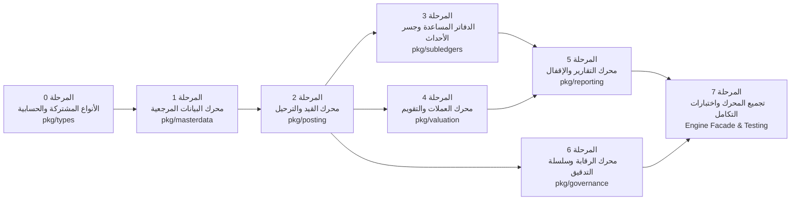

# الخطة التنفيذية المعمارية للنواة المحاسبية والمالية المستقلة

# Pure Accounting Engine - Architecture & Execution Plan

> **المرجع التحليلي والمعماري:** [`financial_accounting_system_architecture.md`](./financial_accounting_system_architecture.md)  
> **طبيعة النظام:** مكتبة ومحرك برمجي مجرد (Embeddable Core Engine Library) بدون أي ارتباط بـ HTTP / Web Handlers / Controllers / Network Protocols.  
> **مبدأ التصميم:** كل مكون مستقل وظيفياً ومعمارياً (Autonomous Component) مع واجهات برمجية صارمة (Strongly Typed In-Memory APIs & Contracts).

---

## 1. الفلسفة المعمارية: محرك مجرد (Pure In-Memory / Autonomous Engine)

### 1.1 التجرد التام من طبقات النقل (Decoupled from Transport / Web Layer)

النظام **ليس تطبيق ويب ولا خادم HTTP**، بل هو **محرك مالي حتمي (Deterministic Financial Core Engine)**:

* **لا وجود لـ:** HTTP Handlers, Gin/Echo/Chi Routers, REST Controllers, gRPC Servers, DTOs الخاصة بطلبات الويب.
* **التعامل حصراً مع:** كيانات النطاق (Domain Entities)، كائنات القيمة (Value Objects)، واجهات المنافذ (Ports/Interfaces)، وخدمات المحرك الحتمية (Engine Services).
* **إمكانية التضمين (Embeddability):** يمكن استيراد المحرك كحزمة Go داخل أي خدمة خلفية، عامل مهام (Worker)، معالج أحداث (Event Consumer)، أو أداة CLI دون تعديل سطر واحد.

### 1.2 استقلالية المكونات (Component Autonomy)

كل مكون من المكونات الستة المذكورة في وثيقة التحليل يتم بناؤه في حزمة (Package) مستقلة تماماً داخل المحرك، بحيث:

1. يمتلك كل مكون عقوده ونماذجه وقواعد تحققه الخاصة.
2. لا يعتمد أي مكون على تفاصيل التنفيذ الداخلي للمكون الآخر، وإنما يتواصلون عبر الواجهات (Interfaces/Contracts).
3. يمكن تشغيل واختبار كل مكون بمفرده (Unit Testing & Isolation).

```text
+---------------------------------------------------------------------------------------+
|                               CALLER / HOST APPLICATION                               |
|        (Can be: Backend API, Background Worker, Event Consumer, or CLI Tool)         |
+---------------------------------------------------------------------------------------+
                                           |
                                Calls Engine APIs (Go Interfaces / In-Memory Calls)
                                           v
+=======================================================================================+
|                            PURE FINANCIAL ACCOUNTING ENGINE                           |
|                                                                                       |
|  +--------------------+   +---------------------+   +-------------------------------+  |
|  |  pkg/masterdata    |   |  pkg/posting        |   |  pkg/subledgers               |  |
|  |  - Chart of Accs   |   |  - Double-Entry Eng |   |  - AR / AP Ledgers            |  |
|  |  - Fiscal Calendar |-->|  - Balance Rules    |-->|  - Cash / Treasury Ledger     |  |
|  |  - Multi-Ledgers   |   |  - Immutability Eng |   |  - Fixed Assets Subledger     |  |
|  |  - Dimensions / CC |   |  - Maker-Checker    |   |  - Event Mapping Bridge       |  |
|  +--------------------+   +---------------------+   +-------------------------------+  |
|                                     ^                               |                 |
|                                     |                               v                 |
|  +--------------------+   +---------------------+   +-------------------------------+  |
|  |  pkg/governance    |   |  pkg/valuation      |   |  pkg/reporting                |  |
|  |  - Hash Chain Audit|   |  - Multi-Currency   |   |  - Trial Balance Engine       |  |
|  |  - SoD Enforcement |<--|  - IAS 21 Engine    |<--|  - Financial Statements (IAS1)|  |
|  |  - Integrity Check |   |  - Revaluation Eng  |   |  - Closing Engine (Year-End)  |  |
|  +--------------------+   +---------------------+   +-------------------------------+  |
|                                                                                       |
+=======================================================================================+
                                           |
                                SPI (Service Provider Interface)
                                           v
+---------------------------------------------------------------------------------------+
|                            PERSISTENCE SPI / STORAGE DRIVERS                          |
|         (PostgreSQL Engine Driver, In-Memory Test Driver, SQLite Driver, etc.)        |
+---------------------------------------------------------------------------------------+
```

---

## 2. الهيكل البرمجي للمحرك المجرد (Directory Structure)

```text
accounting_engine/
├── docs/
│   ├── financial_accounting_system_architecture.md
│   └── financial_accounting_implementation_plan.md
├── pkg/                                   # المكونات الستة المستقلة القابلة للتضمين
│   ├── types/                             # الأنواع الحسابية الأساسية المشتركة
│   │   ├── money.go                       # معالج الدقة الحسابية العالية (Decimal-safe)
│   │   ├── currency.go                    # معايير العملات (ISO 4217)
│   │   └── errors.go                      # أخطاء النطاق المالي المجردة
│   │
│   ├── masterdata/                        # المكون 1: محرك البيانات المرجعية المالية
│   │   ├── account.go                     # هيكل الحساب وأنواعه الخمسة
│   │   ├── chart_of_accounts.go           # شجرة الحسابات والتحقق الهيكلي
│   │   ├── fiscal_calendar.go             # التقويم، السنوات، وفترات التسوية
│   │   ├── journal.go                     # دفاتر اليومية والتسلسل
│   │   ├── dimension.go                   # أبعاد التحليل المالي ومراكز التكلفة
│   │   ├── repository.go                  # واجهة تخزين البيانات المرجعية
│   │   └── service.go                     # واجهة وخدمة إدارة البيانات المرجعية
│   │
│   ├── posting/                           # المكون 2: محرك القيد المزدوج والترحيل
│   │   ├── entry.go                       # قيد اليومية وأسطره (Aggregate Root)
│   │   ├── validator.go                   # التحقق من التوازن الحتمي والقواعد
│   │   ├── engine.go                      # محرك الترحيل الذري وعدم التعديل
│   │   ├── reversal.go                    # منطق القيود العكسية
│   │   ├── maker_checker.go               # قواعد التحقق من الفصل الرقابي
│   │   └── repository.go                  # واجهة استمرارية قيود اليومية
│   │
│   ├── subledgers/                        # المكون 3: دفاتر الأستاذ المساعدة
│   │   ├── event_bridge.go                # استقبال وتوجيه الأحداث الاقتصادية المجردة
│   │   ├── receivable.go                  # دفتر الذمم المدينة (AR) وجداول التقادم
│   │   ├── payable.go                     # دفتر الذمم الدائنة (AP)
│   │   ├── cash_treasury.go               # دفتر الخزينة والنقد والتسوية البنكية
│   │   ├── fixed_assets.go                # دفتر الأصول الثابتة وحسابات الاستهلاك
│   │   └── repository.go                  # واجهات تخزين الدفاتر المساعدة
│   │
│   ├── valuation/                         # المكون 4: محرك التقويم والعملات (IAS 21)
│   │   ├── rates.go                       # أسعار الصرف التاريخية واللحظية
│   │   ├── conversion.go                  # التحويل بين عملة المعاملة والعملة الوظيفية
│   │   ├── revaluation.go                 # حساب وتوليد قيود فروق تقييم العملات
│   │   └── spi.go                         # واجهة تزويد أسعار الصرف (Rate Provider SPI)
│   │
│   ├── reporting/                         # المكون 5: محرك التقارير المالية والإقفال
│   │   ├── trial_balance.go               # ميزان المراجعة (أولي / معدل)
│   │   ├── balance_sheet.go               # قائمة المركز المالي (IAS 1)
│   │   ├── income_statement.go            # قائمة الدخل الشامل (P&L)
│   │   ├── cash_flow.go                   # قائمة التدفقات النقدية (IAS 7)
│   │   ├── equity_statement.go            # قائمة التغيرات في حقوق الملكية
│   │   ├── closing_engine.go              # محرك الإقفال الدوري وإقفال السنة
│   │   └── repository.go                  # واجهة استعلامات المجاميع والتقارير
│   │
│   └── governance/                        # المكون 6: الرقابة وسلسلة التدقيق
│       ├── audit_chain.go                 # سلسلة التدقيق التشفيرية (Hash-Chaining)
│       ├── verifier.go                    # مدقق سلامة السلسلة ومنع التلاعب
│       ├── sod_policy.go                  # سياسات الفصل بين المهام
│       └── repository.go                  # واجهة حفظ واسترجاع سجلات التدقيق
│
├── storage/                               # محركات التخزين المدعومة (SPI Implementations)
│   ├── memory/                            # مشغل التخزين في الذاكرة (للاختبارات الفورية)
│   │   └── memory_driver.go
│   └── postgres/                          # مشغل التخزين في قاعدة بيانات PostgreSQL
│       ├── schema/                        # ملفات DDL الخاصة بالنواة المالية فقط
│       └── pg_driver.go
│
├── engine.go                              # نقطة تجميع المحرك الكامل (Facade Engine)
├── go.mod
└── go.sum
```

---

## 3. تفصيل المكونات المستقلة (Component Specifications)

### المكون 1: محرك البيانات المرجعية المالية (`pkg/masterdata`)

* **الاستقلالية:** لا يعتمد على الترحيل أو التقارير. يمثل قاموس القواعد والكيانات المالية.
* **المسؤوليات:**
  1. إدارة شجرة الحسابات (COA) والتحقق من التسلسل الشجري، ومنع الترحيل إلى حسابات تجميعية (Parent Accounts).
  2. إدارة التقويم المالي (Fiscal Calendar) والفترات (Periods) وحالاتها (`open`, `soft_closed`, `hard_closed`).
  3. إدارة اليوميات وتوليد الأرقام المتسلسلة دون فجوات.
  4. تسجيل أبعاد التحليل المالي ومراكز التكلفة.

### المكون 2: محرك القيد المزدوج والترحيل (`pkg/posting`)

* **الاستقلالية:** يعتمد فقط على `types` وواجهات التحقق من `masterdata`. لا يعلم شيئاً عن كيفية عرض التقارير.
* **المسؤوليات:**
  1. بناء وفحص قيود اليومية (`AccountMove` و `AccountMoveLine`).
  2. تطبيق معادلة الاتزان الحتمية: $\sum \text{Debits} = \sum \text{Credits}$ ومطابقة العملة.
  3. منع أي قيد بسطور سالبة أو أسطر ذات مبالغ صفرية.
  4. فرض عدم قابلية التعديل (Immutability): لا يوجد Update أو Delete على قيد مرحل (`posted`).
  5. توليد القيود العكسية (Reversals) المرتبطة بالقيود الأصلية.

### المكون 3: محرك الدفاتر المساعدة والأحداث (`pkg/subledgers`)

* **الاستقلالية:** يترجم الأحداث المالية المجردة إلى قيود، ويدير الحسابات المساعدة بمعزل عن دفتر الأستاذ العام.
* **المسؤوليات:**
  1. **جسر الأحداث:** استلام حدث مالي مجرد (`EconomicEvent` يحتوي نوع الحدث، المبلغ، العملة، الحساب الوسيط، ومفتاح عدم التكرار `IdempotencyKey`).
  2. **دفتر الذمم (AR/AP):** مطابقة ومقاصة الأسطر المفتوحة، وتوليد مصفوفة التقادم (Aging Buckets).
  3. **دفتر الخزينة (Treasury):** إدارة الصناديق وحركات المطابقة البنكية.
  4. **دفتر الأصول (Assets):** جداول الاستهلاك الدوري وفق IAS 16.

### المكون 4: محرك التقويم والعملات (`pkg/valuation`)

* **الاستقلالية:** يتعامل مع فروق العملات وإعادة التقييم دون الارتباط بنوع النشاط التجاري.
* **المسؤوليات:**
  1. التحويل بين عملة المعاملة والعملة الوظيفية استناداً إلى أسعار التاريخ المحدد.
  2. فحص المراكز المالية النقدية المقومة بعملات أجنبية.
  3. توليد قيود فروق العملة (FX Gain / Loss) آلياً وفق معيار `IAS 21`.

### المكون 5: محرك التقارير المالية والإقفال (`pkg/reporting`)

* **الاستقلالية:** يقرأ الحركات المسجلة عبر واجهات القراءة لإنتاج مخرجات معيارية خالصة.
* **المسؤوليات:**
  1. احتساب ميزان المراجعة (Unadjusted / Adjusted Trial Balance).
  2. بناء قائمة المركز المالي (Balance Sheet) مع التحقق من المعادلة الأساسية.
  3. بناء قائمة الدخل الشامل (P&L) وتحديد صافي نتيجة النشاط.
  4. بناء قائمة التدفقات النقدية (Cash Flow Statement - IAS 7).
  5. محرك الإقفال: إقفال الحسابات الاسمية إلى حساب الأرباح المبقاة وتوليد الأرصدة الافتتاحية للسنة اللاحقة.

### المكون 6: محرك الرقابة وسلسلة التدقيق (`pkg/governance`)

* **الاستقلالية:** يعمل كمراقب وموثق غير قابل للتعطيل لحركات المحرك.
* **المسؤوليات:**
  1. حساب التوقيع التشفيري المتسلسل (Cryptographic Hash-Chain) لكل قيد وحركة.
  2. توفير خوارزمية التحقق الشامل من نزاهة السجلات وكشف أي تلاعب في قاعدة البيانات.
  3. تطبيق قيود الفصل بين المهام (Maker-Checker Enforcement).

---

## 4. مراحل التنفيذ المتسلسلة للمحرك (Sequential Execution Phases)



### تفاصيل المراحل التنفيذية

#### المرحلة 0: النواة الرياضية والأنواع المالية المشتركة (`pkg/types`)

- بناء كائن القيمة المالي `Money` المرتكز على دقة عشرية ثابتة (`Fixed-point / decimal`) لمنع أي خطأ تقريب (Floating-point error).
* تعريف هياكل العملات وفق معيار ISO 4217.
* تعريف قاموس الأخطاء المالية المعيارية (Domain Errors).

#### المرحلة 1: بناء محرك البيانات المرجعية المالية (`pkg/masterdata`)

- كيان شجرة الحسابات (COA) مع خوارزمية التحقق من الشجرة ومنع الترحيل إلى العقد التجميعية.
* محرك التقويم المالي وإدارة حالات الفترات (`Period State Machine`).
* محرك دفاتر اليومية وتوليد الأرقام المتسلسلة المتزامنة والآمنة تنافسياً (Concurrency-safe Sequential Generator).

#### المرحلة 2: بناء محرك القيد المزدوج والترحيل الصارم (`pkg/posting`)

- نموذج القيد وأسطره وقواعد الاتزان الرياضي الصارم.
* محرك الترحيل الذري (Atomic Posting Service) الذي يضمن عدم قابلية التراجع أو التعديل بعد الترحيل.
* منطق التراجع عبر القيود العكسية المتطابقة (`Reversal Entries`).
* فحص قيود الصلاحية الرقابية (Maker-Checker Policy).

#### المرحلة 3: بناء محرك الدفاتر الفرعية وجسر الأحداث (`pkg/subledgers`)

- محول الأحداث الاقتصادية (`Economic Event Ingestion Engine`) لتحويل الأحداث الخارجية المجردة إلى قيود متوازنة عبر خرائط التوجيه المحاسبي.
* منطق مطابقة الذمم ومصفوفات التقادم (Aging Schedules) ومخصصات الخسائر الائتمانية.
* محرك الاستهلاك المحاسبي للأصول وفق الطرق المعيارية (IAS 16).

#### المرحلة 4: بناء محرك العملات والتقويم الدوري (`pkg/valuation`)

- واجهة تزويد أسعار الصرف التاريخية والإقفال (`FX Rate SPI`).
* محرك حساب فروق العملات وتحويل العملات عند الترحيل.
* خدمة إعادة التقييم الدوري (FX Revaluation Routine) لتوليد قيود التسوية آلياً.

#### المرحلة 5: بناء محرك التقارير المالية والإقفال (`pkg/reporting`)

- محرك احتساب ميزان المراجعة وتجميع الأرصدة التاريخية.
* محرك القوائم المالية الأربع (المركز المالي، الدخل الشامل، التدفقات النقدية، التغير في الملكية).
* محرك إقفال السنة المالية: تصفير الحسابات الاسمية ونقل النتيجة لحساب الأرباح المبقاة وترحيل الأرصدة الافتتاحية للسنة الجديدة.

#### المرحلة 6: بناء محرك الرقابة والتدقيق التشفيري (`pkg/governance`)

- خوارزمية الربط التشفيري لسجل الحركات (`SHA-256 Hash Chain`).
* إجراء الفحص الدوري لسلامة الدفاتر (`Audit Integrity Verification`).

#### المرحلة 7: واجهة المحرك الموحدة واختبارات المحاكاة (`Engine Facade`)

- توفير واجهة موحدة `AccountingEngine` تجمع خدمات المحرك وتسهل تضمينها واستدعائها برمجياً.
* كتابة اختبارات شاملة تحاكي دورة حياة مالية كاملة لشركة على مدار سنة كاملة (تأسيس، عمليات، إعادة تقييم، تسويات، إقفال، واستخراج قوائم مالية معتمدة).

---

## 5. معايير القبول والتحقق (Acceptance Criteria)

1. **انعدام أي ارتباط ببروتوكولات النقل:** خلو كود المحرك تماماً من حزم مثل `net/http` أو معالجات الطلبات.
2. **الاستقلالية التامة:** إمكانية اختبار كل حزمة بمفردها بنسبة تغطية عالية وبدون الحاجة لتشغيل خادم ويب.
3. **سلامة الحسابات:** اتزان جميع القيود والموازين والقوائم المالية رياضياً ومحاسبياً وفق مبادئ IFRS / GAAP.
4. **مناعة مسار التدقيق:** عدم إمكانية تعديل أو مسح أي قيد مرحل، وفشل فحص النزاهة التشفيري عند التلاعب المباشر بأي سجل.
