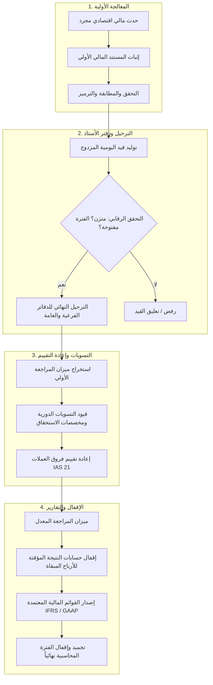
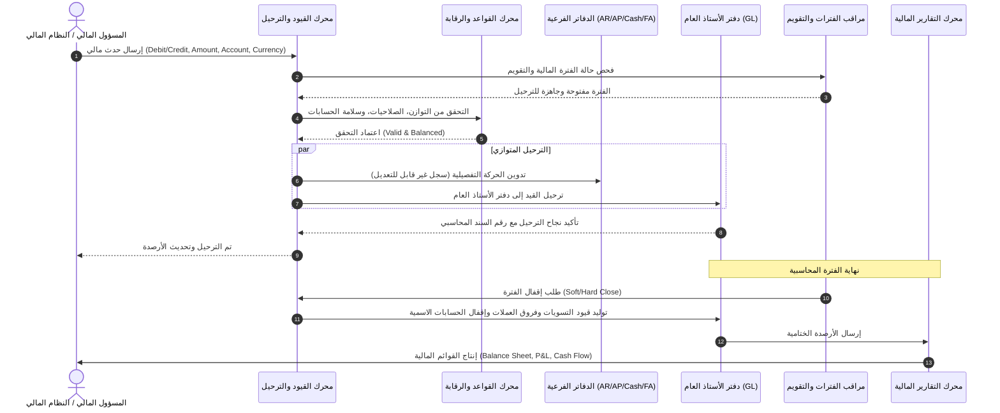

# المعمارية القياسية للنواة المحاسبية والمالية (Pure Financial Accounting Engine Architecture)

**وفقاً للمعايير العالمية (IFRS / IASB / US GAAP / ISO 20022 / COSO)**

---

## 1. المقدمة والحدود المعمارية (Architectural Boundaries)

يهدف هذا البحث التوثيقي إلى تفكيك النظام المحاسبي المالي وعزله تماماً عن الأنظمة التجارية (Commercial Systems مثل إدارة المبيعات، المشتريات، ونقاط البيع POS) والأنظمة التشغيلية (Operational Systems مثل المستودعات، اللوجستيات، وخطوط الإنتاج).

### الفصل المعماري الحاسم (Separation of Concerns)

* **النظام التشغيلي/التجاري (Operational / Business Layer):** يتعامل مع مفاهيم مثل: بوالص الشحن، استلام البضاعة، عروض الأسعار، إدارة علاقات العملاء (CRM)، وكميات المخزون الفيزيائي.
* **النظام المالي والمحاسبي (Pure Financial & Accounting Engine):** يتعامل حصراً مع: **الأحداث الاقتصادية (Economic Events)**، **الأثر المالي المتزن (Debit/Credit)**، **القياس النقدي (Monetary Measurement)**، **الفترات المحاسبية (Accounting Periods)**، و**التقارير الرقابية والختامية**.

```text
+-------------------------------------------------------------+
|             Operational & Commercial Systems                |
|      (Sales Orders, Inbound Shipments, Inventory, etc.)     |
+-------------------------------------------------------------+
                               |
                               | Economic Event / Subledger Transaction
                               v
+=============================================================+
|             PURE FINANCIAL ACCOUNTING ENGINE                |
|  - Financial Master Data (COA, Currencies, Fiscal Calendar) |
|  - Double-Entry Posting Engine (Debit = Credit)            |
|  - General Ledger (GL) & Financial Subledgers (AR/AP/FA/Cash)|
|  - Valuation, Revaluation & Adjustments Engine              |
|  - Closing & Financial Reporting Engine (IFRS / GAAP)      |
+=============================================================+
```

---

## 2. المكونات الهيكلية للنظام المحاسبي المالي (Core Components)

استناداً إلى معايير معهد المحاسبين الماليين (AICPA)، ومعايير التقرير المالي الدولية (IFRS Conceptual Framework)، والإطار الرقابي لمؤسسة COSO، يتكون النظام المحاسبي المالي المجرد من ستة مكونات أساسية:

### 2.1. محرك البيانات المرجعية المالية (Financial Master Data Management - FMDM)

1. **شجرة الحسابات (Chart of Accounts - COA):** الهيكل الشجري الذي يصنف الحسابات وفق العناصر الخمسة المعيارية:
   * الأصول (Assets)
   * الالتزامات (Liabilities)
   * حقوق الملكية (Equity)
   * الإيرادات (Revenue)
   * المصروفات (Expenses)
2. **التقويم المالي والفترات المحاسبية (Fiscal Calendar & Periods):** إدارة السنوات المالية، الفترات التشغيلية (أشهر، أرباع)، وفترات التسوية والتسوية الإضافية (Closing/Adjustment Periods)، وحالات الفترة (مفتوحة، مغلقة مؤقتاً، مغلقة نهائياً).
3. **دفاتر الأستاذ (Ledgers):**
   * **دفتر الأستاذ الأساسي (Primary Ledger):** العملة الأساسية، والتقويم المالي، ومعايير المحاسبة المعتمدة (مثلاً IFRS).
   * **دفاتر الأستاذ الثانوية/الموازية (Secondary/Parallel Ledgers):** لدعم متطلبات محلية أو ضريبية أو متطلبات عملات متعددة (Multi-Currency / Multi-GAAP).
4. **أبعاد التحليل المالي (Financial Dimensions / Cost Centers):** مراكز التكلفة، وحدات الأعمال، والمشاريع كأبعاد مالية مسندة للقيود.

### 2.2. محرك الترحيل والقيد المزدوج (Double-Entry Posting Engine)

* تطبيق قاعدة التوازن الحتمي الصارم: $\sum \text{Debits} = \sum \text{Credits}$.
* فرض عدم قابلية التعديل (Immutability): بمجرد ترحيل القيد، لا يمكن تعديله أو حذفه، وإنما يتم تصحيحه بقيد عكسي (Reversal Entry) للحفاظ على مسار التدقيق (Audit Trail).
* التحقق من قواعد العمل المحاسبية (Validation Rules): منع الترحيل إلى حسابات تجميعية (Header Accounts)، والتأكد من فتح الفترة المحاسبية المحددة للقيد.

### 2.3. دفاتر الأستاذ الفرعية المالية (Financial Subledgers)

تتعامل مع السجلات المالية التفصيلية قبل تلخيصها في دفتر الأستاذ العام:

1. **دفتر الذمم المدينة (Accounts Receivable - AR Subledger):** يتابع الاستحقاقات المالية والالتزامات النقدية للعملاء، جداول التقادم المالي (Aging)، ومخصص الخسائر الائتمانية المتوقعة (ECL بموجب IFRS 9).
2. **دفتر الذمم الدائنة (Accounts Payable - AP Subledger):** يتابع التزامات المنشأة المالية تجاه الموردين والجهات الدائنة، وجداول السداد.
3. **دفتر إدارة النقد والخزينة (Cash & Treasury Management):** متابعة الحسابات البنكية، الصناديق النقدية، حركات المقاصة، والتسويات البنكية (Bank Reconciliations).
4. **دفتر الأصول الثابتة والمالية (Fixed & Financial Assets Subledger):** تسجيل القيمة الدفترية، الاستهلاك المتراكم (Depreciation وفق IAS 16)، الانخفاض في القيمة (Impairment وفق IAS 36)، وإعادة التقييم.

### 2.4. محرك التقويم والعملات والتسويات (Valuation & Multi-Currency Engine)

* **إدارة العملات المتعددة (IAS 21):**
  * عملة المعاملة (Transaction Currency)
  * العملة الوظيفية (Functional Currency)
  * عملة العرض (Presentation Currency)
* **إعادة التقييم الدوري (Foreign Exchange Revaluation):** حساب أرباح وخسائر فروق تقييم العملات المحققة وغير المحققة (Realized & Unrealized FX Gains/Losses).

### 2.5. نظام الرقابة الداخلية ومسار التدقيق (Internal Controls & Audit Trail - COSO Compliant)

* تسجيل كامل لجميع التغييرات مع البصمات الزمنية (Timestamp, User ID, Source Document Ref).
* الفصل بين المهام (Segregation of Duties - SoD): فصل منشئ القيد عن مرحل القيد (Maker-Checker Principle).

### 2.6. محرك التقارير المالية والإقفال (Financial Reporting Engine)

* توليد القوائم المالية الإلزامية حسب معيار IAS 1:
  1. قائمة المركز المالي (Statement of Financial Position / Balance Sheet).
  2. قائمة الدخل الشامل (Statement of Comprehensive Income / P&L).
  3. قائمة التدفقات النقدية (Statement of Cash Flows - IAS 7).
  4. قائمة التغيرات في حقوق الملكية (Statement of Changes in Equity).
  5. ميزان المراجعة (Trial Balance) قبل وبعد التسويات والإقفال.

---

## 3. دورة حياة النظام المالي المحاسبي المجرد (Financial Accounting Lifecycle)

تمثل دورة العمليات المحاسبية المالية سلسلة من المراحل المعيارية المتعاقبة التي تحكم حياة الحدث المالي من لحظة نشأته حتى إدراجه في القوائم المالية وإقفال الفترة:



### تفصيل مراحل دورة الحياة

### المرحلة 1: نشأة الحدث المالي والإثبات (Recognition & Inception)

* **المفهوم:** ينشأ الالتزام أو الحق المالي نتيجة واقعة اقتصادية مكتملة الشروط المحاسبية (تحقق الأصل، الالتزام، الإيراد، أو المصروف وفقاً لمبدأ الاستحقاق Accrual Basis).
* **الإجراء:** إصدار سند مالي أولي (Financial Voucher: سند قبض، سند صرف، أو مذكرة تسوية قيود).
* **المطابقة:** ربط السند بمعرف المعاملة المالي الموحد (UUID / Transaction Hash).

### المرحلة 2: التحقق والتوجيه المحاسبي (Validation & Account Mapping)

* مطابقة المعاملة مع دليل الحسابات وتحديد أطراف القيد (المدين والدائن).
* التحقق الآلي من توازن القيد وصلاحيات الحسابات وحالة الفترة المالية الحالية.

### المرحلة 3: الترحيل إلى الدفاتر (Subledger & General Ledger Posting)

* **التأثير المتزامن:**
  1. ترحيل السجلات التفصيلية إلى دفاتر الأستاذ المساعد (حساب العميل أو المورد أو الخزينة المحددة).
  2. ترحيل المجاميع إلى دفتر الأستاذ العام (General Ledger).
* جعل السجلات **غير قابلة للمسح (Append-Only / Immutable)**.

### المرحلة 4: ميزان المراجعة الأولي والتسويات الجردية (Unadjusted Trial Balance & Adjustments)

* استخراج ميزان المراجعة للتحقق من التساوي الرياضي للمدين والدائن.
* إدخال قيود التسوية الجردية وفق مبدأ الاستحقاق:
  * الإيرادات المستحقة وغير المقبوضة (Accrued Revenues).
  * المصروفات المستحقة وغير المدفوعة (Accrued Expenses).
  * الإيرادات المقدمة (Deferred / Unearned Revenues).
  * المصروفات المدفوعة مقدماً (Prepaid Expenses).
  * قيود مخصصات الاستهلاك ومخصصات الديون المشكوك فيها (Depreciation & Impairment).

### المرحلة 5: تقييم العملات الأجنبية (FX Revaluation)

* إعادة تقييم الحسابات النقدية وحسابات الذمم المقومة بعملات أجنبية بالاعتماد على أسعار الإقفال الفورية (Closing Spot Rates) في تاريخ إعداد التقرير، وترحيل الفروق إلى حساب أرباح/خسائر تقييم عملات.

### المرحلة 6: ميزان المراجعة المعدل والتقارير المالية (Adjusted TB & Reporting)

* التحقق النهائي من الأرصدة بعد كافة التسويات.
* استخراج القوائم المالية الختامية وفق معايير IAS 1.

### المرحلة 7: الإقفال الدوري والسنوي (Financial Closing)

* **الإقفال الشهري/الفصلي (Soft Close):** منع إضافة أو تعديل القيود لغير المفوضين لحين تدقيق ومراجعة الحسابات.
* **الإقفال السنوي (Hard / Year-End Close):**
  * إقفال جميع الحسابات الاسمية/المؤقتة (Nominal Accounts: الإيرادات والمصروفات) في حساب الأرباح والخسائر / الأرباح المبقاة (Retained Earnings).
  * تدوير الحسابات الدائمة (Real/Permanent Accounts: الأصول، الالتزامات، وحقوق الملكية) كأرصدة افتتاحية (Opening Balances) للسنة المالية الجديدة.
  * قفل السنة المحاسبية المنتهية نهائياً ضد أي تعديل لاحق.

---

## 4. مخطط تدفق البيانات بين المكونات المالية (Data Flow & Component Interaction)

يوضح المخطط التالي كيفية سريان المعاملة المالية البحتة داخل مكونات النواة المحاسبية:



---

## 5. مصفوفة الفروق بين النظام المحاسبي المالي والنظام التجاري والتشغيلي

| المعيار | النظام المالي المحاسبي (Financial Accounting) | النظام التجاري / التشغيلي (Commercial & Ops) |
| :--- | :--- | :--- |
| **الهدف الأساسي** | الإثبات المالي المتزن، الامتثال للمعايير، والتقارير الرقابية | إدارة وتسهيل دورة المبيعات والمشتريات وتخزين السلع |
| **الوحدة المعتمدة** | النقد والعملات وأثرها على المركز المالي | الكميات، الأرقام التسلسلية، الصناديق، مسارات الشحن |
| **قواعد البيانات** | غير قابلة للتعديل بعد الترحيل (Immutable / Append-Only) | قابلة للتعديل والتحديث والإلغاء وفق مسارات العمل |
| **المعايير المرجعية** | IFRS, US GAAP, IPSAS, ISO 20022 | ITIL, Supply Chain (SCOR), CRM Best Practices |
| **مفهوم الإلغاء** | قيد تسوية عكسي (Credit Memo / Reversal Voucher) | إلغاء أمر البيع، مسح السجل، أو تغيير حالته إلى Canceled |
| **الأثر عند الحدوث** | تغير في الأصول أو الالتزامات أو حقوق الملكية | تغير في المخزون المتوقع أو حالة الطلب أو تواصل العميل |

---

## 6. المراجع والمصادر العالمية المعتمدة

1. **مجلس معايير المحاسبة الدولية (IASB) / مؤسسة IFRS:**
   * *Conceptual Framework for Financial Reporting (2018)*.
   * *IAS 1: Presentation of Financial Statements*.
   * *IAS 8: Accounting Policies, Changes in Accounting Estimates and Errors*.
   * *IAS 21: The Effects of Changes in Foreign Exchange Rates*.
   * *IFRS 9: Financial Instruments*.
2. **مجلس معايير المحاسبة المالية الأمريكي (FASB):**
   * *Statements of Financial Accounting Concepts (SFAC No. 8)*.
3. **لجنة المنظمات الراعية التابعة للجنة تريدواي (COSO):**
   * *Internal Control — Integrated Framework (2013)*: المتطلبات الرقابية للمحاسبة المالية وإثبات القيود ومسار التدقيق.
4. **المنظمة الدولية للمقاييس (ISO):**
   * *ISO 20022: Financial Services — Universal financial industry message scheme*.
5. **معهد المحاسبين الماليين (AICPA):**
   * *Audit and Accounting Guide: General Ledger and Subledger Integrities and Internal Audit Standards*.
