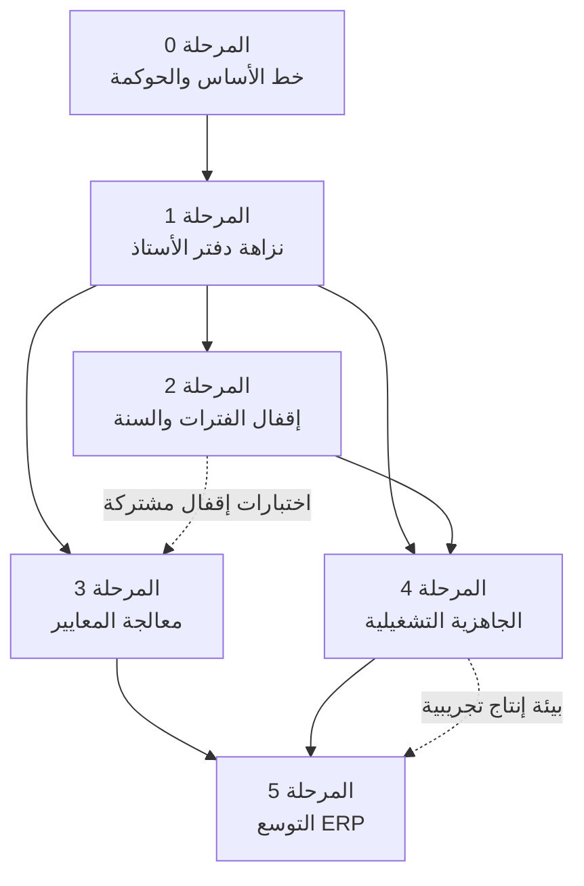

# الخطة التنفيذية الشاملة لمعالجة فجوات محرك المحاسبة

## Master Remediation & Engineering Execution Plan — `accounting_engine`

**تاريخ الإصدار:** 12 نوفمبر 2026  
**الإصدار:** 1.0  
**المالك:** قيادة الهندسة المعمارية للمحرك المحاسبي  
**الجمهور المستهدف:** المهندسون المعماريون، مهندسو Go، مهندسو قواعد البيانات، فرق الجودة، DevOps/SRE، الأمن، خبراء المحاسبة المعيارية، وإدارة المنتج.  
**حالة الوثيقة:** خطة ملزمة قابلة للتتبع؛ تُحدَّث عند إغلاق كل مهمة مع إرفاق دليل الإثبات.

---

## 0. كيف تُقرأ هذه الخطة

هذه الوثيقة هي **المصدر الوحيد للحقيقة (Single Source of Truth)** لخطة المعالجة. وهي لا تكتفي بتكرار تقرير سابق، بل:

1. **تتحقق من كل ادعاء** في تقرير الوكيل السابق مقابل الشيفرة الفعلية.
2. **تفصل بين الفجوة الحقيقية والادعاء القديم** الذي عولج بالفعل.
3. **تحوّل كل فجوة مؤكدة** إلى مهمة قابلة للتنفيذ بمعرّف ثابت.
4. **تحدد التبعيات والتوازي** بين المراحل والمهام.
5. **تحدد بوابة جودة (Quality Gate)** لا تُغلق المرحلة قبل اجتيازها.

> **قاعدة الحوكمة:** الشيفرة المصدرية هي المرجع النهائي. أي تعارض بين هذه الوثيقة والكود يُحسم لصالح الكود، وتُحدَّث الوثيقة فوراً.

### ملفات المراحل

| المرحلة | الملف | التركيز |
| --- | --- | --- |
| المرحلة 0 | [phase-0-baseline-and-governance.md](./phase-0-baseline-and-governance.md) | خط الأساس، بوابات CI، قرارات المعمارية، مصفوفة التتبع |
| المرحلة 1 | [phase-1-core-ledger-integrity.md](./phase-1-core-ledger-integrity.md) | نزاهة دفتر الأستاذ، ذرّية الفترات، الاعتماد، العكس، الترحيل الجماعي |
| المرحلة 2 | [phase-2-period-and-year-closing.md](./phase-2-period-and-year-closing.md) | إقفال الفترات والسنة المالية، إثبات محتوى قيد الإقفال، إعادة الفتح |
| المرحلة 3 | [phase-3-standards-remediation.md](./phase-3-standards-remediation.md) | IAS 12، IFRS 16، IFRS 9، IFRS 10/3، IAS 21، الإفصاحات |
| المرحلة 4 | [phase-4-operational-readiness.md](./phase-4-operational-readiness.md) | الخدمة، الأتمتة المستدامة، المراقبة، التعافي، الأمن، الأداء |
| المرحلة 5 | [phase-5-erp-expansion.md](./phase-5-erp-expansion.md) | المخزون، المشتريات، المبيعات، الرواتب، الضرائب، الموازنات، المشاريع |

---

## 1. الملخص التنفيذي

المحرك الحالي **ناضج في نواته المحاسبية** ويمتلك أساساً قوياً: قيد مزدوج متوازن، تعدد عملات، فترات مالية، حوكمة، محولات تخزين (Memory/PostgreSQL)، حزم معايير (IFRS 9/15/16، IAS 12/21، IFRS 3/10)، اختبارات ذهبية واختبارات تكامل. جميع الاختبارات تمر على Go 1.26.3.

لكن الفحص المستقل كشف أن **الخطر الأكبر ليس في غياب الميزات، بل في الفجوات بين طبقات المحرك**:

- طبقة الترحيل تتحقق من الفترة **قبل** فتح معاملة القيد، وليس داخلها.
- محرك PostgreSQL يسمح بتغيير حالة الفترة **دون** التحقق من الانتقال الصحيح.
- بصمة الاعتماد لا تغطي كل الحقول المؤثرة محاسبياً.
- مسارات العكس والترحيل الجماعي الاحتياطية **غير ذرّية**.
- استهلاك الأصل الثابت لا يحمي من التزامن على **نفس الأصل**.
- إقفال السنة لا يثبت أن **محتوى قيد الإقفال** صحيح، بل يتحقق من البيانات الوصفية فقط.
- IAS 12 يعترف بالأصل الضريبي المؤجل عند غياب قرار صريح باحتمالية الربح المستقبلي.
- IFRS 16 يستنتج عمر الاستهلاك من عدد الدفعات عند غياب العمر الصحيح.

هذه الفجوات **لا تظهر في اختبارات النجاح العادية**، لأنها تظهر فقط تحت التزامن، أو عند إعادة المحاولة، أو عند فشل جزئي، أو عند مدخلات حدودية. لذلك تُبنى الخطة على مبدأ: **اختبار الفشل أولاً (Red Test)، ثم الإصلاح، ثم إثبات البوابة**.

**الحكم النهائي:** المحرك صالح كأساس، لكنه **غير جاهز للإنتاج المالي الحرج** قبل إغلاق المراحل 0–4. المرحلة 5 توسع تجاري وليست شرطاً للسلامة الأساسية.

---

## 2. خط الأساس والمنهجية

### 2.1 خط الأساس التقني

| العنصر | القيمة |
| --- | --- |
| لغة Go | `1.26.3` (مثبتة في `go.mod`) |
| قاعدة البيانات | PostgreSQL عبر `pgx/v5` |
| التخزين البديل | `storage/memory` للاختبارات والتشغيل الخفيف |
| الاختبارات | `go test ./...` — جميع الحزم `ok` عند إعداد الخطة |
| اختبارات التكامل | تعتمد على متغيرات بيئة PostgreSQL؛ زمن `storage/postgres` يقارب 120 ثانية |
| الحزم الداخلية | `posting`, `masterdata`, `reporting`, `subledgers`, `governance`, `policy`, `valuation`, `consolidation`, `ias12`, `ifrs9`, `ifrs15`, `ifrs16`, `ifrsautomation` |
| نقاط الدخول | `engine.go`, `cmd/agy` |

### 2.2 منهجية التحقق

لكل ادعاء في تقرير الوكيل السابق تم تطبيق الخطوات التالية:

1. تحديد الملف والدالة والسطر الفعلي.
2. قراءة الاختبارات المرتبطة للتأكد من أن السلوك مقصود أم سهو.
3. تصنيف الادعاء: **مؤكد** / **مؤكد جزئياً** / **قديم أو غير دقيق** / **قرار معماري وليس عيباً**.
4. تحويل الفجوة المتبقية إلى مهمة بمعرّف `GAP-*` ثم ربطها بمهمة `P*-T*`.
5. تحديد دليل القبول: اختبار فاشل قبل الإصلاح، واختبار ناجح بعده، مع دليل تشغيلي عند اللزوم.

### 2.3 مبادئ المعالجة

- **الذرّية أولاً (Atomicity First):** لا تُقبل أي عملية مالية تتكون من أكثر من كتابة دون معاملة واحدة أو تعويض صريح (Compensation).
- **الفشل المغلق (Fail-Closed):** غياب السياسة أو الإعداد في الإنتاج يعني الرفض، لا السماح.
- **التحقق داخل حدود المعاملة (Validate Inside the Transaction):** حالة الفترة، حالة القيد، والنسخة المتوقعة تُقرأ وتُقفل داخل نفس المعاملة.
- **البصمة تغطي ما يؤثر محاسبياً (Hash What Matters):** كل حقل يغيّر الفترة أو التصنيف أو المبلغ أو الارتباط يجب أن يدخل في بصمة الاعتماد.
- **التوافق الخلفي مع التخزين (Storage Parity):** Memory وPostgreSQL وMock يجب أن تتصرف بنفس القواعد أو يفشل العقد صراحةً.
- **القابلية لإعادة التشغيل (Idempotency):** كل عملية قابلة للتكرار الآمن بمفتاح واضح.
- **التوثيق كأثر هندسي (Docs as Evidence):** كل إصلاح يحدّث ADR أو وثيقة المرحلة.

---

## 3. مصفوفة التحقق من تقرير الوكيل السابق

الرموز: ✅ مؤكد بالكود | 🟡 مؤكد جزئياً | 🔴 قديم/غير دقيق | ⚪ قرار معماري وليس عيباً

| # | ادعاء التقرير السابق | الدليل الفعلي في الكود | الحكم | التصحيح / الفجوة المتبقية |
| --- | --- | --- | --- | --- |
| 1 | سياسة الموافقات اختيارية (Fail-Open) وتسمح بالترحيل دون اعتماد | `internal/governance/approval_gate.go` — `IsApproved` يعيد `true` عند غياب السياسة، لكن `StrictGovernance` موجود، ومربوط في `engine.go` عبر `Config.StrictGovernance` | 🟡 مؤكد جزئياً | الفجوة ليست غياب الوضع الصارم، بل أن **الافتراضي** ما زال مفتوحاً ولا يوجد إلزام إنتاجي عند بدء التشغيل. المهمة: `P1-T7`. |
| 2 | IFRS 9 مجرد مصفوفة تقادم ولا يطبق النموذج العام | `internal/ifrs9/ecl.go` يحتوي `CalculateGeneralECL` و`classifyStage`، لكن النموذج العام يُستدعى بمدخلات من الخارج | 🟡 مؤكد جزئياً | النموذج العام موجود لكنه **غير مدمج** في دورة القياس الافتراضية ولا يفرض سياسة المراحل/الخصم. المهمة: `P3-T5`. |
| 3 | مصدر المخصصات التاريخي يعود للرصيد الحالي عند غياب `AsOfAllowanceSource` | `ecl.go` — عند تاريخ سابق وغياب المصدر يعيد `ErrHistoricalAllowanceUnavailable`؛ الرجوع للرصيد الحالي يحدث فقط للتاريخ الحالي/المستقبلي | 🟡 مؤكد جزئياً | الخطر المتبقي هو **الاعتماد الضمني على الرصيد الحالي** للتواريخ غير السابقة. المهمة: `P3-T6`. |
| 4 | `RateProviderSPI` لا يلزم بنوع السعر | `internal/valuation/spi.go` — الواجهة تتضمن `GetRateOfType` إلزامياً | 🔴 قديم/غير دقيق | عولجت. تبقى مهمة تدقيق جميع نقاط الاستدعاء: `P3-T8`. |
| 5 | سباق بيانات في `RateRegistry` | `internal/valuation/rates.go` — يستخدم `sync.RWMutex` | 🔴 قديم/غير دقيق | عولجت. لا مهمة إصلاح؛ تبقى مراجعة اختبار `-race` في `P0-T2`. |
| 6 | محرك التجميع يقتصر على الاستحواذ المباشر وطريقة Partial Goodwill | `internal/consolidation/model.go` يدعم `FullGoodwill`، و`engine.go` يدعم سلاسل الملكية المتداخلة واستبعاد المعاملات البينية، مع اختبارات `TestConsolidateSupportsNestedOwnershipChain` و`TestConsolidateRecognizesGoodwillAndAllocatesNCI` | 🔴 قديم/غير دقيق | الادعاء لا يعكس الكود. الفجوة الحقيقية: **عدم وجود `ConsolidationRun` مستدام** وإثبات إصدار قابل لإعادة الإنتاج. المهمة: `P3-T7`. |
| 7 | عزل وحدات IFRS والتجميع عن المحرك الرئيسي | `engine.go` — `AccountingEngine` يربط الحزم عبر منافذ، لكن حزم المعايير تُستدعى مباشرة في بعض المسارات | ⚪ قرار معماري | الفصل الحالي مقصود كحدود نطاق. لا يُعالج كعيب؛ يُوثق في ADR: `P0-T3`. |
| 8 | تداخل الفترتين 13 و14 مع الفترة 12 وبعضهما | `internal/masterdata/fiscal_calendar.go` — الفترتان تستخدمان `year.EndDate` نفسه، والتعليق يوضح أنهما حاويتان إجرائيتان تُختاران بالرقم لا بالتاريخ | 🟡 مؤكد جزئياً | التصميم موثق، لكن **واجهات الاختيار بالتاريخ** قد تخلط بينهما. المهمة: `P2-T3`. |
| 9 | قصور تمرير السياق `context.Background()` | `internal/subledgers/*` — الدوال المختصرة تستخدم `context.Background()`، بينما توجد نسخ `...Context` | 🟡 مؤكد جزئياً | الخطر في **إساءة الاستخدام** وليس في غياب الدعم. المهمة: `P4-T8`. |
| 10 | الاعتماد على `runtime.Caller` لمسار الهجرات بدلاً من `embed.FS` | `storage/postgres/migrations.go` — يستخدم `//go:embed migrations/*.sql` و`embeddedMigrations` | 🔴 قديم/غير دقيق | عولجت. لا مهمة إصلاح. |

### 3.1 ادعاءات إضافية لم يغطها التقرير السابق

| # | الفجوة | الدليل | الخطورة | المهمة |
| --- | --- | --- | --- | --- |
| 11 | `UpdatePeriodState` في PostgreSQL يتجاوز `ValidatePeriodTransition` | `storage/postgres/masterdata.go` — تنفيذ `UPDATE` مباشر دون فحص الحالة السابقة | حرجة | `P1-T1` |
| 12 | حالة الفترة لا تُقفل/تُعاد التحقق داخل معاملة الترحيل | `internal/posting/engine.go` + `storage/postgres/posting.go` | حرجة | `P1-T2` |
| 13 | `DraftContentMatches` يغفل `PeriodID` و`TargetPeriodNumber` و`AdjustmentAuthorized` و`OriginalEntryID` | `internal/posting/entry.go` | عالية | `P1-T3` |
| 14 | `EntryContentHash` يغفل `SourceEventID` | `internal/posting/content_hash.go` | عالية | `P1-T4` |
| 15 | مسار العكس الاحتياطي غير ذرّي، ومسار PostgreSQL لا يثبت تطابق القيد العكسي مع الأصل | `internal/posting/reversal.go` + `storage/postgres/posting.go` | عالية | `P1-T5` |
| 16 | الترحيل الجماعي يتراجع إلى ترحيل متسلسل غير ذرّي، ويحل الفترة خارج معاملة الدفعة | `internal/posting/bulk.go` + `storage/postgres/posting.go` | عالية | `P1-T6` |
| 17 | استهلاك نفس الأصل الثابت غير محمي من التزامن | `internal/subledgers/fixed_assets.go` — `DepreciationAttachment` | عالية | `P1-T9` |
| 18 | `DepreciationAttachment` لا يتحقق من المبلغ/التاريخ/الجدول مقابل القيد | `internal/subledgers/fixed_assets.go` | عالية | `P1-T9` |
| 19 | إقفال السنة لا يثبت محتوى قيد الإقفال، والتحديثات متسلسلة غير ذرّية | `internal/reporting/closing_engine.go` | عالية | `P2-T1`, `P2-T2` |
| 20 | IAS 12 يعترف بالأصل الضريبي المؤجل عند `FutureTaxableProfitProbable == nil` | `internal/ias12/ias12.go` | عالية | `P3-T1` |
| 21 | IAS 12 يرفض المعدلات ذات `EffectiveFrom` بعد `asOf` ولا يدعم جدول معدلات متوقع | `internal/ias12/ias12.go` | عالية | `P3-T2` |
| 22 | IFRS 16 يستنتج عدد فترات الاستهلاك من `len(c.Payments)` عند غياب العمر الصحيح | `internal/ifrs16/lease.go` | متوسطة | `P3-T3` |
| 23 | لا يوجد سجل `ConsolidationRun` مستدام ولا إثبات إصدار قابل لإعادة الإنتاج | `internal/consolidation/*` | متوسطة | `P3-T7` |
| 24 | خدمة `cmd/agy` تعرض `/healthz` و`/metrics` فقط | `cmd/agy/serve.go` | عالية | `P4-T1` |
| 25 | جدولة الأتمتة لا تملك حالة تشغيل مستدامة، إعادة محاولة، Outbox، أو DLQ | `internal/ifrsautomation/service.go` | عالية | `P4-T2` |
| 26 | التسوية موجودة لكن غير مجدولة | `internal/reporting/balance_integrity.go` + `reconciliation.go` | متوسطة | `P4-T3` |
| 27 | `docs/README.md` يشير إلى ملفات غير موجودة | `docs/README.md` | منخفضة | `P0-T5` |
| 28 | لا توجد وحدات مخزون/رواتب/مشتريات/مبيعات/ضريبة مستقلة | هيكل `internal/` | عالية (للتوسع ERP) | `P5-T2`…`P5-T11` |

---

## 4. سجل الفجوات الهندسي (Engineering Gap Register)

### 4.1 تعريفات الخطورة

| المستوى | المعنى | سياسة الإغلاق |
| --- | --- | --- |
| **Critical** | قد يؤدي إلى قيد خاطئ أو تجاوز رقابة أو فساد بيانات مالية | لا يُغلق إلا باختبار فشل + إصلاح + مراجعة معمارية + دليل تكامل |
| **High** | قد يؤدي إلى عدم اتساق أو تجاوز اعتماد أو خطأ معياري جوهري | اختبار انحدار + إصلاح + مراجعة نظير |
| **Medium** | ضعف قابلية تشغيل أو اكتمال معياري غير جوهري | اختبار + توثيق |
| **Low** | دين تقني/توثيقي | توثيق + متابعة |

### 4.2 السجل الكامل

| المعرّف | المجال | الفجوة | الدليل | الخطورة | المهمة | الحالة |
| --- | --- | --- | --- | --- | --- | --- |
| `GAP-GOV-01` | الفترات | PostgreSQL يسمح بانتقال حالة فترة غير صالح (بما فيه إعادة فتح مقفلة نهائياً) | `storage/postgres/masterdata.go::UpdatePeriodState` | Critical | `P1-T1` | مفتوحة |
| `GAP-GOV-02` | الحوكمة | لا توجد صلاحية/سبب/تدقيق إلزامي لإعادة فتح فترة | `internal/masterdata/fiscal_calendar.go` | High | `P2-T4` | مفتوحة |
| `GAP-GOV-03` | الحوكمة | الوضع الافتراضي للموافقات مفتوح (Fail-Open) ولا يوجد إلزام إنتاجي عند الإقلاع | `internal/governance/approval_gate.go`, `engine.go` | High | `P1-T7` | مفتوحة |
| `GAP-GOV-04` | الحوكمة | غياب سياسة الشركة يُفسَّر كسماح في الوضع غير الصارم | `approval_gate.go::IsApproved` | Medium | `P1-T7` | مفتوحة |
| `GAP-PST-01` | الترحيل | حالة الفترة تُقرأ قبل المعاملة ولا تُقفل/تُعاد التحقق داخلها | `internal/posting/engine.go::prepareForPosting`, `storage/postgres/posting.go` | Critical | `P1-T2` | مفتوحة |
| `GAP-PST-02` | الترحيل | `DraftContentMatches` لا يقارن الفترة/الفترة المستهدفة/تفويض التعديل/القيد الأصلي | `internal/posting/entry.go::DraftContentMatches` | High | `P1-T3` | مفتوحة |
| `GAP-PST-03` | الترحيل | بصمة الاعتماد لا تغطي `SourceEventID` | `internal/posting/content_hash.go::EntryContentHash` | High | `P1-T4` | مفتوحة |
| `GAP-PST-04` | الترحيل | مسار العكس الاحتياطي غير ذرّي (حفظ/ترحيل/تحديث الأصل على مراحل) | `internal/posting/reversal.go` | High | `P1-T5` | مفتوحة |
| `GAP-PST-05` | الترحيل | مسار PostgreSQL للعكس لا يثبت أن الأسطر عكس مطابق للأصل | `storage/postgres/posting.go::PostReversalAtomicContext` | High | `P1-T5` | مفتوحة |
| `GAP-PST-06` | الترحيل | الترحيل الجماعي يتراجع لترحيل متسلسل غير ذرّي عند غياب `BulkRepository` | `internal/posting/bulk.go::PostBulkContext` | High | `P1-T6` | مفتوحة |
| `GAP-PST-07` | الترحيل | حل الفترة يتم خارج معاملة الدفعة الجماعية | `bulk.go::postBulkAtomic` + `prepareForPosting` | High | `P1-T6` | مفتوحة |
| `GAP-PST-08` | الترحيل | لا مفتاح Idempotency صريح للترحيل/العكس | `internal/posting/*` | Medium | `P1-T10` | مفتوحة |
| `GAP-PST-09` | الترحيل | `PostWithAttachmentsContext` لا يعيد التحقق من حالة الفترة داخل المعاملة | `storage/postgres/posting.go` | Medium | `P1-T2` | مفتوحة |
| `GAP-PST-10` | الترحيل | لا تحكم تفاؤلي (Version) على القيد بين القراءة والكتابة | `storage/postgres/posting.go` | Medium | `P1-T11` | مفتوحة |
| `GAP-AST-01` | الأصول | `DepreciationAttachment.ValidateAttachment` يتحقق من المعرفات فقط | `internal/subledgers/fixed_assets.go` | High | `P1-T9` | مفتوحة |
| `GAP-AST-02` | الأصول | استهلاك نفس الأصل بشكل متزامن يمكن أن ينتج قيدين | `fixed_assets.go::DepreciateAssetAtomic` | High | `P1-T9` | مفتوحة |
| `GAP-AST-03` | الأصول | تحديث الأصل لا يستخدم نسخة متوقعة/تحقق تفاؤلي | `fixed_assets.go::ExecuteAtomicMutation` | Medium | `P1-T9` | مفتوحة |
| `GAP-AST-04` | الأصول | اختبار التزامن الحالي يستخدم أصلين مختلفين لا أصلاً واحداً | `storage/*/phase2_subledger_test.go` | Medium | `P1-T9` | مفتوحة |
| `GAP-CLS-01` | الإقفال | تأكيد الإقفال يتحقق من البيانات الوصفية لا من محتوى القيد | `internal/reporting/closing_engine.go::ConfirmFiscalYearCloseContext` | High | `P2-T2` | مفتوحة |
| `GAP-CLS-02` | الإقفال | إغلاق الفترات وتحديث السنة متسلسل وغير ذرّي؛ فشل جزئي ممكن | `closing_engine.go` | High | `P2-T1` | مفتوحة |
| `GAP-CLS-03` | الإقفال | لا سجل `ClosingRun` مستدام/قابل للاستئناف | `closing_engine.go` | Medium | `P2-T7` | مفتوحة |
| `GAP-CLS-04` | الإقفال | الفترتان 13/14 تتشاركان تاريخ نهاية السنة؛ الاختيار بالتاريخ ملتبس | `internal/masterdata/fiscal_calendar.go` | Medium | `P2-T3` | مفتوحة |
| `GAP-CLS-05` | الإقفال | ترحيل الأرصدة الافتتاحية غير ذرّي مع إغلاق السنة | `closing_engine.go::CarryForward` | Medium | `P2-T6` | مفتوحة |
| `GAP-STD-01` | IAS 12 | اعتراف تلقائي بالأصل الضريبي المؤجل عند `nil` | `internal/ias12/ias12.go` | High | `P3-T1` | مفتوحة |
| `GAP-STD-02` | IAS 12 | لا يدعم جدول معدلات/معدلات مستقبلية متوقعة؛ يرفض `EffectiveFrom > asOf` | `internal/ias12/ias12.go::TaxRate.Validate` | High | `P3-T2` | مفتوحة |
| `GAP-STD-03` | IFRS 16 | استنتاج فترات الاستهلاك من عدد الدفعات عند عمر صفري/مبالغ فيه | `internal/ifrs16/lease.go` | Medium | `P3-T3` | مفتوحة |
| `GAP-STD-04` | IFRS 16 | دورة حياة عقد الإيجار غير مستدامة (تعديل/إنهاء/إعادة قياس) | `internal/ifrs16/*` | Medium | `P3-T4` | مفتوحة |
| `GAP-STD-05` | IFRS 9 | النموذج العام غير مدمج في دورة القياس الافتراضية | `internal/ifrs9/ecl.go` | Medium | `P3-T5` | مفتوحة |
| `GAP-STD-06` | IFRS 9 | الاعتماد الضمني على الرصيد الحالي عند غياب مصدر تاريخي | `ecl.go::Calculate` | Medium | `P3-T6` | مفتوحة |
| `GAP-STD-07` | التجميع | لا `ConsolidationRun` مستدام ولا إثبات إصدار قابل لإعادة الإنتاج | `internal/consolidation/*` | Medium | `P3-T7` | مفتوحة |
| `GAP-STD-08` | IAS 21 | تحتاج جميع نقاط الاستدعاء التحقق من تمرير نوع السعر الإلزامي | `internal/valuation/*` | Low | `P3-T8` | مفتوحة |
| `GAP-STD-09` | IFRS 15 | دورة حياة العقد/الإفصاح تحتاج تدقيق اكتمال | `internal/ifrs15/*` | Medium | `P3-T10` | مفتوحة |
| `GAP-STD-10` | الإفصاح | تغطية الإفصاحات/التصنيفات غير مكتملة | `internal/reporting/taxonomy` | Low | `P3-T11` | مفتوحة |
| `GAP-OPS-01` | الخدمة | `/healthz` و`/metrics` فقط؛ لا readiness/auth/TLS/limits | `cmd/agy/serve.go` | High | `P4-T1` | مفتوحة |
| `GAP-OPS-02` | الأتمتة | لا حالة تشغيل مستدامة/إعادة محاولة/Outbox/DLQ | `internal/ifrsautomation/service.go` | High | `P4-T2` | مفتوحة |
| `GAP-OPS-03` | التسوية | محرك التسوية موجود لكن غير مجدول | `internal/reporting/balance_integrity.go`, `reconciliation.go` | Medium | `P4-T3` | مفتوحة |
| `GAP-OPS-04` | التعافي | لا دليل نسخ احتياطي/استعادة/PITR | `docs/production_readiness_specification_and_verification.md` | Medium | `P4-T5` | مفتوحة |
| `GAP-OPS-05` | الأداء | لا SLOs لزمن الاستجابة/التنافس على الأقفال | `storage/postgres/benchmark_test.go` | Medium | `P4-T7` | مفتوحة |
| `GAP-OPS-06` | المراقبة | لا مقاييس RED/USE ولا تتبع موحد لكل مسار | `internal/observability/*` | Medium | `P4-T4` | مفتوحة |
| `GAP-OPS-07` | الأمن | اختبارات RLS موجودة لكن لا تحقق مستمر في CI | `storage/postgres/rls_test.go` | Medium | `P4-T6` | مفتوحة |
| `GAP-OPS-08` | السياق | الدوال المختصرة تستخدم `context.Background()` | `internal/subledgers/*` | Low | `P4-T8` | مفتوحة |
| `GAP-OPS-09` | التوثيق | `docs/README.md` يشير إلى ملفات غير موجودة | `docs/README.md` | Low | `P0-T5` | مفتوحة |
| `GAP-ERP-01` | المخزون | لا دفتر مساعد مستقل للمخزون/التقييم/تكلفة البضاعة | `internal/` | High | `P5-T2` | مفتوحة |
| `GAP-ERP-02` | الرواتب | لا وحدة رواتب/استحقاقات/استقطاعات | `internal/` | High | `P5-T5` | مفتوحة |
| `GAP-ERP-03` | المشتريات | دورة فاتورة المورد/المطابقة الثلاثية غير مكتملة | `internal/subledgers` | Medium | `P5-T3` | مفتوحة |
| `GAP-ERP-04` | المبيعات | دورة التحصيل/حدود الائتمان/التذكير غير مكتملة | `internal/subledgers` | Medium | `P5-T4` | مفتوحة |
| `GAP-ERP-05` | الضرائب | لا وحدة VAT مستقلة | `internal/` | Medium | `P5-T6` | مفتوحة |
| `GAP-ERP-06` | الضرائب | لا وحدة استقطاع (WHT) مستقلة | `internal/` | Medium | `P5-T7` | مفتوحة |
| `GAP-ERP-07` | الموازنات | لا محاسبة موازنات/انحرافات | `internal/` | Medium | `P5-T8` | مفتوحة |
| `GAP-ERP-08` | المشاريع | محاسبة المشاريع/التوزيع غير مكتملة | `internal/` | Medium | `P5-T9` | مفتوحة |
| `GAP-ERP-09` | التكاليف | محاسبة التكاليف/التوزيع غير مكتملة | `internal/` | Medium | `P5-T10` | مفتوحة |
| `GAP-ERP-10` | الإفصاح | الإفصاحات المالية غير مكتملة | `internal/reporting` | Low | `P5-T11` | مفتوحة |

---

## 5. مصفوفة التبعيات بين المراحل

### 5.1 قواعد التبعية

| المرحلة | لا تبدأ قبل | يمكن أن تتوازى مع |
| --- | --- | --- |
| 0 | — | — |
| 1 | إغلاق `P0-T1` و`P0-T4` | `P0-T2`…`P0-T8` بعد `P0-T1` |
| 2 | إغلاق `P1-T1` و`P1-T2` | `P3-T1`, `P3-T3`, `P4-T1` |
| 3 | إغلاق `P1-T2` و`P1-T9` | `P2`, `P4-T1` |
| 4 | إغلاق `P1-T2` و`P2-T1` | `P3` |
| 5 | إغلاق `P3-T1`…`P3-T7` و`P4-T1` | — |

---

## 6. مصفوفة التوازي (Parallelization Matrix)

| الموجة | المهام المتوازية | شرط البدء | المخرجات |
| --- | --- | --- | --- |
| W0 | `P0-T1` | — | تقرير خط أساس قابل لإعادة الإنتاج |
| W1 | `P0-T2`, `P0-T3`, `P0-T4`, `P0-T5`, `P0-T6`, `P0-T7`, `P0-T8` | `P0-T1` | CI، ADRs، مصفوفة تتبع، توثيق، مراقبة، أمن، سياسة هجرات |
| W2 | `P1-T1`, `P1-T3`, `P1-T4`, `P1-T7`, `P1-T9` | `P0-T4` | إصلاحات مستقلة في ملفات مختلفة |
| W3 | `P1-T2`, `P1-T5`, `P1-T6`, `P1-T8` | `P1-T1` + `P1-T3` | نزاهة الترحيل والعكس والدفعات |
| W4 | `P1-T10`, `P1-T11`, `P2-T3`, `P3-T1`, `P3-T3`, `P4-T1` | `P1-T2` | Idempotency، تحكم تفاؤلي، تقويم، IAS 12، IFRS 16، خدمة |
| W5 | `P2-T1`, `P2-T2`, `P2-T4`, `P3-T2`, `P3-T4`, `P4-T2`, `P4-T3` | W4 | إقفال ذرّي، إثبات محتوى، إعادة فتح، معدلات، إيجار، أتمتة، تسوية |
| W6 | `P2-T5`, `P2-T6`, `P2-T7`, `P2-T8`, `P3-T5`, `P3-T6`, `P3-T7`, `P3-T8`, `P4-T4`, `P4-T5`, `P4-T6` | W5 | إقفال كامل، IFRS 9، تجميع، IAS 21، مراقبة، تعافي، أمن. ملاحظة: `P3-T5` يبدأ بعد `P3-T6` |
| W7 | `P3-T9`, `P3-T10`, `P3-T11`, `P4-T7`, `P4-T8`, `P4-T9`, `P4-T10`, `P4-T11` | W6 | اختبارات معايير، إفصاح، أداء، Runbooks، عزل، Go/No-Go |
| W8 | `P5-T1` | W7 | حدود وحدات ERP |
| W9 | `P5-T2`…`P5-T11` | `P5-T1` | وحدات ERP المستقلة |
| W10 | `P5-T12` | `P5-T2`…`P5-T11` | توسعة التجميع/تعدد المعايير |

> **قاعدة التوازي:** لا تُنفَّذ مهمتان في نفس الملف في نفس الموجة إلا إذا كانتا خلفيتين متعاقدتين (Interface-first) ومتوافق عليهما في `P0-T3`.

---

## 7. بوابات الجودة (Quality Gates)

| البوابة | الاسم | شرط الاجتياز | المخرجات الإلزامية |
| --- | --- | --- | --- |
| **G0** | Baseline & Governance | `go test ./...` و`go test -race ./...` يمران؛ CI يحجب الدمج عند الفشل؛ ADRs الأساسية معتمدة؛ مصفوفة تتبع الفجوات مكتملة | تقرير خط أساس، ملف CI، ADR-0001..0005، مصفوفة `GAP → TEST` |
| **G1** | Ledger Integrity | لا يمكن ترحيل قيد إلى فترة مقفلة تحت التزامن؛ لا يمكن تغيير حقل مؤثر بعد الاعتماد؛ العكس/الدفعات ذرّية؛ استهلاك نفس الأصل لا يتكرر | اختبارات فشل قبل الإصلاح، اختبارات تكامل PostgreSQL، تقرير سباق `-race` |
| **G2** | Closing Integrity | الإقفال ذرّي وقابل للاستئناف؛ محتوى قيد الإقفال مُثبت؛ إعادة الفتح مصرح ومدقق؛ لا إقفال جزئي | سيناريوهات فشل/إعادة محاولة، تقرير Preflight، سجل `ClosingRun` |
| **G3** | Standards Conformance | IAS 12/IFRS 16/IFRS 9/IFRS 10/3/IAS 21 لها اختبارات إيجابية وسلبية وحالات ذهبية | مصفوفة امتثال، تقرير فروق، تحديث وثائق المعايير |
| **G4** | Operational Readiness | readiness/auth/TLS/limits تعمل؛ الأتمتة مستدامة؛ التسوية مجدولة؛ DR مُختبر؛ SLOs معرّفة | تقرير اختبار DR، لوحات مراقبة، Runbooks، تقرير أمن |
| **G5** | ERP Expansion | حدود الوحدات معتمدة؛ كل وحدة لها عقود واختبارات وتكامل محاسبي | ADR الوحدات، اختبارات تكامل، خطة إصدار |

### 7.1 قاعدة الإغلاق

لا تُغلق أي مهمة إلا بوجود:

1. **اختبار فاشل مسبقاً (Red)** يثبت الفجوة.
2. **إصلاح مراجع من نظير (Peer-reviewed)**.
3. **اختبار ناجح (Green)** مع تغطية الحالة الحدية.
4. **تحديث وثيقة المرحلة** أو ADR.
5. **دليل تشغيلي** إن كانت المهمة تمس الإنتاج (لقطة، سجل، أو تقرير).

---

## 8. الأدوار والمسؤوليات (RACI)

| الدور | الرمز | المسؤولية |
| --- | --- | --- |
| القائد المعماري | ARCH | قرارات التصميم، ADRs، مراجعة الحدود |
| مهندس دفتر الأستاذ | LEDGER | `internal/posting`, `storage/*`, الذرّية والتزامن |
| مهندس المعايير | STD | `ias12`, `ifrs9`, `ifrs15`, `ifrs16`, `consolidation` |
| مهندس قاعدة البيانات | DBA | الهجرات، الأقفال، الفهارس، RLS، الأداء |
| مهندس الجودة | QA | مصفوفة الاختبارات، اختبارات الفشل، التغطية |
| DevOps/SRE | SRE | CI/CD، المراقبة، التعافي، السعة |
| مهندس الأمن | SEC | RLS، الأسرار، SAST/DAST، SBOM |
| خبير المحاسبة | SME | صحة المعالجة المعيارية، قبول الحالات الذهبية |
| كاتب تقني | DOC | الوثائق، Runbooks، تحديث الفهرس |

**قاعدة الفصل:** لا يعتمد المطوّر تغييره الخاص في المسارات المالية الحرجة؛ يلزم مراجعان: `ARCH` + `SME` للمعايير، و`LEDGER` + `QA` للترحيل.

---

## 9. تعريف الإنجاز (Definition of Done)

المهمة تكون `Done` فقط عند تحقق جميع ما يلي:

- [ ] معرّف الفجوة `GAP-*` مربوط بالمهمة `P*-T*`.
- [ ] اختبار فشل موثق قبل الإصلاح.
- [ ] إصلاح يمر محلياً و`-race` حيث ينطبق.
- [ ] اختبار تكامل PostgreSQL للحالات التي تمس التخزين.
- [ ] لا كسر للتوافق الخلفي أو خطة هجرة واضحة.
- [ ] تحديث الوثيقة/ADR.
- [ ] مراجعة نظير معتمدة.
- [ ] دليل قبول مرفق في سجل المرحلة.

---

## 10. المخاطر والافتراضات

| المخاطرة | الاحتمال | الأثر | التخفيف |
| --- | --- | --- | --- |
| تغيير السلوك الافتراضي للموافقات يكسر عملاء قدامى | متوسط | عالٍ | مفتاح إعداد + فترة انتقال + إشعار إصدار |
| إصلاح الذرّية يزيد زمن الأقفال | متوسط | متوسط | قياس قبل/بعد، فهارس مناسبة، عزل معاملات قصير |
| اختلاف Memory/PostgreSQL بعد الإصلاح | متوسط | عالٍ | عقد تخزين مشترك (Storage Contract Tests) |
| إقفال ذرّي يتعارض مع سيناريوهات استئناف | متوسط | متوسط | تصميم State Machine + Idempotency |
| توسع ERP يشتت فريق النواة | عالٍ | متوسط | فصل الفريق بعد G4، وحدات خلف عقود |
| ادعاءات تقرير سابق تُنسخ دون تحقق | متوسط | متوسط | هذه الوثيقة هي المرجع، والكود هو الحكم |

**افتراضات:**

- PostgreSQL هو هدف الإنتاج الأساسي؛ Memory للتطوير والاختبار.
- لا يُسمح بكسر واجهات التخزين العامة دون إصدار رئيسي.
- خبير محاسبي متاح لقبول الحالات الذهبية.
- بيئة CI قادرة على تشغيل PostgreSQL Integration.

---

## 11. خارطة الطريق الإرشادية

| المرحلة | المدة الإرشادية | ناتج قابل للعرض |
| --- | --- | --- |
| 0 | 1–2 أسبوع | CI + ADRs + مصفوفة تتبع |
| 1 | 3–5 أسابيع | نواة ترحيل ذرّية ومحصنة |
| 2 | 2–4 أسابيع | إقفال سنوي ذرّي ومُثبت |
| 3 | 4–6 أسابيع | معايير مكتملة باختبارات |
| 4 | 3–5 أسابيع | خدمة إنتاجية ومراقبة وتعافي |
| 5 | 8–16 أسبوعاً | وحدات ERP تدريجية |

> المدد تقديرية للتخطيط فقط، وتُعاد معايرة بعد `P0-T1`.

---

## 12. سجل التغييرات

| الإصدار | التاريخ | التغيير |
| --- | --- | --- |
| 1.0 | 2026-11-12 | الإصدار الأول: تحقق من تقرير سابق، سجل فجوات، ست مراحل، بوابات جودة، مصفوفة توازٍ |
