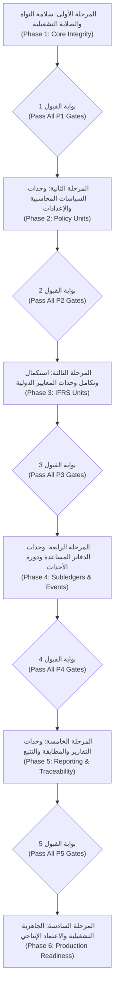

# دليل الخطة التنفيذية الشاملة لمشروع Accounting Engine

## Master Implementation Plan Index & Units Architecture

**تاريخ الإصدار:** 11 نوفمبر 2026  
**المرجع الأساسي:** [تقرير التحقق المستقل من تحليل الفجوات والعيوب والامتثال للمعايير العالمية](file:///home/osm/StudioProjects/cashflow_system/accounting_engine/docs/gap_analysis_and_standards_verification_report.md)  
**الحالة:** معتمدة للتنفيذ  
**نمط المعمارية:** النواة المحاسبية الموحدة المدعومة بالوحدات الوظيفية المتخصصة (**Single Engine — Modular Units Architecture**)

---

## 1. الفلسفة المعمارية: اعتماد مفهوم "الوحدات" (Units Architecture)

استجابة للتوجيه الهندسي السديد بعدم تضخيم المصطلحات وتجنب إطلاق مسمى "محرك" (Engine) على كل ميزة فرعية جديدة (مما قد يسبب تشتتاً معمارياً وتعقيداً غير مبرر)، تم اعتماد قاعدة التصميم التالية:

> **النظام يحتوي على محرك مركزي واحد فقط هو المحرك المحاسبي (`AccountingEngine`). أما كافة المكونات الفرعية والخدمات المتخصصة والمعايير والسياسات فتُبنى وتُسمى كـ "وحدات وظيفية متخصصة" (`Units`).**

```text
+-----------------------------------------------------------------------------------+
|                           Accounting Engine (النواة المحاسبية المركزية)           |
+-----------------------------------------------------------------------------------+
|  [Core Ledger]      [Atomic Posting]      [Double-Entry Balance]   [WORM Audit]   |
+-----------------------------------------------------------------------------------+
|                                 Functional Units                                  |
|                                                                                   |
|  +------------------------+  +------------------------+  +---------------------+  |
|  |     Policy Units       |  |     Standard Units     |  |   Subledger Units   |  |
|  | - Currency Policy Unit |  | - IFRS 9 Unit          |  | - Receivables Unit  |  |
|  | - Rounding Policy Unit |  | - IFRS 15 Unit         |  | - Payables Unit     |  |
|  | - Posting Policy Unit  |  | - IFRS 16 Unit         |  | - Fixed Assets Unit |  |
|  | - Fiscal Policy Unit   |  | - IAS 12 Unit          |  | - Treasury Unit     |  |
|  +------------------------+  | - Consolidation Unit   |  +---------------------+  |
|                              +------------------------+                           |
|  +------------------------+  +------------------------+  +---------------------+  |
|  |     Control Units      |  |      Event Units       |  |   Reporting Units   |  |
|  | - Maker-Checker Unit   |  | - Event Lifecycle Unit |  | - Statements Unit   |  |
|  | - Balance Audit Unit   |  | - Ingestion Bridge Unit|  | - Traceability Unit |  |
|  +------------------------+  +------------------------+  +---------------------+  |
+-----------------------------------------------------------------------------------+
|                        Storage Ports & Storage Adapters                           |
|         [PostgreSQL (RLS / ACID)]           [In-Memory (Testing SPI)]             |
+-----------------------------------------------------------------------------------+
```

### مزايا نموذج الـ Units

1. **الحد من التعقيد (Simplicity & Cohesion):** كل وحدة (`Unit`) تمثل حزمة مسؤولية واحدة (Single Responsibility)، ولها مدخلاتها ومخرجاتها المحددة.
2. **عقود واضحة (Ports & Adapters):** تتصل كل وحدة بالمحرك المركزي عبر واجهات برمجية واضحة (`SPI / Ports`) دون الحاجة لإنشاء بنية معقدة لكل وظيفة.
3. **سهولة الاختبار والتطوير المستقل:** يمكن اختبار وتطوير كل `Unit` بمعزل عن بقية النظام ثم دمجها بسلاسة.
4. **تجنب تكرار الكود:** تشترك الوحدات في البنية التحتية المشتركة للمحرك (الأنواع المالية، التخزين الذري، الحوكمة).

---

## 2. مصفوفة المراحل المتسلسلة (Sequential Implementation Phases)

تم تنظيم الخطة التنفيذية في **6 مراحل متسلسلة بدقة**، بحيث تشكل كل مرحلة أساساً منطقياً لا يمكن الانتقال للمرحلة التي تليها إلا بعد استيفاء معايير القبول (Acceptance Gates) الخاصة بها:



---

## 3. روابط وثائق المراحل التفصيلية (Phase Documentation Index)

لكل مرحلة ملف توثيقي مستقل ومفصل في مجلد `docs`، يحتوي على المشاكل، والأهداف، والسياق، والخطوات، ومعايير القبول لكل مهمة:

| المرحلة | الملف المستقل | نطاق التركيز والأولويات |
| --- | --- | --- |
| **المرحلة 1** | [**docs/phase_1_core_integrity.md**](file:///home/osm/StudioProjects/cashflow_system/accounting_engine/docs/phase_1_core_integrity.md) | **سلامة النواة والصلابة:** تحويل الحوكمة إلى Fail-Closed، حماية سجل الأسعار من سباق البيانات، تضمين الهجرات عبر `embed.FS`، فرض أنواع أسعار الصرف، معالجة فترات التسوية، وتوحيد السياق `context.Context`. |
| **المرحلة 2** | [**docs/phase_2_policy_units.md**](file:///home/osm/StudioProjects/cashflow_system/accounting_engine/docs/phase_2_policy_units.md) | **وحدات السياسات المحاسبية:** إنشاء وحدات سياسات العملات والتقريب، وحدات سياسات الترحيل والفترات المالية، وتأريخ السياسات بالإصدارات الفعالة تاريخياً. |
| **المرحلة 3** | [**docs/phase_3_ifrs_units.md**](file:///home/osm/StudioProjects/cashflow_system/accounting_engine/docs/phase_3_ifrs_units.md) | **وحدات المعايير الدولية:** ترقية IFRS 9 ECL للنموذج العام والأسلوب المبسط، استكمال دورة IFRS 15، أصول وعقود IFRS 16، ضرائب IAS 12، توسيع التجميع المالي (Consolidation)، وربطها بالمحرك. |
| **المرحلة 4** | [**docs/phase_4_subledgers_and_events.md**](file:///home/osm/StudioProjects/cashflow_system/accounting_engine/docs/phase_4_subledgers_and_events.md) | **الدفاتر المساعدة والأحداث:** وحدة إدارة دورة الأحداث الاقتصادية مع عدم التكرار (Idempotency)، تطوير وحدات الذمم AR/AP، استكمال وحدة الخزينة والبنوك، وإدارة مكونات الأصول الثابتة. |
| **المرحلة 5** | [**docs/phase_5_reporting_and_traceability.md**](file:///home/osm/StudioProjects/cashflow_system/accounting_engine/docs/phase_5_reporting_and_traceability.md) | **التقارير والتتبع والمطابقة:** وحدة التتبع المالي (Drill-Down من القائمة المالية إلى المستند)، وحدة إعادة بناء الأرصدة المادية ومطابقتها دورياً، والقوائم المالية المقارنة والإفصاحات. |
| **المرحلة 6** | [**docs/phase_6_production_readiness.md**](file:///home/osm/StudioProjects/cashflow_system/accounting_engine/docs/phase_6_production_readiness.md) | **الجاهزية والاعتماد الإنتاجي:** وحدة المراقبة وقياسات الأداء والتدقيق، الاختبارات المحاسبية المرجعية الذهبية (Golden Tests)، اختبارات الضغط والسباق والتزامن، واعتماد عزل المستأجرين (RLS). |

---

## 4. قواعد ومعايير إدارة الخطة التنفيذية (Execution Governance)

1. **لا قفز فوق المراحل (Strict Sequential Execution):** لا يجوز البدء في مهام المرحلة $N+1$ قبل الانتهاء من جميع معايير قبول المرحلة $N$.
2. **التحقق التقني والمحاسبي المتلازم:** كل مهمة برمجية جديدة يجب أن يرافقها اختبار وحدة (Unit Test) واختبار تكامل (Integration Test) واختبار اتزان محاسبي (Accounting Invariant Test).
3. **عدم كسر التوافق الحالي (Zero Regression):** يجب التأكد دوماً من بقاء جميع الاختبارات الـ 278 الحالية ناجحة وخضراء بنسبة 100% أثناء وبعد إدخال التحسينات.
4. **توثيق التغييرات المحاسبية:** أي تعديل يؤثر على قياسات الأرقام المالية يجب أن يستند إلى نص المعيار المعتمد ويُسجل في سجل التعديلات المعمارية.
