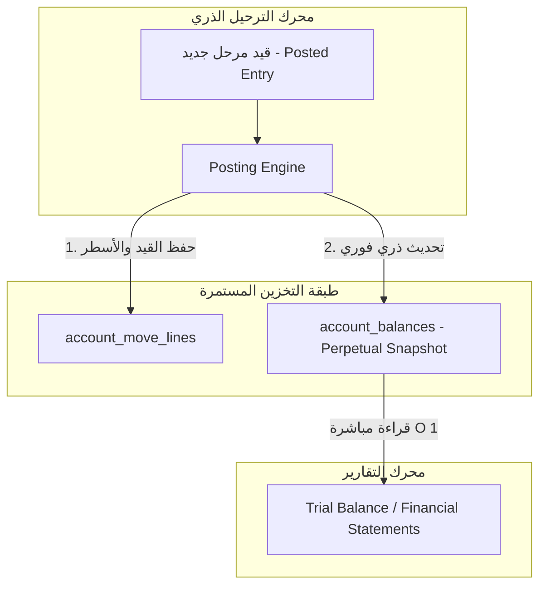
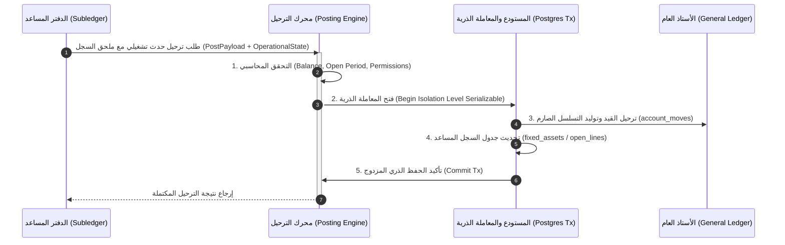
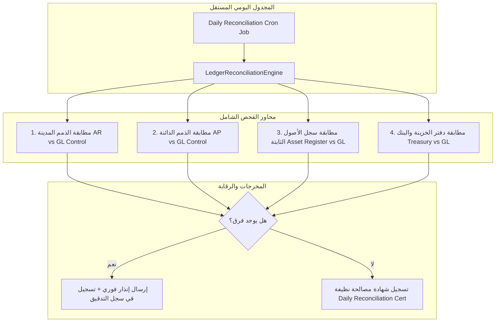
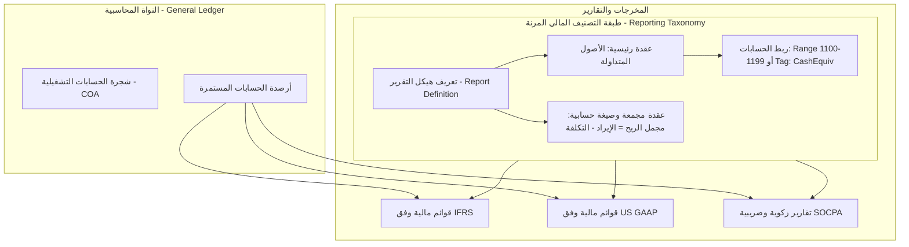
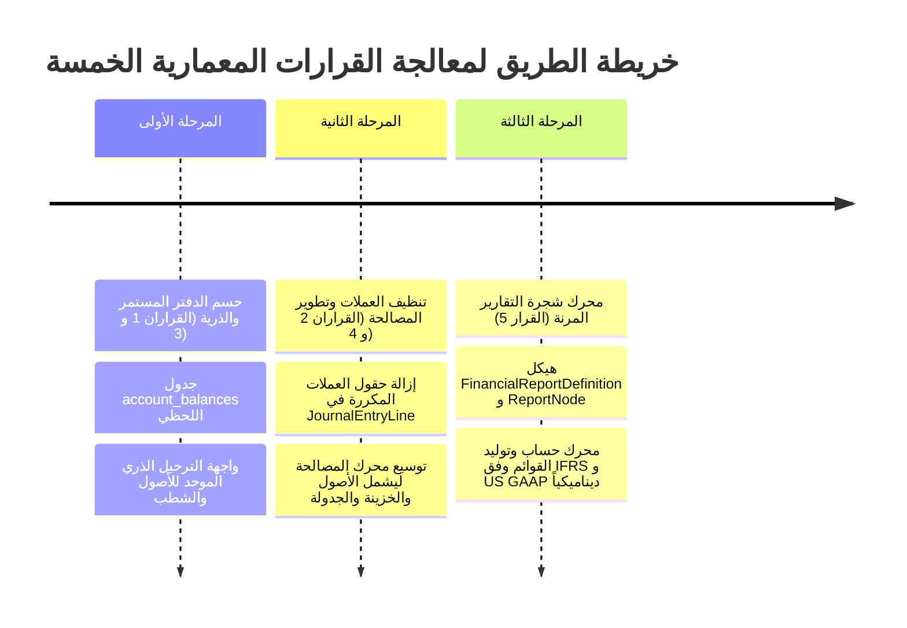

# التحليل المعماري الشامل للقرارات المحاسبية الاستراتيجية الخمسة

## Comprehensive Architectural & Implementation Analysis of the 5 Key Accounting Decisions

### مشروع محرك المحاسبة المالية (`accounting_engine`)

**تاريخ التحليل:** نوفمبر 2026  
**الإصدار الخاضع للتدقيق:** `accounting_engine v1.0-rc`  
**المرجع المعماري:** البند 12 من التقرير المعماري للمشروع (Key Architectural Decisions)  
**نطاق الفحص:** فحص تفصيلي للشيفرة المصدرية (Go)، طبقات التخزين (PostgreSQL / Memory)، نماذج القيود، الدفاتر المساعدة، محرك التقييم، ونظم التقارير والحوكمة.

---

## الفهرس العام

1. [المقدمة والمنهجية الهندسية](#1-المقدمة-والمنهجية-الهندسية)
2. [القرار 1: الدفتر المستمر (Perpetual Ledger) أم الدفتر الدوري (Periodic Ledger)؟](#2-القرار-1-الدفتر-المستمر-perpetual-ledger-أم-الدفتر-الدوري-periodic-ledger)
3. [القرار 2: عمق تعدد العملات المعتمد (Transaction vs. Functional vs. Presentation)](#3-القرار-2-عمق-تعدد-العملات-المعتمد-transaction-vs-functional-vs-presentation)
4. [القرار 3: سلطة الترحيل المحاسبي (Posting Engine Authority & Subledger Roles)](#4-القرار-3-سلطة-الترحيل-المحاسبي-posting-engine-authority--subledger-roles)
5. [القرار 4: مطابقة الدفاتر المساعدة مع الأستاذ العام (Subledger to GL Reconciliation)](#5-القرار-4-مطابقة-الدفاتر-المساعدة-مع-الأستاذ-العام-subledger-to-gl-reconciliation)
6. [القرار 5: الفصل المعماري بين المحاسبة المالية والتقارير المالية (IFRS / GAAP Taxonomies)](#6-القرار-5-الفصل-المعماري-بين-المحاسبة-المالية-والتقارير-المالية-ifrs--gaap-taxonomies)
7. [مصفوفة الأثر المعماري وخريطة طريق المعالجة (Architectural Impact & Roadmap)](#7-مصفوفة-الأثر-المعماري-وخريطة-طريق-المعالجة-architectural-impact--roadmap)

---

## 1. المقدمة والمنهجية الهندسية

تهدف هذه الوثيقة إلى تقديم **تحليل تشريحي دقيق وعميق (Deep-Dive Code & Architectural Audit)** للمشروع `accounting_engine` على ضوء القرارات المعمارية الخمسة الواردة في البند 12، للإجابة على الأسئلة الجوهرية:

- أين يقف كود المحرك الحالي من كل قرار؟ (ما هو المطبق فعلياً في ملفات Go وقاعدة بيانات PostgreSQL، وما هو الغائب أو المطبق جزئياً؟)
- ما هي المخاطر المحاسبية والتقنية الناتجة عن الوضع الراهن؟
- ما هو التصميم المعماري المستهدف والمخطط التنفيذي (Implementation Blueprint) لحسم كل قرار بصورة نهائية ومطابقة للمعايير الدولية (IFRS / US GAAP).

---

## 2. القرار 1: الدفتر المستمر (Perpetual Ledger) أم الدفتر الدوري (Periodic Ledger)؟

> **التوصية المعتمدة:** تثبيت خيار **الدفتر المستمر (Perpetual Ledger)**؛ حيث تنعكس كل حركة فوراً على الأرصدة، مع تحديد آليات واضحة وصارمة للقيود الافتتاحية والإقفال الدوري.

### 2.1 واقع الكود الحالي في المشروع (Current State)

من خلال فحص ملفات `internal/posting/engine.go`، `internal/reporting/trial_balance.go`، و`internal/reporting/closing_engine.go`، وسائق قاعدة البيانات `storage/postgres/driver.go`، يتضح الآتي:

1. **طريقة احتساب الأرصدة الحالية (Runtime Aggregate):**
   - المحرك **لا يمتلك جدولاً مادياً للأرصدة المستمرة (Materialized Account Balances Table)**.
   - عند طلب ميزان المراجعة أو قائمة المركز المالي، يقوم محرك التقارير بتشغيل الاستعلام:

     ```go
     // internal/reporting/trial_balance.go:99
     allEntries, err := listPostedEntries(e.repository, time.Time{}, endDate)
     ```

     حيث يتم استرجاع **كافة قيود اليومية المرحلة منذ بداية تاريخ المنشأة** (`time.Time{}` إلى `endDate`) وتجميعها في الذاكرة عبر حلقات تكرارية (`for _, line := range entry.Lines`).
   - هذا النمط المعماري يُصنف تقنياً كـ *Event-Sourced Query Aggregation* وليس *Perpetual Materialized Ledger*.

2. **معالجة الإقفال الدوري (Periodic Closing):**
   - في `internal/reporting/closing_engine.go`، يولد التابع `GenerateClosingMove` قيد إقفال في الفترة 13 (Adjustment Period) لتصفير حسابات الإيرادات والمصروفات وترحيل الفارق إلى حساب الأرباح المبقاة (`Retained Earnings`).
   - هذا السلوك سليم من الناحية المحاسبية الدورية.

3. **معضلة القيد الافتتاحي (The Opening Move Paradox):**
   - يتيح الكود دالة `GenerateOpeningMove` في `closing_engine.go` (السطر 73):

     ```go
     func (e *ClosingEngine) GenerateOpeningMove(year masterdata.FiscalYear, journalID uuid.UUID, currency string) (posting.JournalEntry, error)
     ```

     تقوم هذه الدالة بجمع كافة أرصدة الأصول والالتزامات وحقوق الملكية للسنة السابقة وتوليد قيد افتتاحي في بداية السنة الجديدة تصنيفه `posting.EntryClassOpening`.
   - **الخلل الجوهري المكتشف:** بما أن ميزان المراجعة `trial_balance.go` يجمع كافة الحركات من تاريخ التأسيس `time.Time{}`، وبما أن دالة التجميع لا تستثني قيود الإقفال أو القيود الافتتاحية السنوية:
     $$\text{Balance} = \sum \text{Historical Moves} + \text{Opening Move} \implies \text{Double Counting!}$$
     سيؤدي ترحيل قيد افتتاحي سنوي إلى **مضاعفة أرصدة الميزانية العمومية فوراً**!

### 2.2 تحليل الفجوات والمخاطر (Gap & Risk Analysis)

- **مخاطر الأداء ($O(N)$ Complexity):** مع نمو النظام إلى ملايين القيود، فإن قراءة وتجميع كل القيود السابقة لحساب رصيد حساب واحد سيؤدي إلى انهيار أداء التقارير واستنزاف موارد الذاكرة وقاعدة البيانات.
- **غموض مفهوم القيد الافتتاحي:** الخلط بين "قيد الأرصدة الافتتاحية للمنظومة لأول مرة" (Cutover / Initial Migration Entry) وبين "التدوير السنوي للأرصدة" (Annual Balance Carry-Forward). في الدفتر المستمر الحقيقي، الأرصدة الحقيقية تدور تلقائياً دون الحاجة لقيد يومية ورقي جديد.

### 2.3 المخطط المعماري المستهدف لحسم القرار (Target Architecture)



#### التعديلات البرمجية الإلزامية

1. **إنشاء جدول الأرصدة المستمرة اللحظية (`account_balances`):**

   ```sql
   CREATE TABLE IF NOT EXISTS account_balances (
       company_id UUID NOT NULL,
       account_id UUID NOT NULL,
       fiscal_period_id UUID NOT NULL,
       currency_id VARCHAR(3) NOT NULL,
       beginning_debit NUMERIC(28,4) NOT NULL DEFAULT 0,
       beginning_credit NUMERIC(28,4) NOT NULL DEFAULT 0,
       period_debit NUMERIC(28,4) NOT NULL DEFAULT 0,
       period_credit NUMERIC(28,4) NOT NULL DEFAULT 0,
       ending_debit NUMERIC(28,4) NOT NULL DEFAULT 0,
       ending_credit NUMERIC(28,4) NOT NULL DEFAULT 0,
       PRIMARY KEY (company_id, account_id, fiscal_period_id, currency_id),
       FOREIGN KEY (company_id, account_id) REFERENCES accounts(company_id, id) ON DELETE RESTRICT
   );
   ```

2. **قواعد الإقفال والافتتاح الصارمة:**
   - **قيد الافتتاح (`EntryClassOpening`):** يُسمح به فقط عند بداية تشغيل المنشأة على النظام (Cutover Balance) أو في الفترة الأولى من السنة المالية الأولى للمنشأة.
   - **الإقفال السنوي (`EntryClassClosing`):** يقتصر فقط على تصفير حسابات الأرباح والخسائر إلى الأرباح المبقاة في الفترة التعديلية (Period 13)، بينما تُنقل أرصدة الأصول والالتزامات إلى الفترة اللاحقة برمجياً في جدول `account_balances` كـ `beginning_balance` دون توليد قيد يومية مضاعف.

---

## 3. القرار 2: ما هو عمق تعدد العملات المعتمد؟

> **التوصية المعتمدة:** الفصل الدائم والصارم بين ثلاثة مستويات من العملات:
>
> 1. **عملة المعاملة (`Transaction Currency`):** العملة الأصلية للفاتورة أو الإيصال أو العقد.
> 2. **العملة الوظيفية (`Functional Currency`):** عملة البيئة الاقتصادية الأساسية للمنشأة، وبها يُحفظ ويتوازن دفتر الأستاذ العام.
> 3. **عملة العرض والتقارير (`Presentation Currency`):** العملة التي تُعرض بها القوائم المالية للأطراف الخارجية والمجموعات الدولية وفق معيار IAS 21.

### 3.1 واقع الكود الحالي في المشروع (Current State)

1. **تعدد الحقول وتداخلها في سطر القيد (`internal/posting/entry.go`):**
   يحتوي سطر القيد `JournalEntryLine` حالياً على حقول متداخلة تسبب تشويشاً معمارياً:

   ```go
   type JournalEntryLine struct {
       Debit               financialtypes.Money // أي عملة؟ (تاريخياً كانت وظيفية)
       Credit              financialtypes.Money
       TransactionAmount   financialtypes.Money // عملة المعاملة
       TransactionCurrency string
       ExchangeRate        decimal.Decimal      // سعر التحويل
       FunctionalDebit     financialtypes.Money // العملة الوظيفية
       FunctionalCredit    financialtypes.Money
       AmountCurrency      financialtypes.Money // حقل موروث مكرر
       Currency            string               // حقل غير محدد المعالم
       ForeignAmount       decimal.Decimal      // حقل مكرر
   }
   ```

2. **التحقق من التوازن متعدد العملات:**
   - تم دعم التحقق من توازن القيد في العملة الوظيفية داخل `Validate()` في `entry.go`.
   - يتم التحقق من أن العملة الوظيفية للقيد تطابق عملة الشركة (`validateFunctionalCurrency` في `engine.go:288`).
3. **طبقة التقارير وعملة العرض (IAS 21):**
   - تم بناء `CurrencyTranslator` في `internal/reporting/currency_translation.go` بصورة ممتازة؛ حيث يفصل:
     - بنود الميزانية (أصول والتزامات) تُترجم بسعر الإقفال (`ClosingRate`).
     - بنود حقوق الملكية تُترجم بالسعر التاريخي (`HistoricalRate`).
     - بنود قائمة الدخل تُترجم بمتوسط السعر للفترة (`AverageRate`).
     - يتم احتساب الفارق وترحيله إلى احتياطي ترجمة العملات الأجنبية (`FCTR` / `TranslationReserve`) ضمن الدخل الشامل والملكية.

### 3.2 تحليل الفجوات والمخاطر (Gap & Risk Analysis)

- **ازدواجية وتضارب حقول العملة:** وجود 5 حقول للمبالغ والعملات في سطر القيد الواحد يفتح ثغرات في التكامل؛ هل المعتمد في التقارير هو `Debit`/`Credit` أم `FunctionalDebit`/`FunctionalCredit`؟
- **تخزين مبالغ العرض في قيود اليومية (خطأ محتمل):** يجب ألا يتم حفظ مبالغ عملة العرض (`Presentation Currency`) في قيود اليومية نهائياً؛ لأن أسعار الصرف متغيرة، والترجمة لعملة العرض هي عملية ديناميكية وقت إعداد التقرير وليست حدثاً محاسبياً تشغيلياً.

### 3.3 المخطط المعماري المستهدف لحسم القرار (Target Architecture)

| المستوى | اسم العملة | أين تُعرف؟ | أين تُسجل؟ | قاعدة التوازن والامتثال |
| :--- | :--- | :--- | :--- | :--- |
| **المستوى 1** | **Transaction Currency** | في وثيقة المصدر (فاتورة، عقد، كشف حساب) | `transaction_currency`, `transaction_amount` | لا يشترط توازن القيد بعملة المعاملة إذا كان القيد يضم أطرافاً بعملات مختلفة. |
| **المستوى 2** | **Functional Currency** | على مستوى المنشأة القانونية `companies.functional_currency` | `functional_debit`, `functional_credit`, `exchange_rate` | **إلزامي:** $\sum \text{FunctionalDebit} = \sum \text{FunctionalCredit}$ بدقة تامة. |
| **المستوى 3** | **Presentation Currency** | في محددات طلب التقرير المالي (`ReportParams`) | لا تُحفظ في القيود؛ تُولد آنياً في `reporting` و`consolidation` | تخضع لقواعد معيار المحاسبة الدولي **IAS 21** واحتساب احتياطي الترجمة **FCTR**. |

#### إعادة هيكلة العقد البرمجي `JournalEntryLine`

```go
type JournalEntryLine struct {
    ID                  uuid.UUID
    AccountID           uuid.UUID
    // المستوى 1: عملة المعاملة
    TransactionCurrency string               // رمز ISO 4217 (e.g. "USD")
    TransactionAmount   decimal.Decimal      // المبلغ بالعملة الأصلية (+ للمدين، - للدائن)
    // المستوى 2: العملة الوظيفية ومعدل التحويل
    ExchangeRate        decimal.Decimal      // سعر الصرف المعتمد للتحويل للعملة الوظيفية
    FunctionalDebit     financialtypes.Money // مدين بالعملة الوظيفية للمنشأة
    FunctionalCredit    financialtypes.Money // دائن بالعملة الوظيفية للمنشأة
    // الأبعاد التحليلية والمرجعية
    PartnerID           *uuid.UUID
    CostCenterID        *uuid.UUID
    ProjectID           *uuid.UUID
}
```

---

## 4. القرار 3: من يملك سلطة الترحيل المحاسبي؟

> **التوصية المعتمدة:** يجب أن يكون **Posting Engine** هو المكون والممر الوحيد المخول بترحيل القيود وتحديث الأستاذ العام؛ بينما تعمل الدفاتر المساعدة (`Subledgers`) كمصدّر للعمليات ومخزن للتفاصيل التشغيلية.

### 4.1 واقع الكود الحالي في المشروع (Current State)

1. **محرك الترحيل وسائقي التخزين:**
   - يمتلك `Posting Engine` آليات رقابية ممتازة: التحقق من التوازن، فحص حالة الفترة (مفتوحة/مغلقة)، الترقيم التسلسلي غير القابل للثغرات، وفحص صلاحيات الصانع والمراجع (`Maker-Checker`).
   - يوجد Trigger في قاعدة بيانات Postgres يمنع إدراج القيود مباشرة بحالة `posted`:

     ```sql
     CREATE TRIGGER trg_prevent_direct_posted_move_insert
         BEFORE INSERT ON account_moves ...
     ```

2. **سلوك الدفاتر المساعدة (Subledgers):**
   - **الذمم المدينة والدائنة (AR/AP Invoices):** تم ربطها بصورة ذرية ممتازة من خلال دالة `PostEntryWithOpenLine` واستخدام `PostAndSequenceWithOpenLineContext` في `driver.go`، حيث يتم ترحيل القيد وإدراج السطر المفتوح في معاملة قاعدة بيانات واحدة (`Single Transaction`).
   - **الأصول الثابتة (Fixed Assets):** تعتمد على **آلية من مرحلتين منفصلتين (Two-Phase Disconnected Flow)**:
     1. استدعاء `PrepareDepreciation`: يولد مسودة قيد في الأستاذ العام.
     2. ترحيل مسودة القيد بواسطة مستخدم أو محرك الترحيل الخارجي.
     3. استدعاء `ConfirmDepreciation`: يقوم بتحديث بيانات الأصل في جدول الأصول.
   - **الشطب والديون المعدومة (`writeoff.go`):** يعتمد أيضاً على نمط `PrepareWriteOff` ثم انتظار ترحيل القيد ثم استدعاء التحديث.

### 4.2 تحليل الفجوات والمخاطر (Gap & Risk Analysis)

- **خطر التفكك والانفصال (Split-Brain Anomaly):** في نمط المرحلتين الخاص بالأصول الثابتة والشطب، إذا نجح ترحيل القيد في الأستاذ العام عبر `Posting Engine`، ثم انقطع الاتصال أو فشل استدعاء `ConfirmDepreciation` في الدفتر المساعد:
  - يصبح الأستاذ العام محتوياً على قيد استهلاك مرحّل.
  - بينما سجل الأصل الثابت لا يعلم بحدوث الاستهلاك، وسيُعاد احتساب استهلاكه مجدداً!
- **تعدد منافذ الترحيل:** غياب خط أنابيب موحد يمنع أي تحديث تشغيلي مرتبط بالأستاذ العام ما لم يمر بذات الذرية المحاسبية.

### 4.3 المخطط المعماري المستهدف لحسم القرار (Target Architecture)



#### المبادئ الإلزامية لتثبيت القرار

1. **مبدأ الكاتب الوحيد (Single Writer Principle):** لا يوجد أي مسار برمجي في كامل النظام يكتب أو يرحل في جداول `account_moves` أو `account_move_lines` سوى `posting.Engine`.
2. **تجريد واجهة الملحقات الذرية (`Atomic Attachment SPI`):**
   توسيع نمط `OpenLineAttachment` ليشمل أي تحديث تشغيلي مرتبط بالترحيل:

   ```go
   type LedgerAttachment interface {
       ValidateAttachment(ctx context.Context, entry JournalEntry) error
       ExecuteAtomicMutation(ctx context.Context, tx pgx.Tx, entry JournalEntry) error
   }
   ```

   بحيث يمر ترحيل استهلاك الأصل، أو إثبات الشطب، أو إثبات العمليات البنكية عبر نفس المعاملة الذرية في `Posting Engine`.

---

## 5. القرار 4: كيف نضمن تطابق الدفاتر المساعدة مع الأستاذ العام؟

> **التوصية المعتمدة:** إنشاء محرك مصالحة دوري مستقل:
>
> ```go
> LedgerReconciliationEngine
> ```
>
> يقوم بفحص دوري/يومي لأرصدة الدفاتر المساعدة ومقارنتها بحسابات المراقبة (`Control Accounts`) في الأستاذ العام وتنبيه مسؤولي النظام بأي فروقات.

### 5.1 واقع الكود الحالي في المشروع (Current State)

1. **المكون الموجود فعلياً (`internal/subledgers/gl_reconciliation.go`):**
   - يحتوي المشروع على هيكل أولي للمحرك:

     ```go
     type LedgerReconciliationEngine struct {
         arRepo openLineBalanceReader
         apRepo openLineBalanceReader
         glRepo GeneralLedgerReader
     }
     ```

   - يمتلك دوال فحص: `ReconcileARControl` و `ReconcileAPControl`.
   - يقوم بجمع المبالغ المتبقية في السطور المفتوحة ومقارنتها برصيد حساب المراقبة في الأستاذ العام `GetAccountBalance`.
2. **فحص حسابات المراقبة:**
   - يمنع النظام الترحيل اليدوي العشوائي على حسابات المراقبة إذا كانت معرّفة كـ `is_control_account = true` ما لم ترتبط بسجل مساعد.

### 5.2 تحليل الفجوات والمخاطر (Gap & Risk Analysis)

من خلال الفحص الدقيق لكود `gl_reconciliation.go`، تبيّن وجود **أربع فجوات حرجة**:

1. **انحصار النطاق في الذمم فقط (AR/AP Only):**
   - المحرك لا يفحص مطابقة سجل الأصول الثابتة (إجمالي تكلفة الأصول ومجمع الاستهلاك) بحسابات الأصول ومجمعات الاستهلاك في الـ GL.
   - لا يفحص مطابقة رصيد حسابات البنوك النقدية في الـ GL مع رصيد دفتر الخزينة وسجلات التسوية البنكية.
2. **خلل العملات المتعددة (Mixed Currency Blocker):**
   - السطر 108 من `gl_reconciliation.go`:

     ```go
     if currency != line.ResidualAmount.Currency() {
         return nil, ErrMixedCurrencyReconciliation
     }
     ```

     إذا كان حساب مراقبة المدينين يحتوي على عملاء بعملات متعددة (مثلاً فواتير بالـ USD وأخرى بالـ EUR)، يفشل فحص المصالحة فوراً ويرجع خطأ بدلاً من إجراء المطابقة بالعملة الوظيفية ومطابقة العملات الفرعية!
3. **غياب البعد الزمني (Point-in-Time Reconciliation):**
   - المحرك يطابق فقط "الوضع الراهن لحظة الاستدعاء"، ولا يستطيع مطابقة الأرصدة كما كانت في نهاية شهر سابق (As-Of Date Reconciliation).
4. **غياب الجدولة والتنبيهات الآلية (No Daemon / Alerts):**
   - لا توجد مهمة مجدولة (Cron/Worker) تقوم بتشغيل الفحص يومياً وإرسال تنبيهات (Webhooks/Alerts) للمدققين في حال حدوث عدم تطابق.

### 5.3 المخطط المعماري المستهدف لحسم القرار (Target Architecture)



#### توسيع نطاق واجهة المحرك

```go
type ComprehensiveReconciliationEngine interface {
    ReconcileSubledgersAsOf(ctx context.Context, companyID uuid.UUID, asOf time.Time) (ReconciliationReport, error)
    ReconcileAR(ctx context.Context, companyID uuid.UUID, asOf time.Time) ([]Discrepancy, error)
    ReconcileAP(ctx context.Context, companyID uuid.UUID, asOf time.Time) ([]Discrepancy, error)
    ReconcileFixedAssets(ctx context.Context, companyID uuid.UUID, asOf time.Time) ([]Discrepancy, error)
    ReconcileTreasuryAndBank(ctx context.Context, companyID uuid.UUID, asOf time.Time) ([]Discrepancy, error)
}
```

---

## 6. القرار 5: كيف نفصل بين المحاسبة المالية والتقارير المالية؟

> **التوصية المعتمدة:** عدم جعل التقارير مجرد تجميع حسابي سطحي للأرصدة؛ بل بناؤها على هيكل **شجرة تصنيف مالي مرنة وقابلة للتهيئة (Financial Statement Taxonomy)** بحسب متطلبات المعايير الدولية المطبقة (IFRS / US GAAP).

### 6.1 واقع الكود الحالي في المشروع (Current State)

1. **الاقتران الصلب بالكود البرمجي (Hardcoded Coupling):**
   - في `internal/reporting/balance_sheet.go` و `internal/reporting/income_statement.go`، يتم بناء القوائم المالية عبر هياكل Go ثابتة (`structs`) مع منطق تجميع معتمد كلياً على جمل `switch`:

     ```go
     // internal/reporting/balance_sheet.go:45
     switch account.AccountType {
     case masterdata.AccountTypeAsset:
         if account.IsCurrentAsset() {
             report.CurrentAssets = report.CurrentAssets.Add(amount)
         } else {
             report.NonCurrentAssets = report.NonCurrentAssets.Add(amount)
         }
     ```

2. **الاعتماد على سلاسل نصية هشة في الحسابات:**
   - يعتمد تصنيف الحساب في قائمة الدخل على قراءة الحقل `account.SubClassification` ومقارنته بسلاسل نصية ثابتة (`normalizeClassification`).
   - إذا رغبت منشأة في عرض قائمة الدخل "بحسب الطبيعة" (By Nature) بدلاً من "بحسب الوظيفة" (By Function) وفق خيارات معيار **IAS 1**، يستحيل ذلك دون تعديل كود Go وإعادة بناء النظام!
   - إذا رغبت شركة قابضة في استخراج تقارير متوافقة مع متطلبات هيئة الزكاة والضريبة والجمارك (ZATCA / SOCPA) أو US GAAP لشركة تابعة، لا يدعم المحرك الحالي قوالب تقارير متباينة لنفس شجرة الحسابات.

### 6.2 تحليل الفجوات والمخاطر (Gap & Risk Analysis)

- **غياب المرونة التنظيمية:** لا يمكن لأي نظام محاسبي مؤسسي أن يفرض هيكل تقارير جامداً داخل الكود؛ فالقوائم المالية تخضع لمتطلبات إفصاح متغيرة وتصنيفات صناعية مختلفة (بنوك، تأمين، شركات تجارية، قطاع تصنيع).
- **خلط المفاهيم المحاسبية:** المحاسبة المالية وظيفتها تسجيل القيود وإثبات صحة الأستاذ العام المزدوج، بينما التقارير المالية هي وظيفة نمذجة وعرض (`Presentation Layer`) تعتمد على شجرة محاور ومؤشرات مالية.

### 6.3 المخطط المعماري المستهدف لحسم القرار (Target Architecture)



#### التصميم البرمجي لقوالب التقارير المرنة (Taxonomy Engine)

```go
// ReportNode represents a dynamic hierarchical node in any financial statement.
type ReportNode struct {
    ID             uuid.UUID
    Code           string
    Title          string
    NodeType       ReportNodeType // Header, AccountMapping, Formula, Summary
    AccountRules   []AccountMappingRule // نطاق حسابات، تصنيفات، أو وسوم
    Formula        string               // e.g. "REVENUE - COGS"
    Children       []*ReportNode
    DisplayOrder   int
    SignMultiplier int // +1 or -1 for presentation formatting
}

type FinancialReportDefinition struct {
    ID          uuid.UUID
    CompanyID   uuid.UUID
    Framework   ReportingFramework // FrameworkIFRS, FrameworkUSGAAP, FrameworkSOCPA
    ReportType  ReportKind         // BalanceSheet, IncomeStatement, CashFlow
    RootNode    *ReportNode
    Currency    string
}
```

هذا الفصل يحقق:

1. استقلال الأستاذ العام تماماً عن شكل الإفصاح النهائي.
2. قدرة العميل على تخصيص شجرة التقارير وعرض الحسابات دون المساس بحساب واحد في كود Go.
3. التوافق التام مع المعايير الدولية المتعددة في نفس الوقت ومن نفس بيانات الحركات.

---

## 7. مصفوفة الأثر المعماري وخريطة طريق المعالجة (Architectural Impact & Roadmap)

### 7.1 مصفوفة المقارنة الفنية للقرارات الخمسة

| القرار المعماري | الوضع الراهن في الكود | التقييم الهندسي | المخاطر | الإجراء التنفيذي المطلوب |
| :--- | :--- | :---: | :--- | :--- |
| **1. الدفتر المستمر (Perpetual)** | تجميع القيود في الذاكرة من زمن الصفر ($O(N)$) | ⚠️ يحتاج إعادة ضبط بنيوية | انهيار الأداء ومضاعفة الميزانية عند ترحيل قيد افتتاحي سنوي | إنشاء جدول `account_balances` وإلغاء القيد الافتتاحي السنوي المكرر. |
| **2. عمق تعدد العملات** | حقول متعددة ومتداخلة في سطر القيد | ⚠️ جزئي وغير موحد | تضارب الحقول والخلط بين عملة العرض والعملة الوظيفية | توحيد سطر القيد في طبقتين (معاملة ووظيفية) وإبقاء عملة العرض في طبقة التقارير. |
| **3. سلطة الترحيل المحاسبي** | `Posting Engine` يرحل، لكن بعض الدفاتر المساعدة تعتمد نمط المرحلتين | ⚠️ ثغرة عدم تطابق | انفصال حالة الأصل الثابت عن القيد المرحل في الأستاذ العام | تطبيق واجهة الملحقات الذرية الموحدة (`Atomic Attachment SPI`) للترحيل المشترك. |
| **4. مطابقة الدفاتر المساعدة** | محرك مطابقة أولي للذمم فقط (AR/AP) | ⚠️ محدود وناقص | عجز عن مطابقة العملات المتعددة، وإغفال الأصول والخزينة والجدولة اليومية | توسيع `LedgerReconciliationEngine` ليشمل الأصول والبنك والجدولة والتنبيهات. |
| **5. الفصل بين المحاسبة والتقارير** | شروط وهياكل Go ثابتة مدمجة بالكود | ❌ غير مطابق هندسياً | استحالة تغيير طريقة العرض وفق المعايير المختلفة دون تعديل كود Go | بناء محرك شجرة التصنيف المالي المرنة (`Taxonomy Engine`). |

---

### 7.2 خطة العمل التنفيذية الموصى بها (Step-by-Step Implementation Roadmap)

> [!TIP]
> **الوثائق التنفيذية المستقلة:** تم تفصيل هذه الخطة إلى 5 مراحل متسلسلة مدعومة بالمعايير الدولية الرسمية وملفات DDL وأكواد Go واختبارات القبول داخل المجلد: [execution_plan/index.md](file:///home/osm/StudioProjects/cashflow_system/accounting_engine/docs/execution_plan/index.md).



1. **الأسبوع 1: إرساء قواعد الدفتر المستمر والترحيل الذري:**
   - تطبيق جدول `account_balances` في Postgres وتحديث سائق التخزين لتحديث الأرصدة ذرياً مع كل ترحيل.
   - تعديل دالة `GenerateOpeningMove` لمنع مضاعفة الأرصدة وحصر القيد الافتتاحي في بداية نشاط المنشأة.
   - توحيد ترحيل الأصول الثابتة والشطب ليكون ذرياً داخل `Posting Engine`.
2. **الأسبوع 2: توحيد نمط العملات وتكامل المصالحة:**
   - إعادة هيكلة `JournalEntryLine` لحذف الحقول الموروثة الزائدة والاعتماد الحصري على عملة المعاملة والعملة الوظيفية.
   - حل مشكلة `ErrMixedCurrencyReconciliation` في `gl_reconciliation.go` وتوسيع الفحص ليشمل الأصول والعمليات البنكية.
   - إضافة مشغل الجدولة اليومي المستقل `ReconciliationScheduler`.
3. **الأسبوع 3: بناء محرك التصنيف المالي للتقارير:**
   - بناء مجلد `internal/reporting/taxonomy` يدعم تعريف وتخزين هياكل التقارير المالية المتوافقة مع IFRS و GAAP.
   - تحويل محركات `BalanceSheetEngine` و `IncomeStatementEngine` لتعمل كـ Evaluators للشجرة المرنة بدلاً من الاعتماد على الحقول الثابتة.

---

## 8. الخاتمة والاعتماد المعماري

تمثل القرارات المعمارية الخمسة **حجر الزاوية** لنقل محرك `accounting_engine` من مرتبة "نموذج أولي متقدم" إلى **نواة محاسبية مؤسسية معتمدة عالمياً (Enterprise-Grade Accounting Engine)** قادرة على إدارة مليارات المعاملات، ودعم الشركات متعددة الكيانات والعملات، وضمان نزاهة البيانات والامتثال لأعلى معايير الحوكمة المالية الدولية.
