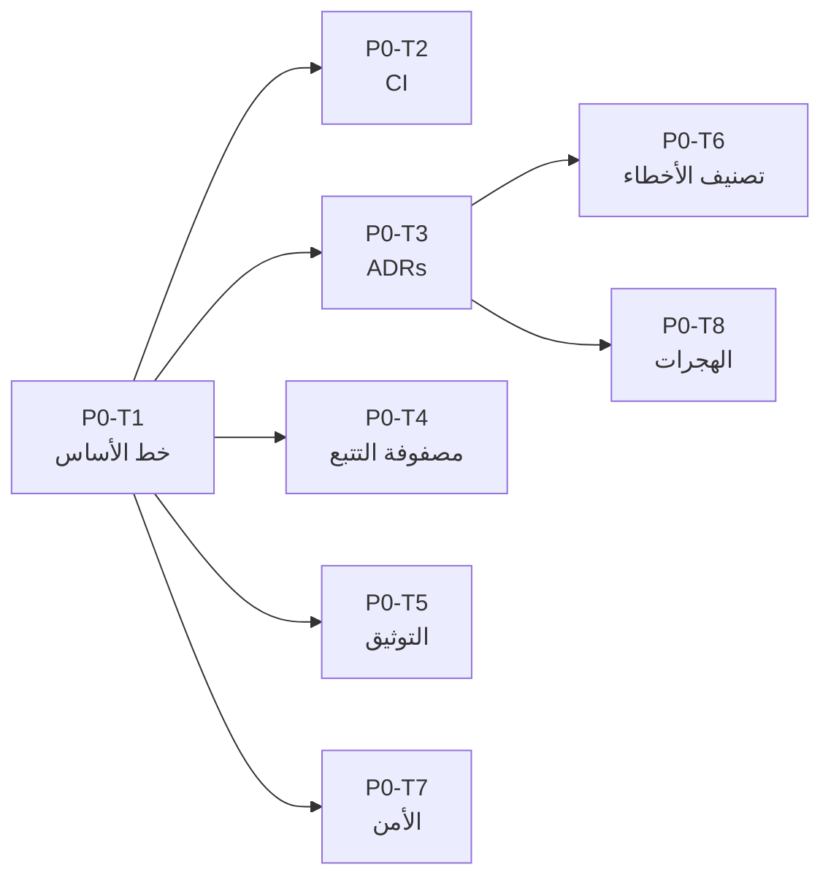

# المرحلة 0 — خط الأساس والحوكمة الهندسية

## Baseline, Verification Harness & Engineering Governance

**المرحلة:** 0 من 5  
**التبعية:** لا تبدأ قبل اعتماد هذه الوثيقة.  
**البوابة:** `G0 — Baseline & Governance`  
**المالك:** `ARCH` + `QA` + `SRE`  
**الهدف الاستراتيجي:** تثبيت خط أساس موثوق، وبناء أدوات إثبات قابلة للتكرار، وتحديد القرارات المعمارية الملزمة قبل أي إصلاح وظيفي.

> **حالة التنفيذ (2026-11-12):** جميع مهام `P0-T1`…`P0-T8` لها مخرجات وأدلة. بوابة `G0` مكتملة باستثناء بند واحد خارجي: تفعيل **إلزامية CI وحماية الفرع** على GitHub. المستودع خاص على خطة مجانية، وGitHub يرفض `branch protection` و`rulesets` (HTTP 403). الملف `.github/workflows/ci.yml` يعمل على كل `push`/`pull_request`، لكن منع الدمج تقنياً يتطلب ترقية الخطة أو مستودعاً عاماً، ثم تطبيق الخطوات في [`ci.md`](./ci.md) §7.

---

## 1. لماذا هذه المرحلة أولاً؟

الفجوات المكتشفة في المراحل 1–4 ليست أخطاء صياغة يمكن إصلاحها بالتخمين. هي **فجوات سلوك تحت ظروف الفشل والتزامن**. وإصلاحها دون خط أساس ثابت يؤدي إلى:

- عدم القدرة على إثبات أن الإصلاح لم يكسر سلوكاً قائماً.
- تكرار النقاش حول ادعاءات قديمة (مثل سباق `RateRegistry` أو `embed.FS` التي عولجت بالفعل).
- اختلاف سلوك Memory وPostgreSQL دون اكتشافه.
- غياب قرارات معمارية موثقة تُحسم عندها الخلافات.

لذلك تُثبّت المرحلة 0 **الحقيقة القابلة للقياس** أولاً: ماذا يعمل الآن، وكيف نثبت أنه يعمل، وكيف نمنع الانحدار.

---

## 2. نطاق المرحلة

### داخل النطاق

- تشغيل خط الأساس وتوثيق بيئته.
- بناء بوابات CI إلزامية.
- إنشاء ADRs للقرارات الحرجة.
- بناء مصفوفة تتبع `GAP → Test`.
- تصحيح التوثيق المضلل.
- توحيد المصطلحات والأخطاء والمراقبة الأساسية.
- تثبيت سياسة الهجرات والتوافق الخلفي.

### خارج النطاق

- أي إصلاح وظيفي في منطق الترحيل أو المعايير (المراحل 1–3).
- أي ميزة ERP جديدة (المرحلة 5).
- تغيير واجهات التخزين العامة دون ADR.

---

## 3. المخرجات الإلزامية

| المخرج | الوصف | المالك |
| --- | --- | --- |
| `docs/baseline_report.md` | تقرير خط الأساس: الإصدار، الأوامر، النتائج، مدة الاختبارات، تغطية | `QA` |
| `.github/workflows/ci.yml` أو ما يعادله | خط CI كامل | `SRE` |
| `docs/adr/ADR-0001..0005` | قرارات معمارية ملزمة | `ARCH` |
| `docs/traceability_matrix.md` | ربط كل `GAP` باختبار فاشل/ناجح | `QA` |
| تحديث `docs/README.md` | إزالة المراجع المفقودة وإضافة `index.md` | `DOC` |
| `docs/error_taxonomy.md` | تصنيف أخطاء موحد | `LEDGER` + `SRE` |
| `docs/migration_policy.md` | سياسة Expand/Contract والتراجع | `DBA` |

---

## 4. المهام

### P0-T1 — تثبيت خط الأساس وإعادة إنتاج النتائج

| الحقل | القيمة |
| --- | --- |
| **الدور** | `QA` + `SRE` |
| **الهدف** | إثبات أن الحالة الحالية قابلة للتشغيل بنفس النتائج على بيئة نظيفة، وتوثيق كل ما يلزم لإعادة ذلك. |
| **المشكلة التي تحلها** | غياب مرجع ثابت يجعل أي إصلاح لاحق غير قابل للإثبات، ويسمح بتكرار ادعاءات قديمة. |
| **النطاق** | `go.mod`, `go.sum`, جميع الحزم، متغيرات بيئة PostgreSQL، أوامر التشغيل. |
| **الاعتماديات** | لا شيء. |
| **مجموعة التوازي** | `W0` — تبدأ أولاً ولا تتوازى معها مهمة أخرى. |

**خطوات التنفيذ:**

1. سجّل SHA الالتزام الحالي، وإصدار Go، ونظام التشغيل، وإصدار PostgreSQL.
2. شغّل `go version` و`go env` واحفظهما في التقرير.
3. شغّل `go test ./...` وسجّل النتيجة لكل حزمة والزمن.
4. شغّل `go test -race ./...` وسجّل أي سباقات أو مدة غير مقبولة.
5. شغّل اختبارات تكامل PostgreSQL مع متغيرات البيئة الموثقة، وسجّل أسماء قواعد البيانات المؤقتة وسياسة التنظيف.
6. أنشئ جدولاً بعدد ملفات الاختبار ودوال الاختبار لكل حزمة.
7. أضف قسم "كيف تعيد إنتاج هذا التقرير" بأوامر نسخ/لصق.
8. اربط التقرير بـ`docs/index.md`.

**معايير القبول للمهمة التالية:**

- [x] `docs/baseline_report.md` موجود ويحتوي SHA وإصدار Go وإصدار PostgreSQL.
- [x] جميع نتائج `go test ./...` موثقة (PASS/FAIL لكل حزمة).
- [x] `go test -race ./...` موثق، وأي سباق معروف مذكور بمساره.
- [x] اختبارات تكامل PostgreSQL موثقة أو موثق سبب تعذرها.
- [x] أوامر إعادة الإنتاج تعمل من نسخة نظيفة.
- [x] لا توجد تغييرات كود في هذه المهمة.

**أدلة الإثبات:** مخرجات الأوامر محفوظة، جدول الحزم، رابط التقرير.

---

### P0-T2 — بناء بوابات CI إلزامية

| الحقل | القيمة |
| --- | --- |
| **الدور** | `SRE` + `QA` |
| **الهدف** | منع دمج أي تغيير يكسر البناء أو الاختبارات أو التنسيق أو التهجير. |
| **المشكلة التي تحلها** | الاعتماد على التشغيل اليدوي يسمح بمرور انحدارات إلى الفرع الرئيسي. |
| **النطاق** | خط CI، خدمات PostgreSQL للاختبار، التغطية، الفحص الأمني الأولي. |
| **الاعتماديات** | `P0-T1`. |
| **مجموعة التوازي** | `W1`. |

**خطوات التنفيذ:**

1. أنشئ خطاً يشغّل: `gofmt -l`, `go vet ./...`, `go build ./...`, `go test ./...`.
2. أضف مهمة `go test -race ./...` (يمكن تشغيلها بالتوازي مع الاختبارات العادية).
3. أضف خدمة PostgreSQL وإعداد متغيرات البيئة لاختبارات التكامل.
4. أضف فحص تغطية بحد أدنى مبدئي (لا يقل عن القيمة الحالية) ومنع الانخفاض.
5. أضف `govulncheck` أو مكافئه، و`gosec` إن توفر.
6. أضف فحصاً يمنع الهجرات غير المتوافقة (مثل حذف عمود دون مرحلة Contract).
7. اجعل الخط إلزامياً على `main` وفروع الإصدار.
8. وثّق كيفية تشغيل الخط محلياً.

**معايير القبول للمهمة التالية:**

- [ ] خط CI موجود ويعمل على فرع تجريبي. **ملاحظة:** الملف مكتمل ومُتحقق محلياً، لكن لا يمكن إثبات تشغيله على فرع تجريبي قبل الالتزام/الدفع.
- [ ] فشل `gofmt` أو `vet` أو الاختبارات يمنع الدمج. **حاجز خارجي:** المستودع خاص على خطة GitHub مجانية؛ تفعيل `branch protection`/`rulesets` يتطلب GitHub Pro أو مستودعاً عاماً. الخط يعمل على كل PR، لكنه غير إلزامي تقنياً حتى يُفعَّل الإعداد أو تُرقّى الخطة. الخطوات موثقة في [`ci.md`](./ci.md) §7.
- [x] اختبارات PostgreSQL تعمل في CI أو يوجد Skip موثق بسبب البيئة.
- [x] `-race` يعمل في CI.
- [x] التغطية لا تنخفض عن خط الأساس.
- [x] `docs/baseline_report.md` يذكر رابط الخط.

**أدلة الإثبات:** لقطة من تشغيل ناجح، لقطة من تشغيل فاشل متعمد، ملف الإعداد.

---

### P0-T3 — قرارات المعمارية الملزمة (ADRs)

| الحقل | القيمة |
| --- | --- |
| **الدور** | `ARCH` + `SME` |
| **الهدف** | حسم القرارات التي ستُبنى عليها المراحل 1–5 قبل كتابة الكود. |
| **المشكلة التي تحلها** | الخلافات المتكررة حول الذرّية، الفشل المغلق، حدود الوحدات، وسياسة الفترات. |
| **النطاق** | `docs/adr/`، القرارات التالية على الأقل. |
| **الاعتماديات** | `P0-T1`. |
| **مجموعة التوازي** | `W1`. |

**القرارات المطلوبة:**

| ADR | الموضوع | القرار المطلوب |
| --- | --- | --- |
| `ADR-0001` | Period State Machine | الحالات المسموحة، من يملك إعادة الفتح، وهل يُسمح بـ`hard → open` أبداً |
| `ADR-0002` | Fail-Closed Governance | هل `StrictGovernance` إلزامي في الإنتاج؟ وكيف يُفرض عند الإقلاع؟ |
| `ADR-0003` | Atomic Posting Boundary | أين تُقفل الفترة؟ وما عقد `PostingStoragePort` الجديد؟ |
| `ADR-0004` | Approval Fingerprint | ما الحقول الملزمة في `EntryContentHash` و`DraftContentMatches`؟ |
| `ADR-0005` | Storage Parity & Migrations | كيف نضمن تطابق Memory/PostgreSQL؟ وسياسة Expand/Contract |
| `ADR-0006` | Module Boundaries for ERP | كيف تُضاف وحدات المخزون/الرواتب دون كسر النواة؟ |

**خطوات التنفيذ:**

1. اكتب لكل ADR: السياق، القرار، البدائل، النتائج، المخاطر، تاريخ المراجعة.
2. اربط كل ADR بالفجوات والمهام التي يعنيه.
3. راجع مع `SME` للقرارات المحاسبية ومع `DBA` لقرارات التخزين.
4. اعتمد ADRs في اجتماع مراجعة معمارية.
5. أضف فهرس ADRs إلى `docs/index.md`.

**معايير القبول للمهمة التالية:**

- [x] ADR-0001..0006 موجودة ومعتمدة.
- [x] كل ADR يذكر البدائل المرفوضة وسبب الرفض.
- [x] `ADR-0001` يحدد صراحةً سياسة إعادة فتح الفترة المقفلة نهائياً.
- [x] `ADR-0002` يحدد سلوك الإقلاع عند غياب سياسة الشركة.
- [x] `ADR-0003` يحدد توقيت قفل صف الفترة داخل المعاملة.
- [x] `ADR-0004` يسرد كل حقل مؤثر محاسبياً.
- [x] `ADR-0006` يحدد عقد الوحدة الجديدة وحدود التكامل.

**أدلة الإثبات:** ملفات ADR، محضر المراجعة، روابط المهام.

---

### P0-T4 — مصفوفة تتبع الفجوات والاختبارات

| الحقل | القيمة |
| --- | --- |
| **الدور** | `QA` + `LEDGER` |
| **الهدف** | تحويل كل فجوة إلى اختبار فاشل محدد قبل الإصلاح. |
| **المشكلة التي تحلها** | إصلاحات بلا اختبار فشل مسبق لا تثبت أن الفجوة كانت حقيقية ولا تمنع الانحدار. |
| **النطاق** | `docs/traceability_matrix.md` + اختبارات `_test.go` الجديدة. |
| **الاعتماديات** | `P0-T1`, `P0-T3`. |
| **مجموعة التوازي** | `W1`. |

**خطوات التنفيذ:**

1. أنشئ جدولاً: `GAP ID`، الوصف، الملف/الدالة، الاختبار المقترح، نوع الاختبار (وحدة/تكامل/سباق/فشل)، الحالة.
2. اكتب لكل فجوة `Critical/High` اختباراً فاشلاً (أو موثقاً كـ`t.Skip` مع سبب) قبل الإصلاح.
3. حدد الاختبارات التي تحتاج PostgreSQL وأضفها لوسم تكامل واضح.
4. حدد الاختبارات التي تحتاج `-race`.
5. اربط الاختبارات بأسماء واضحة تشير إلى `GAP ID`.
6. راجع المصفوفة مع `ARCH` قبل بدء المرحلة 1.

**معايير القبول للمهمة التالية:**

- [x] كل فجوة `Critical` و`High` لها اختبار واحد على الأقل.
- [x] الاختبارات الجديدة تفشل على الكود الحالي (أو `Skip` مبرر).
- [x] لا يوجد اختبار يعتمد على ترتيب تنفيذ غير محدد.
- [x] اختبارات PostgreSQL موسومة وتُشغَّل في CI.
- [x] المصفوفة مدمجة في `docs/index.md`.

**أدلة الإثبات:** ملف المصفوفة، مخرجات تشغيل الاختبارات الفاشلة.

---

### P0-T5 — تصحيح التوثيق المضلل

| الحقل | القيمة |
| --- | --- |
| **الدور** | `DOC` + `ARCH` |
| **الهدف** | جعل `docs/` صادقاً وقابلاً للاستخدام، وإزالة المراجع المفقودة. |
| **المشكلة التي تحلها** | `docs/README.md` يشير إلى ملفات غير موجودة، ما يضلل المهندسين والمراجعين. |
| **النطاق** | `docs/README.md` والوثائق المرتبطة فقط. **لا تُعدَّل الوثائق المعدلة من المستخدم دون مراجعة.** |
| **الاعتماديات** | `P0-T1`. |
| **مجموعة التوازي** | `W1`. |

**خطوات التنفيذ:**

1. افحص كل رابط في `docs/README.md` وتأكد من وجود الملف.
2. أزل أو أنشئ الملفات المفقودة: `engine_errors_analysis.md`, `engine_problems_verification_and_standards_compliance.md`, `testing_confidence_report.md`, `remediation_execution_plan.md`, `remediation_execution_report.md`.
3. أضف `docs/index.md` كخطة المعالجة الرسمية.
4. ميّز بوضوح بين الوثائق التاريخية والوثائق الملزمة الحالية.
5. أضف تاريخاً وحالة لكل وثيقة (`نشطة` / `مؤرشفة` / `مسودة`).
6. لا تحذف تعديلات المستخدم غير المحفوظة؛ استخدم فروعاً أو ملاحظات.

**معايير القبول للمهمة التالية:**

- [x] لا رابط مكسور في `docs/README.md`.
- [x] `docs/index.md` مذكور في الفهرس.
- [x] كل وثيقة لها حالة وتاريخ.
- [x] الوثائق التاريخية موسومة بوضوح.
- [x] لا تعارض بين `index.md` والوثائق النشطة.

**أدلة الإثبات:** تقرير فحص الروابط، فرق التغيير.

---

### P0-T6 — تصنيف الأخطاء والمراقبة الأساسية

| الحقل | القيمة |
| --- | --- |
| **الدور** | `LEDGER` + `SRE` |
| **الهدف** | توحيد الأخطاء والقرارات المرتبطة بها، وتجهيز إشارات مراقبة أولية. |
| **المشكلة التي تحلها** | الأخطاء الحالية متفرقة، وبعضها يُعاد تعريفه في حزم متعددة، ما يصعّب التتبع والتشغيل. |
| **النطاق** | `internal/*/errors`, `internal/observability`, `docs/error_taxonomy.md`. |
| **الاعتماديات** | `P0-T3`. |
| **مجموعة التوازي** | `W1`. |

**خطوات التنفيذ:**

1. اجرد الأخطاء الحرجة: فترة مقفلة، قيد غير متوازن، اعتماد مطلوب، تعارض نسخة، فشل ذرّية.
2. وحّد التصنيف: `validation`, `conflict`, `authorization`, `infrastructure`, `invariant`.
3. أضف رموزاً ثابتة (error codes) قابلة للتسجيل.
4. تأكد أن كل خطأ مالي حرج يُسجَّل مع `company_id`, `entry_id`, `period_id`, `trace_id`.
5. أضف عدادات أساسية: عدد محاولات الترحيل، الفشل حسب النوع، مدة المعاملة.
6. وثّق التصنيف في `docs/error_taxonomy.md`.

**معايير القبول للمهمة التالية:**

- [x] كل خطأ مالي حرج له رمز وتصنيف.
- [x] لا تكرار لتعريف نفس الخطأ في أكثر من حزمة دون alias موثق.
- [x] السجلات تحتوي معرفات التتبع الأساسية.
- [x] العدادات تظهر في `/metrics`.
- [x] الوثيقة معتمدة من `SRE`.

**أدلة الإثبات:** قائمة الأخطاء، لقطة `/metrics`, الوثيقة.

---

### P0-T7 — خط أساس الأمن وعزل المستأجرين

| الحقل | القيمة |
| --- | --- |
| **الدور** | `SEC` + `DBA` |
| **الهدف** | إثبات أن عزل الشركات (Multi-Tenancy) يعمل، وتحديد الفجوات قبل الإنتاج. |
| **المشكلة التي تحلها** | أي تسرب بين الشركات في نظام مالي هو عيب حرج لا يُكتشف بالاختبارات الوظيفية. |
| **النطاق** | `storage/postgres/rls_test.go`, `rls`, `governance`, الأسرار. |
| **الاعتماديات** | `P0-T1`. |
| **مجموعة التوازي** | `W1`. |

**خطوات التنفيذ:**

1. شغّل اختبارات RLS الحالية ووثّق نتيجتها.
2. أضف اختبارات محاولة قراءة/كتابة عبر الشركات لكل جدول مالي رئيسي.
3. تحقق من أن كل استعلام يمر عبر `company_id` أو RLS.
4. افحص الأسرار في المستودع (`git secrets` أو مكافئ).
5. أضف `govulncheck` إلى CI.
6. أعدّ قائمة مخاطر أمنية مرتبة حسب الخطورة.

**معايير القبول للمهمة التالية:**

- [x] اختبارات RLS تمر أو الفشل موثق مع خطة إصلاح.
- [x] لا أسرار مكشوفة في المستودع.
- [x] فحص الثغرات يعمل في CI.
- [x] قائمة المخاطر الأمنية موجودة ومصنفة.
- [x] كل جدول مالي رئيسي مغطى باختبار عزل.

**أدلة الإثبات:** تقرير RLS، مخرجات الفحص، قائمة المخاطر.

---

### P0-T8 — سياسة الهجرات والتوافق الخلفي

| الحقل | القيمة |
| --- | --- |
| **الدور** | `DBA` + `ARCH` |
| **الهدف** | ضمان أن كل تغيير في قاعدة البيانات قابل للنشر والتراجع دون توقف أو فقدان بيانات. |
| **المشكلة التي تحلها** | التغييرات المباشرة على الجداول المالية قد تسبب توقفاً أو فساداً في الإنتاج. |
| **النطاق** | `storage/postgres/migrations`, `docs/migration_policy.md`. |
| **الاعتماديات** | `P0-T3`. |
| **مجموعة التوازي** | `W1`. |

**خطوات التنفيذ:**

1. وثّق نمط Expand/Contract: إضافة عمود → تعبئة → تبديل قراءة → إزالة.
2. حدد قواعد الهجرات غير المتوافقة (حذف عمود، تغيير نوع، قيد جديد على بيانات قائمة).
3. أضف فحصاً آلياً يرفض الهجرات الخطرة دون موافقة.
4. وثّق سياسة النسخ الاحتياطي قبل الهجرة والتراجع.
5. أضف اختبار هجرة من نسخة سابقة إلى الحالية.
6. وثّق إجراء الطوارئ عند فشل الهجرة.

**معايير القبول للمهمة التالية:**

- [x] `docs/migration_policy.md` معتمد.
- [x] اختبار الترقية من نسخة سابقة يمر.
- [x] فحص الهجرات الخطرة يعمل.
- [x] كل هجرة جديدة لها خطة تراجع.
- [x] لا هجرة تحذف بيانات دون أرشفة.

**أدلة الإثبات:** وثيقة السياسة، اختبار الهجرة، سجل المراجعة.

---

## 5. ترتيب التنفيذ والتوازي

| الموجة | المهام | ملاحظة |
| --- | --- | --- |
| W0 | `P0-T1` | إلزامية أولاً |
| W1 | `P0-T2`, `P0-T3`, `P0-T4`, `P0-T5`, `P0-T7` | متوازية بعد `P0-T1` |
| W1b | `P0-T6`, `P0-T8` | بعد `P0-T3` |

---

## 6. بوابة الجودة G0

لا تُغلق المرحلة 0 إلا بتحقق:

- [x] `go test ./...` و`go test -race ./...` يمران أو الفشل موثق بخطة.
- [ ] CI إلزامي ويحجب الدمج عند الفشل. **حاجز خارجي:** GitHub يرفض حماية الفرع للمستودعات الخاصة على الخطة المجانية (HTTP 403). المطلوب: ترقية الخطة/جعل المستودع عاماً/استخدام مدير فروع مؤسسي، ثم تطبيق الخطوات في [`ci.md`](./ci.md) §7.
- [x] ADR-0001..0006 معتمدة.
- [x] كل فجوة `Critical/High` لها اختبار فاشل أو `Skip` مبرر.
- [x] `docs/README.md` بلا روابط مكسورة و`index.md` مذكور.
- [x] تصنيف الأخطاء موحد ومراقب.
- [x] تقرير RLS موجود.
- [x] سياسة الهجرات معتمدة.

---

## 7. المخاطر الخاصة بالمرحلة

| المخاطرة | التخفيف |
| --- | --- |
| اختبارات التكامل غير متاحة في CI | خدمة PostgreSQL مؤقتة + وسم `integration` + تشغيل ليلي |
| ADRs تتحول إلى وثائق نظرية | ربط كل ADR بمهمة واختبار قبول |
| مصفوفة التتبع تتضخم | معرّفات ثابتة ومراجعة أسبوعية |
| تعديل توثيق المستخدم بالخطأ | العمل على فرع + مراجعة الفروق قبل الدمج |

---

## 8. تعريف إنجاز المرحلة

المرحلة 0 منجزة عندما يستطيع مهندس جديد، من نسخة نظيفة، تشغيل الاختبارات، وفهم القرارات المعمارية، ورؤية كل فجوة مربوطة باختبار، دون الرجوع إلى تقرير الوكيل السابق.
