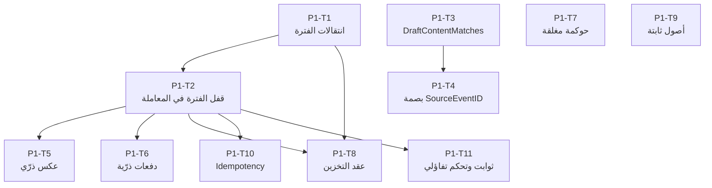

# المرحلة 1 — نزاهة دفتر الأستاذ الأساسي

## Core Ledger Integrity: Atomic Posting, Period Locking & Approval Binding

**المرحلة:** 1 من 5  
**التبعية:** إغلاق `G0` (`P0-T1`, `P0-T3`, `P0-T4`).  
**البوابة:** `G1 — Ledger Integrity`  
**المالك:** `LEDGER` + `DBA` + `QA`  
**الهدف الاستراتيجي:** ضمان أن كل قيد يُرحَّل مرة واحدة، إلى فترة صحيحة، بمحتوى معتمد، وبشكل ذرّي، تحت أي تزامن أو إعادة محاولة.

---

## 1. جوهر المشكلة

المحرك الحالي يتحقق من معظم القواعد في طبقة `internal/posting`، لكن **قرار الترحيل النهائي** يقع في طبقة التخزين. وبين التحقق والكتابة توجد نافذة زمنية (Time-of-Check to Time-of-Use) يمكن أن تتغير فيها حالة الفترة، أو محتوى القيد، أو حالة الأصل. النتيجة:

- قيد قد يُرحَّل إلى فترة أُقفلت بعد التحقق.
- قيد قد يُعدَّل بعد الاعتماد دون اكتشاف.
- عكس قد يُنشئ قيداً لا يطابق الأصل.
- دفعة قد تُرحَّل جزئياً عند الفشل.
- استهلاك أصل قد يتكرر مرتين.

هذه المرحلة تغلق هذه النافذة **داخل حدود المعاملة**، وتجعل الفشل مغلقاً.

---

## 2. نطاق المرحلة

### داخل النطاق

- `internal/posting/entry.go`, `content_hash.go`, `engine.go`, `reversal.go`, `bulk.go`
- `storage/postgres/posting.go`, `storage/postgres/masterdata.go`
- `storage/memory/posting.go`, `storage/memory/masterdata.go`
- `internal/masterdata/fiscal_calendar.go`, `context_repository_adapter.go`
- `internal/subledgers/fixed_assets.go` (الملحقات الذرّية)
- `internal/governance/approval_gate.go` + ربط `engine.go`
- اختبارات العقد بين التخزينات

### خارج النطاق

- إقفال السنة المالية (المرحلة 2).
- قواعد IAS 12 / IFRS 16 / IFRS 9 (المرحلة 3).
- واجهات الخدمة والتشغيل (المرحلة 4).

---

## 3. المهام

### P1-T1 — فرض انتقالات حالة الفترة في PostgreSQL

| الحقل | القيمة |
| --- | --- |
| **الدور** | `DBA` + `LEDGER` |
| **الهدف** | منع أي انتقال غير صالح لحالة الفترة، وإغلاق ثغرة إعادة فتح فترة مقفلة نهائياً. |
| **المشكلة التي تحلها** | `storage/postgres/masterdata.go::UpdatePeriodState` ينفذ `UPDATE` مباشراً دون `ValidatePeriodTransition`، بينما Memory وMock يفرضانها. هذا يسمح بـ`hard → open` و`open → hard` مباشرة. |
| **الفجوة** | `GAP-GOV-01` |
| **الاعتماديات** | `P0-T3` (ADR-0001). |
| **مجموعة التوازي** | `W2`. |

**خطوات التنفيذ:**

1. أضف اختبار تكامل PostgreSQL يفشل حالياً: `UpdatePeriodState(hard → open)` يجب أن يعيد خطأ.
2. أضف اختباراً لـ`open → hard` المباشر (يجب أن يفشل أو يمر بخطوتين فقط حسب ADR-0001).
3. عدّل `UpdatePeriodState` ليقرأ الحالة الحالية بـ`SELECT ... FOR UPDATE` داخل نفس المعاملة.
4. استدعِ `masterdata.ValidatePeriodTransition(period.State, state)` قبل التحديث.
5. أضف تحققاً من وجود الفترة ومن نطاق الشركة.
6. أضف تحققاً من `closed_at`: لا يُعاد ضبطه إلا وفق سياسة إعادة الفتح المعتمدة.
7. أضف حدث تدقيق `period.state_changed` مع الحالة السابقة واللاحقة والمستخدم.
8. طبّق نفس القواعد على `UpdatePeriodStateForCompanyContext`.
9. أضف اختبار عقد يقارن سلوك Memory وPostgreSQL وMock.

**معايير القبول للمهمة التالية:**

- [ ] اختبار `hard → open` يفشل قبل الإصلاح ويمر بعده.
- [ ] اختبار `open → hard` المباشر يفشل (أو يمر وفق ADR-0001 فقط).
- [ ] `UpdatePeriodState` يستخدم `SELECT ... FOR UPDATE` داخل المعاملة.
- [ ] لا يمكن تحديث فترة شركة أخرى.
- [ ] حدث التدقيق مسجل ويحتوي الحالة السابقة واللاحقة.
- [ ] اختبار العقد بين التخزينات يمر.
- [ ] لا تغيير في واجهة `ContextStorageRepository` العامة دون ADR.

**أدلة الإثبات:** اختبار فاشل/ناجح، سجل التدقيق، تقرير العقد.

---

### P1-T2 — قفل وإعادة التحقق من الفترة داخل معاملة الترحيل

| الحقل | القيمة |
| --- | --- |
| **الدور** | `LEDGER` + `DBA` |
| **الهدف** | ضمان أن القيد لا يُرحَّل إلا إذا كانت الفترة ما زالت مفتوحة/مسموحة في لحظة الكتابة. |
| **المشكلة التي تحلها** | `prepareForPosting` يتحقق من الفترة عبر قراءة منفصلة، ثم تُفتح معاملة الكتابة لاحقاً. يمكن لإقفال متزامن أن يمر بينهما. |
| **الفجوة** | `GAP-PST-01`, `GAP-PST-09` |
| **الاعتماديات** | `P1-T1`. |
| **مجموعة التوازي** | `W3`. |

**خطوات التنفيذ:**

1. أضف اختبار تكامل: ابدأ ترحيلاً، أوقفه قبل الكتابة، اقفل الفترة في معاملة أخرى، ثم أكمل — يجب أن يفشل الترحيل.
2. في `PostAndSequenceContext` و`PostWithAttachmentsContext`، أضف داخل المعاملة:
   - `SELECT state, start_date, end_date FROM fiscal_periods WHERE company_id=$1 AND id=$2 FOR UPDATE`.
   - تحقق من أن `entry.EntryDate` داخل النطاق.
   - تحقق من الحالة وفق سياسة الترحيل (مفتوحة/مقفلة بمرونة).
3. في `PostReversalAtomicContext`، أضف نفس القفل والتحقق لفترة القيد العكسي.
4. في `PostBulk`، أضف قفل جميع الفترات المعنية بترتيب ثابت (مرتب حسب `id`) لتجنب الجمود.
5. أعد استخدام دالة مشتركة `lockAndValidatePeriodTx(ctx, tx, companyID, periodID, date)`.
6. لا تعتمد على `entry.PeriodID` فقط؛ تحقق من `entry.EntryDate` أيضاً.
7. أضف اختبار سباق `-race` واختبار جمود (deadlock) لدفعتين متعاكستين.
8. وثّق ترتيب الأقفال في ADR-0003.

**معايير القبول للمهمة التالية:**

- [ ] اختبار "إقفال الفترة أثناء الترحيل" يفشل قبل الإصلاح ويمر بعده.
- [ ] كل مسارات الترحيل (فردي، مع ملحق، عكس، دفعة) تقفل الفترة داخل المعاملة.
- [ ] لا يمكن ترحيل قيد بتاريخ خارج نطاق الفترة.
- [ ] لا يمكن ترحيل قيد إلى فترة مقفلة نهائياً.
- [ ] اختبار الجمود يمر دون `deadlock detected`.
- [ ] ترتيب الأقفال موثق ومطبق.
- [ ] اختبارات Memory وPostgreSQL متطابقة.

**أدلة الإثبات:** اختبار التزامن، سجل `EXPLAIN` للأقفال، تقرير `-race`.

---

### P1-T3 — توسيع `DraftContentMatches` ليشمل كل الحقول المؤثرة

| الحقل | القيمة |
| --- | --- |
| **الدور** | `LEDGER` + `QA` |
| **الهدف** | منع تغيير أي حقل محاسبي بين اعتماد المسودة وترحيلها. |
| **المشكلة التي تحلها** | `DraftContentMatches` يقارن التاريخ والمرجع والتصنيف والأسطر، لكنه يغفل `PeriodID`, `TargetPeriodNumber`, `AdjustmentAuthorized`, `OriginalEntryID`. يمكن تغيير فترة القيد أو تفويض فترة التعديل بعد الاعتماد. |
| **الفجوة** | `GAP-PST-02` |
| **الاعتماديات** | `P0-T3` (ADR-0004). |
| **مجموعة التوازي** | `W2`. |

**خطوات التنفيذ:**

1. أضف اختبارات وحدة تفشل حالياً:
   - تغيير `PeriodID` بعد الاعتماد → يجب أن يفشل الترحيل.
   - تغيير `TargetPeriodNumber` من 0 إلى 13 → يجب أن يفشل.
   - تغيير `AdjustmentAuthorized` من `false` إلى `true` → يجب أن يفشل.
   - تغيير `OriginalEntryID` → يجب أن يفشل.
2. أضف الحقول إلى `DraftContentMatches` مع مقارنة آمنة للمؤشرات.
3. أضف مقارنة `SourceEventID` إن كان موجوداً (تنسيق مع `P1-T4`).
4. أضف مقارنة `FunctionalCurrency`/`AmountCurrency` إن كانت مؤثرة.
5. أضف دالة `accountingSignificantFields` مركزية تُستخدم في `DraftContentMatches` و`EntryContentHash` لتجنب التباعد.
6. أضف اختبار "كل حقل في `JournalEntry` إما مؤثر ومقارن أو موثق كغير مؤثر".
7. وثّق القائمة في ADR-0004.

**معايير القبول للمهمة التالية:**

- [ ] الاختبارات الأربعة تفشل قبل الإصلاح وتمر بعده.
- [ ] `DraftContentMatches` يقارن كل حقل مؤثر محاسبياً.
- [ ] توجد دالة مركزية واحدة للحقول المؤثرة.
- [ ] لا حقل مؤثر غير مغطى دون تعليق مبرر.
- [ ] اختبار الانحدار يمنع إضافة حقل جديد دون تحديث المقارنة.

**أدلة الإثبات:** اختبارات الوحدة، ADR-0004، قائمة الحقول.

---

### P1-T4 — ربط بصمة الاعتماد بـ`SourceEventID`

| الحقل | القيمة |
| --- | --- |
| **الدور** | `LEDGER` + `QA` |
| **الهدف** | منع اعتماد قيد ثم استبدال أصله/حدثه المصدر قبل الترحيل. |
| **المشكلة التي تحلها** | `EntryContentHash` يغطي الفترة والتصنيف والتفويض لكنه لا يغطي `SourceEventID`، فيمكن أن تتغير هوية الحدث المصدر دون كسر البصمة. |
| **الفجوة** | `GAP-PST-03` |
| **الاعتماديات** | `P0-T3` (ADR-0004). |
| **مجموعة التوازي** | `W2`. |

**خطوات التنفيذ:**

1. أضف اختباراً: احسب البصمة، غيّر `SourceEventID`، أعد الحساب — يجب أن تختلف.
2. أضف `SourceEventID` إلى `entryHashPayload`.
3. أضف اختبار توافق: البصمة القديمة لا تُستخدم للاعتماد بعد الترقية؛ وثّق سياسة إبطال الاعتمادات القديمة.
4. أضف اختبار "نفس القيد بنفس الحقول = نفس البصمة" و"أي حقل مؤثر مختلف = بصمة مختلفة".
5. تأكد أن `EntryContentHash` لا يعتمد على ترتيب الخريطة أو الوقت الحالي.
6. أضف بصمة المحتوى إلى سجل التدقيق عند الاعتماد والترحيل.

**معايير القبول للمهمة التالية:**

- [ ] اختبار تغيير `SourceEventID` يفشل قبل الإصلاح ويمر بعده.
- [ ] البصمة حتمية عبر عمليات تشغيل مختلفة.
- [ ] كل حقل في `entryHashPayload` له مبرر محاسبي.
- [ ] سياسة الاعتمادات القديمة موثقة.
- [ ] سجل التدقيق يحتوي البصمة.

**أدلة الإثبات:** اختبارات البصمة، سياسة الترقية، سجل التدقيق.

---

### P1-T5 — جعل العكس ذرّياً ومُثبت التطابق

| الحقل | القيمة |
| --- | --- |
| **الدور** | `LEDGER` + `DBA` |
| **الهدف** | ضمان أن القيد العكسي يُنشأ ويُرحَّل ويُحدَّث الأصل في وحدة واحدة، وأنه عكس مطابق تماماً. |
| **المشكلة التي تحلها** | مسار `ReverseDualContext` الاحتياطي يحفظ المسودة، ثم يرحّل، ثم يحدّث الأصل — أي ثلاث كتابات منفصلة. ومسار PostgreSQL لا يثبت أن أسطر العكس هي مرآة الأصل. |
| **الفجوة** | `GAP-PST-04`, `GAP-PST-05` |
| **الاعتماديات** | `P1-T2`. |
| **مجموعة التوازي** | `W3`. |

**خطوات التنفيذ:**

1. أضف اختبار تكامل: افشل تحديث الأصل بعد ترحيل العكس — يجب ألا يبقى قيد عكسي مرتحل.
2. أضف اختباراً: قدّم قيد عكس لا يطابق الأصل (مبلغ/حساب/بعد) — يجب أن يُرفض.
3. في `PostReversalAtomicContext`، داخل المعاملة:
   - تحقق من `original.ID == *reversal.OriginalEntryID`.
   - تحقق من عدد الأسطر وتطابق الحسابات والأبعاد.
   - تحقق من `reversal.Debit == original.Credit` و`reversal.Credit == original.Debit` لكل سطر.
   - تحقق من العملة وسعر الصرف والمبالغ الوظيفية.
   - تحقق من الفترة وحالتها.
4. في المسار الاحتياطي، إما:
   - ألغِ الدعم واطلب `ContextAtomicReversalRepository` صراحةً، أو
   - استخدم معاملة تعويضية مع تسجيل `compensation_required` عند الفشل.
5. أضف اختبار "فشل الترحيل لا يترك مسودة يتيمة" و"فشل تحديث الأصل لا يترك عكساً".
6. أضف مفتاح idempotency للعكس (تنسيق مع `P1-T10`).

**معايير القبول للمهمة التالية:**

- [ ] اختبار الفشل الجزئي يمر (لا حالة وسيطة).
- [ ] العكس غير المطابق يُرفض.
- [ ] التحقق من التطابق يحدث داخل معاملة PostgreSQL.
- [ ] لا مسار احتياطي صامت غير ذرّي.
- [ ] اختبار إعادة المحاولة لا ينشئ عكساً مزدوجاً.
- [ ] `OriginalEntryID` و`ReversedEntryID` متسقان.

**أدلة الإثبات:** اختبارات الفشل، سجل المعاملة، تقرير التطابق.

---

### P1-T6 — ذرّية الترحيل الجماعي وإزالة المسار الصامت

| الحقل | القيمة |
| --- | --- |
| **الدور** | `LEDGER` + `DBA` |
| **الهدف** | ضمان أن الدفعة إما تُرحَّل كاملة أو لا شيء منها، وأن حل الفترة يحدث داخل المعاملة. |
| **المشكلة التي تحلها** | `PostBulkContext` يتراجع إلى ترحيل متسلسل عند غياب `BulkRepository`، و`postBulkAtomic` يستدعي `prepareForPosting` (وحل الفترة) قبل `repository.PostBulk`. |
| **الفجوة** | `GAP-PST-06`, `GAP-PST-07` |
| **الاعتماديات** | `P1-T2`. |
| **مجموعة التوازي** | `W3`. |

**خطوات التنفيذ:**

1. أضف اختباراً: افشل العنصر الأخير في الدفعة — يجب ألا يُرحَّل أي عنصر.
2. أضف اختباراً: اقفل فترة أحد العناصر أثناء الدفعة — يجب أن تفشل الدفعة كاملة.
3. اجعل `BulkRepository` إلزامياً في الإنتاج؛ أضف خياراً صريحاً `AllowNonAtomicBulk` للتطوير فقط.
4. انقل حل الفترة والتحقق منها إلى داخل معاملة `PostBulk` في طبقة التخزين.
5. أضف قفل فترات الدفعة بترتيب ثابت.
6. أضف تحققاً مسبقاً من توازن كل قيد قبل أي كتابة.
7. أضف حداً أقصى لحجم الدفعة مع خطأ واضح.
8. أضف اختبار إعادة المحاولة (idempotency) للدفعة.

**معايير القبول للمهمة التالية:**

- [ ] فشل أي عنصر يمنع ترحيل الجميع.
- [ ] لا يوجد تراجع صامت لترحيل متسلسل في الإنتاج.
- [ ] حل الفترة داخل معاملة الدفعة.
- [ ] ترتيب الأقفال ثابت ولا يسبب جموداً.
- [ ] حد الدفعة موثق ومختبر.
- [ ] إعادة المحاولة لا تكرر القيود.

**أدلة الإثبات:** اختبارات الذرّية، سجل الجمود، تقرير الأداء.

---

### P1-T7 — فرض الحوكمة المغلقة في الإنتاج

| الحقل | القيمة |
| --- | --- |
| **الدور** | `ARCH` + `SEC` + `LEDGER` |
| **الهدف** | جعل غياب سياسة الاعتماد سبباً للرفض في الإنتاج، لا للسماح. |
| **المشكلة التي تحلها** | `ApprovalGate.IsApproved` يعيد `true` عند غياب السياسة، و`StrictGovernance` موجود لكنه ليس الافتراضي ولا يُفرض عند الإقلاع. |
| **الفجوة** | `GAP-GOV-03`, `GAP-GOV-04` |
| **الاعتماديات** | `P0-T3` (ADR-0002). |
| **مجموعة التوازي** | `W2`. |

**خطوات التنفيذ:**

1. أضف اختباراً: `Config{StrictGovernance:false}` في بيئة إنتاج → يجب أن يفشل الإقلاع أو يحذر بشكل حاجب.
2. أضف حقل إعداد `Environment` (`development`/`production`) وحقل `GovernanceMode`.
3. اجعل `production + غير صارم` خطأ إقلاع واضحاً.
4. أضف تحققاً من وجود سياسة لكل شركة نشطة عند الإقلاع (أو تقرير فجوة).
5. أضف مسار ترحيل للعملاء القدامى: فترة سماح + تقرير + إشعار.
6. أضف اختباراً يثبت أن القيد فوق الحد لا يُرحَّل دون اعتماد مكتمل.
7. أضف تدقيقاً لكل محاولة ترحيل دون اعتماد.

**معايير القبول للمهمة التالية:**

- [ ] الإنتاج لا يبدأ بدون `StrictGovernance`.
- [ ] غياب سياسة شركة يمنع الترحيل برسالة واضحة.
- [ ] القيد فوق الحد يتطلب اعتماداً مكتملاً.
- [ ] محاولات التجاوز مسجلة.
- [ ] مسار الترقية موثق ومختبر.
- [ ] لا كسر للاختبارات الحالية في وضع التطوير.

**أدلة الإثبات:** اختبار الإقلاع، اختبار الترحيل، سجل التدقيق، دليل الترقية.

---

### P1-T8 — اختبارات عقد التخزين (Storage Parity)

| الحقل | القيمة |
| --- | --- |
| **الدور** | `QA` + `DBA` |
| **الهدف** | ضمان أن Memory وPostgreSQL وMock تتصرف بنفس القواعد في الحالات الحرجة. |
| **المشكلة التي تحلها** | الاختلاف الحالي في `UpdatePeriodState` يثبت أن السلوك يمكن أن يتباعد بين التخزينات دون اكتشاف. |
| **الفجوة** | عرضية — تدعم `GAP-GOV-01`, `GAP-PST-01` |
| **الاعتماديات** | `P1-T1`, `P1-T2`. |
| **مجموعة التوازي** | `W3`. |

**خطوات التنفيذ:**

1. أنشئ مجموعة اختبارات عقد موحدة تُشغَّل على كل تخزين.
2. غطِّ: انتقالات الفترة، الترحيل، العكس، الدفعات، الملحقات، الأقفال.
3. استخدم نفس السيناريوهات والنتائج المتوقعة.
4. أضف اختبارات سباق للنسختين.
5. وثّق أي اختلاف مقصود في ADR-0005.
6. اجعل اختبار العقد إلزامياً في CI.

**معايير القبول للمهمة التالية:**

- [ ] نفس السيناريو يعطي نفس النتيجة على Memory وPostgreSQL.
- [ ] الاختلافات المقصودة موثقة.
- [ ] اختبار العقد يعمل في CI.
- [ ] اختبارات السباق تعمل على النسختين.
- [ ] لا توجد حالة `skip` غير مبررة.

**أدلة الإثبات:** تقرير العقد، مصفوفة السيناريوهات، CI.

---

### P1-T9 — تحصين الملحقات الذرّية للأصول الثابتة

| الحقل | القيمة |
| --- | --- |
| **الدور** | `LEDGER` + `QA` |
| **الهدف** | منع استهلاك نفس الأصل مرتين، ومنع تحديث الأصل بمبلغ/تاريخ لا يطابق القيد. |
| **المشكلة التي تحلها** | `DepreciationAttachment.ValidateAttachment` يتحقق من المعرفات فقط، و`ExecuteAtomicMutation` يحدّث بلا نسخة متوقعة. الاختبار الحالي يستخدم أصلين مختلفين، فلا يكتشف التزامن على نفس الأصل. |
| **الفجوة** | `GAP-AST-01`…`GAP-AST-04` |
| **الاعتماديات** | `P0-T3` (ADR-0003). |
| **مجموعة التوازي** | `W2`. |

**خطوات التنفيذ:**

1. أضف اختبار سباق على **نفس الأصل**: ترحيلان متزامنان — يجب أن ينجح واحد فقط.
2. أضف اختباراً: قيد بمبلغ لا يطابق `DepreciationAttachment.Amount` → يُرفض.
3. أضف اختباراً: تاريخ `AsOf` لا يطابق القيد → يُرفض.
4. أضف اختباراً: أصل غير موجود/موقوف/مستنفد → يُرفض.
5. أضف `ExpectedVersion` أو `ExpectedBookValue`/`ExpectedLastDepreciationDate` إلى الملحق.
6. في `ExecuteAtomicMutation`، استخدم `UPDATE ... WHERE id=$1 AND company_id=$2 AND version=$3` أو تحقق من الحالة المتوقعة.
7. أضف `ValidateAttachment` للتحقق من:
   - تطابق الشركة.
   - تطابق المبلغ مع مجموع سطور المصروف.
   - تطابق التاريخ.
   - أن الأصل يستحق الاستهلاك في الفترة.
   - أن الجدول الزمني يسمح بهذا المبلغ.
8. طبّق نفس النمط على `fixedAssetOperationAttachment` إن لزم.
9. أضف اختبار إعادة المحاولة (نفس الشهر) → لا قيد ثانٍ.

**معايير القبول للمهمة التالية:**

- [ ] اختبار نفس الأصل المتزامن ينجح مرة واحدة فقط.
- [ ] القيد غير المطابق للمبلغ/التاريخ يُرفض.
- [ ] التحديث يستخدم نسخة متوقعة.
- [ ] لا يمكن تجاوز صافي القيمة الدفترية.
- [ ] اختبار إعادة المحاولة لا يكرر القيد.
- [ ] اختبارات Memory وPostgreSQL متطابقة.

**أدلة الإثبات:** اختبار `-race`، سجل التحديث، تقرير التزامن.

---

### P1-T10 — مفاتيح Idempotency للترحيل والعكس

| الحقل | القيمة |
| --- | --- |
| **الدور** | `LEDGER` + `DBA` |
| **الهدف** | جعل إعادة إرسال نفس الطلب آمنة دون إنشاء قيد مزدوج. |
| **المشكلة التي تحلها** | لا يوجد مفتاح صريح يربط الطلب بالنتيجة، والاعتماد على `ID` وحده لا يكفي عند إعادة المحاولة من طبقة أعلى. |
| **الفجوة** | `GAP-PST-08` |
| **الاعتماديات** | `P1-T2`. |
| **مجموعة التوازي** | `W4`. |

**خطوات التنفيذ:**

1. أضف حقل `IdempotencyKey` إلى طلب الترحيل/العكس (أو جدول منفصل).
2. أضف قيداً فريداً `(company_id, idempotency_key)`.
3. عند التكرار، أعد النتيجة الأصلية بدل إنشاء قيد جديد.
4. أضف اختبار إعادة المحاولة المتزامنة.
5. أضف سياسة انتهاء صلاحية للمفاتيح.
6. وثّق العقد في ADR.

**معايير القبول للمهمة التالية:**

- [ ] نفس المفتاح لا ينشئ قيدين.
- [ ] إعادة المحاولة تعيد نفس النتيجة.
- [ ] المفاتيح مرتبطة بالشركة.
- [ ] سياسة الانتهاء موثقة.
- [ ] اختبار التزامن يمر.

**أدلة الإثبات:** اختبار التكرار، مخطط الجدول، الوثيقة.

---

### P1-T11 — الثوابت والتحكم التفاؤلي للقيد

| الحقل | القيمة |
| --- | --- |
| **الدور** | `LEDGER` + `QA` |
| **الهدف** | حماية القيد من التعديل المتزامن، وإثبات الثوابت المحاسبية بعد كل ترحيل. |
| **المشكلة التي تحلها** | لا تحكم تفاؤلي على نسخة القيد، ولا اختبارات ثوابت شاملة بعد الترحيل. |
| **الفجوة** | `GAP-PST-10` + عرضية |
| **الاعتماديات** | `P1-T2`. |
| **مجموعة التوازي** | `W4`. |

**خطوات التنفيذ:**

1. أضف `Version` إلى القيد (أو استخدم `UpdatedAt`/hash).
2. ارفض التحديث إذا تغيرت النسخة.
3. أضف اختبارات خصائص (property-based) للثوابت:
   - مجموع المدين = مجموع الدائن.
   - تسلسل القيود متزايد ولا يتكرر.
   - لا سطر بلا قيد.
   - لا قيد بلا أسطر.
   - القيد المرحّل لا يُعدّل.
4. أضف فحصاً دورياً (يُستدعى في المرحلة 4).
5. أضف اختبارات على بيانات عشوائية.

**معايير القبول للمهمة التالية:**

- [ ] التعديل المتزامن يفشل برسالة تعارض.
- [ ] الثوابت الخمسة مغطاة باختبارات.
- [ ] لا يمكن تعديل قيد مرحّل.
- [ ] اختبارات الخصائص تعمل في CI.
- [ ] الفحص الدوري جاهز للجدولة.

**أدلة الإثبات:** اختبارات الخصائص، تقرير الثوابت، مخطط النسخة.

---

## 4. ترتيب التنفيذ والتوازي

| الموجة | المهام | ملاحظة |
| --- | --- | --- |
| W2 | `P1-T1`, `P1-T3`, `P1-T4`, `P1-T7`, `P1-T9` | ملفات مستقلة |
| W3 | `P1-T2`, `P1-T5`, `P1-T6`, `P1-T8` | بعد `P1-T1` و`P1-T3` |
| W4 | `P1-T10`, `P1-T11` | بعد `P1-T2` |

> `P1-T3` و`P1-T4` يعملان على نفس الحزمة؛ يُفضّل توحيد دالة الحقول المؤثرة أولاً لتجنب التعارض.

---

## 5. بوابة الجودة G1

لا تُغلق المرحلة 1 إلا بتحقق:

- [ ] لا يمكن ترحيل قيد إلى فترة مقفلة تحت أي تزامن.
- [ ] لا يمكن تغيير أي حقل مؤثر بعد الاعتماد.
- [ ] العكس ذرّي ومُثبت التطابق.
- [ ] الدفعة ذرّية بالكامل.
- [ ] استهلاك نفس الأصل لا يتكرر.
- [ ] الإنتاج يرفض العمل بدون حوكمة مغلقة.
- [ ] اختبارات العقد بين التخزينات تمر.
- [ ] `go test -race ./...` يمر.
- [ ] كل `GAP` في هذه المرحلة له اختبار فاشل/ناجح موثق.

---

## 6. المخاطر الخاصة بالمرحلة

| المخاطرة | التخفيف |
| --- | --- |
| الأقفال تسبب جموداً | ترتيب ثابت + معاملات قصيرة + اختبار جمود |
| تغيير السلوك الافتراضي يكسر عملاء | فترة سماح + إعداد + إشعار |
| اختبارات التزامن غير حتمية | تكرار 100 مرة + `-race` + `t.Parallel` بحذر |
| توسيع البصمة يبطل اعتمادات قديمة | سياسة إبطال واضحة + ترحيل |
| تحديث الملحق يكسر مسارات قائمة | توافق خلفي + `ExpectedVersion` اختياري في البداية |

---

## 7. تعريف إنجاز المرحلة

المرحلة 1 منجزة عندما يصبح من المستحيل، تحت أي ترتيب تنفيذ أو إعادة محاولة، أن يُرحَّل قيد إلى فترة غير صالحة، أو بمحتوى غير معتمد، أو أن يُرحَّل مرتين، أو أن يُعكس دون أثر ذرّي مطابق.
