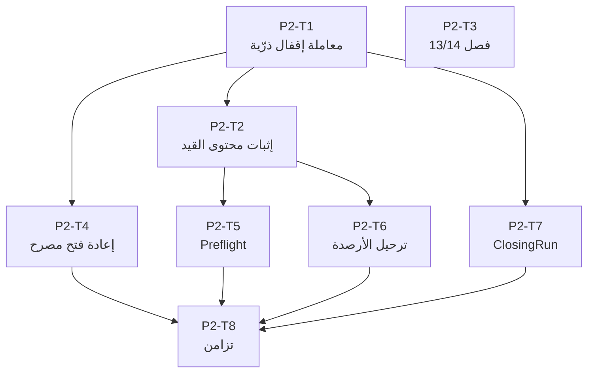

# المرحلة 2 — إقفال الفترات والسنة المالية

## Period & Fiscal Year Closing: Atomic, Provable, Resumable

**المرحلة:** 2 من 5  
**التبعية:** إغلاق `G1` (`P1-T1`, `P1-T2`).  
**البوابة:** `G2 — Closing Integrity`  
**المالك:** `LEDGER` + `DBA` + `SME`  
**الهدف الاستراتيجي:** جعل الإقفال عملية ذرّية قابلة للإثبات والاستئناف، لا سلسلة تحديثات قابلة للفشل الجزئي.

---

## 1. جوهر المشكلة

الإقفال هو أكثر لحظة حساسة في المحرك: يتحول فيها الدفتر من "قابل للتعديل" إلى "مقفل نهائياً". أي فشل جزئي هنا يعني:

- فترة مقفلة وأخرى مفتوحة في نفس السنة.
- سنة "مقفلة" بدون قيد إقفال صحيح.
- أرصدة افتتاحية غير مرحّلة.
- إعادة محاولة تنشئ قيد إقفال مزدوجاً.

الكود الحالي يتحقق من **البيانات الوصفية** لقيد الإقفال (التصنيف، المرجع، الفترة المستهدفة، التفويض) لكنه **لا يثبت محتوى الأسطر**، وينفذ إغلاق الفترتين 13/14 وتحديث حالة السنة بشكل متسلسل. لذلك قد تبقى السنة في حالة وسيطة عند الفشل.

---

## 2. نطاق المرحلة

### داخل النطاق

- `internal/reporting/closing_engine.go`
- `internal/masterdata/fiscal_calendar.go`
- `storage/postgres/masterdata.go` (تحديثات الحالة)
- `storage/postgres/posting.go` (قيد الإقفال)
- جداول/هجرات جديدة: `closing_runs`, `closing_run_steps`
- اختبارات الإقفال والاستئناف

### خارج النطاق

- إعداد التقارير المالية النهائية (المرحلة 3/5).
- أتمتة الجدولة (المرحلة 4).

---

## 3. المهام

### P2-T1 — معاملة إقفال واحدة قابلة للاستئناف

| الحقل | القيمة |
| --- | --- |
| **الدور** | `DBA` + `LEDGER` |
| **الهدف** | تنفيذ إغلاق الفترات 12/13/14 وتحديث حالة السنة في معاملة واحدة، أو عدم تنفيذ أي شيء. |
| **المشكلة التي تحلها** | `ConfirmFiscalYearCloseContext` يغلق الفترة 13 ثم 14 ثم يحدّث السنة على خطوات منفصلة؛ الفشل في المنتصف يترك حالة جزئية. |
| **الفجوة** | `GAP-CLS-02` |
| **الاعتماديات** | `P1-T1`, `P1-T2`. |
| **مجموعة التوازي** | `W5`. |

**خطوات التنفيذ:**

1. أضف اختبار تكامل: افشل تحديث السنة بعد إغلاق الفترة 13 — يجب أن تبقى الفترة 13 مفتوحة.
2. أضف اختبار إعادة محاولة بعد فشل — يجب أن تستأنف دون تكرار.
3. أنشئ جدول `closing_runs`:
   - `id`, `company_id`, `fiscal_year_id`, `status`, `started_at`, `completed_at`, `started_by`, `closing_entry_id`, `input_hash`, `error`.
4. أنشئ جدول `closing_run_steps` لتتبع كل خطوة (`period_12`, `period_13`, `period_14`, `year_state`, `carry_forward`).
5. نفّذ الإقفال داخل معاملة PostgreSQL واحدة:
   - اقفل صف السنة `FOR UPDATE`.
   - تحقق من الحالة الحالية.
   - حدّث الفترات بالترتيب.
   - حدّث حالة السنة.
   - سجّل `closing_run`.
6. اجعل العملية Idempotent: إعادة التشغيل بنفس `input_hash` تعيد النتيجة دون تكرار.
7. أضف حالة `failed` مع سبب واضح، ومسار `resume`.
8. أضف حدث تدقيق لكل خطوة.

**معايير القبول للمهمة التالية:**

- [ ] الفشل في أي خطوة لا يترك أي تغيير.
- [ ] إعادة المحاولة تستأنف بأمان.
- [ ] `closing_runs` يسجل كل محاولة.
- [ ] لا يمكن تشغيل إقفالين متزامنين لنفس السنة.
- [ ] كل خطوة لها حدث تدقيق.
- [ ] اختبار Memory وPostgreSQL متطابق.

**أدلة الإثبات:** اختبار الفشل/الاستئناف، مخطط الجداول، سجل التدقيق.

---

### P2-T2 — إثبات محتوى قيد الإقفال

| الحقل | القيمة |
| --- | --- |
| **الدور** | `SME` + `LEDGER` |
| **الهدف** | التأكد من أن قيد الإقفال يحقق فعلياً إغلاق حسابات قائمة الدخل وتحويل النتيجة للأرباح المحتجزة. |
| **المشكلة التي تحلها** | `ConfirmFiscalYearCloseContext` يتحقق من `Classification`, `DocumentReference`, `TargetPeriodNumber`, `AdjustmentAuthorized` فقط؛ يمكن تمرير قيد "إقفال" بمحتوى خاطئ. |
| **الفجوة** | `GAP-CLS-01` |
| **الاعتماديات** | `P2-T1`. |
| **مجموعة التوازي** | `W5`. |

**خطوات التنفيذ:**

1. أضف اختبارات سلبية:
   - قيد إقفال غير متوازن → يُرفض.
   - قيد لا يصفّر حسابات الإيراد/المصروف → يُرفض.
   - قيد لا يحوّل الصافي إلى الأرباح المحتجزة → يُرفض.
   - قيد بمبالغ لا تطابق أرصدة الفترة → يُرفض.
   - قيد يحتوي حسابات ميزانية دون مبرر → يُرفض.
2. أضف دالة `ValidateClosingEntryContent(ctx, year, entry)`:
   - تحقق من توازن الأسطر.
   - تحقق من أن كل حساب إيراد/مصروف له رصيد مقابل.
   - تحقق من حساب الأرباح المحتجزة المستهدف.
   - تحقق من العملة الوظيفية.
   - تحقق من عدم وجود أسطر لأصول/خصوم دون سياسة.
3. أضف `content_hash` لقيد الإقفال واحفظه في `closing_runs`.
4. أضف اختبار "إعادة استخدام قيد إقفال من سنة أخرى" → يُرفض.
5. وثّق القاعدة المحاسبية في ADR.

**معايير القبول للمهمة التالية:**

- [ ] كل اختبار سلبي يفشل قبل الإصلاح ويمر بعده.
- [ ] لا يمكن تأكيد الإقفال بقيد غير متوازن.
- [ ] لا يمكن تأكيد الإقفال بقيد لا يصفّر P&L.
- [ ] بصمة محتوى القيد محفوظة.
- [ ] قيد سنة أخرى يُرفض.
- [ ] خبير المحاسبة اعتمد القاعدة.

**أدلة الإثبات:** اختبارات سلبية، دالة التحقق، اعتماد `SME`.

---

### P2-T3 — فصل الفترات الإجرائية 13/14 عن النطاق الزمني

| الحقل | القيمة |
| --- | --- |
| **الدور** | `ARCH` + `DBA` |
| **الهدف** | إزالة الالتباس بين الفترات العادية والفترات الإجرائية عند الاختيار بالتاريخ. |
| **المشكلة التي تحلها** | الفترتان 13 و14 تستخدمان `year.EndDate` نفسه، وأي اختيار بالتاريخ قد يعيد واحدة منهما عشوائياً. |
| **الفجوة** | `GAP-CLS-04` |
| **الاعتماديات** | `P1-T1`. |
| **مجموعة التوازي** | `W4`. |

**خطوات التنفيذ:**

1. راجع كل استدعاء لـ`GetPeriodByDateForCompany` وحدد ما إذا كان يقبل فترة إجرائية.
2. أضف معاملاً صريحاً `period_type` أو دالة منفصلة `GetAdjustmentPeriodForCompanyDate`.
3. امنع الاختيار بالتاريخ من إرجاع فترة 13/14 إلا بطلب صريح.
4. أضف اختباراً: تاريخ نهاية السنة مع `period_type=normal` يعيد الفترة 12، لا 13/14.
5. أضف اختباراً: طلب فترة 13 بتاريخ نهاية السنة يعيد 13 فقط.
6. حدّث التوثيق ومخطط التقويم.

**معايير القبول للمهمة التالية:**

- [ ] لا استدعاء بالتاريخ يمكن أن يعيد 13/14 ضمنياً.
- [ ] كل استدعاء يحدد النوع أو يستخدم دالة صريحة.
- [ ] اختبارات التمييز تمر.
- [ ] التوثيق يوضح الفرق.
- [ ] لا كسر للتقارير الحالية.

**أدلة الإثبات:** قائمة الاستدعاءات، الاختبارات، مخطط التقويم.

---

### P2-T4 — إعادة فتح الفترة المصرح بها والمدققة

| الحقل | القيمة |
| --- | --- |
| **الدور** | `SEC` + `SME` + `LEDGER` |
| **الهدف** | السماح بإعادة الفتح عند الحاجة المحاسبية فقط، مع تفويض وسبب وتدقيق، ومنع الفتح الصامت. |
| **المشكلة التي تحلها** | لا توجد سياسة إعادة فتح؛ و`UpdatePeriodState` في PostgreSQL كان يسمح بها دون تحقق. |
| **الفجوة** | `GAP-GOV-02` |
| **الاعتماديات** | `P2-T1`. |
| **مجموعة التوازي** | `W5`. |

**خطوات التنفيذ:**

1. حدد في ADR-0001: من يملك إعادة الفتح، وأي الحالات تسمح بذلك.
2. أضف طلب إعادة فتح يحتوي: السبب، الفترة، المستخدم، الاعتماد.
3. أضف حالة `reopened` أو حدثاً تدقيقياً بدلاً من الرجوع الصامت إلى `open`.
4. أضف قيداً يمنع إعادة فتح سنة مقفلة نهائياً دون اعتماد مزدوج.
5. أضف إشعاراً/تقريراً لكل إعادة فتح.
6. أضف اختبارات: بدون سبب → رفض؛ بدون اعتماد → رفض؛ مع اعتماد → نجاح + تدقيق.
7. أضف تقرير "الفترات المعاد فتحها" للتدقيق الخارجي.

**معايير القبول للمهمة التالية:**

- [ ] لا إعادة فتح بدون سبب واعتماد.
- [ ] كل إعادة فتح لها حدث تدقيق كامل.
- [ ] يمكن استخراج تقرير بكل عمليات إعادة الفتح.
- [ ] السنة المقفلة نهائياً محمية.
- [ ] اختبارات الصلاحيات تمر.
- [ ] `SME` و`SEC` اعتمدا السياسة.

**أدلة الإثبات:** سجل التدقيق، تقرير إعادة الفتح، اختبارات الصلاحيات.

---

### P2-T5 — تقرير ما قبل الإقفال (Preflight)

| الحقل | القيمة |
| --- | --- |
| **الدور** | `SME` + `QA` |
| **الهدف** | كشف كل ما يمنع الإقفال قبل بدء العملية، بدلاً من الفشل في منتصفها. |
| **المشكلة التي تحلها** | لا توجد قائمة تحقق شاملة تعرض الفترات المفتوحة، القيود غير المرحّلة، الفروقات، والأرصدة غير المتسقة. |
| **الفجوة** | عرضية — تدعم `GAP-CLS-01`, `GAP-CLS-02` |
| **الاعتماديات** | `P2-T2`. |
| **مجموعة التوازي** | `W6`. |

**خطوات التنفيذ:**

1. أنشئ `ClosingPreflightReport` يحتوي:
   - الفترات وحالتها.
   - القيود غير المرحّلة.
   - القيود غير المتوازنة.
   - فروقات التسوية بين الدفاتر المساعدة والأستاذ.
   - الأرصدة الافتتاحية المفقودة.
   - قيد الإقفال المقترح وحالته.
2. أضف أمر/دالة لعرض التقرير دون تنفيذ الإقفال.
3. أضف اختبارات لحالة "جاهز" وحالة "غير جاهز".
4. أضف التقرير إلى سجل `closing_runs` كخطوة `preflight`.
5. وثّق كيفية قراءة التقرير.

**معايير القبول للمهمة التالية:**

- [ ] يمكن تشغيل Preflight دون أي تعديل.
- [ ] التقرير يكشف كل مانع مع سبب.
- [ ] الإقفال يرفض البدء إذا كان Preflight غير ناجح (أو يتطلب تجاوزاً مصرحاً).
- [ ] اختبارات الحالتين تمر.
- [ ] التقرير محفوظ في سجل الإقفال.

**أدلة الإثبات:** نموذج تقرير، اختبارات، سجل.

---

### P2-T6 — ترحيل الأرصدة الافتتاحية بشكل ذرّي

| الحقل | القيمة |
| --- | --- |
| **الدور** | `LEDGER` + `DBA` |
| **الهدف** | ضمان أن السنة الجديدة تبدأ بأرصدة مطابقة، وأن الترحيل جزء من الإقفال أو قابل للاستئناف. |
| **المشكلة التي تحلها** | `CarryForwardBalancesForCompanyContext` عملية منفصلة عن الإقفال؛ قد تنجح السنة وتفشل الأرصدة أو العكس. |
| **الفجوة** | `GAP-CLS-05` |
| **الاعتماديات** | `P2-T2`. |
| **مجموعة التوازي** | `W6`. |

**خطوات التنفيذ:**

1. أضف اختبار: فشل الترحيل بعد الإقفال — يجب أن يعود الإقفال أو يبقى قابلاً للاستئناف.
2. أضف `carry_forward` كخطوة في `closing_run_steps`.
3. تحقق من أن مجموع الأرصدة الافتتاحية = مجموع الأرصدة الختامية.
4. تحقق من العملة والفترة الافتتاحية.
5. أضف Idempotency: إعادة الترحيل لا تضاعف الأرصدة.
6. أضف تقرير مطابقة افتتاحي/ختامي.

**معايير القبول للمهمة التالية:**

- [ ] لا سنة مفتوحة بأرصدة ناقصة.
- [ ] إعادة الترحيل لا تضاعف.
- [ ] المطابقة الافتتاحية/الختامية تمر.
- [ ] الخطوة مسجلة في `closing_run_steps`.
- [ ] الفشل لا يترك حالة جزئية.

**أدلة الإثبات:** تقرير المطابقة، اختبار الفشل، سجل الخطوات.

---

### P2-T7 — سجل `ClosingRun` وإصدار قابل لإعادة الإنتاج

| الحقل | القيمة |
| --- | --- |
| **الدور** | `ARCH` + `DBA` |
| **الهدف** | توفير أثر تدقيق كامل لكل إقفال، وإمكانية إعادة إنتاج النتيجة. |
| **المشكلة التي تحلها** | لا يوجد سجل مستدام يربط السنة والقيد والفترات والمستخدم والبصمة. |
| **الفجوة** | `GAP-CLS-03` |
| **الاعتماديات** | `P2-T1`. |
| **مجموعة التوازي** | `W6`. |

**خطوات التنفيذ:**

1. أكمل مخطط `closing_runs` و`closing_run_steps`.
2. احفظ `input_hash` (أرصدة + فترات + قيد) و`output_hash`.
3. أضف حالة: `pending`, `running`, `completed`, `failed`, `rolled_back`.
4. أضف واجهة استعلام: `GetClosingRun(companyID, yearID)`.
5. أضف اختبار إعادة إنتاج: نفس المدخلات → نفس البصمة.
6. أضف تقرير تدقيق قابل للتصدير.

**معايير القبول للمهمة التالية:**

- [ ] كل إقفال له سجل كامل.
- [ ] نفس المدخلات تعطي نفس البصمة.
- [ ] يمكن استعراض الخطوات والحالة.
- [ ] التقرير قابل للتصدير.
- [ ] لا سجل بلا مالك/تاريخ.

**أدلة الإثبات:** مخطط الجداول، اختبار إعادة الإنتاج، تقرير التصدير.

---

### P2-T8 — اختبارات تزامن الإقفال

| الحقل | القيمة |
| --- | --- |
| **الدور** | `QA` + `DBA` |
| **الهدف** | إثبات أن الإقفال آمن تحت التزامن وإعادة المحاولة والفشل. |
| **المشكلة التي تحلها** | سيناريوهات الإقفال الحقيقية تتضمن أكثر من مستخدم وأكثر من عملية. |
| **الفجوة** | عرضية |
| **الاعتماديات** | `P2-T1`…`P2-T7`. |
| **مجموعة التوازي** | `W6`. |

**خطوات التنفيذ:**

1. اختبار إقفالين متزامنين لنفس السنة — واحد ينجح والآخر يفشل بوضوح.
2. اختبار ترحيل قيد أثناء الإقفال — يُرفض أو ينتظر.
3. اختبار إعادة فتح أثناء الإقفال — يُرفض.
4. اختبار فشل عشوائي في كل خطوة — لا حالة جزئية.
5. اختبار إعادة المحاولة بعد كل نوع فشل.
6. اختبار `-race` واختبار جمود.

**معايير القبول للمهمة التالية:**

- [ ] كل سيناريو ينتج حالة نهائية صحيحة.
- [ ] لا حالة وسيطة بعد الفشل.
- [ ] لا إقفال مزدوج.
- [ ] لا جمود.
- [ ] `-race` يمر.
- [ ] النتائج موثقة في تقرير.

**أدلة الإثبات:** تقرير التزامن، مخرجات `-race`.

---

## 4. ترتيب التنفيذ والتوازي

| الموجة | المهام | ملاحظة |
| --- | --- | --- |
| W4 | `P2-T3` | يمكن البدء بعد `P1-T1` |
| W5 | `P2-T1`, `P2-T2`, `P2-T4` | `T2` و`T4` بعد `T1` |
| W6 | `P2-T5`, `P2-T6`, `P2-T7`, `P2-T8` | بعد `T1`/`T2` |

---

## 5. بوابة الجودة G2

لا تُغلق المرحلة 2 إلا بتحقق:

- [ ] الإقفال ذرّي بالكامل.
- [ ] محتوى قيد الإقفال مُثبت محاسبياً.
- [ ] إعادة الفتح مصرح ومدقق.
- [ ] Preflight يكشف الموانع قبل البدء.
- [ ] الأرصدة الافتتاحية مطابقة ومرحّلة ذرّياً.
- [ ] `ClosingRun` موجود وقابل لإعادة الإنتاج.
- [ ] اختبارات التزامن والفشل تمر.
- [ ] `SME` اعتمد منطق الإقفال.

---

## 6. المخاطر الخاصة بالمرحلة

| المخاطرة | التخفيف |
| --- | --- |
| معاملة طويلة تقفل جداول كثيرة | تقليل النطاق، فهارس، وخطوات تحضير خارج المعاملة |
| اختلاف تفسير "إقفال نهائي" | ADR-0001 + اعتماد SME |
| إعادة الفتح تفتح باب التلاعب | سبب + اعتماد مزدوج + تقرير تدقيق |
| Preflight بطيء | استعلامات مجمعة + فهارس |
| ترحيل الأرصدة يكرر | Idempotency + مفتاح سنة/فترة |

---

## 7. تعريف إنجاز المرحلة

المرحلة 2 منجزة عندما يمكن إقفال سنة مالية كاملة، أو فشل الإقفال، دون أي حالة وسيطة، مع إثبات محاسبي كامل لمحتوى قيد الإقفال، وسجل تدقيق يمكن للمراجع الخارجي إعادة إنتاجه.
