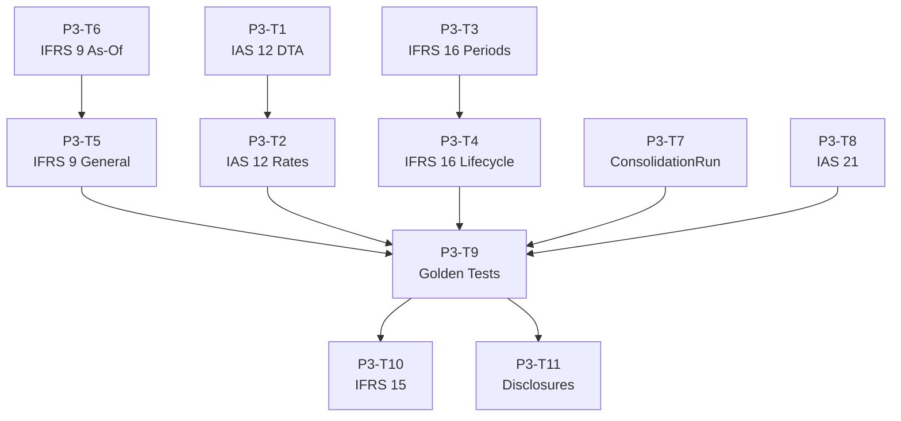

# المرحلة 3 — معالجة المعايير المحاسبية

## Standards Remediation: IAS 12, IFRS 16, IFRS 9, IFRS 10/3, IAS 21

**المرحلة:** 3 من 5  
**التبعية:** إغلاق `G1` (`P1-T2`, `P1-T9`). يمكن البدء بالحزم المستقلة بعد `P0`.  
**البوابة:** `G3 — Standards Conformance`  
**المالك:** `STD` + `SME` + `QA`  
**الهدف الاستراتيجي:** تحويل حزم المعايير من "حسابات متاحة" إلى "دورة قياس مكتملة قابلة للإثبات والمعارضة".

---

## 1. جوهر المشكلة

المحرك يمتلك نماذج جيدة للمعايير، لكن الفجوات ليست في غياب المعادلات، بل في:

- **الافتراضات الضمنية** التي تُفسَّر كقرارات محاسبية (مثل اعتبار `nil` = probable في IAS 12).
- **الاستنتاجات الصامتة** التي تخفي مدخلات ناقصة (مثل IFRS 16 عند غياب عمر الاستهلاك).
- **عدم ربط النموذج بدورة القياس** (مثل IFRS 9 العام الذي يُستدعى بمدخلات خارجية).
- **عدم وجود إثبات إصدار** (مثل التجميع الذي يُحسب ولا يُحفظ).

هذه المرحلة تجعل كل قرار معياري **صريحاً، موثقاً، وقابلاً للاختبار السلبي**.

---

## 2. نطاق المرحلة

### داخل النطاق

- `internal/ias12/`
- `internal/ifrs16/`
- `internal/ifrs9/`
- `internal/consolidation/`
- `internal/valuation/`
- `internal/ifrs15/`
- `internal/reporting/taxonomy/`
- اختبارات المعايير الذهبية والسيناريوهات السلبية

### خارج النطاق

- وحدات ERP الجديدة (المرحلة 5).
- الأتمتة التشغيلية (المرحلة 4).

---

## 3. المهام

### P3-T1 — IAS 12: إزالة الاعتراف التلقائي بالأصل الضريبي المؤجل

| الحقل | القيمة |
| --- | --- |
| **الدور** | `STD` + `SME` |
| **الهدف** | جعل الاعتراف بالأصل الضريبي المؤجل قراراً صريحاً مبنياً على احتمالية الربح الخاضع للضريبة. |
| **المشكلة التي تحلها** | `FutureTaxableProfitProbable == nil` يُفسَّر حالياً كـ"محتمل"، فيُعترف بالأصل الضريبي المؤجل تلقائياً دون تقييم. |
| **الفجوة** | `GAP-STD-01` |
| **الاعتماديات** | `P0-T3`. |
| **مجموعة التوازي** | `W4`. |

**خطوات التنفيذ:**

1. أضف اختباراً: فرق مؤقت قابل للخصم مع `FutureTaxableProfitProbable == nil` → يجب ألا يُعترف بالأصل تلقائياً (أو يجب أن يُرفض الإدخال).
2. استبدل `*bool` بحالة ثلاثية صريحة:
   - `Probable` → اعتراف.
   - `NotProbable` → عدم اعتراف.
   - `Unassessed` → رفض القياس أو تحذير حاجب.
3. أضف سياسة شركة تحدد السلوك الافتراضي (مع توثيق أنها سياسة، لا افتراض صامت).
4. أضف اختبارات للثلاث حالات.
5. أضف توثيقاً يشرح IAS 12.24/35/37 وعلاقة الأصل الضريبي بالأرباح المستقبلية.
6. أضف تقريراً يوضح الفروقات التي لم يُعترف بها وسببها.

**معايير القبول للمهمة التالية:**

- [ ] `nil` لم يعد يعني "محتمل".
- [ ] الحالات الثلاث مغطاة باختبارات.
- [ ] القرار الافتراضي موثق كسياسة شركة.
- [ ] التقرير يوضح الفروقات غير المعترف بها.
- [ ] `SME` اعتمد المنطق.

**أدلة الإثبات:** اختبارات الحالات، وثيقة السياسة، اعتماد `SME`.

---

### P3-T2 — IAS 12: جدول المعدلات والمعدلات المتوقعة

| الحقل | القيمة |
| --- | --- |
| **الدور** | `STD` + `SME` |
| **الهدف** | دعم اختيار المعدل الصحيح حسب تاريخ القياس وتاريخ عكس الفرق المؤقت. |
| **المشكلة التي تحلها** | `TaxRate.Validate` يرفض أي معدل `EffectiveFrom` بعد `asOf`، ولا يوجد جدول معدلات يسمح بقياس DTA/DTL بالمعدلات المتوقعة عند العكس وفق IAS 12. |
| **الفجوة** | `GAP-STD-02` |
| **الاعتماديات** | `P3-T1`. |
| **مجموعة التوازي** | `W5`. |

**خطوات التنفيذ:**

1. أضف اختباراً: معدل enacted بتاريخ مستقبلي يُستخدم لقياس فرق مؤقت طويل الأجل → يجب أن يُقبل إذا كان مطبقاً عند العكس.
2. أضف نوع `TaxRateSchedule` يحتوي معدلات متعددة بفترات سريان.
3. أضف دالة `RateFor(asOf, reversalDate)` تختار المعدل المطبق.
4. ميّز بين:
   - `Enacted` (مُسن).
   - `SubstantivelyEnacted` (مُسن جوهرياً).
   - `Expected` (متوقع، للاستخدام في القياس إذا كان معتمداً).
5. ارفض المعدل غير المطبق مع رسالة واضحة.
6. أضف اختبارات: قبل السريان، أثناء السريان، بعد السريان، تعدد المعدلات.
7. أضف توثيقاً لسياسة الشركة في استخدام المعدلات المتوقعة.

**معايير القبول للمهمة التالية:**

- [ ] يمكن قياس DTA/DTL بمعدل مستقبلي مطبق عند العكس.
- [ ] لا يُستخدم معدل غير مُسن.
- [ ] الجدول يدعم فترات سريان متعددة.
- [ ] اختبارات الحدود تمر.
- [ ] السياسة موثقة ومعتمدة.

**أدلة الإثبات:** اختبارات الجدول، وثيقة السياسة، مصفوفة المعدلات.

---

### P3-T3 — IFRS 16: إزالة الاستنتاج الصامت لعمر الاستهلاك

| الحقل | القيمة |
| --- | --- |
| **الدور** | `STD` + `SME` |
| **الهدف** | منع حساب استهلاك خاطئ عند غياب `UsefulLifePeriods` أو تجاوزه عدد الدفعات. |
| **المشكلة التي تحلها** | الكود يستخدم `len(c.Payments)` عندما يكون العمر صفراً أو أكبر من عدد الدفعات، ما يخفي مدخلاً ناقصاً وينتج جدولاً غير صحيح. |
| **الفجوة** | `GAP-STD-03` |
| **الاعتماديات** | `P0-T3`. |
| **مجموعة التوازي** | `W4`. |

**خطوات التنفيذ:**

1. أضف اختبارات:
   - `UsefulLifePeriods == 0` → خطأ واضح.
   - `UsefulLifePeriods > len(Payments)` → خطأ واضح.
   - عمر صحيح → جدول صحيح.
2. أزل الاستنتاج الصامت.
3. أضف حقل `DepreciationPeriods` صريحاً إن كان العمر يختلف عن مدة العقد.
4. أضف تحققاً من أن مجموع الاستهلاك = أصل حق الاستخدام (مع مراعاة القيمة المتبقية).
5. أضف اختبار "آخر فترة" للتأكد من عدم وجود رصيد متبقٍ.
6. وثّق القاعدة في تعليق الحزمة ووثيقة المعيار.

**معايير القبول للمهمة التالية:**

- [ ] لا استنتاج صامت.
- [ ] الحالات الحدية تُرجع خطأ واضحاً.
- [ ] مجموع الاستهلاك يطابق أصل حق الاستخدام.
- [ ] اختبار آخر فترة يمر.
- [ ] `SME` اعتمد القاعدة.

**أدلة الإثبات:** اختبارات الحدود، جدول الاستهلاك، اعتماد `SME`.

---

### P3-T4 — IFRS 16: دورة حياة عقد الإيجار المستدامة

| الحقل | القيمة |
| --- | --- |
| **الدور** | `STD` + `DBA` |
| **الهدف** | حفظ نسخة العقد وتعديلاته وإنهائه المبكر وإعادة قياسه بشكل قابل للتتبع. |
| **المشكلة التي تحلها** | `RecalculateModification` و`EarlyTerminate` موجودان كحسابات، لكن لا توجد حالة عقد مستدامة أو نسخ أو ربط بالقيد. |
| **الفجوة** | `GAP-STD-04` |
| **الاعتماديات** | `P3-T3`. |
| **مجموعة التوازي** | `W5`. |

**خطوات التنفيذ:**

1. صمّم كيان `LeaseContract` مع `Version`, `Status`, `StartDate`, `EndDate`, `Payments`, `DiscountRate`, `ROUAsset`, `Liability`.
2. أضف جدول `lease_contract_versions` لتخزين كل تعديل.
3. اربط كل إعادة قياس بقيد محاسبي وبصمة.
4. أضف اختبارات:
   - تعديل يزيد الدفعات → إعادة قياس صحيحة.
   - إنهاء مبكر → إقفال الأصل والالتزام.
   - تعديل ثم إنهاء → تسلسل صحيح.
   - إعادة المحاولة لا تكرر القيد.
5. أضف تقرير حركة العقد (Roll-forward).
6. وثّق دورة الحياة في ADR.

**معايير القبول للمهمة التالية:**

- [ ] كل عقد له نسخة وحالة.
- [ ] كل تعديل/إنهاء مرتبط بقيد وبصمة.
- [ ] إعادة المحاولة آمنة.
- [ ] تقرير Roll-forward يطابق.
- [ ] اختبارات التسلسل تمر.

**أدلة الإثبات:** مخطط الجداول، اختبارات الدورة، تقرير Roll-forward.

---

### P3-T5 — IFRS 9: دمج النموذج العام في دورة القياس

| الحقل | القيمة |
| --- | --- |
| **الدور** | `STD` + `SME` |
| **الهدف** | جعل النموذج العام (PD × LGD × EAD مع الخصم والمراحل) جزءاً من دورة القياس الافتراضية، لا استدعاءً خارجياً. |
| **المشكلة التي تحلها** | `CalculateGeneralECL` موجود لكنه يتطلب نماذج PD/LGD/EIR من الخارج، ولا توجد سياسة مراحل أو ربط بالتصنيف. |
| **الفجوة** | `GAP-STD-05` |
| **الاعتماديات** | `P3-T6`. |
| **مجموعة التوازي** | `W6`. |

**خطوات التنفيذ:**

1. أضف واجهة `StagePolicy` تحدد Stage 1/2/3 حسب SICR والتعثر.
2. أضف `PDModel`, `LGDModel`, `EIRDiscount` كعقود قابلة للتنفيذ.
3. أضف دالة `MeasureGeneralECL(ctx, portfolio, policy, models, asOf)`.
4. أضف خصماً زمنياً لكل فترة تدفق.
5. أضف اختبارات:
   - Stage 1 → 12-month ECL.
   - Stage 2/3 → Lifetime ECL.
   - زيادة SICR تنقل المرحلة.
   - التعثر ينقل Stage 3.
   - الخصم يقلل القيمة.
6. أضف تقرير تحليل ECL حسب المرحلة.
7. وثّق أن النموذج المبسط يبقى للذمم التجارية فقط.

**معايير القبول للمهمة التالية:**

- [ ] Stage policy قابلة للتحديد والاختبار.
- [ ] ECL يختلف بين Stage 1 و2/3.
- [ ] الخصم مطبق.
- [ ] التقرير يفصل المراحل.
- [ ] اختبارات SICR/Default تمر.
- [ ] `SME` اعتمد النموذج.

**أدلة الإثبات:** اختبارات المراحل، تقرير ECL، اعتماد `SME`.

---

### P3-T6 — IFRS 9: إلزام مصدر المخصصات التاريخي

| الحقل | القيمة |
| --- | --- |
| **الدور** | `STD` + `LEDGER` |
| **الهدف** | منع استخدام رصيد المخصص الحالي كتقدير لتاريخ سابق. |
| **المشكلة التي تحلها** | عند غياب `AsOfAllowanceSource`، الكود يسمح بالرجوع للرصيد الحالي للتواريخ غير السابقة، وقد يُستخدم خطأً لتاريخ سابق. |
| **الفجوة** | `GAP-STD-06` |
| **الاعتماديات** | `P0-T3`. |
| **مجموعة التوازي** | `W6`. |

**خطوات التنفيذ:**

1. أضف اختباراً: تاريخ سابق + مصدر غائب → خطأ (`ErrHistoricalAllowanceUnavailable`).
2. اجعل `AsOfAllowanceSource` إلزامياً عند `asOf < today`.
3. أضف تحققاً من أن المصدر يعيد رصيداً بتاريخ `asOf` وليس الآن.
4. أضف بصمة للرصيد المستخدم في الحساب.
5. أضف اختبار "نفس التاريخ → نفس الرصيد".
6. وثّق القاعدة.

**معايير القبول للمهمة التالية:**

- [ ] لا رجوع للرصيد الحالي لتاريخ سابق.
- [ ] المصدر إلزامي للتواريخ السابقة.
- [ ] البصمة محفوظة.
- [ ] اختبار الحتمية يمر.
- [ ] لا كسر للتواريخ الحالية.

**أدلة الإثبات:** اختبارات التاريخ، البصمة، الوثيقة.

---

### P3-T7 — التجميع: `ConsolidationRun` وإثبات الإصدار

| الحقل | القيمة |
| --- | --- |
| **الدور** | `STD` + `DBA` |
| **الهدف** | حفظ كل عملية تجميع بمدخلاتها ومعدلاتها ومخرجاتها، وإتاحة إعادة إنتاجها. |
| **المشكلة التي تحلها** | `Engine.Consolidate` يحسب النتيجة في الذاكرة ولا يحفظها؛ لا يمكن للمراجع إعادة إنتاج نفس الأرقام. |
| **الفجوة** | `GAP-STD-07` |
| **الاعتماديات** | `P0-T3`. |
| **مجموعة التوازي** | `W6`. |

**خطوات التنفيذ:**

1. أضف كيان `ConsolidationRun`: `id`, `group_id`, `period`, `status`, `input_hash`, `rates_hash`, `output_hash`, `created_by`, `created_at`.
2. أضف جدول `consolidation_run_inputs` و`consolidation_run_outputs`.
3. احفظ نسخة المعدلات المستخدمة (`RateRequest` → `Rate`).
4. أضف دالة `Replay(runID)` تعيد النتيجة من المدخلات المحفوظة.
5. أضف اختبار: نفس المدخلات → نفس المخرجات.
6. أضف اختبار: تغيير معدل → `output_hash` مختلف.
7. أضف تقرير إصدار قابل للتصدير.
8. وثّق أن التجميع يدعم Nested Ownership وFull Goodwill (موجود) وحدود عدم فقدان السيطرة.

**معايير القبول للمهمة التالية:**

- [ ] كل تجميع له سجل.
- [ ] إعادة الإنتاج تعطي نفس البصمة.
- [ ] المعدلات محفوظة.
- [ ] تقرير الإصدار متاح.
- [ ] اختبارات التغيير تمر.
- [ ] الحدود المعيارية موثقة.

**أدلة الإثبات:** مخطط الجداول، اختبار Replay، تقرير الإصدار.

---

### P3-T8 — IAS 21: التحقق من تمرير نوع السعر في كل المسارات

| الحقل | القيمة |
| --- | --- |
| **الدور** | `STD` + `QA` |
| **الهدف** | التأكد من أن كل تحويل عملة يستخدم النوع الصحيح (Spot/Closing/Average/Historical). |
| **المشكلة التي تحلها** | الواجهة أصبحت تلزم `GetRateOfType`، لكن قد توجد مسارات قديمة تستخدم `GetRate` أو نوعاً غير مناسب. |
| **الفجوة** | `GAP-STD-08` |
| **الاعتماديات** | `P0-T3`. |
| **مجموعة التوازي** | `W6`. |

**خطوات التنفيذ:**

1. اجرد كل استدعاء لـ`GetRate` و`GetRateOfType`.
2. صنّف كل استدعاء حسب الغرض المحاسبي.
3. أضف اختبارات لكل نوع:
   - بنود نقدية → Closing.
   - عمليات → Spot/Average حسب السياسة.
   - بنود غير نقدية بالتكلفة التاريخية → Historical.
4. أضف اختباراً يمنع تمرير نوع فارغ.
5. أضف تقرير تغطية يوضح كل مسار ونوعه.
6. وثّق السياسة في ADR.

**معايير القبول للمهمة التالية:**

- [ ] لا استدعاء بلا نوع محدد.
- [ ] كل نوع له اختبار.
- [ ] تقرير التغطية مكتمل.
- [ ] لا مسار يستخدم سعراً خاطئاً.
- [ ] `SME` اعتمد التصنيف.

**أدلة الإثبات:** تقرير التغطية، اختبارات الأنواع، ADR.

---

### P3-T9 — مجموعة اختبارات الامتثال الذهبية

| الحقل | القيمة |
| --- | --- |
| **الدور** | `QA` + `SME` |
| **الهدف** | بناء حزمة اختبارات مرجعية لكل معيار تغطي الحالات الإيجابية والسلبية والحدية. |
| **المشكلة التي تحلها** | الاختبارات الحالية تغطي مسارات النجاح أكثر من الحالات السلبية والحدية. |
| **الفجوة** | عرضية |
| **الاعتماديات** | `P3-T1`…`P3-T8`. |
| **مجموعة التوازي** | `W7`. |

**خطوات التنفيذ:**

1. أنشئ جدول `Standard → Scenario → Expected`.
2. غطِّ لكل معيار:
   - حالة أساسية.
   - حالة حدية.
   - حالة سلبية (مدخل غير صالح).
   - حالة إعادة محاولة/حتمية.
3. استخدم بيانات ذهبية ثابتة (fixtures) لا تعتمد على الوقت الحالي.
4. أضف اختبارات `-race` حيث ينطبق.
5. اربط كل اختبار ببند المعيار (فقرة/رقم).
6. أضف تقرير تغطية معياري.

**معايير القبول للمهمة التالية:**

- [ ] كل معيار له 4 أنواع حالات على الأقل.
- [ ] البيانات الذهبية ثابتة.
- [ ] كل اختبار مرتبط ببند معياري.
- [ ] تقرير التغطية موجود.
- [ ] `SME` راجع النتائج.

**أدلة الإثبات:** مصفوفة السيناريوهات، تقرير التغطية، اعتماد `SME`.

---

### P3-T10 — تدقيق اكتمال IFRS 15

| الحقل | القيمة |
| --- | --- |
| **الدور** | `STD` + `SME` |
| **الهدف** | التأكد من أن دورة حياة عقد الإيراد تغطي الالتزامات والأسعار والتخصيص والاعتراف. |
| **المشكلة التي تحلها** | الحزمة موجودة لكن تغطيتها للسيناريوهات المعقدة (تعديل العقد، الالتزامات المتعددة، التمويل) تحتاج تدقيقاً. |
| **الفجوة** | `GAP-STD-09` |
| **الاعتماديات** | `P3-T9`. |
| **مجموعة التوازي** | `W7`. |

**خطوات التنفيذ:**

1. اجرد ما تدعمه الحزمة فعلاً.
2. أضف اختبارات للفجوات المؤكدة فقط.
3. أضف حالات: عقد متعدد الالتزامات، تخصيص سعر المعاملة، تعديل عقد، إيراد مؤجل.
4. وثّق ما هو خارج النطاق صراحةً.
5. أضف تقرير فجوات IFRS 15.

**معايير القبول للمهمة التالية:**

- [ ] كل فجوة مؤكدة لها اختبار.
- [ ] ما هو خارج النطاق موثق.
- [ ] السيناريوهات الأربعة مغطاة.
- [ ] `SME` اعتمد التقرير.

**أدلة الإثبات:** تقرير الفجوات، الاختبارات، الاعتماد.

---

### P3-T11 — اكتمال الإفصاحات والتصنيفات

| الحقل | القيمة |
| --- | --- |
| **الدور** | `SME` + `STD` |
| **الهدف** | ربط الحسابات والتقارير بمتطلبات الإفصاح الأساسية. |
| **المشكلة التي تحلها** | التصنيفات الحالية قد لا تغطي كل متطلبات العرض والإفصاح. |
| **الفجوة** | `GAP-STD-10` |
| **الاعتماديات** | `P3-T9`. |
| **مجموعة التوازي** | `W7`. |

**خطوات التنفيذ:**

1. أنشئ مصفوفة `Disclosure → Account/Tag → Report`.
2. حدد الفجوات في `internal/reporting/taxonomy`.
3. أضف التصنيفات الناقصة فقط بعد اعتماد `SME`.
4. أضف اختبارات تقارير.
5. وثّق خريطة الإفصاح.

**معايير القبول للمهمة التالية:**

- [ ] مصفوفة الإفصاح موجودة.
- [ ] الفجوات المؤكدة موثقة.
- [ ] التصنيفات الجديدة معتمدة.
- [ ] اختبارات التقارير تمر.

**أدلة الإثبات:** مصفوفة الإفصاح، الاختبارات، الاعتماد.

---

## 4. ترتيب التنفيذ والتوازي

| الموجة | المهام | ملاحظة |
| --- | --- | --- |
| W4 | `P3-T1`, `P3-T3` | حزم مستقلة |
| W5 | `P3-T2`, `P3-T4` | بعد المهام المقابلة |
| W6 | `P3-T5`, `P3-T6`, `P3-T7`, `P3-T8` | `T5` بعد `T6` |
| W7 | `P3-T9`, `P3-T10`, `P3-T11` | بعد اكتمال الإصلاحات |

---

## 5. بوابة الجودة G3

لا تُغلق المرحلة 3 إلا بتحقق:

- [ ] IAS 12 لا يعترف تلقائياً عند `nil`.
- [ ] IAS 12 يدعم جدول معدلات ومعدلات متوقعة.
- [ ] IFRS 16 لا يستنتج العمر صامتاً.
- [ ] IFRS 16 له دورة حياة مستدامة.
- [ ] IFRS 9 العام مدمج ويطبق المراحل والخصم.
- [ ] IFRS 9 التاريخي لا يعتمد على الرصيد الحالي.
- [ ] التجميع له `ConsolidationRun` قابل لإعادة الإنتاج.
- [ ] IAS 21 مطبق في كل المسارات.
- [ ] اختبارات ذهبية لكل معيار.
- [ ] `SME` اعتمد كل قاعدة معيارية.

---

## 6. المخاطر الخاصة بالمرحلة

| المخاطرة | التخفيف |
| --- | --- |
| تغيير IAS 12 يكسر تقارير قائمة | مفتاح سياسة + تقرير فروق + فترة انتقال |
| IFRS 16 يتطلب بيانات عقود غير متوفرة | حقل صريح + رفض واضح + دليل إدخال |
| IFRS 9 العام يحتاج نماذج إحصائية | عقود قابلة للتنفيذ + قيم افتراضية موثقة |
| التجميع يتأثر بتغير المعدلات | حفظ نسخة المعدلات + Replay |
| الإفصاحات تتضخم | مصفوفة أولوية + اعتماد SME |

---

## 7. تعريف إنجاز المرحلة

المرحلة 3 منجزة عندما يصبح كل قرار معياري في المحرك **صريحاً** (لا افتراض صامت)، و**قابلاً للاختبار** (إيجابي/سلبي/حدي)، و**قابلاً لإعادة الإنتاج** (بصمة/سجل)، ومعتمداً من خبير محاسبة.
