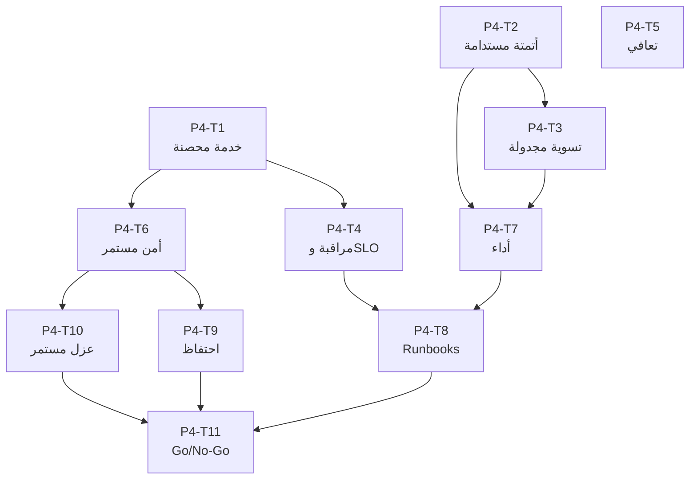

# المرحلة 4 — الجاهزية التشغيلية والإنتاجية

## Operational Readiness: Service, Automation, Observability, DR & Security

**المرحلة:** 4 من 5  
**التبعية:** إغلاق `G1` (`P1-T2`) و`G2` (`P2-T1`). يمكن البدء بـ`P4-T1` بعد `P0`.  
**البوابة:** `G4 — Operational Readiness`  
**المالك:** `SRE` + `SEC` + `DBA`  
**الهدف الاستراتيجي:** تحويل المحرك من "مكتبة تعمل" إلى "خدمة مالية إنتاجية قابلة للتشغيل والمراقبة والتعافي".

---

## 1. جوهر المشكلة

المحرك الحالي يمتلك نواة قوية، لكن واجهة التشغيل محدودة:

- `cmd/agy/serve.go` يعرض `/healthz` و`/metrics` فقط.
- لا توجد readiness probe، ولا مصادقة، ولا TLS، ولا حدود طلبات.
- `ifrsautomation.Scheduler` يعمل في الذاكرة، بلا حالة مستدامة أو إعادة محاولة أو DLQ.
- التسوية موجودة لكنها غير مجدولة.
- لا يوجد دليل تعافٍ من الكوارث أو SLOs.

هذه الفجوات لا تظهر في الاختبارات، لكنها تظهر في الإنتاج: عند إعادة التشغيل، أو انقطاع الشبكة، أو ضغط التزامن، أو حادث أمني.

---

## 2. نطاق المرحلة

### داخل النطاق

- `cmd/agy/serve.go`, `cmd/agy/main.go`
- `internal/ifrsautomation/`
- `internal/reporting/balance_integrity.go`, `reconciliation.go`
- `internal/observability/`
- `storage/postgres/` (RLS، الفهارس، النسخ الاحتياطي)
- البنية التحتية: CI/CD، الأسرار، المراقبة، التنبيهات

### خارج النطاق

- وحدات ERP (المرحلة 5).
- تغيير منطق المعايير (المرحلة 3).

---

## 3. المهام

### P4-T1 — تحصين خدمة HTTP

| الحقل | القيمة |
| --- | --- |
| **الدور** | `SRE` + `SEC` |
| **الهدف** | خدمة إنتاجية آمنة وقابلة للمراقبة، لا مجرد خادم صحة. |
| **المشكلة التي تحلها** | `serve.go` يعرض `/healthz` و`/metrics` فقط، بلا readiness/auth/TLS/limits. |
| **الفجوة** | `GAP-OPS-01` |
| **الاعتماديات** | `P0-T1`. |
| **مجموعة التوازي** | `W4`. |

**خطوات التنفيذ:**

1. أضف `/livez` (عملية حية) و`/readyz` (جاهز لاستقبال الطلبات، يفحص قاعدة البيانات والتهجير).
2. أضف مهلات قراءة/كتابة/Idle، وحداً أقصى لحجم الطلب، وحداً للمعدل.
3. أضف مصادقة (mTLS أو OIDC/JWT) وتفويضاً حسب الشركة/الدور.
4. أضف TLS مع إدارة شهادات.
5. أضف `request_id` و`trace_id` في كل استجابة.
6. أضف إيقافاً رشيقاً (Graceful Shutdown) مع مهلة.
7. أضف فحصاً يمنع الإقلاع إذا كانت الهجرات غير مطبقة أو الحوكمة غير صارمة في الإنتاج.
8. أضف اختبارات: readiness عند تعطل DB، رفض الطلب غير المصرح، تجاوز الحد.

**معايير القبول للمهمة التالية:**

- [ ] `/readyz` يعكس جاهزية DB والهجرات.
- [ ] لا طلب بلا مصادقة (عدا الصحة الداخلية).
- [ ] TLS مفعل في الإنتاج.
- [ ] حدود الطلب والمعدل تعمل.
- [ ] الإيقاف الرشيق لا يقطع معاملة جارية.
- [ ] اختبارات الأمان والجاهزية تمر.

**أدلة الإثبات:** اختبارات الخدمة، إعداد TLS، تقرير الأمن.

---

### P4-T2 — أتمتة مستدامة: حالة، إعادة محاولة، Outbox، DLQ

| الحقل | القيمة |
| --- | --- |
| **الدور** | `SRE` + `LEDGER` |
| **الهدف** | ضمان أن مهام الأتمتة الشهرية تعمل بعد إعادة التشغيل، وتُعاد المحاولة عند الفشل، ولا تفقد حدثاً. |
| **المشكلة التي تحلها** | `Scheduler` في الذاكرة، بلا سجل تشغيل أو سياسة إعادة محاولة أو Outbox/DLQ. |
| **الفجوة** | `GAP-OPS-02` |
| **الاعتماديات** | `P1-T10`, `P2-T1`. |
| **مجموعة التوازي** | `W5`. |

**خطوات التنفيذ:**

1. أنشئ جدول `automation_runs`: `id`, `job_key`, `period`, `status`, `attempts`, `last_error`, `next_retry_at`, `idempotency_key`.
2. أنشئ جدول `automation_outbox` للأحداث التي يجب تسليمها.
3. أنشئ `automation_dlq` للفشل النهائي.
4. أضف سياسة إعادة محاولة أسّية مع حد أقصى.
5. أضف قفلاً موزعاً (Advisory Lock) لمنع تشغيل نفس المهمة مرتين.
6. أضف واجهة إعادة تشغيل يدوية من DLQ.
7. أضف اختبارات: إعادة تشغيل العملية أثناء المهمة، فشل الشبكة، تكرار الحدث.
8. أضف لوحة مراقبة لحالة المهام.

**معايير القبول للمهمة التالية:**

- [ ] إعادة تشغيل الخدمة لا تفقد مهمة.
- [ ] الفشل يعاد محاولته وفق السياسة.
- [ ] لا تنفيذ مزدوج لنفس المهمة.
- [ ] DLQ قابلة للاستعراض وإعادة التشغيل.
- [ ] الأحداث تُسلَّم مرة واحدة على الأقل.
- [ ] اختبارات الفشل تمر.

**أدلة الإثبات:** مخطط الجداول، اختبارات الفشل، لوحة المراقبة.

---

### P4-T3 — جدولة التسوية والتنبيه بالانحراف

| الحقل | القيمة |
| --- | --- |
| **الدور** | `SRE` + `LEDGER` |
| **الهدف** | تشغيل التسوية تلقائياً واكتشاف الانحراف قبل أن يتراكم. |
| **المشكلة التي تحلها** | `BalanceIntegrityUnit` و`BalanceReconciliationEngine` موجودان لكن لا يُشغَّلان دورياً. |
| **الفجوة** | `GAP-OPS-03` |
| **الاعتماديات** | `P4-T2`. |
| **مجموعة التوازي** | `W5`. |

**خطوات التنفيذ:**

1. أضف مهمة مجدولة يومية/أسبوعية لكل شركة.
2. شغّل `Reconcile` وسجّل النتيجة في جدول `reconciliation_runs`.
3. أضف عتبات للتنبيه (عدد الحسابات المنحرفة، مقدار الانحراف).
4. أضف تنبيهات إلى نظام المراقبة.
5. أضف خيار `RebuildBalancesFromLines` بعد اعتماد (وليس تلقائياً).
6. أضف اختبارات: انحراف مصطنع → تنبيه؛ إصلاح → اختفاء.
7. أضف تقريراً دورياً للمراجع.

**معايير القبول للمهمة التالية:**

- [ ] التسوية تعمل دورياً.
- [ ] الانحراف يُنبّه.
- [ ] إعادة البناء تتطلب اعتماداً.
- [ ] التقرير متاح.
- [ ] لا تعديل تلقائي صامت.

**أدلة الإثبات:** سجل التشغيل، تنبيه تجريبي، تقرير التسوية.

---

### P4-T4 — المراقبة والتتبع وSLOs

| الحقل | القيمة |
| --- | --- |
| **الدور** | `SRE` |
| **الهدف** | رؤية كاملة لصحة المحرك المالي وأدائه وأخطائه. |
| **المشكلة التي تحلها** | المراقبة موجودة جزئياً لكنها لا تغطي كل المسارات ولا ترتبط بـSLOs. |
| **الفجوة** | `GAP-OPS-06` |
| **الاعتماديات** | `P4-T1`. |
| **مجموعة التوازي** | `W6`. |

**خطوات التنفيذ:**

1. أضف مقاييس RED (Rate, Errors, Duration) لكل نقطة نهاية.
2. أضف مقاييس USE (Utilization, Saturation, Errors) لقاعدة البيانات.
3. أضف تتبعاً موزعاً يربط الطلب بالقيد والفترة.
4. أضف لوحات: الترحيل، الإقفال، التسوية، الأتمتة، الأخطاء.
5. حدد SLOs: توفر 99.9%، زمن ترحيل p95، نسبة الأخطاء.
6. أضف تنبيهات مرتبطة باستهلاك ميزانية الخطأ.
7. أضف اختباراً يثبت ظهور المقاييس.

**معايير القبول للمهمة التالية:**

- [ ] كل نقطة نهاية لها RED.
- [ ] DB لها USE.
- [ ] التتبع يربط الطلب بالقيد.
- [ ] اللوحات موجودة.
- [ ] SLOs معرفة ومقاسة.
- [ ] التنبيهات تعمل.

**أدلة الإثبات:** لوحات، لقطات مقاييس، وثيقة SLO.

---

### P4-T5 — النسخ الاحتياطي والتعافي من الكوارث

| الحقل | القيمة |
| --- | --- |
| **الدور** | `DBA` + `SRE` |
| **الهدف** | إثبات القدرة على الاستعادة إلى نقطة زمنية محددة دون فقدان بيانات. |
| **المشكلة التي تحلها** | لا يوجد دليل PITR أو RPO/RTO أو اختبار استعادة. |
| **الفجوة** | `GAP-OPS-04` |
| **الاعتماديات** | `P0-T8`. |
| **مجموعة التوازي** | `W6`. |

**خطوات التنفيذ:**

1. فعّل WAL Archiving وPITR.
2. حدد RPO/RTO المستهدفين (مثلاً RPO=0، RTO<5m).
3. أضف نسخاً احتياطية مشفرة يومية + احتفاظ.
4. أضف اختبار استعادة كامل إلى بيئة معزولة.
5. أضف اختبار استعادة نقطة زمنية قبل/بعد قيد.
6. وثّق Runbook الاستعادة.
7. أضف مراقبة لفشل النسخ.
8. أضف اختباراً دورياً (شهري) موثقاً.

**معايير القبول للمهمة التالية:**

- [ ] PITR يعمل.
- [ ] RPO/RTO موثقان ومقاسان.
- [ ] الاستعادة الكاملة مختبرة.
- [ ] Runbook موجود.
- [ ] التنبيه على فشل النسخ يعمل.
- [ ] لا فقدان بيانات في الاختبار.

**أدلة الإثبات:** تقرير الاستعادة، قياس RPO/RTO، Runbook.

---

### P4-T6 — الأمن المستمر وعزل المستأجرين

| الحقل | القيمة |
| --- | --- |
| **الدور** | `SEC` + `DBA` |
| **الهدف** | منع تسرب البيانات وضمان استمرار العزل مع كل تغيير. |
| **المشكلة التي تحلها** | اختبارات RLS موجودة لكنها ليست جزءاً إلزامياً من CI ولا تغطي كل الجداول. |
| **الفجوة** | `GAP-OPS-07` |
| **الاعتماديات** | `P0-T7`, `P4-T1`. |
| **مجموعة التوازي** | `W6`. |

**خطوات التنفيذ:**

1. اجعل اختبارات RLS إلزامية في CI.
2. أضف اختبارات لكل جدول مالي جديد.
3. أضف SAST/DAST وفحص تبعيات وSBOM.
4. أضف إدارة أسرار (Vault/KMS) ودوراناً.
5. أضف اختبار اختراق سنوي أو مراجعة خارجية.
6. أضف سياسة استجابة للحوادث.
7. أضف سجلات وصول غير قابلة للتلاعب.

**معايير القبول للمهمة التالية:**

- [ ] RLS إلزامي في CI.
- [ ] كل جدول مالي مغطى.
- [ ] SAST/DAST يعملان.
- [ ] الأسرار لا تظهر في السجلات.
- [ ] SBOM متاح.
- [ ] سياسة الحوادث معتمدة.

**أدلة الإثبات:** تقرير CI، SBOM، سياسة الحوادث.

---

### P4-T7 — الأداء والسعة ومقاومة الجمود

| الحقل | القيمة |
| --- | --- |
| **الدور** | `DBA` + `SRE` |
| **الهدف** | ضمان أن المحرك يحقق أهداف الأداء تحت الحمل، وأن الأقفال الجديدة لا تسبب جموداً. |
| **المشكلة التي تحلها** | لا SLOs للأداء ولا اختبار حمل يغطي الترحيل الجماعي والإقفال. |
| **الفجوة** | `GAP-OPS-05` |
| **الاعتماديات** | `P1-T2`, `P2-T1`. |
| **مجموعة التوازي** | `W7`. |

**خطوات التنفيذ:**

1. حدد أهدافاً: زمن ترحيل p95، عدد القيود/الثانية، زمن الإقفال.
2. أضف اختبار حمل للترحيل الفردي والجماعي.
3. أضف اختبار حمل للإقفال والتسوية.
4. قس الجمود ومعدل إعادة المحاولة.
5. أضف فهارس لازمة (فترات، قيود، تسلسل).
6. اضبط connection pool وtimeouts.
7. أضف تقرير سعة وتوصيات.
8. أضف اختبار انحدار أداء في CI (خفيف) أو ليلي.

**معايير القبول للمهمة التالية:**

- [ ] أهداف الأداء محددة.
- [ ] الحمل يمر دون جمود.
- [ ] p95 ضمن الهدف.
- [ ] الفهارس موثقة.
- [ ] تقرير السعة موجود.
- [ ] لا انحدار مقارنة بخط الأساس.

**أدلة الإثبات:** تقرير الحمل، `EXPLAIN ANALYZE`, إعدادات pool.

---

### P4-T8 — Runbooks والاستجابة للحوادث

| الحقل | القيمة |
| --- | --- |
| **الدور** | `SRE` + `DOC` |
| **الهدف** | تمكين فريق التشغيل من التعامل مع الحوادث دون الرجوع للمطورين. |
| **المشكلة التي تحلها** | لا توجد إجراءات موثقة للفشل الشائع. |
| **الفجوة** | `GAP-OPS-08` + عرضية |
| **الاعتماديات** | `P4-T1`…`P4-T7`. |
| **مجموعة التوازي** | `W7`. |

**خطوات التنفيذ:**

1. اكتب Runbooks:
   - تعطل قاعدة البيانات.
   - فشل الترحيل.
   - فشل الإقفال.
   - فشل الأتمتة.
   - انحراف التسوية.
   - تسرب/حادث أمني.
   - استعادة من نسخة احتياطية.
2. أضف شجرة قرار وتصعيد.
3. أضف قوالب تواصل مع أصحاب المصلحة.
4. أضف تمريناً تجريبياً (Game Day).
5. راجع الـRunbooks بعد كل حادث.

**معايير القبول للمهمة التالية:**

- [ ] كل سيناريو له Runbook.
- [ ] التصعيد واضح.
- [ ] Game Day موثق.
- [ ] الفريق قادر على التنفيذ دون مطور.

**أدلة الإثبات:** Runbooks، تقرير Game Day.

---

### P4-T9 — الاحتفاظ بالبيانات والثبات القانوني

| الحقل | القيمة |
| --- | --- |
| **الدور** | `SEC` + `SME` |
| **الهدف** | تحديد مدة الاحتفاظ، ومنع الحذف غير المصرح، ودعم الحجز القانوني. |
| **المشكلة التي تحلها** | لا سياسة احتفاظ موثقة قد تعرض المشروع لمخاطر تنظيمية. |
| **الفجوة** | عرضية |
| **الاعتماديات** | `P4-T6`. |
| **مجموعة التوازي** | `W7`. |

**خطوات التنفيذ:**

1. حدد مدة الاحتفاظ حسب النوع (قيود، تدقيق، تقارير).
2. أضف منع حذف/تعديل السجلات المالية المرحّلة.
3. أضف `legal hold` يوقف أي حذف.
4. أضف أرشفة قابلة للاستعلام.
5. أضف اختبار محاولة حذف → رفض.
6. وثّق السياسة.

**معايير القبول للمهمة التالية:**

- [ ] سياسة الاحتفاظ معتمدة.
- [ ] الحذف ممنوع على المرحّل.
- [ ] Legal hold يعمل.
- [ ] الأرشفة قابلة للاستعلام.
- [ ] اختبار الحذف يمر.

**أدلة الإثبات:** السياسة، اختبار الحذف، إعداد الأرشفة.

---

### P4-T10 — التحقق المستمر من عزل الشركات

| الحقل | القيمة |
| --- | --- |
| **الدور** | `QA` + `SEC` |
| **الهدف** | إثبات أن كل تغيير جديد لا يكسر العزل. |
| **المشكلة التي تحلها** | العزل يُختبر مرة واحدة، لكنه قد يُكسر بإضافة استعلام جديد. |
| **الفجوة** | `GAP-OPS-07` |
| **الاعتماديات** | `P4-T6`. |
| **مجموعة التوازي** | `W7`. |

**خطوات التنفيذ:**

1. أضف اختبار عزل لكل نقطة نهاية جديدة.
2. أضف اختبار "شركة A لا ترى قيود شركة B" لكل تقرير.
3. أضف فحصاً آلياً يبحث عن استعلامات بلا `company_id`.
4. أضف اختبار RLS على مستوى الصلاحيات.
5. أضف تقرير تغطية العزل.

**معايير القبول للمهمة التالية:**

- [ ] كل تقرير مغطى باختبار عزل.
- [ ] لا استعلام مالي بلا نطاق شركة.
- [ ] RLS يعمل تحت صلاحيات مختلفة.
- [ ] تقرير التغطية موجود.

**أدلة الإثبات:** تقرير العزل، فحص الاستعلامات.

---

### P4-T11 — أتمتة قرار Go/No-Go

| الحقل | القيمة |
| --- | --- |
| **الدور** | `ARCH` + `SRE` |
| **الهدف** | تحويل بوابات الجاهزية إلى فحص آلي قابل للتكرار. |
| **المشكلة التي تحلها** | قرار الإنتاج يعتمد على مراجعة يدوية قابلة للنسيان. |
| **الفجوة** | عرضية |
| **الاعتماديات** | `P4-T1`…`P4-T10`. |
| **مجموعة التوازي** | `W7`. |

**خطوات التنفيذ:**

1. أنشئ سكربت/أمر يجمع نتائج G0–G4.
2. تحقق من: الاختبارات، `-race`، التغطية، RLS، DR، SLOs، الحوكمة الصارمة، الهجرات.
3. أخرج تقرير `GO` / `NO-GO` مع أسباب.
4. أضف التقرير إلى سجل الإصدار.
5. اربطه بخط الإصدار.

**معايير القبول للمهمة التالية:**

- [ ] القرار آلي وقابل للتكرار.
- [ ] كل سبب `NO-GO` واضح.
- [ ] التقرير محفوظ.
- [ ] لا إصدار بدون `GO`.

**أدلة الإثبات:** تقرير Go/No-Go، خط الإصدار.

---

## 4. ترتيب التنفيذ والتوازي

| الموجة | المهام | ملاحظة |
| --- | --- | --- |
| W4 | `P4-T1` | بعد `P0` |
| W5 | `P4-T2`, `P4-T3` | بعد `P1-T10` و`P2-T1` |
| W6 | `P4-T4`, `P4-T5`, `P4-T6` | متوازية |
| W7 | `P4-T7`, `P4-T8`, `P4-T9`, `P4-T10`, `P4-T11` | بعد الأساسيات |

---

## 5. بوابة الجودة G4

لا تُغلق المرحلة 4 إلا بتحقق:

- [ ] `/readyz` و`/livez` يعملان.
- [ ] المصادقة والتخويل وTLS وحدود الطلب مفعلة.
- [ ] الأتمتة مستدامة مع إعادة محاولة وDLQ.
- [ ] التسوية مجدولة وتنبّه.
- [ ] المراقبة وSLOs مفعلة.
- [ ] DR مختبر وRPO/RTO موثقان.
- [ ] RLS إلزامي في CI.
- [ ] اختبار حمل ناجح دون جمود.
- [ ] Runbooks موجودة.
- [ ] تقرير Go/No-Go آلي.

---

## 6. المخاطر الخاصة بالمرحلة

| المخاطرة | التخفيف |
| --- | --- |
| إضافة مصادقة تعقّد التكامل | عقد واضح + بيئة تطوير + توثيق |
| إعادة المحاولة تسبب تكراراً | Idempotency + مفاتيح فريدة |
| الأقفال تخفض الأداء | قياس + فهارس + معاملات قصيرة |
| DR غير ممول | تحديد RPO/RTO واقعي + اختبار دوري |
| مراقبة كثيرة بلا قيمة | ربط كل مقياس بـSLO/تنبيه |

---

## 7. تعريف إنجاز المرحلة

المرحلة 4 منجزة عندما يمكن تشغيل المحرك في الإنتاج، ومراقبته، وإعادة تشغيله، واستعادته، وحمايته، وإثبات جاهزيته آلياً، دون تدخل يدوي غير موثق.
