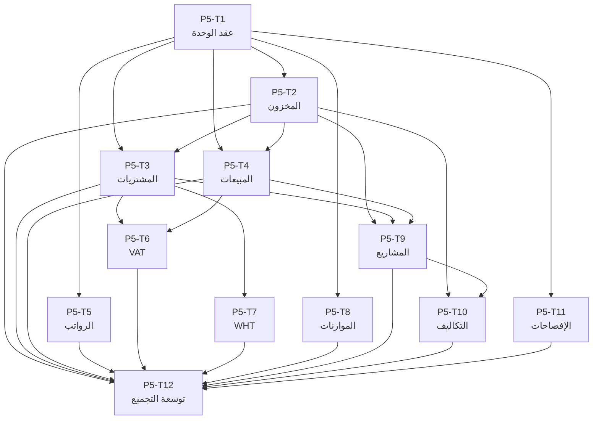

# المرحلة 5 — التوسع نحو نظام ERP مالي شامل

## ERP Expansion: Inventory, Procure-to-Pay, Order-to-Cash, Payroll & Tax

**المرحلة:** 5 من 5  
**التبعية:** إغلاق `G3` (`P3-T1`…`P3-T7`) و`G4` (`P4-T1`).  
**البوابة:** `G5 — ERP Expansion`  
**المالك:** `ARCH` + `SME` + فرق الوحدات  
**الهدف الاستراتيجي:** إضافة وحدات ERP فوق نواة محاسبية مستقرة، دون كسر النواة أو تكرار منطق الترحيل.

---

## 1. جوهر المشكلة

`accounting_engine` حالياً **نواة دفتر أستاذ عام (GL Core)** قوية، وليست نظام ERP شاملاً. الوحدات التالية إما غائبة أو جزئية:

| المجال | الحالة الحقيقية | الفجوة |
| --- | --- | --- |
| المخزون | غير موجود كدفتر مساعد مستقل | تقييم، COGS، هبوط قيمة |
| المشتريات/AP | جزئي | دورة فاتورة المورد والمطابقة الثلاثية |
| المبيعات/AR | جزئي | حدود الائتمان، التحصيل، التذكير |
| الرواتب | غير موجود | إجمالي/صافي، استحقاقات، استقطاعات |
| VAT | غير موجود كوحدة | ضريبة مخرجات/مدخلات وتسوية |
| WHT | غير موجود كوحدة | استقطاع وإقرار |
| الموازنات | غير موجود | موازنة/فعلي/انحراف |
| المشاريع | جزئي | تكاليف وإيرادات المشروع |
| التكاليف | غير مكتمل | توزيع وتكاليف غير مباشرة |
| الإفصاحات | غير مكتمل | إيضاحات وتصنيفات |

**قاعدة التوسع:** لا تُضاف وحدة إلا عبر **عقد وحدة (Module Contract)** يحدد المدخلات، المخرجات، القيود التي تولّدها، حدود المعاملة، والاختبارات. لا يُسمح لأي وحدة بالكتابة المباشرة في جداول النواة.

---

## 2. نطاق المرحلة

### داخل النطاق

- وحدات ERP المذكورة أعلاه.
- عقود التكامل مع النواة.
- لوحات وتقارير تشغيلية.
- اختبارات التكامل بين الوحدات.

### خارج النطاق

- إعادة كتابة النواة.
- استبدال PostgreSQL أو تغيير نموذج التخزين.
- ميزات غير مالية (CRM، HR الكامل، التصنيع المتقدم) إلا كتكامل.

---

## 3. المهام

### P5-T1 — عقد الوحدة وحدود التكامل

| الحقل | القيمة |
| --- | --- |
| **الدور** | `ARCH` + `SME` |
| **الهدف** | تعريف طريقة إضافة وحدة ERP دون كسر النواة. |
| **المشكلة التي تحلها** | إضافة وحدات مباشرة إلى `internal/` ستخلق اعتماداً دائرياً وتكراراً لمنطق الترحيل. |
| **الفجوة** | عرضية — تمكّن `GAP-ERP-01`…`GAP-ERP-10` |
| **الاعتماديات** | `G3`, `G4`. |
| **مجموعة التوازي** | `W8` — تبدأ أولاً. |

**خطوات التنفيذ:**

1. اكتب `Module Contract` يحتوي:
   - `Name`, `Version`, `Dependencies`.
   - `Commands` (أوامر الوحدة).
   - `Events` (أحداث تصدرها).
   - `JournalFactory` (كيف تولّد القيود).
   - `Reconciliation` (كيف تُطابق مع GL).
   - `Permissions` (الأدوار).
2. حدد أن الوحدة لا تكتب في `account_moves` مباشرة، بل عبر `posting.Engine`.
3. حدد أن كل قيد يحمل `SourceModule` و`SourceDocumentID`.
4. أضف سجلاً للوحدات (`module registry`) وتحميلاً عند الإقلاع.
5. أضف اختبار عقد لوحدة مرجعية بسيطة.
6. وثّق ADR-0006.

**معايير القبول للمهمة التالية:**

- [ ] `Module Contract` معتمد.
- [ ] لا وحدة تكتب في جداول النواة مباشرة.
- [ ] كل قيد يحمل مصدره.
- [ ] سجل الوحدات يعمل.
- [ ] اختبار الوحدة المرجعية يمر.

**أدلة الإثبات:** ADR-0006، العقد، اختبار الوحدة المرجعية.

---

### P5-T2 — دفتر المخزون المساعد وتقييم IAS 2

| الحقل | القيمة |
| --- | --- |
| **الدور** | فريق المخزون + `SME` |
| **الهدف** | تتبع الكميات والتكلفة، وتوليد قيود COGS وهبوط القيمة. |
| **المشكلة التي تحلها** | لا يوجد دفتر مساعد مستقل للمخزون، ولا ربط بين الحركة الفعلية وتكلفة البضاعة المباعة. |
| **الفجوة** | `GAP-ERP-01` |
| **الاعتماديات** | `P5-T1`. |
| **مجموعة التوازي** | `W9`. |

**خطوات التنفيذ:**

1. صمّم `InventoryItem`, `Warehouse`, `StockMovement`, `ValuationLayer`.
2. ادعم FIFO وWeighted Average.
3. أضف `CostOfGoodsSold` و`InventoryWriteDown`.
4. اربط كل حركة بقيد عبر `JournalFactory`.
5. أضف تقرير عمر المخزون وتقييمه.
6. أضف اختبارات: استلام، صرف، تحويل، جرد، هبوط قيمة.
7. أضف اختبار تكامل مع GL.

**معايير القبول للمهمة التالية:**

- [ ] FIFO وWA يعملان.
- [ ] COGS يطابق الحركة.
- [ ] هبوط القيمة يولد قيداً.
- [ ] تقرير التقييم يطابق GL.
- [ ] اختبارات الحركات تمر.

**أدلة الإثبات:** اختبارات المخزون، تقرير التقييم، مطابقة GL.

---

### P5-T3 — دورة المشتريات والمطابقة الثلاثية

| الحقل | القيمة |
| --- | --- |
| **الدور** | فريق المشتريات + `SME` |
| **الهدف** | إدارة أمر الشراء، الاستلام، فاتورة المورد، والمطابقة قبل الترحيل. |
| **المشكلة التي تحلها** | دورة AP الحالية جزئية ولا تمنع ترحيل فاتورة بلا استلام أو أمر شراء. |
| **الفجوة** | `GAP-ERP-03` |
| **الاعتماديات** | `P5-T1`, `P5-T2`. |
| **مجموعة التوازي** | `W9`. |

**خطوات التنفيذ:**

1. صمّم `PurchaseOrder`, `GoodsReceipt`, `VendorInvoice`.
2. أضف مطابقة ثلاثية: أمر شراء ↔ استلام ↔ فاتورة.
3. أضف فروقات التسامح وسياسة الاعتماد.
4. أضف استحقاقاً تلقائياً وقيود AP.
5. أضف جدول أعمار الدائنين.
6. أضف اختبارات: مطابقة ناجحة، كمية زائدة، سعر مختلف، فاتورة مكررة.
7. أضف تقرير التزامات.

**معايير القبول للمهمة التالية:**

- [ ] لا فاتورة تُرحَّل بلا مطابقة (أو تجاوز مصرح).
- [ ] الفروقات ضمن السياسة.
- [ ] الالتزامات تظهر في التقارير.
- [ ] تكرار الفاتورة يُرفض.
- [ ] اختبارات الدورة تمر.

**أدلة الإثبات:** اختبارات المطابقة، تقرير الالتزامات.

---

### P5-T4 — دورة المبيعات والتحصيل

| الحقل | القيمة |
| --- | --- |
| **الدور** | فريق المبيعات + `SME` |
| **الهدف** | إدارة أمر البيع، التسليم، الفاتورة، التحصيل، وحدود الائتمان. |
| **المشكلة التي تحلها** | دورة AR جزئية ولا تفرض حدود ائتمان أو تذكيراً. |
| **الفجوة** | `GAP-ERP-04` |
| **الاعتماديات** | `P5-T1`, `P5-T2`. |
| **مجموعة التوازي** | `W9`. |

**خطوات التنفيذ:**

1. صمّم `SalesOrder`, `Delivery`, `CustomerInvoice`, `Receipt`.
2. أضف حد ائتمان وتحققاً قبل الفاتورة.
3. أضف أعمار المدينين وتذكيراً.
4. اربط الإيراد بـIFRS 15.
5. أضف اختبارات: بيع نقدي/آجل، تجاوز الحد، تحصيل جزئي، إشعار دائن.
6. أضف تقرير أعمار المدينين.

**معايير القبول للمهمة التالية:**

- [ ] حد الائتمان مفروض.
- [ ] التحصيل يطابق الفاتورة.
- [ ] الإيراد يتبع IFRS 15.
- [ ] تقرير الأعمار صحيح.
- [ ] اختبارات الدورة تمر.

**أدلة الإثبات:** اختبارات الدورة، تقرير الأعمار.

---

### P5-T5 — محاسبة الرواتب

| الحقل | القيمة |
| --- | --- |
| **الدور** | فريق الرواتب + `SME` |
| **الهدف** | حساب الإجمالي/الصافي والاستحقاقات والاستقطاعات وترحيلها. |
| **المشكلة التي تحلها** | لا وحدة رواتب، ما يمنع إغلاق كامل للالتزامات. |
| **الفجوة** | `GAP-ERP-02` |
| **الاعتماديات** | `P5-T1`. |
| **مجموعة التوازي** | `W9`. |

**خطوات التنفيذ:**

1. صمّم `Employee`, `PayrollRun`, `PayElement`, `Deduction`.
2. ادعم الراتب الأساسي، البدلات، العمل الإضافي، الاستقطاعات.
3. أضف قيود الاستحقاق والدفع.
4. أضف تقرير كشف الرواتب.
5. أضف اختبارات: راتب كامل، جزئي، إجازة، استقطاع، تصحيح.
6. أضف فصل صلاحيات إعداد/اعتماد الرواتب.

**معايير القبول للمهمة التالية:**

- [ ] الإجمالي/الصافي صحيح.
- [ ] الاستحقاق والدفع متوازنان.
- [ ] كشف الرواتب يطابق GL.
- [ ] فصل الصلاحيات مفروض.
- [ ] اختبارات الحالات تمر.

**أدلة الإثبات:** اختبارات الرواتب، كشف مطابقة، مصفوفة الصلاحيات.

---

### P5-T6 — وحدة ضريبة القيمة المضافة

| الحقل | القيمة |
| --- | --- |
| **الدور** | فريق الضرائب + `SME` |
| **الهدف** | حساب ضريبة المخرجات والمدخلات وتسويتها وإقرارها. |
| **المشكلة التي تحلها** | لا وحدة VAT مستقلة، والضريبة قد تُعامل كحساب عادي. |
| **الفجوة** | `GAP-ERP-05` |
| **الاعتماديات** | `P5-T3`, `P5-T4`. |
| **مجموعة التوازي** | `W9`. |

**خطوات التنفيذ:**

1. صمّم `TaxCode`, `TaxRate`, `TaxTransaction`.
2. اربط الفواتير بالرموز الضريبية.
3. أضف تقرير ضريبة المخرجات/المدخلات.
4. أضف قيد التسوية.
5. أضف إقراراً قابلاً للتصدير.
6. أضف اختبارات: فاتورة قياسية، صفرية، معفاة، مرتجعة.
7. أضف اختبار تكامل مع GL.

**معايير القبول للمهمة التالية:**

- [ ] كل فاتورة تحمل رمزاً ضريبياً.
- [ ] التقرير يطابق GL.
- [ ] التسوية متوازنة.
- [ ] الإقرار قابل للتصدير.
- [ ] اختبارات الحالات تمر.

**أدلة الإثبات:** اختبارات الضريبة، تقرير التسوية، الإقرار.

---

### P5-T7 — وحدة استقطاع الضريبة (WHT)

| الحقل | القيمة |
| --- | --- |
| **الدور** | فريق الضرائب + `SME` |
| **الهدف** | حساب الاستقطاع على المدفوعات الخاضعة وإصدار الشهادات. |
| **المشكلة التي تحلها** | لا وحدة WHT مستقلة. |
| **الفجوة** | `GAP-ERP-06` |
| **الاعتماديات** | `P5-T3`. |
| **مجموعة التوازي** | `W9`. |

**خطوات التنفيذ:**

1. صمّم `WithholdingRule`, `WithholdingTransaction`.
2. اربط المدفوعات بالقواعد.
3. أضف شهادة استقطاع قابلة للتصدير.
4. أضف قيد الالتزام والدفع.
5. أضف اختبارات: خاضع، معفى، نسبة متغيرة، تصحيح.
6. أضف تقرير التزامات WHT.

**معايير القبول للمهمة التالية:**

- [ ] القاعدة تطبق على الدفع الصحيح.
- [ ] الشهادة صحيحة.
- [ ] الالتزام يطابق GL.
- [ ] اختبارات الحالات تمر.

**أدلة الإثبات:** اختبارات WHT، الشهادة، التقرير.

---

### P5-T8 — محاسبة الموازنات والانحرافات

| الحقل | القيمة |
| --- | --- |
| **الدور** | فريق FP&A + `SME` |
| **الهدف** | إعداد الموازنة ومقارنتها بالفعلي وتحليل الانحراف. |
| **المشكلة التي تحلها** | لا محاسبة موازنات، ما يضعف الرقابة الإدارية. |
| **الفجوة** | `GAP-ERP-07` |
| **الاعتماديات** | `P5-T1`. |
| **مجموعة التوازي** | `W9`. |

**خطوات التنفيذ:**

1. صمّم `Budget`, `BudgetLine`, `BudgetVersion`.
2. أضف مقارنة الفعلي/الموازنة.
3. أضف تحليل انحراف (سعر/كمية/حجم).
4. أضف تقريراً حسب المركز/المشروع.
5. أضف اختبارات: موازنة، تجاوز، انحراف موجب/سالب.
6. أضف اعتماد الموازنة.

**معايير القبول للمهمة التالية:**

- [ ] الموازنة مرتبطة بالفترة والحساب.
- [ ] المقارنة صحيحة.
- [ ] الانحراف قابل للتفسير.
- [ ] التقرير متاح.
- [ ] اختبارات الحالات تمر.

**أدلة الإثبات:** اختبارات الموازنة، تقرير الانحراف.

---

### P5-T9 — محاسبة المشاريع

| الحقل | القيمة |
| --- | --- |
| **الدور** | فريق المشاريع + `SME` |
| **الهدف** | تتبع إيرادات وتكاليف المشروع وربحه. |
| **المشكلة التي تحلها** | محاسبة المشاريع جزئية ولا تربط التكاليف بالإيراد. |
| **الفجوة** | `GAP-ERP-08` |
| **الاعتماديات** | `P5-T1`, `P5-T3`, `P5-T4`. |
| **مجموعة التوازي** | `W9`. |

**خطوات التنفيذ:**

1. صمّم `Project`, `ProjectBudget`, `ProjectCost`.
2. اربط القيود ببعد المشروع.
3. أضف تقرير ربحية المشروع.
4. أضف توزيع تكاليف غير مباشرة.
5. أضف اختبارات: تكلفة مباشرة، غير مباشرة، إيراد، إقفال مشروع.
6. أضف تكامل مع الموازنات.

**معايير القبول للمهمة التالية:**

- [ ] كل قيد مشروع يحمل `ProjectID`.
- [ ] الربحية صحيحة.
- [ ] التوزيع موثق.
- [ ] التقرير متاح.
- [ ] اختبارات الحالات تمر.

**أدلة الإثبات:** اختبارات المشروع، تقرير الربحية.

---

### P5-T10 — محاسبة التكاليف والتوزيع

| الحقل | القيمة |
| --- | --- |
| **الدور** | فريق التكاليف + `SME` |
| **الهدف** | حساب تكلفة المنتج/الخدمة وتوزيع التكاليف غير المباشرة. |
| **المشكلة التي تحلها** | محاسبة التكاليف غير مكتملة. |
| **الفجوة** | `GAP-ERP-09` |
| **الاعتماديات** | `P5-T2`, `P5-T9`. |
| **مجموعة التوازي** | `W9`. |

**خطوات التنفيذ:**

1. صمّم `CostCenter`, `CostDriver`, `AllocationRule`.
2. ادعم التوزيع حسب ساعات/كميات/إيراد.
3. أضف تكلفة أمر الإنتاج/الخدمة.
4. أضف تقرير التكلفة والانحراف.
5. أضف اختبارات: توزيع مباشر، متدرج، متبادل.
6. أضف تكامل مع المخزون والمشاريع.

**معايير القبول للمهمة التالية:**

- [ ] التوزيع متوازن.
- [ ] التكلفة قابلة للتتبع.
- [ ] التقرير يطابق GL.
- [ ] اختبارات التوزيع تمر.

**أدلة الإثبات:** اختبارات التوزيع، تقرير التكلفة.

---

### P5-T11 — الإفصاحات المالية والتصدير

| الحقل | القيمة |
| --- | --- |
| **الدور** | `SME` + فريق التقارير |
| **الهدف** | إنتاج إيضاحات وقوائم قابلة للتصدير والمراجعة. |
| **المشكلة التي تحلها** | الإفصاحات غير مكتملة، ما يحد من الاستخدام الخارجي. |
| **الفجوة** | `GAP-ERP-10` |
| **الاعتماديات** | `P5-T1`, `P3-T11`. |
| **مجموعة التوازي** | `W9`. |

**خطوات التنفيذ:**

1. أنشئ قوالب إفصاح لكل معيار.
2. اربط الأرقام بالتقارير.
3. أضف تصدير PDF/Excel/XBRL (حسب الأولوية).
4. أضف توقيعاً/بصمة للإصدار.
5. أضف اختبارات تطابق الأرقام.
6. أضف مراجعة `SME`.

**معايير القبول للمهمة التالية:**

- [ ] كل إفصاح له قالب.
- [ ] الأرقام مطابقة.
- [ ] التصدير يعمل.
- [ ] البصمة موجودة.
- [ ] `SME` اعتمد.

**أدلة الإثبات:** القوالب، اختبارات المطابقة، ملف تصدير.

---

### P5-T12 — توسعة التجميع وتعدد المعايير

| الحقل | القيمة |
| --- | --- |
| **الدور** | `STD` + `ARCH` |
| **الهدف** | دعم مجموعات أعقد وتعدد أطر التقارير دون كسر `ConsolidationRun`. |
| **المشكلة التي تحلها** | التجميع الحالي قوي لكنه يحتاج دعماً لفقدان السيطرة وتعدد المعايير. |
| **الفجوة** | امتداد `GAP-STD-07` |
| **الاعتماديات** | `P5-T2`…`P5-T11`. |
| **مجموعة التوازي** | `W10`. |

**خطوات التنفيذ:**

1. أضف معالجة فقدان السيطرة (Loss of Control).
2. أضف تعدد أطر التقارير (IFRS/GAAP محلي).
3. أضف خرائط تحويل بين الأطر.
4. أضف اختبارات سيناريو مجموعة متعددة المستويات والعملات.
5. حدّث `ConsolidationRun` لدعم الإطار.
6. وثّق القيود.

**معايير القبول للمهمة التالية:**

- [ ] فقدان السيطرة معالج.
- [ ] تعدد الأطر يعمل.
- [ ] خرائط التحويل موثقة.
- [ ] اختبارات المجموعة المعقدة تمر.
- [ ] `SME` اعتمد.

**أدلة الإثبات:** اختبارات التجميع، خرائط الأطر، اعتماد `SME`.

---

## 4. ترتيب التنفيذ والتوازي

| الموجة | المهام | ملاحظة |
| --- | --- | --- |
| W8 | `P5-T1` | إلزامية أولاً |
| W9 | `P5-T2`, `P5-T5`, `P5-T8`, `P5-T11` | وحدات مستقلة |
| W9b | `P5-T3`, `P5-T4` | بعد `P5-T2` |
| W9c | `P5-T6`, `P5-T7`, `P5-T9` | بعد `P5-T3`/`P5-T4` |
| W9d | `P5-T10` | بعد `P5-T2` و`P5-T9` |
| W10 | `P5-T12` | بعد اكتمال الوحدات |

---

## 5. بوابة الجودة G5

لا تُغلق المرحلة 5 إلا بتحقق:

- [ ] عقد الوحدة معتمد ومطبق.
- [ ] لا وحدة تكتب مباشرة في جداول النواة.
- [ ] كل وحدة لها اختبارات تكامل مع GL.
- [ ] المخزون والرواتب يعملان بدورة كاملة.
- [ ] المشتريات والمبيعات تطبق المطابقة وحدود الائتمان.
- [ ] VAT وWHT ينتجان تقارير متوازنة.
- [ ] الموازنات والمشاريع والتكاليف مترابطة.
- [ ] الإفصاحات قابلة للتصدير.
- [ ] التجميع يدعم فقدان السيطرة وتعدد الأطر.
- [ ] `SME` اعتمد كل وحدة.

---

## 6. المخاطر الخاصة بالمرحلة

| المخاطرة | التخفيف |
| --- | --- |
| تضخم النطاق | إصدارات وحدة تلو الأخرى + بوابة G5 |
| تكرار منطق الترحيل | إلزام `JournalFactory` + منع الكتابة المباشرة |
| تعارض بيانات المخزون مع GL | مطابقة دورية + اختبار تكامل |
| تعقيد الضرائب المحلية | قواعد قابلة للتوصيف + مراجعة خبير |
| إجهاد الفريق | فصل فريق النواة عن فريق الوحدات بعد G4 |
| تعدد المعايير | خرائط تحويل + `ConsolidationRun` بإطار |

---

## 7. تعريف إنجاز المرحلة

المرحلة 5 منجزة عندما يمكن تشغيل دورة ERP مالية كاملة — شراء، مخزون، بيع، تحصيل، رواتب، ضريبة، موازنة، مشروع، تكلفة، إفصاح، تجميع — فوق النواة، مع مطابقة مستمرة مع دفتر الأستاذ، ودون أي كسر في نزاهة الترحيل أو الإقفال.
