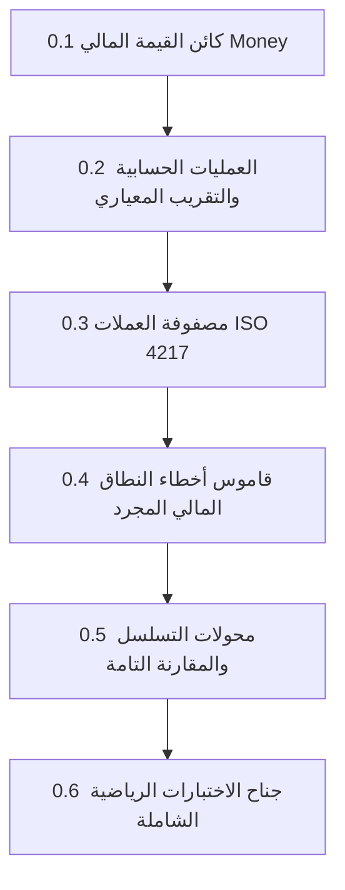

# خطة المرحلة 0: النواة الرياضية والأنواع المالية المشتركة (Phase 0: Mathematical Core & Common Financial Types)

**الحزمة المستهدفة:** `internal/types`  
**طبيعة المكون:** مكتبة حسابية مستقلة عالية الدقة ومنيعة ضد أخطاء الفواصل العائمة (Floating-Point Errors).

---

## 1. الأهداف المعمارية والصرامة الحسابية

في الأنظمة المالية المحاسبية، يُحظر تماماً استخدام أنواع البيانات العشرية العائمة (`float32` / `float64`) بسبب تراكم أخطاء التقريب الثنائي (IEEE-754).  
تتطلب المعايير المالية الدولية تمثيل المبالغ كأعداد فواصل ثابتة (Fixed-Point Decimals) بدقة لا تقل عن 4 منازل عشرية وبدقة تخزينية تصل إلى 28 رقماً، مع منع العمليات بين عملات مختلفة إلا عبر محرك التحويل المعتمد.

---

## 2. المراحل الفرعية المتسلسلة (Sub-Phases)

### 0.1 تصميم وتغليف كائن القيمة المالي (`Money Value Object`)

* **الهدف:** عزل بنية المبلغ النقدي داخل هيكل محمي لا يمكن التلاعب بقيمته مباشرة (Immutable Value Object).
* **التفاصيل البرمجية:**
  * تمثيل الحقل الداخلي عبر `decimal.Decimal`.
  * حقل العملة `currency string` متوافق مع كود العملة الثلاثي (ISO 4217).
  * توفير دوال الإنشاء الآمنة: `NewMoney(amount, currency)` و `NewMoneyFromString(val, currency)` و `Zero(currency)`.
  * التحقق الصارم من صحة النصوص المدخلة ورفض المدخلات التالفة مثل `NaN` أو `Infinity`.

### 0.2 العمليات الحسابية وقواعد التدوير والتقريب (Rounding & Precision Arithmetic)

* **الهدف:** ضمان دقة العمليات الحسابية الأساسية: الجمع، الطرح، والضرب بسكالار.
* **التفاصيل البرمجية:**
  * ضبط المقياس المالي الثابت `FinancialScale = 4`.
  * فرض شرط تطابق العملة في الجمع والطرح، وإرجاع خطأ `ErrCurrencyMismatch` عند اختلاف العملتين.
  * تطبيق طريقة التقريب البنكي النصف زوجي (Half to Even / Banker's Rounding) عند التقسيم أو الضرب.
  * منع تسلل القيم السالبة الصريحة إلى أسطر القيود المحاسبية عبر دالة فحص `IsNegative()`.

### 0.3 معايير العملات الدولية (`ISO 4217 Currency Standards`)

* **الهدف:** توحيد ترميز العملات ومنع الخلط بين العملة الوظيفية والعملات الأجنبية.
* **التفاصيل البرمجية:**
  * تعريف ثوابت العملات الأساسية (`SAR`, `USD`, `EUR`, `AED`, `GBP` ...).
  * تعريف خصائص العملة: الرمز، الاسم الرسمي، وعدد المنازل العشرية القياسية للظهور (Minor Unit Display).

### 0.4 قاموس الأخطاء المالية المجردة (`Domain Financial Sentinel Errors`)

* **الهدف:** توحيد جميع الأخطاء الناتجة عن اختراق المبادئ المحاسبية دون الاعتماد على رسائل نصية متغيرة.
* **التفاصيل البرمجية:**
  * تصنيف الأخطاء في ثوابت معيارية:
    * أخطاء الاتزان الحسابي: `ErrUnbalancedMove`, `ErrNegativeAmountProhibited`, `ErrZeroAmountLine`.
    * أخطاء الفترات: `ErrFiscalPeriodClosed`, `ErrFiscalPeriodNotFound`, `ErrInvalidPeriodTransition`.
    * أخطاء الشجرة والترحيل: `ErrCannotPostToParentAccount`, `ErrAccountNotFound`, `ErrDuplicateAccountCode`.
    * أخطاء الرقابة والثبات: `ErrMoveAlreadyPosted`, `ErrCannotModifyPostedMove`, `ErrMakerCheckerViolation`.

### 0.5 محولات التسلسل والمقارنة التامة (Serialization & Formatting)

* **الهدف:** تمكين تخزين ونقل كائن القيمة المالي دون فقدان الدقة الحسابية.
* **التفاصيل البرمجية:**
  * تنفيذ واجهات `encoding/json` (`MarshalJSON` و `UnmarshalJSON`) لضمان تصدير المبالغ كأوتار نصوص ثابتة بدلاً من أرقام عائمة تفقد الدقة.
  * دوال المقارنة الحتمية: `Equal(other)`, `GreaterThan(other)`, `LessThan(other)`.
  * دالة العرض النصي المنسق: `String()` بصيغة `0.0000 SAR`.

### 0.6 جناح الاختبارات الرياضية واختبارات الضغط (Mathematical Test Suite)

* **الهدف:** إثبات الحصانة الرياضية ضد الأخطاء الحسابية.
* **التفاصيل البرمجية:**
  * اختبارات الجمع والطرح للكسور الدقيقة (مثل `0.1 + 0.2 = 0.3000`).
  * اختبار كشف الأخطاء عند جمع عملات غير متطابقة.
  * اختبارات الأعداد الضخمة جداً (Big Numbers Handling) حتى 28 خانة.

---

## 3. مصفوفة الملفات ومخرجات المرحلة

| الملف المستهدف | الوصف التقني الدقيق |
| :--- | :--- |
| `internal/types/money.go` | كائن القيمة `Money`، دوال الحسابات، وضبط الدقة (Scale = 4) |
| `internal/types/currency.go` | سجل وتعريفات العملات ومواصفات ISO 4217 |
| `internal/types/errors.go` | سجل جميع أخطاء النطاق المالي المحاسبي |
| `internal/types/money_test.go` | اختبارات النطاق الرياضي، الدقة، التحويل، والمقارنات |

---

## 4. معايير القبول والتحقق الصارم (Acceptance Criteria)

* [x] اجتياز جميع اختبارات الدقة الحسابية بدون أي نسبة خطأ تقريب عشري.

* [x] رفض أي عملية جمع أو طرح بين عملات مختلفة بدون تحويل مسبق.
* [x] منع تمثيل المبالغ بصيغة أعداد عائمة أثناء الـ JSON Serialization.
