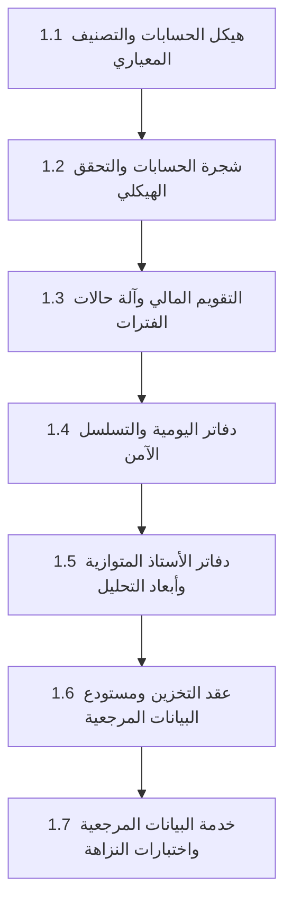

# خطة المرحلة 1: محرك البيانات المرجعية المالية (Phase 1: Financial Master Data Management)

**الحزمة المستهدفة:** `internal/masterdata`  
**طبيعة المكون:** محرك مستقل لإدارة دليل الحسابات المالي والتقويم والفترات واليوميات وأبعاد التحليل، دون أي اتصال ببروتوكولات الويب.

---

## 1. الأهداف المعمارية والمعايير المنظمة

المكون يمثل العمود الفقري للنظام المحاسبي؛ حيث يضبط شجرة الحسابات (COA) وفق العناصر الخمسة المعيارية (Assets, Liabilities, Equity, Revenue, Expense)، والتقويم المالي والفترات، ودفاتر اليومية والتسلسل الرقمي الإلزامي لمنع الفجوات (Gapless Numbering).

---

## 2. المراحل الفرعية المتسلسلة (Sub-Phases)



### 1.1 هيكل وتصنيف الحسابات المالية (Account Classification & Types)

* **الهدف:** نمذجة كيان الحساب المالي المجرد.
* **التفاصيل البرمجية:**
  * الأنواع الأساسية الخمسة (`AccountTypeAsset`, `AccountTypeLiability`, `AccountTypeEquity`, `AccountTypeIncome`, `AccountTypeExpense`).
  * تحديد الرصيد الطبيعي (`NormalBalanceDebit` للأصول والمصروفات، و `NormalBalanceCredit` للالتزامات وحقوق الملكية والإيرادات).
  * حقول التصنيف الإضافية المتوافقة مع معيار IAS 1: `SubClassification` (مثل: نقد وما في حكمه، ذمم تجارية، أصول ثابتة، مخصصات).

### 1.2 محرك شجرة الحسابات والتحقق الهيكلي (Chart of Accounts Tree & Validation)

* **الهدف:** فرض البنية الشجرية وحماية الحسابات التجميعية من الترحيل العشوائي.
* **التفاصيل البرمجية:**
  * دعم علاقة الأب-الابن (`ParentID *uuid.UUID`) بعمق شجري غير محدود.
  * قاعدة التحقق الذهبية: **منع الترحيل إلى حساب تجميعي (Parent/Header Account)**؛ الترحيل مسموح فقط للحسابات الورقية النهائية (Leaf Accounts).
  * فحص منع الحلقات التكرارية في الشجرة (Cycle Detection) عند تعديل الأب.
  * فرض ثبات كود الحساب ونوعه بعد وجود قيود تاريخية مرحلة عليه.

### 1.3 محرك التقويم المالي وآلة حالات الفترات (Fiscal Calendar & Period State Machine)

* **الهدف:** إدارة فترات السنة المالية وإحكام إغلاقها لمنع أي تلاعب بالتاريخ.
* **التفاصيل البرمجية:**
  * توليد السنة المالية (12 فترة شهرية متتالية + فترات التسوية الجردية الإضافية Period 13/14).
  * آلة حالات الفترة الصارمة:

    ```text
    [Open] ───> [Soft-Closed] ───> [Hard-Closed]
    ```

    * `Open`: ترحيل مباشر مسموح.
    * `Soft-Closed`: ترحيل مقيد بمسؤول التدقيق أو التسويات فقط.
    * `Hard-Closed`: إغلاق حتمي ونهائي لا رجعة فيه.
  * استعلام الفترة النشطة لتاريخ معين: مطابقة تاريخ المعاملة مع الفترة المفتوحة حصراً.

### 1.4 دفاتر اليومية والتسلسل الرقمي المتزامن (Journals & Gapless Sequential Generator)

* **الهدف:** تقسيم القيود حسب طبيعتها المالية وإعطاؤها أرقاماً متسلسلة غير قابلة للتكرار أو التجاوز.
* **التفاصيل البرمجية:**
  * أنواع دفاتر اليومية (`general`, `bank`, `cash`, `sale`, `purchase`).
  * خوارزمية توليد الأرقام المتسلسلة (Sequencer) مع حماية التنافسية العالية (Concurrency-Safe Lock) لمنع حدوث فجوات في الترقيم القانوني.

### 1.5 دفاتر الأستاذ الموازية وأبعاد التحليل المالي (Multi-Ledgers & Dimensions)

* **الهدف:** تمكين تسجيل الحركات وفق معايير متعددة (Multi-GAAP / Tax Ledger) وإسناد أبعاد التحليل.
* **التفاصيل البرمجية:**
  * تعريف دفتر الأستاذ الأساسي (Primary Ledger) ودفاتر الأستاذ الموازية (Secondary Ledgers).
  * إدارة أبعاد التحليل المالي (Financial Dimensions / Cost Centers) لربط القيد بمركز تكلفة أو مشروع دون تلويث شجرة الحسابات.

### 1.6 عقود التخزين المجردة (Master Data Repository SPI)

* **الهدف:** عزل محرك البيانات المرجعية عن أي آلية تخزين ملموسة.
* **التفاصيل البرمجية:**
  * واجهة `masterdata.Repository`:
    * `CreateAccount`, `GetAccountByID`, `GetAccountByCode`, `ListAccounts`.
    * `HasChildren(accountID)` للتحقق السريع من كون الحساب تجميعياً أم طرفياً.
    * `CreateFiscalYear`, `GetPeriodByDate`, `UpdatePeriodState`.
    * `GetNextSequenceWithLock`.

### 1.7 خدمة البيانات المرجعية واختبارات التحقق الشاملة (Service & Integration)

* **الهدف:** تقديم واجهة برمجية موحدة للاستخدام الداخلي واختبارها.
* **التفاصيل البرمجية:**
  * `RegisterAccount`, `ValidateCanPostToAccount`, `GetOpenPeriodForDate`.
  * اختبارات شجرة الحسابات، التحقق من الحسابات التجميعية، وفحص حالات الفترات.

---

## 3. مصفوفة الملفات ومخرجات المرحلة

| الملف المستهدف | الوصف التقني الدقيق |
| :--- | :--- |
| `internal/masterdata/account.go` | نموذج الحساب وتصنيفاته وأنواعه وقواعد الرصيد الطبيعي |
| `internal/masterdata/fiscal_calendar.go` | نموذج السنة المالية والفترات وآلة الحالات |
| `internal/masterdata/journal.go` | دفاتر اليومية والتسلسل الرقمي القانوني |
| `internal/masterdata/dimension.go` | مراكز التكلفة وأبعاد التحليل المالي |
| `internal/masterdata/repository.go` | واجهة المستودع التجريدي (SPI) للبيانات المرجعية |
| `internal/masterdata/service.go` | محرك إدارة وقواعد البيانات المرجعية والتحقق |
| `internal/masterdata/mock_repo.go` | مشغل ذاكرة سريع للاختبارات المعزولة |
| `internal/masterdata/service_test.go` | اختبارات التحقق من الشجرة، الفترات، واليوميات |

---

## 4. معايير القبول والتحقق الصارم (Acceptance Criteria)

* [ ] منع إنشاء حساب بكود مكرر داخل نفس النظام المالي.

* [ ] رفض أي عملية ترحيل تستهدف حساباً رئيسياً يمتلك حسابات فرعية.
* [ ] رفض أي معاملة يقع تاريخها في فترة مقفلة أو غير موجودة.
* [ ] توليد تسلسل أرقام تصاعدي لا يحتوي على فراغات أو تكرار.
