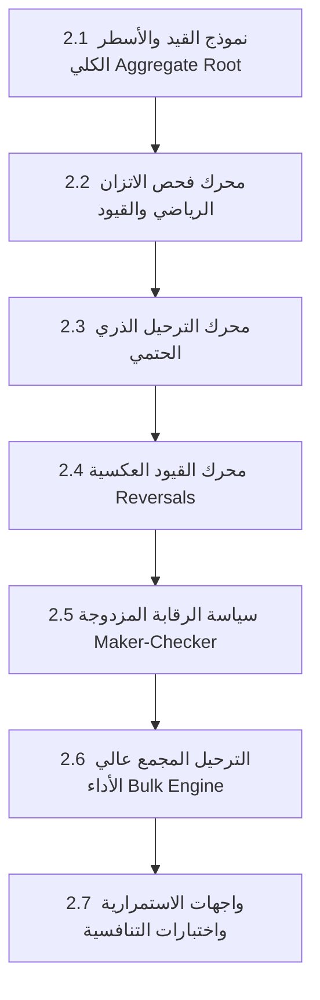

# خطة المرحلة 2: محرك القيد المزدوج والترحيل الصارم (Phase 2: Double-Entry Posting Engine)

**الحزمة المستهدفة:** `internal/posting`  
**طبيعة المكون:** النواة الحتمية المركزية لتطبيق قاعدة القيد المزدوج، التحقق من التوازن، فرض عدم القابلية للتعديل، والترحيل الذري.

---

## 1. الأهداف المعمارية ومبادئ الحصانة

يعد محرك الترحيل الحصن المحاسبي الأول؛ مسؤوليته الحصرية هي ضمان عدم تسجيل أي سنت دون أثر مقابل متزن تماماً، وفرض مبدأ **الخلود المالي وسلسلة الأحداث (Append-Only / Immutability)** حيث يستحيل تعديل أو حذف أي قيد تم ترحيله نهائياً.

---

## 2. المراحل الفرعية المتسلسلة (Sub-Phases)

### 2.1 نموذج القيد المحاسبي والأسطر كـ Aggregate Root

* **الهدف:** بناء نموذج قيد اليومية (`JournalEntry`) وأسطره (`JournalEntryLine`) كوحدة ذرية متماسكة.
* **التفاصيل البرمجية:**
  * تعريف القيد كـ Aggregate Root يحتوي على: المعرف الفريد `ID`، رقم التسلسل القانوني، اليومية، الفترة المالية، التاريخ، الحالة (`draft`, `posted`, `reversed`)، مرجع المستند الأصلي، وهوية المنشئ والمرحل.
  * كل سطر يحتوي على: الحساب الورقي، الشريك (`PartnerID` كمعرف مجرد للعميل أو المورد)، المبلغ المدين `Debit`، المبلغ الدائن `Credit`، المبلغ بالعملة الأجنبية `AmountCurrency`، والعملة الأصلية.

### 2.2 محرك فحص الاتزان المحاسبي الصارم (Balance & Validation Engine)

* **الهدف:** تطبيق كافة قواعد الفحص والتحقق قبل تمرير القيد للترحيل.
* **التفاصيل البرمجية:**
  * **معادلة الاتزان الإلزامية:** $\sum \text{Debits} == \sum \text{Credits}$ لنفس العملة الوظيفية.
  * **قاعدة الحد الأدنى:** القيد يجب أن يحتوي على سطرين على الأقل (حساب مدين وحساب دائن).
  * **قاعدة منع المبالغ الصفرية والسالبة:** منع السطور التي تحمل قيمة صفرية في الطرفين، ومنع أي قيم سالبة منعاً باتاً.
  * **قاعدة السطر الأحادي:** لا يجوز أن يحتوي سطر القيد الواحد على مبلغ مدين ومبلغ دائن في آن واحد.

### 2.3 محرك الترحيل الذري الحتمي (Atomic Posting Engine)

* **الهدف:** تحويل المسودة (`draft`) إلى قيد معتمد ومرحل (`posted`) بشكل غير قابل للتراجع.
* **التفاصيل البرمجية:**
  * التحقق من كون القيد في حالة مسودة، ورفض ترحيل قيد تم ترحيله مسبقاً (`ErrMoveAlreadyPosted`).
  * التأكد من أن الفترة المالية مفتوحة، وإسناد معرف الفترة للقيد تلقائياً.
  * التحقق من نشاط الحسابات الورقية وعدم وجود فروع لها عبر `masterdata.Service`.
  * جلب الرقم التسلسلي التالي وحجزه دون فجوات.
  * إغلاق القيد وتحويل حالته إلى `posted` وتسجيل بصمة الوقت وهوية المستخدم المرحل ضمن معاملة واحدة.

### 2.4 محرك القيود العكسية وتصحيح الأخطاء (Reversal Engine)

* **الهدف:** معالجة الأخطاء المحاسبية بطريقة معيارية عبر القيود العكسية حصراً، وتجريم الحذف والتعديل.
* **التفاصيل البرمجية:**
  * التحقق من أن القيد المراد عكسه بحالة `posted`، وأنه لم يتم عكسه من قبل.
  * توليد قيد جديد يقلب أطراف القيد الأصلي تماماً (المدين يصبح دائناً والدائن يصبح مديناً).
  * ربط القيد الجديد بالقيد القديم عبر `ReversedEntryID`.
  * ترحيل القيد العكسي ذرياً وتحديث حالة القيد الأصلي إلى `reversed`.

### 2.5 سياسة الرقابة المزدوجة وفصل المهام (Maker-Checker Policy)

* **الهدف:** منع الاحتيال المالي من خلال فرض موافقة طرف ثانٍ على القيود ذات الأهمية النسبية.
* **التفاصيل البرمجية:**
  * إعداد حد مالي للرقابة (Maker-Checker Threshold).
  * إذا تجاوز إجمالي مبلغ القيد هذا الحد، يُمنع منشئ المسودة (`CreatedBy`) من ترحيل القيد بنفسه (`ErrMakerCheckerViolation`).
  * اشتراط تمرير هوية شخص آخر مختلف يملك صلاحية الاعتماد للترحيل.

### 2.6 محرك الترحيل المجمّع عالي الأداء (Bulk Posting Engine)

* **الهدف:** ترحيل مئات أو آلاف القيود الناتجة عن عمليات مجمعة دفعة واحدة.
* **التفاصيل البرمجية:**
  * معالجة مجمعة في معاملة ذرية (All-or-Nothing).
  * إذا فشل قيد واحد في التوازن أو التحقق، يتم إحباط العملية بالكامل وتحديد القيد المعيب بدقة.

### 2.7 عقود التخزين واختبارات التنافسية (Repository SPI & Concurrency Tests)

* **الهدف:** تعريف منفذ التخزين واختبار ثبات المحرك تحت الضغط التنافسي.
* **التفاصيل البرمجية:**
  * واجهة `posting.Repository`:
    * `SaveDraft`, `GetEntryByID`, `PostAtomic`, `GetNextSequence`.
  * اختبارات التنافسية (Race Condition Tests) لضمان عدم توليد نفس التسلسل عند ترحيل عدة قيود متزامنة في نفس اللحظة.

---

## 3. مصفوفة الملفات ومخرجات المرحلة

| الملف المستهدف | الوصف التقني الدقيق |
| :--- | :--- |
| `internal/posting/entry.go` | نموذج القيد وأسطره وقواعد التحقق الذاتي من الاتزان |
| `internal/posting/engine.go` | محرك الترحيل المركزي وتطبيق القواعد وفصل المهام |
| `internal/posting/reversal.go` | محرك توليد واعتماد القيود العكسية |
| `internal/posting/bulk.go` | محرك الترحيل المجمع وإدارة المعاملات الكبيرة |
| `internal/posting/repository.go` | واجهة المستودع التجريدي (SPI) لقيود اليومية |
| `internal/posting/mock_repo_test.go` | مشغل ذاكرة سريع للاختبارات |
| `internal/posting/engine_test.go` | اختبارات التحقق الشامل من التوازن والتسلسل والحصانة |

---

## 4. معايير القبول والتحقق الصارم (Acceptance Criteria)

* [ ] رفض أي قيد لا يتساوى فيه المدين والدائن بدقة 100%.
* [ ] منع تعديل أو حذف أي قيد بعد اكتسابه حالة `posted`.
* [ ] نجاح إنشاء وربط القيود العكسية دون التأثير على المسار التاريخي للقيد الأصلي.
* [ ] منع المستخدم من ترحيل قيوده الشخصية إذا تجاوزت سقف الاعتماد الرقابي.
