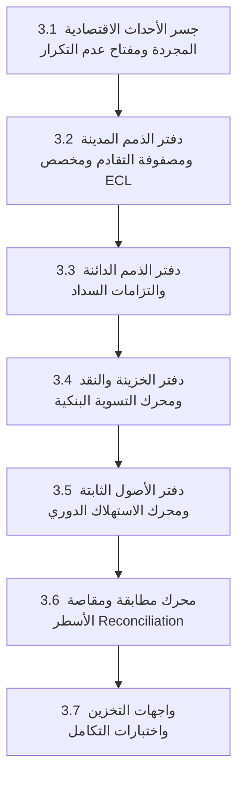

# خطة المرحلة 3: الدفاتر المساعدة المالية وجسر الأحداث (Phase 3: Financial Subledgers & Event Bridge)

**الحزمة المستهدفة:** `internal/subledgers`  
**طبيعة المكون:** محرك مستقل لإدارة السجلات المالية التفصيلية (الذمم المدينة، الذمم الدائنة، الخزينة والنقد، والأصول الثابتة) واستقبال الأحداث الاقتصادية المجردة.

---

## 1. الأهداف المعمارية والفصل عن النظم التشغيلية

الدفاتر المساعدة لا تدير عمليات البيع أو المخازن؛ بل تدير **الأثر المالي المتخصص** لكل قطاع:

* الذمم المدينة تدير المديونيات وجداول التقادم ومخصصات خسائر الائتمان (IFRS 9).
* الذمم الدائنة تدير التزامات السداد للموردين.
* الخزينة تدير مطابقة الأرصدة البنكية والمقاصة النقدية.
* الأصول الثابتة تدير جداول الاستهلاك المحاسبي وانخفاض القيمة (IAS 16 / IAS 36).
* جسر الأحداث يحول أي حدث اقتصادي مجرد (`EconomicEvent`) إلى قيد متزن تلقائياً دون ربط المحرك بأي تفاصيل تجارية.

---

## 2. المراحل الفرعية المتسلسلة (Sub-Phases)

### 3.1 جسر تحويل الأحداث الاقتصادية المجردة (Economic Event Bridge & Idempotency)

* **الهدف:** استقبال وقائع مالية من خارج المحرك دون معرفة مصدرها أو تفاصيلها التشغيلية.
* **التفاصيل البرمجية:**
  * تعريف نموذج الحدث الاقتصادي المجرد `EconomicEvent`:
    * `IdempotencyKey string`: مفتاح حتمي لمنع تكرار المعالجة.
    * `EventType string`: نوع الحدث المالي (مثل `invoice_issued`, `customer_payment`, `depreciation_run`).
    * `Date time.Time`, `Amount types.Money`, `PartnerID *uuid.UUID`, `Reference string`.
  * خرائط التوجيه المحاسبي `SubledgerEventMapping`:
    * تربط `EventType` بحساب مدين افتراضي، حساب دائن افتراضي، ودفتر اليومية المستهدف.
  * ضمان الحصانة ضد التكرار: إذا وصل نفس `IdempotencyKey` مرتين، يتم إرجاع القيد الناتج سابقاً فوراً دون إنشاء قيد مكرر.

### 3.2 دفتر الذمم المدينة ومحرك التقادم ومخصص الخسائر (Accounts Receivable & ECL)

* **الهدف:** إدارة حركة حسابات العملاء المالية وحساب مخاطر الائتمان وفق IFRS 9.
* **التفاصيل البرمجية:**
  * تسجيل الفواتير كاستحقاق مدين، والدفعات كاستحقاق دائن مرتبط بـ `PartnerID`.
  * محرك جداول أعمار الديون (Aging Schedule Engine) وتوزيع الأرصدة المتبقية على فئات الاستحقاق:
    * فئة جارية (Current / Non-due).
    * من 1 إلى 30 يوماً.
    * من 31 إلى 60 يوماً.
    * من 61 إلى 90 يوماً.
    * أكثر من 90 يوماً متأخرة.
  * محرك احتساب مخصص الخسائر الائتمانية المتوقعة (Expected Credit Loss - ECL) بناءً على مصفوفة الاحتمالات المعتمدة وتوليد قيد المخصص آلياً.

### 3.3 دفتر الذمم الدائنة (Accounts Payable Subledger)

* **الهدف:** متابعة التزامات المنشأة المالية وجدولة السداد للموردين والجهات الدائنة.
* **التفاصيل البرمجية:**
  * تتبع الاستحقاقات غير المسددة لكل `PartnerID`.
  * استخراج تقرير تقادم الذمم الدائنة لضبط السيولة وإدارة رأس المال العامل.

### 3.4 دفتر الخزينة والنقد والتسوية البنكية (Treasury & Bank Reconciliation)

* **الهدف:** ضبط حسابات البنوك والصناديق ومطابقة السجلات الدفترية مع الكشوف البنكية.
* **التفاصيل البرمجية:**
  * تسجيل حركات المقبوضات والمدفوعات على حسابات النقد وما في حكمه.
  * محرك التسوية البنكية: مقارنة سجلات دفتر الأستاذ مع كشف الحساب البنكي (Bank Statement).
  * تحديد البنود المعلقة: شيكات لم تُصرف، إيداعات في الطريق، ومصروفات بنكية غير مسجلة.

### 3.5 دفتر الأصول الثابتة والاستهلاك الدوري (Fixed Assets & Depreciation)

* **الهدف:** إدارة القيمة الدفترية للأصول واحتساب استهلاكها وفق معيار IAS 16.
* **التفاصيل البرمجية:**
  * نموذج الأصل المالي: القيمة التاريخية، القيمة التخريدية (Salvage Value)، العمر الإنتاجي، وطريقة الاستهلاك.
  * محرك احتساب الاستهلاك الشهري:
    * طريقة القسط الثابت (Straight-Line Depreciation).
    * طريقة الرصيد المتناقص (Declining Balance).
  * التوليد الآلي لقيد الاستهلاك الدوري: (من حـ/ مصروف الاستهلاك إلى حـ/ مجمع الاستهلاك).
  * تسجيل خسائر انخفاض القيمة وفق معيار IAS 36.

### 3.6 محرك مطابقة ومقاصة الأسطر المفتوحة (Reconciliation & Matching Engine)

* **الهدف:** تسوية الفواتير مقابل سندات القبض والدفع وإغلاق الأرصدة المتقابلة.
* **التفاصيل البرمجية:**
  * إسناد رقم المطابقة الفريد `MatchingNumber` للأسطر المسواة.
  * حساب الرصيد المتبقي (Residual Amount) للسطر المالي جزئي السداد.
  * إمكانية فك المطابقة (Unreconcile) عند حدوث خطأ أو إلغاء شيك.

### 3.7 واجهات التخزين واختبارات التكامل (Subledger SPI & Tests)

* **الهدف:** فصل التخزين واختبار دورة حياة العمليات التفصيلية.
* **التفاصيل البرمجية:**
  * واجهة `subledgers.Repository`.
  * اختبارات دورة كاملة: استقبال حدث اقتصادي ← إنشاء القيد في دفتر الأستاذ العام ← تسجيله في دفتر الأستاذ المساعد ← مطابقة السداد.

---

## 3. مصفوفة الملفات ومخرجات المرحلة

| الملف المستهدف | الوصف التقني الدقيق |
| :--- | :--- |
| `internal/subledgers/event_bridge.go` | محول وموجه الأحداث الاقتصادية الخارجية إلى قيود متزنة |
| `internal/subledgers/receivable.go` | دفتر الذمم المدينة ومحرك جداول التقادم واحتساب ECL |
| `internal/subledgers/payable.go` | دفتر الذمم الدائنة وإدارة الالتزامات المالية للموردين |
| `internal/subledgers/treasury.go` | دفتر الخزينة ومحرك التسويات البنكية وحركات المقاصة |
| `internal/subledgers/fixed_assets.go` | دفتر الأصول الثابتة وجداول احتساب الاستهلاك الدوري |
| `internal/subledgers/reconciliation.go` | محرك تسوية ومطابقة الأسطر وتوليد أرقام المقاصة |
| `internal/subledgers/repository.go` | واجهة المستودع التجريدي لدفاتر الأستاذ المساعدة |
| `internal/subledgers/event_bridge_test.go` | اختبارات التحقق من الـ Idempotency وتوليد القيود |

---

## 4. معايير القبول والتحقق الصارم (Acceptance Criteria)

* [ ] ضمان معالجة الحدث الاقتصادي مرة واحدة فقط مهما تكرر إرساله بنفس الـ Idempotency Key.
* [ ] توزيع دقيق لمبالغ الذمم المدينة على فئات أعمار الديون.
* [ ] احتساب استهلاك شهري صحيح للأصول وتوليد قيد استهلاك متوازن.
* [ ] إتمام المطابقة المالية الجزئية والكلية وتحديث الرصيد المتبقي بدقة.
