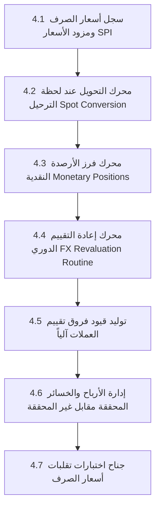

# خطة المرحلة 4: محرك التقويم والعملات المتعددة (Phase 4: Valuation & Multi-Currency Engine)

**الحزمة المستهدفة:** `internal/valuation`  
**طبيعة المكون:** محرك مالي مستقل مسؤول عن معالجة المعاملات متعددة العملات، أسعار الصرف، وإعادة التقييم الدوري وفق المعيار الدولي IAS 21.

---

## 1. الأهداف المعمارية والامتثال لمعيار IAS 21

يتطلب معيار المحاسبة الدولي `IAS 21` (آثار التغيرات في أسعار صرف العملات الأجنبية) التمييز الدقيق بين ثلاثة أنواع من العملات:

1. **عملة المعاملة (Transaction Currency):** العملة التي حُررت بها الفاتورة أو المعاملة الأصلية.
2. **العملة الوظيفية (Functional Currency):** العملة الأساسية للبيئة الاقتصادية التي تعمل فيها المنشأة، والتي يُقيد بها دفتر الأستاذ العام.
3. **عملة العرض (Presentation Currency):** العملة التي تُعرض بها القوائم المالية الختامية.

مسؤولية هذا المكون هي ترجمة المبالغ لحظة المعاملة، وحساب أرباح وخسائر فروق تقييم العملات المحققة وغير المحققة دورياً.

---

## 2. المراحل الفرعية المتسلسلة (Sub-Phases)

### 4.1 سجل أسعار الصرف وواجهة مزود الأسعار (Exchange Rates Registry & SPI)

* **الهدف:** إدارة أسعار صرف العملات التاريخية والإقفالية دون الارتباط بمصدر خارجي محدد.
* **التفاصيل البرمجية:**
  * نموذج سعر الصرف `ExchangeRate`:
    * العملة الأساسية `FromCurrency`، العملة المستهدفة `ToCurrency`.
    * السعر `Rate decimal.Decimal` بدقة تصل إلى 6 منازل عشرية.
    * تاريخ السريان `EffectiveDate time.Time`.
    * نوع السعر: فوري (Spot Rate)، إقفال (Closing Rate)، أو متوسط (Average Rate).
  * منفذ مزود الأسعار `RateProviderSPI`:
    * دالة `GetRate(ctx, from, to, date)` لجلب السعر المعتمد للتاريخ المحدد.

### 4.2 محرك التحويل لحظة تسجيل المعاملة (Spot Rate Conversion Engine)

* **الهدف:** تثبيت القيمة بالعملة الوظيفية لجميع القيود المحررة بعملات أجنبية عند ترحيلها.
* **التفاصيل البرمجية:**
  * عند تسجيل سطر قيد بعملة أجنبية (مثل USD مع عملة وظيفية SAR):
    * يتم تسجيل `AmountCurrency = 100.00 USD`.
    * يتم جلب السعر الفوري في تاريخ القيد (مثلاً 3.7500).
    * يتم احتساب المبلغ بالعملة الوظيفية: `Debit / Credit = 375.0000 SAR`.
  * تضمن هذه الآلية توازن القيد بالعملة الوظيفية دائماً مع الحفاظ على القيمة الأصلية للتدقيق والمطابقة.

### 4.3 محرك حصر وتصنيف المراكز النقدية (Monetary Positions Identification)

* **الهدف:** التمييز الصارم بين البنود النقدية والبنود غير النقدية وفق IAS 21.
* **التفاصيل البرمجية:**
  * **البنود النقدية (Monetary Items):** الحسابات النقدية، البنوك، الذمم المدينة، والذمم الدائنة. هذه البنود **يجب** إعادة تقييمها في نهاية كل فترة مالية بسعر الإقفال الفوري.
  * **البنود غير النقدية (Non-Monetary Items):** الأصول الثابتة، المخزون، والشهرة. هذه البنود تبقى بالقيمة التاريخية ولا تخضع لإعادة تقييم العملات.

### 4.4 خوارزمية إعادة التقييم الدوري (FX Revaluation Algorithm)

* **الهدف:** احتساب الفروق الناتجة عن تغير أسعار الصرف بين تاريخ التسجيل وتاريخ نهاية الفترة.
* **التفاصيل البرمجية:**
  * معادلة الفارق المحاسبي لكل حساب نقدي مقوم بعملة أجنبية:
    $$\Delta \text{FX} = (\text{Foreign Currency Balance} \times \text{Closing Rate}) - \text{Current Functional Carrying Amount}$$
  * إذا كانت النتيجة موجبة: ربح تقييم عملات أجنبية غير محقق (Unrealized FX Gain).
  * إذا كانت النتيجة سالبة: خسارة تقييم عملات أجنبية غير محققة (Unrealized FX Loss).

### 4.5 محرك التوليد الآلي لقيود تسوية العملات (Automated FX Journal Entry Generator)

* **الهدف:** ترجمة الفروق المحتسبة إلى قيود يومية متزنة تُرحل تلقائياً في دفتر الأستاذ العام.
* **التفاصيل البرمجية:**
  * قيد الربح:
    * مدين: حساب الأصل النقدي (لزيادة قيمته الدفترية بالعملة الوظيفية).
    * دائن: حساب أرباح تقييم عملات أجنبية (Unrealized FX Gain - في قائمة الدخل).
  * قيد الخسارة:
    * مدين: حساب خسائر تقييم عملات أجنبية (Unrealized FX Loss - في قائمة الدخل).
    * دائن: حساب الأصل النقدي (لتخفيض قيمته الدفترية بالعملة الوظيفية).
  * ترحيل القيد في اليومية المخصصة لتسويات العملات في آخر يوم من الفترة المالية.

### 4.6 معالجة الفروق المحققة عند السداد الفعلي (Realized FX Gain/Loss)

* **الهدف:** إثبات الربح أو الخسارة المحققة نهائياً عند تسوية الفاتورة بمبلغ فعلي يختلف عن قيمتها الدفترية.
* **التفاصيل البرمجية:**
  * مقارنة سعر الصرف في تاريخ نشوء الفاتورة بسعر الصرف في تاريخ سدادها.
  * إقفال الفرق مباشرة في حساب أرباح/خسائر فروق عملات محققة (Realized FX P&L).

### 4.7 اختبارات الحالات الحدية وتقلبات الأسعار (FX Edge Cases Test Suite)

* **الهدف:** اختبار متانة المحرك أمام الانهيارات أو الارتفاعات الحادة في أسعار الصرف.
* **التفاصيل البرمجية:**
  * اختبار التحويل بعملات ذات أصفار كثيرة أو كسور دقيقة جداً.
  * اختبار إعادة التقييم عند استقرار السعر التام (التأكد من عدم توليد قيد بفارق صفري).
  * اختبار تسوية حساب ذمم بعملة أجنبية بدفعات متعددة بأسعار صرف مختلفة.

---

## 3. مصفوفة الملفات ومخرجات المرحلة

| الملف المستهدف | الوصف التقني الدقيق |
| :--- | :--- |
| `internal/valuation/rates.go` | نموذج أسعار الصرف وإدارة السجل التاريخي |
| `internal/valuation/conversion.go` | محرك التحويل اللحظي للمبالغ عند الترحيل |
| `internal/valuation/revaluation.go` | خوارزمية فحص المراكز النقدية واحتساب فروق التقييم الدوري |
| `internal/valuation/spi.go` | واجهة مزود أسعار الصرف التجريدية (SPI) |
| `internal/valuation/revaluation_test.go` | اختبارات التحقق من صحة احتساب الأرباح والخسائر المعيارية |

---

## 4. معايير القبول والتحقق الصارم (Acceptance Criteria)

* [ ] الحفاظ الصارم على توازن القيد بالعملة الوظيفية بصرف النظر عن العملة الأصلية.
* [ ] إعادة تقييم الحسابات النقدية والذمم فقط وتخطي الأصول الثابتة وفق IAS 21.
* [ ] توليد قيد تسوية عملات متزن بدقة 100% يرحل في آخر يوم من الفترة.
* [ ] عدم توليد أي قيود تسوية إذا لم يتغير سعر الصرف بين الفترتين.
