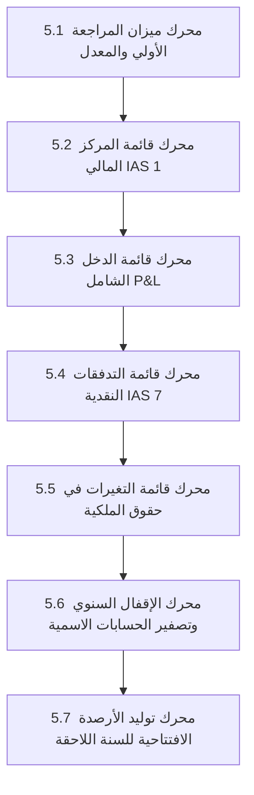

# خطة المرحلة 5: محرك التقارير المالية والإقفال (Phase 5: Financial Reporting & Closing Engine)

**الحزمة المستهدفة:** `internal/reporting`  
**طبيعة المكون:** محرك استخراج التقارير المالية المحاسبية المعتمدة وفق معيار IAS 1، ومحرك الإقفال الدوري وإقفال السنة المالية.

---

## 1. الأهداف المعمارية والمعايير المنظمة

المحرك المالي لا يكتمل إلا بقدرته على تلخيص كافة الحركات التفصيلية وإنتاج موازين المراجعة والقوائم المالية الإلزامية الأربع:

1. **قائمة المركز المالي (Statement of Financial Position - Balance Sheet)**.
2. **قائمة الدخل الشامل (Statement of Comprehensive Income - P&L)**.
3. **قائمة التدفقات النقدية (Statement of Cash Flows - IAS 7)** بالطريقة غير المباشرة.
4. **قائمة التغيرات في حقوق الملكية (Statement of Changes in Equity)**.

بالإضافة إلى **محرك إقفال السنة المالية (Year-End Closing Engine)** الذي يمثل العملية المحاسبية الأكثر خطورة بتصفير حسابات النتيجة وتدوير الأرصدة الافتتاحية.

---

## 2. المراحل الفرعية المتسلسلة (Sub-Phases)

### 5.1 محرك ميزان المراجعة (Trial Balance Engine)

* **الهدف:** تجميع مجاميع وأرصدة كافة الحسابات لفترة محددة والتأكد من التوازن الرياضي.
* **التفاصيل البرمجية:**
  * احتساب لكل حساب:
    * الرصيد الافتتاحي (Opening Debit / Credit).
    * حركة الفترة (Period Debit / Credit).
    * الرصيد الختامي (Ending Debit / Credit).
  * تمييز ميزان المراجعة قبل التسويات (Unadjusted) وبعد التسويات الجردية (Adjusted).
  * التحقق من شرط المعادلة: $\sum \text{Ending Debits} == \sum \text{Ending Credits}$.

### 5.2 محرك قائمة المركز المالي (Balance Sheet Engine - IAS 1)

* **الهدف:** عرض الوضع المالي للمنشأة في تاريخ محدد مصنفاً وفق المعايير الدولية.
* **التفاصيل البرمجية:**
  * تصنيف البنود بدقة استناداً إلى `SubClassification`:
    * **الأصول المتداولة (Current Assets):** نقد وما في حكمه، ذمم مدينة، مخزون دفتري، مدفوعات مقدماً.
    * **الأصول غير المتداولة (Non-Current Assets):** ممتلكات وآلات ومعدات، أصول غير ملموسة، استثمارات مالية.
    * **الالتزامات المتداولة (Current Liabilities):** ذمم دائنة، قروض قصيرة الأجل، مستحقات ومصروفات مستحقة.
    * **الالتزامات غير المتداولة (Non-Current Liabilities):** قروض طويلة الأجل، التزامات عقود إيجار، مخصص مكافأة نهاية الخدمة.
    * **حقوق الملكية (Equity):** رأس المال المدفوع، الاحتياطي النظامي، الأرباح المبقاة، ونتيجة العام الحالي.
  * التحقق الحتمي من معادلة الميزانية: $\text{Total Assets} == \text{Total Liabilities} + \text{Total Equity}$.

### 5.3 محرك قائمة الدخل الشامل (Statement of Comprehensive Income / P&L)

* **الهدف:** قياس الأداء المالي للمنشأة عن فترة زمنية محددة.
* **التفاصيل البرمجية:**
  * الهيكل المعياري المحاسبي:
    * إيرادات النشاط التشغيلي (Revenue)
    * (-) تكلفة المبيعات (Cost of Sales)
    * (=) **إجمالي الربح (Gross Profit)**
    * (-) مصروفات البيع والتوزيع
    * (-) المصروفات الإدارية والعمومية
    * (-) مصروفات الاستهلاك ومخصصات الديون
    * (=) **الربح التشغيلي (Operating Profit / EBIT)**
    * (+) إيرادات التمويل (-) تكاليف التمويل
    * (=) **الربح قبل الضريبة (EBT)**
    * (-) مخصص ضريبة الدخل والزكاة
    * (=) **صافي ربح الفترة (Net Profit)**
    * (+) بنود الدخل الشامل الآخر (Other Comprehensive Income - OCI)
    * (=) **إجمالي الدخل الشامل (Total Comprehensive Income)**

### 5.4 محرك قائمة التدفقات النقدية (Cash Flow Engine - IAS 7)

* **الهدف:** تتبع حركة السيولة النقدية الفعلية وتقسيمها للأنشطة الثلاثة بالطريقة غير المباشرة.
* **التفاصيل البرمجية:**
  * **الأنشطة التشغيلية (Operating Activities):**
    * البدء بصافي الربح قبل الضريبة.
    * تعديل البنود غير النقدية (إضافة الاستهلاك، إضافة المخصصات).
    * تعديل التغير في رأس المال العامل: (التغير في الذمم المدينة، المخزون، والذمم الدائنة).
  * **الأنشطة الاستثمارية (Investing Activities):** التدفقات النقدية لشراء وبيع الأصول الثابتة والاستثمارات.
  * **الأنشطة التمويلية (Financing Activities):** سداد أو استلام القروض وتوزيعات الأرباح على الملاك.
  * التحقق الصارم: صافي التغير في التدفقات النقدية يجب أن يتطابق تماماً مع الفارق بين رصيد النقد أول الفترة وآخر الفترة في الميزانية.

### 5.5 محرك قائمة التغيرات في حقوق الملكية (Statement of Changes in Equity)

* **الهدف:** تتبع حركة رأس المال والاحتياطيات والأرباح المبقاة عبر الفترات.
* **التفاصيل البرمجية:**
  * تتبع الرصيد الافتتاحي لكل مكون.
  * إضافة صافي دخل الفترة، التوزيعات، والتحويل إلى الاحتياطي النظامي.
  * استخراج الرصيد الختامي ومطابقته مع بند حقوق الملكية في المركز المالي.

### 5.6 محرك الإقفال السنوي وتصفير الحسابات المؤقتة (Year-End Closing Routine)

* **الهدف:** إقفال نتائج السنة المالية وتجهيز الدفاتر للسنة الجديدة.
* **التفاصيل البرمجية:**
  * التأكد من إقفال جميع الفترات الشهرية (1 إلى 12) بحالة `hard_closed`.
  * تجميع أرصدة جميع **الحسابات الاسمية/المؤقتة (Nominal Accounts: الإيرادات والمصروفات)**.
  * توليد قيد الإقفال السنوي (Closing Move):
    * جعل حسابات المصروفات دائنة بقيمتها لتصفيرها.
    * جعل حسابات الإيرادات مدينة بقيمتها لتصفيرها.
    * ترحيل الفارق (صافي الربح أو الخسارة) إلى حساب **الأرباح المبقاة (Retained Earnings)**.
  * تصبح أرصدة كافة حسابات قائمة الدخل صفراً تماماً بنهاية هذا القيد.

### 5.7 محرك توليد الأرصدة الافتتاحية وتدوير السنوات (Opening Balance Rolling)

* **الهدف:** فتح السنة المالية الجديدة بترحيل الأرصدة الدائمة فقط.
* **التفاصيل البرمجية:**
  * حصر أرصدة **الحسابات الدائمة/الحقيقية (Real Accounts: الأصول، الالتزامات، وحقوق الملكية المعدلة)**.
  * توليد قيد الأرصدة الافتتاحية (Opening Move) بتاريخ أول يوم في السنة المالية الجديدة (`01-01`).
  * ترحيل القيد في اليومية الافتتاحية لتصبح الأرصدة جاهزة للعمليات التشغيلية الجديدة.
  * وضع علامة إغلاق نهائي على السنة السابقة لمنع أي حركة إضافية.

---

## 3. مصفوفة الملفات ومخرجات المرحلة

| الملف المستهدف | الوصف التقني الدقيق |
| :--- | :--- |
| `internal/reporting/trial_balance.go` | محرك ميزان المراجعة واحتساب الحركات والأرصدة |
| `internal/reporting/balance_sheet.go` | محرك قائمة المركز المالي والتحقق من التوازن وفق IAS 1 |
| `internal/reporting/income_statement.go` | محرك قائمة الدخل الشامل واحتساب صافي الأرباح |
| `internal/reporting/cash_flow.go` | محرك قائمة التدفقات النقدية بالطريقة غير المباشرة (IAS 7) |
| `internal/reporting/equity_statement.go` | محرك قائمة التغيرات في حقوق الملكية |
| `internal/reporting/closing_engine.go` | محرك إقفال السنة المالية، تصفير الإيرادات والمصروفات، وتدوير الأرصدة |
| `internal/reporting/repository.go` | واجهات استعلام واستخراج تقارير الأستاذ العام |
| `internal/reporting/reporting_test.go` | اختبارات التحقق من القوائم الأربع ومطابقة الإقفال السنوي |

---

## 4. معايير القبول والتحقق الصارم (Acceptance Criteria)

* [ ] اتزان ميزان المراجعة: $\sum \text{Debits} == \sum \text{Credits}$.
* [ ] تطابق معادلة المركز المالي: الأصول = الالتزامات + حقوق الملكية بدقة 100%.
* [ ] تطابق صافي تدفقات النقدية مع التغير الفعلي في حسابات النقد وما في حكمه.
* [ ] نجاح الإقفال السنوي وتصفير كامل حسابات الإيرادات والمصروفات للسنة الجديدة.
* [ ] تدوير الأرصدة الدائمة بدقة إلى قيد افتتاحي متزن في بداية العام الجديد.
