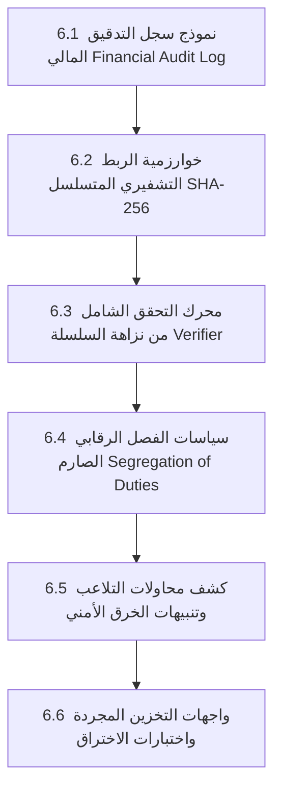

# خطة المرحلة 6: محرك الحوكمة والرقابة وسلسلة التدقيق (Phase 6: Governance, Audit & Hash Chain)
**الحزمة المستهدفة:** `internal/governance`  
**طبيعة المكون:** محرك مستقل يضمن النزاهة التشفيرية، فرض سياسات الفصل بين المهام (SoD)، واكتشاف أي تلاعب أو تعديل غير مشروع في الدفاتر المحاسبية.

---

## 1. الأهداف المعمارية والامتثال لإطار COSO والرقابة التشفيرية
تعتبر النزاهة المحاسبية (Data Integrity) وغير القابلية للإنكار (Non-Repudiation) ركيزتين لا غنى عنهما للامتثال للمعايير المالية وقوانين التدقيق وحوكمة الشركات (COSO Internal Control Framework).  
مسؤولية هذا المكون هي توفير **سلسلة تدقيق تشفيرية متسلسلة (Blockchain-style Cryptographic Audit Chain)** تربط كل حركة بالتي قبلها، بحيث يؤدي أي تعديل يدوي في قاعدة البيانات إلى كسر السلسلة واكتشافه فوراً.

---

## 2. المراحل الفرعية المتسلسلة (Sub-Phases)

### 6.1 نموذج سجل التدقيق المالي المستقل (Financial Audit Log Entity)
* **الهدف:** توثيق كل واقعة محاسبية بتفاصيلها الكاملة قبل وبعد التغيير.
* **التفاصيل البرمجية:**
  * نموذج السجل `FinancialAuditLog`:
    - `ID int64`: رقم تسلسلي متزايد.
    - `EntityType string`: الكيان المتأثر (`account`, `move`, `period`, `reconciliation`).
    - `EntityID uuid.UUID`: المعرف الفريد للكيان.
    - `Action string`: نوع الحركة (`POST`, `REVERSE`, `CLOSE`, `ADJUST`).
    - `ActorID uuid.UUID`: المعرف المجرد للمستخدم المنفذ للعملية.
    - `PayloadBefore []byte`: الحالة الكاملة للبيانات قبل التغيير (JSON).
    - `PayloadAfter []byte`: الحالة الكاملة للبيانات بعد التغيير (JSON).
    - `Timestamp time.Time`: البصمة الزمنية اللحظية بتوقيت UTC.
    - `PreviousLogHash string`: البصمة التشفيرية للسجل السابق في السلسلة.
    - `CurrentLogHash string`: البصمة التشفيرية لهذا السجل.

### 6.2 خوارزمية التوقيع التشفيري المتسلسل (Cryptographic Hash-Chaining Engine)
* **الهدف:** توليد بصمة رقمية حتمية تربط السجل الحالي بماضيه لمنع التعديل بأثر رجعي.
* **التفاصيل البرمجية:**
  * معادلة التشفير باستخدام `SHA-256`:
    $$\text{CurrentLogHash} = \text{SHA256}(\text{PreviousLogHash} + \text{EntityType} + \text{EntityID} + \text{Action} + \text{ActorID} + \text{PayloadAfter} + \text{Timestamp})$$
  * السجل الأول (Genesis Block) يعتمد على قيمة ثابتة مشفرة مسبقاً (`0000000000000000000000000000000000000000000000000000000000000000`).
  * يتم تخزين الـ Hash بشكل ذري متزامن مع ترحيل القيد في قاعدة البيانات.

### 6.3 محرك التحقق الدوري من سلامة السجلات (Audit Integrity Verifier)
* **الهدف:** فحص السلسلة التاريخية بالكامل للتأكد من عدم حدوث أي اختراق أو تعديل خفي.
* **التفاصيل البرمجية:**
  * دالة التحقق الشامل: `VerifyAuditIntegrity(ctx) (bool, error)`.
  * تقرأ السجلات بالترتيب التسلسلي من البداية حتى النهاية.
  * تعيد حساب الـ Hash لكل سجل بناءً على محتوياته وتتحقق من تطابقه مع `CurrentLogHash` المسجل، ومن تطابقه مع `PreviousLogHash` للسجل التالي.
  * في حال وجود أدنى اختلاف (ولو في سنت واحد أو حرف واحد)، يتم إرجاع خطأ `ErrAuditChainBroken` مع تحديد السجل ورقم المعاملة المخترقة بدقة.

### 6.4 سياسات الفصل بين المهام والحوكمة (Segregation of Duties - SoD)
* **الهدف:** منع تركز الصلاحيات المالية الحساسة في يد شخص واحد.
* **التفاصيل البرمجية:**
  * مصفوفة الصلاحيات المجردة:
    - صلاحية إنشاء المسودات (Drafting).
    - صلاحية الاعتماد والترحيل (Posting).
    - صلاحية الإلغاء والعكس (Reversing).
    - صلاحية الإقفال الدوري والسنوي (Closing).
  * قواعد الحوكمة التلقائية:
    - **منع الترحيل الذاتي (Self-Approval Prohibition):** من أنشأ قيداً يتجاوز حداً مالياً معيناً لا يمكنه ترحيله إطلاقاً.
    - **فصل التسوية البنكية:** من يقوم بالمطابقة البنكية يجب أن يختلف عن من ينفذ سندات الصرف.
    - **قفل الإقفال السنوي:** لا يُسمح بإقفال السنة إلا بحساب مصادق عليه يمتلك صلاحية المراقب المالي (Financial Controller).

### 6.5 رصد محاولات التلاعب وإحباطها (Tamper Detection & Forensic Logging)
* **الهدف:** تسجيل أي محاولة لكسر القواعد ورفض تمرير أي حركة غير متوافقة تشفيرياً.
* **التفاصيل البرمجية:**
  * منع أي تعديل مباشر لقيم السجلات المحفوظة.
  * فحص سلامة السلسلة قبل إجراء الإقفال السنوي كشرط إلزامي للبدء.

### 6.6 واجهات التخزين واختبارات كسر النزاهة (Storage SPI & Penetration Tests)
* **الهدف:** اختبار صمود خوارزمية السلسلة ضد التعديلات المصطنعة.
* **التفاصيل البرمجية:**
  * واجهة `governance.Repository`:
    - `AppendAuditLog(ctx, log)`
    - `GetLastAuditLog(ctx)`
    - `IterateAuditLogs(ctx, fromID, handler)`
  * اختبار المحاكاة الهجومية (Tampering Simulation Test):
    - تسجيل عدة قيود متسلسلة.
    - تعديل سطر قيد أو مبلغ بطريقة مصطنعة في التخزين.
    - تشغيل `VerifyAuditIntegrity` والتأكد من اكتشاف التعديل وإرجاع الخطأ الحتمي.

---

## 3. مصفوفة الملفات ومخرجات المرحلة

| الملف المستهدف | الوصف التقني الدقيق |
| :--- | :--- |
| `internal/governance/audit_chain.go` | خوارزمية الربط التشفيري وتوليد بصمات SHA-256 |
| `internal/governance/verifier.go` | محرك فحص سلامة وتماسك سلسلة التدقيق الكاملة |
| `internal/governance/sod_policy.go` | محرك تطبيق قواعد وسياسات الفصل بين المهام (SoD) |
| `internal/governance/repository.go` | واجهة المستودع التجريدي لسجلات التدقيق التشفيرية |
| `internal/governance/audit_chain_test.go` | اختبارات التحقق من السلسلة واختبارات كشف التلاعب |

---

## 4. معايير القبول والتحقق الصارم (Acceptance Criteria)
- [ ] توليد Hash تشفيري فريد ومتسلسل لكل حركة مالية يتم تسجيلها في النظام.
- [ ] نجاح فحص النزاهة بنسبة 100% على السجلات غير المعدلة.
- [ ] فشل فحص النزاهة واكتشاف التلاعب فوراً عند تغيير أي حرف أو رقم في السجلات التاريخية.
- [ ] منع المستخدمين من اعتماد قيودهم الشخصية التي تتجاوز سقف الصلاحية.

