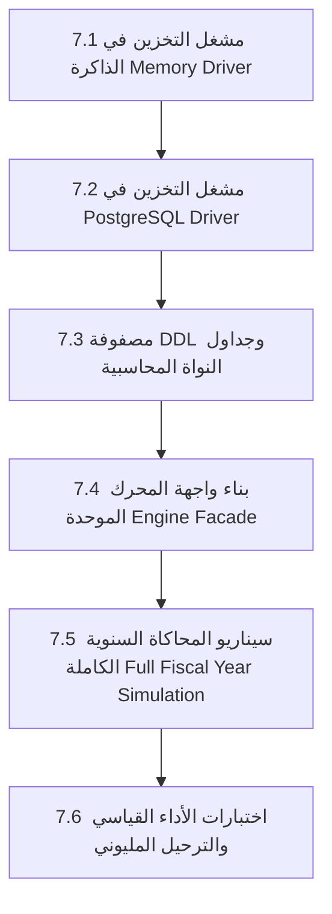

# خطة المرحلة 7: واجهة المحرك الموحدة واختبارات المحاكاة الشاملة (Phase 7: Engine Facade & End-to-End Financial Simulation)

**الحزمة المستهدفة:** `accounting_engine` (الجذر والمشغلات)  
**طبيعة المكون:** نقطة التجميع البرمجية المركزية (Unified Facade Engine) واختبارات المحاكاة السنوية المعقدة دون أي اتصال بالشبكة أو الويب.

---

## 1. الأهداف المعمارية ومبدأ الواجهة الموحدة (Facade Pattern)

الهدف النهائي لبناء النواة المحاسبية هو تمكين التطبيقات والمشاريع الأخرى من استيراد المحرك كحزمة Go نقية (`go get / import`) والتعامل مع واجهة متماسكة وقوية:

```go
engine := accounting_engine.New(config, storageDriver)
```

توفر هذه الواجهة الموحدة وصولاً منسقاً ومنيعاً لجميع المكونات الستة المستقلة، وتوفر مشغلات التخزين المعتمدة (In-Memory للاختبارات و PostgreSQL للإنتاج).

---

## 2. المراحل الفرعية المتسلسلة (Sub-Phases)



### 7.1 مشغل التخزين في الذاكرة (High-Performance In-Memory Driver)

* **الهدف:** توفير مشغل تخزين متكامل وسريع للغاية يعمل داخل الذاكرة العشوائية دون الحاجة لأي خادم قاعدة بيانات خارجي.
* **التفاصيل البرمجية:**
  * تنفيذ كافة واجهات المستودعات (SPIs) للمكونات الستة:
    * `masterdata.Repository`
    * `posting.Repository`
    * `subledgers.Repository`
    * `valuation.RateProviderSPI`
    * `reporting.Repository`
    * `governance.Repository`
  * حماية التنافسية باستخدام `sync.RWMutex`.
  * استخدام هذا المشغل كمعيار أساسي لاختبارات الوحدة واختبارات التكامل فائقة السرعة.

### 7.2 مشغل التخزين في PostgreSQL (Production-Grade PostgreSQL Driver)

* **الهدف:** توفير المشغل الإنتاجي الذي يحفظ السجلات في قاعدة بيانات علائقية متوافقة مع ACID.
* **التفاصيل البرمجية:**
  * استخدام مكتبة `jackc/pgx/v5` لدعم الاتصال الفعال والعمليات المتزامنة (`Connection Pooling`).
  * تنفيذ المعاملات الذرية (`pgx.Tx`) للترحيل وقفل التسلسلات (`SELECT ... FOR UPDATE`).
  * تحويل الاستعلامات المالية المعقدة (مثل ميزان المراجعة وتجميع الأرصدة) إلى استعلامات SQL عالية الأداء تستفيد من الفهارس الجزئية.

### 7.3 مخطط قاعدة البيانات النقي للنواة المالية (Financial DDL Schema)

* **الهدف:** توفير ملفات إنشاء الجداول والفهارس والقيود الرياضية في قاعدة البيانات الخاصة بالمحرك المالي فقط.
* **التفاصيل البرمجية:**
  * جداول النواة الخالصة:
    * `accounts`: شجرة الحسابات مع قيود التحقق من النوع والرصيد الطبيعي.
    * `fiscal_years` و `fiscal_periods`: السنوات والفترات وحالاتها.
    * `journals`: دفاتر اليومية والتسلسل.
    * `account_moves` و `account_move_lines`: القيود والأسطر مع قيود منع القيم السالبة.
    * `subledger_mappings` و `subledger_events`: توجيه وأحداث الدفاتر المساعدة مع مفتاح `idempotency_key` الفريد.
    * `exchange_rates`: أسعار الصرف التاريخية والإقفالية.
    * `financial_audit_logs`: سجلات التدقيق التشفيرية المترابطة.

### 7.4 واجهة المحرك الموحدة (Unified Engine Facade)

* **الهدف:** تجميع كافة الخدمات والمكونات تحت كائن واحد يسهل تهيئته واستدعاؤه.
* **التفاصيل البرمجية:**
  * هيكل `AccountingEngine`:

    ```go
    type AccountingEngine struct {
        MasterData *masterdata.Service
        Posting    *posting.Engine
        Subledgers *subledgers.Service
        Valuation  *valuation.Engine
        Reporting  *reporting.Engine
        Governance *governance.Engine
    }
    ```

  * دالة التهيئة الموحدة `NewEngine(storageDriver, config)` التي تقوم بالحقن التلقائي للاعتماديات والربط بين المكونات.

### 7.5 سيناريو المحاكاة السنوية الكاملة (Full Fiscal Year Simulation Test)

* **الهدف:** إثبات كفاءة ونزاهة المحرك بمحاكاة دورة حياة شركة تجارية كاملة على مدار سنة مالية.
* **التفاصيل البرمجية:**
  1. **التأسيس:** إيداع رأس المال الأولي، شراء أصول ثابتة، وتكوين شجرة الحسابات.
  2. **العمليات التشغيلية (عبر جسر الأحداث المجردة):**
     * تسجيل فواتير بيع متعددة (محلية وبعملات أجنبية USD).
     * استلام دفعات جزئية وكاملة من العملاء ومطابقتها.
     * سداد مستحقات موردين ومصروفات إدارية.
  3. **التسويات الشهرية:**
     * تشغيل استهلاك الأصول الثابتة لكل شهر.
     * إعادة تقييم الحسابات النقدية بالعملة الأجنبية في نهاية كل ربع سنة.
  4. **الفحص الرقابي:**
     * استخراج ميزان المراجعة الأولي والتحقق من توازنه.
     * التحقق الشامل من سلامة سلسلة التدقيق التشفيرية وعدم انقطاعها.
  5. **الإقفال السنوي واستخراج القوائم:**
     * إقفال الفترات من 1 إلى 12.
     * توليد قيد إقفال السنة وتصفير حسابات الإيرادات والمصروفات إلى حساب الأرباح المبقاة.
     * توليد قيد الأرصدة الافتتاحية للسنة المالية الجديدة.
     * استخراج القوائم المالية الأربع (المركز المالي، الدخل الشامل، التدفقات النقدية، التغير في الملكية) والتحقق من اتزانها بنسبة 100%.

### 7.6 اختبارات الأداء العالي والضغط (Benchmark & Stress Testing)

* **الهدف:** قياس سرعة معالجة المحرك ومعدل الترحيل في الثانية (Throughput).
* **التفاصيل البرمجية:**
  * قياس زمن ترحيل القيد الواحد (Target: < 5ms).
  * قياس الترحيل المجمع لـ 10,000 قيد متوازن في معاملة واحدة.
  * قياس سرعة استخراج ميزان المراجعة على ملايين الأسطر باستخدام مشغل PostgreSQL.

---

## 3. مصفوفة الملفات ومخرجات المرحلة

| الملف المستهدف | الوصف التقني الدقيق |
| :--- | :--- |
| `storage/memory/driver.go` | مشغل التخزين في الذاكرة المنفذ لكافة واجهات الـ SPI |
| `storage/postgres/driver.go` | مشغل التخزين في قاعدة بيانات PostgreSQL للإنتاج |
| `storage/postgres/schema.sql` | ملف مخطط الجداول والفهارس والقيود للنواة المالية الخالصة |
| `engine.go` | واجهة المحرك الموحدة (Facade) ودوال التهيئة |
| `simulation_test.go` | اختبار المحاكاة السنوية الكاملة والشاملة لكافة وظائف المحرك |
| `benchmark_test.go` | اختبارات قياس الأداء والضغط وسرعة الترحيل |

---

## 4. معايير القبول والتحقق الصارم (Acceptance Criteria)

* [ ] إمكانية استيراد وتشغيل المحرك برمجياً من أي مكان دون الحاجة لتشغيل أي خادم HTTP.
* [ ] نجاح اختبار المحاكاة السنوية الكاملة من التأسيس إلى الإقفال واستخراج القوائم المالية الأربع بدقة تامة.
* [ ] اتزان المركز المالي ومطابقة التدفقات النقدية مع التغير الفعلي في أرصدة النقد.
* [ ] التحقق التام من سلامة سلسلة التدقيق التشفيرية بعد آلاف المعاملات في سيناريو المحاكاة.
