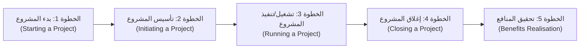
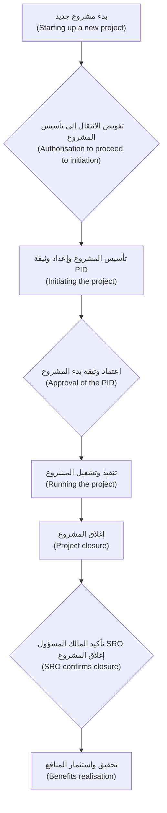
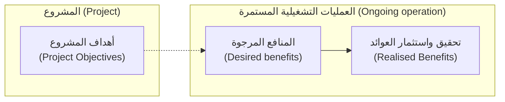
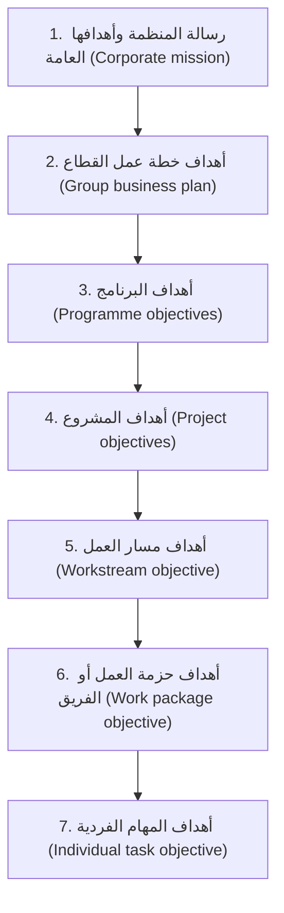
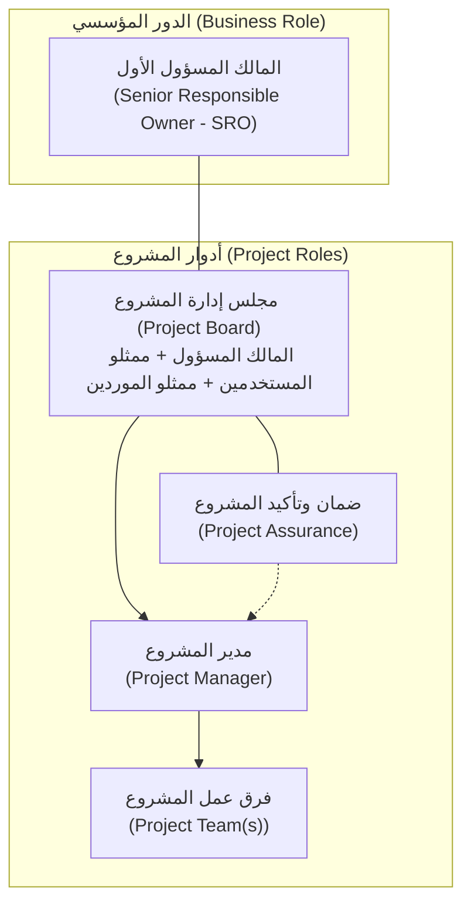
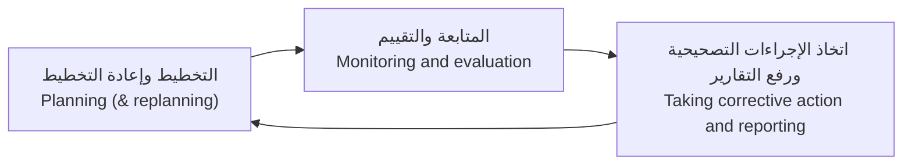
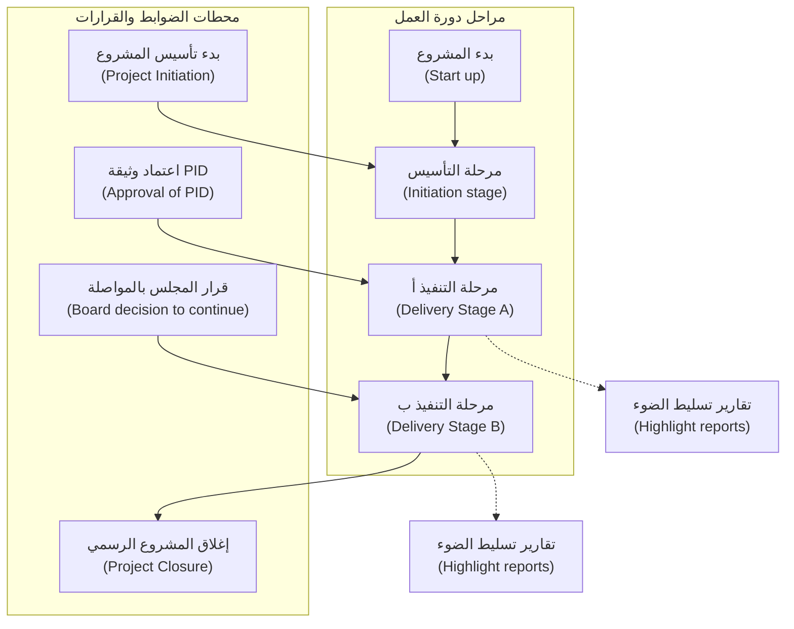
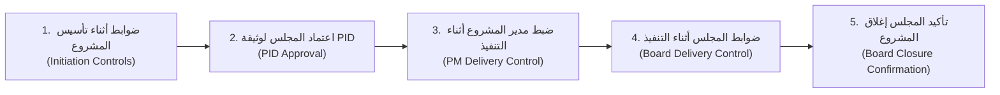

# الدليل الشامل لإدارة المشاريع: التنظيم والتخطيط والرقابة

## (GUIDELINES FOR MANAGING PROJECTS: How to Organise, Plan and Control Projects)

> **الجهة المصدرة:** وزارة الأعمال والابتكار والمهارات البريطانية (Department for Business Innovation & Skills - BIS)  
> **تاريخ الإصدار:** نوفمبر 2010  
> **طبيعة الوثيقة:** دليل منهجي إرشادي متوافق مع معايير PRINCE2® لإدارة المشاريع الحكومية والمؤسسية.  
> **ملاحظة:** هذه وثيقة منهجية مرجعية عامة ومستقلة تماماً عن النظام المحاسبي أو البرمجي للمشروع.

---

## فهرس المحتويات (Contents)

- [القسم 0: الغرض من إرشادات إدارة المشاريع](#القسم-0-الغرض-من-إرشادات-إدارة-المشاريع)
  - [ما هو المشروع الناجح؟](#ما-هو-المشروع-الناجح)
  - [هل تختلف المشاريع عن الأعمال التشغيلية الأخرى؟](#هل-تختلف-المشاريع-عن-الأعمال-التشغيلية-الأخرى)
  - [لماذا نستخدم هذه الإرشادات؟](#لماذا-نستخدم-هذه-الإرشادات)
  - [ما تغطيه هذه الإرشادات وما لا تغطيه](#ما-تغطيه-هذه-الإرشادات-وما-لا-تغطيه)
  - [دورة حياة المشروع (The Project Lifecycle)](#دورة-حياة-المشروع-the-project-lifecycle)
  - [حوكمة البرامج والمشاريع (Programme and Project Governance)](#حوكمة-البرامج-والمشاريع-programme-and-project-governance)
  - [مواءمة وتكييف إدارة المشاريع واستخدام النماذج](#مواءمة-وتكييف-إدارة-المشاريع-واستخدام-النماذج)
- [القسم 1: بدء مشروع جديد (Starting up a new project)](#القسم-1-بدء-مشروع-جديد-starting-up-a-new-project)
  - [موجز المشروع (The Project Brief)](#موجز-المشروع-the-project-brief)
  - [تطوير واعتماد موجز المشروع ومحتوياته](#تطوير-واعتماد-موجز-المشروع-ومحتوياته)
  - [تحديد نطاق المشروع وأهدافه والعلاقة بينهما](#تحديد-نطاق-المشروع-وأهدافه-والعلاقة-بينهما)
  - [أمثلة عملية على تحديد النطاق](#أمثلة-عملية-على-تحديد-النطاق)
  - [صياغة أهداف المشروع وفق معايير SMART والتدرج الهرمي](#صياغة-أهداف-المشروع-وفق-معايير-smart-والتدرج-الهرمي)
  - [تحديد وتوصيف المنافع (Defining the Benefits)](#تحديد-وتوصيف-المنافع-defining-the-benefits)
  - [تصميم الهيكل التنظيمي للمشروع (Project Organisation)](#تصميم-الهيكل-التنظيمي-للمشروع-project-organisation)
  - [الأدوار والمسؤوليات الرئيسية (SRO، المجلس، الضمان، مدير المشروع)](#الأدوار-والمسؤوليات-الرئيسية)
- [القسم 2: تأسيس وإطلاق المشروع (Initiating the Project)](#القسم-2-تأسيس-وإطلاق-المشروع-initiating-the-project)
  - [وثيقة بدء المشروع (Project Initiation Document - PID)](#وثيقة-بدء-المشروع-project-initiation-document---pid)
  - [دراسة الجدوى ومبررات الأعمال (The Business Case)](#دراسة-الجدوى-ومبررات-الأعمال-the-business-case)
  - [تحليل وإدارة أصحاب المصلحة (Stakeholders Management)](#تحليل-وإدارة-أصحاب-المصلحة-stakeholders-management)
  - [تخطيط المشروع وخطواته (Planning the Project)](#تخطيط-المشروع-وخطواته-planning-the-project)
  - [قائمة التحقق التفصيلية للتخطيط (Planning Checklist)](#قائمة-التحقق-التفصيلية-للتخطيط-planning-checklist)
  - [إدارة المخاطر - تجنب العقبات واستغلال الفرص (Risk Management)](#إدارة-المخاطر---تجنب-العقبات-واستغلال-الفرص-risk-management)
  - [اعتماد وثيقة بدء المشروع (Approving the PID)](#اعتماد-وثيقة-بدء-المشروع-approving-the-pid)
- [القسم 3: تنفيذ وتشغيل المشروع (Running the project)](#القسم-3-تنفيذ-وتشغيل-المشروع-running-the-project)
  - [الضبط والتحكم - مفتاح نجاح المشروع (Project Control)](#الضبط-والتحكم---مفتاح-نجاح-المشروع-project-control)
  - [تقسيم المشروع إلى مراحل قابلة للإدارة (Manageable Stages)](#تقسيم-المشروع-إلى-مراحل-قابلة-للإدارة-manageable-stages)
  - [ضوابط المالك المسؤول ومجلس المشروع أثناء التنفيذ](#ضوابط-المالك-المسؤول-ومجلس-المشروع-أثناء-التنفيذ)
  - [تقارير تسليط الضوء الدورية (Highlight Reports)](#تقارير-تسليط-الضوء-الدورية-highlight-reports)
  - [ضوابط مدير المشروع ونقاط الفحص (Checkpoints)](#ضوابط-مدير-المشروع-ونقاط-الفحص-checkpoints)
  - [التعامل مع الانحرافات وحدود التفاوت (Tolerances & Exceptions)](#التعامل-مع-الانحرافات-وحدود-التفاوت-tolerances--exceptions)
  - [إدارة القضايا والتغييرات (Issues, Problems and Changes)](#إدارة-القضايا-والتغييرات-issues-problems-and-changes)
  - [إدارة التكوين وضبط الإصدارات (Configuration Management)](#إدارة-التكوين-وضبط-الإصدارات-configuration-management)
  - [ملخص ضوابط المشروع الشاملة (Summary of Controls)](#ملخص-ضوابط-المشروع-الشاملة-summary-of-controls)
- [القسم 4: إغلاق المشروع (Closing the Project)](#القسم-4-إغلاق-المشروع-closing-the-project)
  - [قائمة التحقق لإغلاق المشروع (Project Closure Checklist)](#قائمة-التحقق-لإغلاق-المشروع-project-closure-checklist)
  - [النتائج التنظيمية لإغلاق المشروع](#النتائج-التنظيمية-لإغلاق-المشروع)
- [القسم 5: تحقيق واستثمار المنافع (Realising the Benefits)](#القسم-5-تحقيق-واستثمار-المنافع-realising-the-benefits)
  - [شروط ما قبل الإغلاق لضمان جني المنافع](#شروط-ما-قبل-الإغلاق-لضمان-جني-المنافع)
  - [خطة تحقيق المنافع (Benefits Realisation Plan)](#خطة-تحقيق-المنافع-the-benefits-realisation-plan)
- [الملحق أ: نماذج واستمارات وثائق إدارة المشاريع](#الملحق-أ-نماذج-واستمارات-وثائق-إدارة-المشاريع)

---

# القسم 0: الغرض من إرشادات إدارة المشاريع

*(Section 0: The Purpose of the Project Management Guidelines)*

الغرض من هذه الإرشادات هو مساعدتك في **تنظيم المشاريع وتخطيطها وضبط مسارها**. لقد صُممت لتمكينك من تعظيم فرص نجاح مشاريعك من خلال معالجة كل عنصر من عناصر المشروع في التوقيت السليم وبمستوى التفصيل الملائم لحجم المشروع ودرجة تعقيده.

### ما هو المشروع الناجح؟

لكي يُعتبر المشروع ناجحاً، يجب أن:

- يُحقق **النتائج والمنافع** المطلوبة من قِبل المنظمة وشركاء التنفيذ والجهات المعنية.
- يُنشئ ويُسلّم **المخرجات (Deliverables)** المطابقة للمتطلبات والمواصفات المتفق عليها.
- يلتزم **بالأهداف والمواعيد الزمنية** المستهدفة.
- يلتزم **بالميزانيات المالية** المعتمدة دون تجاوز.
- يُشرك **جميع الأطراف والكوادر المناسبة**.
- يستثمر **الموارد** المتاحة في المنظمة وخارجها بأعلى درجات الكفاءة.
- يُراعي **التغييرات** المستمرة في طريقة عمل المنظمة.
- يُدير بفاعلية أي **مخاطر** قد تهدد نجاحه.
- يأخذ في الحسبان احتياجات الموظفين وأصحاب المصلحة الذين سيتأثرون بالتغييرات الناتجة عن المشروع.

### هل تختلف المشاريع عن الأعمال التشغيلية الأخرى؟

تختلف المشاريع جوهرياً عن الأنشطة التشغيلية اليومية المعتادة للمنظمة في أنها:

1. تمتلك **أهدافاً محددة ومؤقتة** لتقديم منافع وقيمة جديدة (للمكلفين بدفع الضرائب، الشركات، الجمهور، المنظمة الراعية، أو الشركاء).
2. قد تُدخل **تغييرات هيكلية كبرى** على طريقة ممارسة الأعمال.
3. تُنتج **مخرجات جديدة (Outputs/Deliverables)** تُمكن من جني المنافع.
4. تؤسس **هيكلاً إدارياً وترتيبات حوكمة مؤقتة** خاصة طوال فترة حياة المشروع فقط.
5. تكون **عُرضة لمخاطر غير معتادة** لا تُصادف في العمليات التشغيلية الروتينية.
6. تُشرك **أطرافاً ومصالح متعددة** من داخل المنظمة وخارجها.
7. قد تعتمد **أساليب وأدوات عمل جديدة** وغير مألوفة للمنظمة.

### لماذا نستخدم هذه الإرشادات؟

تفشل بعض المشاريع في تحقيق أهدافها لأسباب متعددة يمكن تجنبها، من أهمها:

- إغفال احتياجات أصحاب المصلحة وتأثيراتهم.
- غياب التواصل الفعال مع أصحاب المصلحة وإبقاؤهم بمعزل عن التطورات.
- تجاهل تأثير أنشطة المشروع على سير العمل التشغيلي الطبيعي للمنظمة.
- الإفراط في إنتاج حلول معقدة ومكلفة للغاية (*Gold-plated solutions*) بينما تفي الحلول البسيطة والعملية بالغرض المطلوب تماماً.
- الفشل في تحديد ومواجهة المخاطر التي تهدد أهداف المشروع.
- التقصير في تخطيط ومتابعة وضبط ومراقبة أعمال المشروع.

### ما تغطيه هذه الإرشادات وما لا تغطيه

توفر هذه الإرشادات إطاراً عملياً يغطي:

- **"ماذا، ولماذا، ومن، ومتى، وكيف"** الخاصة بأنشطة إدارة المشاريع.
- كيفية **مواءمة وتكييف وتوسيع إدارة المشاريع (Scaling)** لتلائم أحجام المشاريع ومددها ودرجات تعقيدها المختلفة.
- **مخططات انسيابية وقوائم فحص (Checklists)** للإرشاد خلال المهام الأساسية.
- إمكانية الوصول إلى نماذج واستمارات موحدة لكافة وثائق إدارة المشاريع.

> [!NOTE]
> **ما لا تغطيه الإرشادات:** النظرية الأكاديمية البحتة لإدارة المشاريع، والتفاصيل الكاملة الموسعة لمنهجية PRINCE2® (رغم التوافق الكامل معها)، والتدريب على أدوات إدارة المشاريع المحددة، والمهارات الشخصية والقيادية (Soft Skills).

---

## دورة حياة المشروع (The Project Lifecycle)

تتألف دورة حياة المشروع المعتمدة في وزارة الأعمال (BIS) من 5 خطوات رئيسية:



### الوثائق والمخرجات الرئيسية لكل خطوة

1. **بدء المشروع:** موجز المشروع (*Project Brief*).
2. **تأسيس المشروع:** وثيقة بدء المشروع (*Project Initiation Document - PID*).
3. **تشغيل وتنفيذ المشروع:** خطة المشروع (*Project Plan*)، تقارير تسليط الضوء (*Highlight Reports*)، سجل المخاطر (*Risk Register*)، وإدارة التغيير (*Change Control*).
4. **إغلاق المشروع:** تقرير الدروس المستفادة (*Lessons Learned*) وتقييم الإغلاق.
5. **تحقيق المنافع:** خطة تحقيق المنافع (*Benefits Realisation Plan*) ومراجعة ما بعد المشروع (*Post Project Review*).

---

### المهام والمسؤوليات عبر مراحل دورة حياة المشروع



| المرحلة | المسؤوليات الأساسية |
| :--- | :--- |
| **1. بدء مشروع جديد** | يقوم **المالك المسؤول الأول (SRO)** بتحديد مبررات المشروع، صياغة النتائج والمنافع المرجوة، تعيين مدير المشروع وتشكيل المجلس، توثيق الشروط المرجعية في **موجز المشروع (Project Brief)**، وضمان المواءمة الاستراتيجية. |
| **2. تفويض الانتقال للتأسيس** | يتخذ **المالك المسؤول / مجلس المشروع** قراراً بما إذا كان من المجدي والمنطقي الانتقال لمرحلة التأسيس. |
| **3. تأسيس المشروع** | يُعد **فريق إدارة المشروع** خطة تسليم المنافع، واستراتيجية أصحاب المصلحة، وتحديد الموارد، وإعداد **دراسة الجدوى ومبررات الأعمال (Business Case)**، وتوثيق كافة الترتيبات في **وثيقة بدء المشروع (PID)**. |
| **4. اعتماد وثيقة PID** | يُقيّم **المالك المسؤول ومجلس المشروع** وثيقة PID ودراسة الجدوى للبت فيما إذا كان المشروع مجدياً، مقدوراً على تكلفته، ومناسباً للتنفيذ حالياً. |
| **5. تشغيل وتنفيذ المشروع** | يُحشد **فريق المشروع** الموارد، ويخطط ويراقب العمل، ويواجه المخاطر والمشكلات، ويُديم التواصل مع المتأثرين، ويرفع تقارير التقدم، ويتأكد من ملاءمة المخرجات لتحقيق المنافع. |
| **6. إغلاق المشروع** | يُقيّم **فريق المشروع** النتائج مقابل PID، ويوثق وينشر الدروس المستفادة، ويحرر الموارد المستهلكة، ويراجع المنافع المحققة مبكراً. |
| **7. تأكيد الإغلاق** | يُغلق **المالك المسؤول الأول (SRO)** المشروع رسمياً، ويتحقق من وضع خطط لمراجعة ما بعد التنفيذ، ويسلم المخرجات للمسؤول التشغيلي. |
| **8. تحقيق واستثمار المنافع** | يضمن **المالك المسؤول (SRO)** إجراء مراجعات ما بعد المشروع لقياس المنافع، وتحديث دراسة الجدوى لتعكس الواقع التشغيلي، وتغذية الدروس في التخطيط الاستراتيجي. |

---

## حوكمة البرامج والمشاريع (Programme and Project Governance)

> **"الحوكمة: هي الوظائف والمسؤوليات والعمليات والإجراءات التي تحدد كيفية إعداد البرنامج/المشروع وإدارته وضبطه ومراقبته."**

### الغرض من الحوكمة

تضمن الحوكمة عدم بدء أي مشروع أو استمراره إلا إذا كان:

- **ذا جدوى وقيمة (Worthwhile)**.
- **قابلاً للتطبيق العملي (Viable)**.
- **مقدوراً على تكلفته (Affordable)**.
- **يُحقق عائداً حقيقياً مقابل المال (Good value for money)**.
- **مخططاً ومضبوطاً بإحكام (Planned and controlled)**.
- **ضمن حدود المخاطر المقبولة (Within tolerances for acceptable risk)**.

### مجالات تغطية الحوكمة

- التبرير المستمر لجدوى المشروع (Continuing Business Justification).
- تأسيس الهيكل الإداري الملائم.
- وضع إطار تفويض الصلاحيات واتخاذ القرارات.
- إعداد الخطط الشاملة وتحديثها باستمرار.
- تطبيق استراتيجيات إدارة أصحاب المصلحة والجودة.
- تشغيل نظام ضبط ومراقبة فاعل للمشروع.
- إدارة أوجه عدم اليقين (الفرص والتهديدات).
- إدارة المشكلات وطلبات التغيير.

---

## مواءمة وتكييف إدارة المشاريع واستخدام النماذج

تعتمد درجة الصرامة والانضباط المنهجي في تطبيق الإرشادات على معايير تكييف محددة:

- **الأهمية والحيوية (Criticality):** للمنظمة وشركائها.
- **قيمة المنافع المتوقعة (Value of benefits)**.
- **درجة الخطورة (Degree of risk)**.
- **المدة الزمنية المتوقعة (Duration)**.
- **حجم الجهد وساعات العمل المطلوبة (Effort)**.
- **درجة التعقيد الفني والتقني (Complexity)**.
- **حجم الإنفاق المالي والميزانية (Spend)**.
- **تعدد التخصصات وتنوعها (Multi-disciplinary)**.
- **طبيعة مصدر التمويل (Funding source)**.
- **مستوى التأثير على مختلف قطاعات المنظمة وخارجها**.
- **الحاجة للاستعانة بشركاء وموردين ومقاولين خارجيين**.

---

# القسم 1: بدء مشروع جديد (Starting up a new project)

تبدأ مرحلة بدء المشروع عندما يقرر **المالك المسؤول الأول (SRO)** تولي مسؤولية مبادرة جديدة بناءً على دافع استراتيجي، تشريع خارجي ملزم، أو معالجة مشكلة جوهرية.

### مخرجات نهاية مرحلة البدء

بنهاية هذه المرحلة يجب أن تكون العناصر التالية محددة بوضوح ومفهومة لكافة الأطراف:

1. أسباب ومبررات المشروع.
2. المنافع المرجوة ومن سيحققها.
3. نطاق المشروع (ما يدخل ضمنه وما يستبعد منه).
4. أهداف SMART المحددة والقابلة للقياس.
5. الخلفية وسياق التوقيت (لماذا الآن؟).
6. القيود والمحددات (Constraints).
7. الافتراضات الأساسية (Assumptions).
8. المخاطر المعروفة أولياً.
9. التبعيات والارتباطات بمشاريع وقرارات أخرى (Dependencies).
10. أصحاب المصلحة الداخليون والخارجيون.
11. المخرجات والنواتج المستهدفة.
12. الجدول الزمني التقديري والمحطات الرئيسية.
13. تقديرات الموارد المطلوبة.
14. الدروس المستفادة من تجارب ومشاريع سابقة مماثلة.

---

## موجز المشروع (The Project Brief)

- **الغرض:** تقديم رؤية أولية لما سيبنيه وينجزه المشروع، ووضع الأساس للاتفاق الرسمي بين المالك المسؤول الأول (SRO) ومدير المشروع، وتفويض الانتقال للتخطيط التفصيلي.
- **كيفية الاستخدام:** يُستخدم لتوثيق التكليف الأولي وتفاصيل الأهداف والحصول على التزام وموافقة الإدارة العليا وأصحاب المصلحة قبل الارتباط بتكاليف أو تخصيص موارد كبرى.
- **محتويات موجز المشروع:** الأهداف، النطاق، المخرجات، منافع الأعمال، الافتراضات، القيود، المخاطر الأولية، مجالات العمل المتأثرة، التبعيات الرئيسية، وأصحاب المصلحة والموارد وتقديرات الوقت والتكلفة.

> [!TIP]
> في المشاريع ذات المدة القصيرة والمحددة بدقة بالغة والمؤكد ضرورة تنفيذها، يمكن التجاوز عن إعداد موجز المشروع والانتقال مباشرة من مرحلة بدء سريعة إلى إعداد **وثيقة بدء المشروع (PID)**.

---

## تحديد نطاق المشروع وأهدافه والعلاقة بينهما



- **تعريف النطاق (Scope):** هو تحديد الحدود الفاصلة بين هذا المشروع والمشاريع الأخرى، وتوضيح ما هو مطلوب إنجازه تحديداً وما تم **استبعاده صراحةً (Exclusions)**، لوضع خط أساس لمنع ظاهرة **"زحف النطاق" (Scope Creep)**.

### أمثلة عملية على تحديد النطاق

- **المشروع أ:** داخل النطاق: تحديد مجالات مكاسب الكفاءة وإعداد خطة عمل ذات أولويات. | خارج النطاق: تنفيذ وتطبيق الخطة.
- **المشروع ب:** داخل النطاق: تنفيذ عناصر خطة كفاءة XYZ وتحديد مواصفات تحسينات أنظمة المعلومات. | خارج النطاق: التعديلات المنفذة ضمن مشروع مستقل (Z).
- **المشروع ج:** داخل النطاق: تعديل التشريعات لتلبية متطلبات الاتحاد الأوروبي X. | خارج النطاق: التعديلات في إسكتلندا أو أيرلندا الشمالية.
- **المشروع د:** داخل النطاق: تعديل شروط خدمة الموظفين للغرض P. | خارج النطاق: الموظفون المعينون قبل تاريخ معين.

---

## صياغة أهداف المشروع وفق معايير SMART والتدرج الهرمي



### معايير الأهداف الذكية (SMART)

1. **محدد (Specific):** خاص بالمشروع بدقة، مثل: *"تقليص متوسط زمن الاستجابة لاستفسارات العملاء حول الموضوع X"*.
2. **قابل للقياس (Measurable):** يحتوي على أرقام ونسب، مثل: *"بنسبة 30% مقارنة بأرقام عام 2006"*.
3. **قابل للتحقيق (Achievable):** ممكن عملياً وتكنولوجياً وضمن القيود التنظيمية ومواعيد المشتريات.
4. **ذو صلة (Relevant):** يخدم الأهداف الاستراتيجية العليا ولا يتبع رغبات فردية هامشية.
5. **محدد زمنياً وقابل للتتبع (Time Bound & Trackable):** مثل: *"بنسبة 20% بحلول d1/m1/y1، وبنسبة 10% إضافية بحلول d2/m2/y2"*.

> [!WARNING]
> الأهداف غير الدقيقة (Non-SMART) تؤدي إلى: نقص معلومات التخطيط، إهدار الجهد في وضع خطط افتراضية متعددة، عجز ونقص الموارد، رفض المخرجات من المستفيدين بدعوى *"ليس هذا ما أردناه"*، وتضرر السمعة المؤسسية.

---

## تحديد وتوصيف المنافع (Defining the Benefits)

تنقسم المنافع إلى: **ملموسة قابلة للقياس** (مثل تقليل التكاليف والامتثال)، **منافع نوعية** (مثل بيئة العمل وجودة القرارات)، و**منافع ناعمة** (مثل المعنويات والصورة الذهنية).

| المنفعة المرجوة (Benefit) | مقاييس التحقق والقياس (Quantified measures) |
| :--- | :--- |
| **الامتثال للتشريعات الجديدة** | الاعتماد الرسمي وتفادي الغرامات المالية. |
| **عمليات أكثر كفاءة وفعالية** | عدد المعاملات المنجزة يومياً وتكلفة الموظف لكل معاملة. |
| **تقديم خدمة أفضل للجمهور** | زمن الاستجابة، وسرعة توفير المعلومة، وتجنب التعويضات. |
| **تجنب أو خفض التكاليف المستقبلية** | وفورات التكاليف الرأسمالية والتشغيلية المباشرة. |
| **تحديث بيئة وظروف العمل** | القياس المرجعي مقابل معايير بيئة العمل الحكومية. |
| **تحسين الاتصال داخل وخارج المنظمة** | سرعة وتكلفة الاتصال وتنوع القنوات وإمكانية العمل عن بُعد. |
| **تقليل الجهد لمعالجة الأخطاء والشكاوى** | ساعات العمل الموفرة وتفادي تكاليف الغرامات والتعويضات. |
| **تحسين جودة المعلومات واتخاذ القرار** | سرعة ودقة واكتمال وحداثة البيانات والتقارير. |
| **الاستفادة من التقنيات الحديثة** | المكاسب التشغيلية والوفورات الناتجة عن تكنولوجيا المعلومات وICT. |
| **تمكين مبادرات ومشاريع أخرى** | الربط بالمشاريع اللاحقة التي تعتمد على هذه المخرجات. |
| **رفع معنويات وتحفيز الموظفين** | انخفاض معدل دوران الموظفين، تراجع الغياب المرضي والشكاوى، وتوفير تكاليف الاستقطاب. |

---

## تصميم الهيكل التنظيمي للمشروع (Project Organisation)

يجب تصميم هيكل إداري مخصص ومؤقت يُحل بنهاية المشروع وفق نموذج PRINCE2®:



---

## الأدوار والمسؤوليات الرئيسية

### 1. المالك المسؤول الأول (Senior Responsible Owner - SRO)

هو المالك والمتبني والمسؤول النهائي عن تسليم المشروع بنجاح:

- يقود ويوجه مجلس المشروع ومدير المشروع.
- يضمن التزام كبار أصحاب المصلحة وأصحاب الميزانيات وملاك الموارد.
- يضع ترتيبات الحوكمة ويرأس اجتماعات مجلس المشروع.
- يحيط القيادة العليا بالتطورات، ويتسلم تقارير مدير المشروع بانتظام.
- يُمكّن مدير المشروع بالصلاحيات ويحدد له حدود التفاوت المسموح بها للتصعيد.
- يتفاوض مع كبار أصحاب المصلحة لحل المشكلات المستعصية.
- يتولى ملكية خطة تحقيق المنافع بعد انتهاء المشروع.

### 2. مجلس إدارة المشروع (Project Board)

يضم: المالك المسؤول (SRO)، ممثلي المستخدمين (Senior User)، وممثلي الموردين الفنيين (Senior Supplier).

- يهيئ بيئة النجاح، ويحدد التوجه العام، ويعتمد المحطات الزمنية الرئيسية.
- يعتمد رسمياً وثيقة بدء المشروع (PID) وخطط المراحل والتغييرات الجوهرية.
- يضمن توفير الموارد وفق الخطط المعتمدة.
- يمنح مدير المشروع الصلاحية لقيادة العمليات اليومية.

### 3. ضمان وتأكيد المشروع (Project Assurance)

دور مستقل (غالباً بدوام جزئي) مفوض من المجلس للتحقق من:

- اتباع أفضل الممارسات المنهجية وسلامة دراسة الجدوى وتحديثاتها.
- اكتمال ونزاهة وثيقة PID وخطط المراحل وهوامش الطوارئ.
- متابعة مسار تحقيق النتائج ومصالح المستخدمين والمشاركة في مراجعات الجودة والدروس المستفادة.

### 4. مدير المشروع (Project Manager)

المسؤول عن التنفيذ اليومي لخطة المشروع وضبط مساره:

- إعداد وثيقة بدء المشروع (PID) وتقديمها للاعتماد.
- متابعة سير الأعمال وتوزيع المهام على الفرق.
- إدارة سجل المخاطر وسجل القضايا وخطط التخفيف.
- رفع تقارير تسليط الضوء الدورية وتقارير الاستثناءات عند تجاوز الصلاحيات.
- إدارة التواصل مع أصحاب المصلحة والتنسيق مع مسؤولي ضمان المشروع.

---

# القسم 2: تأسيس وإطلاق المشروع (Initiating the Project)

مرحلة التأسيس هي التي يتم فيها تحويل *"ماذا ولماذا"* إلى تفصيل دقيق لـ *"كيف، ومتى، وبواسطة من"* من خلال إعداد **وثيقة بدء المشروع (Project Initiation Document - PID)**.

## وثيقة بدء المشروع (PID)

- **الغرض:** توفير الأساس التعاقدي والالتزام بالموارد والجداول، وتمثيل معيار لقياس النجاح الفعلي.
- **الاستخدام:** تُعرض على المجلس للموافقة. وإذا كشف التحليل عن تكاليف ومخاطر غير مبررة، يُتخذ قرار بإلغاء المشروع فوراً لتجنب هدر الموارد.
- **المحتويات:** أدوار ومسؤوليات الفريق، خطة الأنشطة (مخطط غانت والمحطات)، تقييم المخاطر وخطط الطوارئ، تحليل التكلفة والعائد المحدث، خطة الحوكمة والتقارير، وخطة الاتصال.

---

## دراسة الجدوى ومبررات الأعمال (The Business Case)

- **الغرض:** تبرير إطلاق المشروع ومقارنة التكاليف بالمنافع، وتقييم البدائل والخيارات (بما في ذلك خيار عدم فعل شيء "Do Nothing").
- **دورة استخدامها:**
  1. *أثناء المشروع:* تُحدّث بالتكاليف الفعلية والمنافع المتوقعة لتقييم استمرار جدوى المشروع.
  2. *عند الإغلاق:* تُسلّم للمسؤول التشغيلي عن جني المنافع (SRO افتراضياً).
  3. *في مرحلة تحقيق المنافع:* تمثل خط الأساس المرجعي لقياس المتحقق الفعلي.

---

## تحليل وإدارة أصحاب المصلحة (Stakeholders Management)

```mermaid
quadrantChart
    title مصفوفة إدارة أصحاب المصلحة (Power / Impact Matrix)
    x-axis أهمية ونفوذ منخفض --> أهمية ونفوذ مرتفع (Importance/Power)
    y-axis أثر منخفض للمشروع --> أثر مرتفع ومباشر للمشروع (Potential Impact)
    quadrant-1 لاعبون رئيسيون يحتاجون تأييداً قوياً (Key players - need strong buy-in)
    quadrant-2 استشارة نشطة وتفاعل مستمر (Active consultation)
    quadrant-3 إبقاؤهم على اطلاع دوري (Keep informed)
    quadrant-4 الحفاظ على الاهتمام والرضا (Maintain interest)
```

- **خطوات الإدارة:** التحديد، التحليل بالمصفوفة، وضع استراتيجية التعامل، تحديد أساليب التواصل (في خطة الاتصال)، الدمج في خطة العمل، والتنفيذ والمراجعة.
- **خيارات الإشراك:** توجيه المشروع (مجلس المشروع)، فرق عمل تخصصية، ضبط الجودة، مجموعة اهتمام أصحاب المصلحة، تقارير رسمية منتظمة، أو توفير الوصول الذاتي للمعلومات.

---

## تخطيط المشروع وخطواته (Planning the Project)

### محتويات خطة المشروع

وصف الخطة، المتطلبات المسبقة، التبعيات الخارجية، افتراضات التخطيط، مخطط غانت للمراحل والأنشطة، الميزانية المالية، جدول احتياجات الموارد، والكوادر المخصصة.

### الخطوات الإحدى عشرة للتخطيط

1. استيعاب النتائج والنطاق والأهداف والقيود والافتراضات.
2. تحديد المخرجات والمسلمات (Deliverables).
3. تحديد الأنشطة اللازمة لتطوير المخرجات.
4. ترتيب الأنشطة في تسلسل منطقي حسب التبعيات.
5. تقدير احتياجات الموارد (البشرية والمالية وغير البشرية).
6. تقدير المدد الزمنية المستغرقة لكل نشاط.
7. جدولة الأعمال انطلاقاً من تاريخ البدء المستهدف.
8. تحديد نقاط الرقابة ومحطات اتخاذ القرار.
9. تحديد المخاطر ووضع تدابير مواجهتها.
10. توثيق الخطة رسمياً.
11. الحصول على الاعتماد والموافقة للمضي قدماً.

---

## قائمة التحقق التفصيلية للتخطيط (Planning Checklist)

- **(أ) تأكيد النطاق والغرض:** وضوح غرض الخطة، الأهداف، ما يقع داخل النطاق، والقيود والافتراضات.
- **(ب) تحديد المخرجات:** مواصفات كل مخرج، مسؤوله، اعتماداته، خصائص الجودة، وفحوصات الجودة، والترتيب المنطقي للبناء (بالتوالي أو بالتوازي).
- **(ج) تحديد وتقدير الأنشطة:** إشراك الخبراء، تفكيك الأنشطة الكبيرة لأنشطة أصغر، تقدير الجهد والكوادر، مراعاة واقعية أسبوع العمل (4 إلى 4.5 أيام عمل أسبوعياً فقط لكل فرد بسبب الإجازات والتدريب)، ومراعاة الوقت الضائع (Dead time) للموافقات والاستشارات الخارجية.
- **(د) جدولة الأعمال والموارد:** تاريخ بدء واقعي، تجنب التحميل الزائد على الكوادر، موازنة الأعباء، وتضمين التوظيف والتدريب والمشتريات.
- **(هـ) تحديد المخاطر والضوابط:** تقسيم المشروع لمراحل، تحديد المحطات (Milestones)، ضوابط الجودة، ومخصصات وهوامش الطوارئ (Contingency) للوقت والميزانية.
- **(و) التوثيق والاعتماد:** صياغة الخطة بوضوح والتأكد من قبولها من كافة مموني الموارد ومسؤولي التنفيذ.

---

## إدارة المخاطر - تجنب العقبات واستغلال الفرص (Risk Management)

الخطر هو حالة عدم يقين تشكل **تهديداً أو فرصة**. وإدارة المخاطر تتطلب التركيز على الفرص الإيجابية بالتساوي مع التهديدات السلبية، وهي ليست مجرد سجل شكلي (Risk Log) بل عملية مستمرة.

### خطوات إدارة المخاطر

1. **تحديد المخاطر:** وربطها بأهداف المشروع وتدوينها في السجل.
2. **تقييم المخاطر:** قياس الاحتمالية وشدة الأثر.
3. **ترتيب الأولويات:** التمييز بين المخاطر العاجلة والمخاطر الهامة.
4. **تخطيط الاستجابة:** (التجنب والمنع، التقليص والتخفيف، النقل والتأمين، خطط الطوارئ البديلة، أو القبول الواعي).
5. **التخصيص والدمج:** إدراج إجراءات المواجهة في ميزانية وخطط المشروع.
6. **المتابعة والمراقبة المستمرة**.

### مصفوفة تقييم المخاطر (RAG Matrix)

| الاحتمالية | شدة الأثر | حالة الخطر (RAG) |
| :---: | :---: | :---: |
| مرتفعة | مرتفع | **أحمر (RED)** |
| مرتفعة | متوسط | **أحمر (RED)** |
| مرتفعة | منخفض | **كهرماني (AMBER)** |
| متوسطة | مرتفع | **أحمر (RED)** |
| متوسطة | متوسط | **كهرماني (AMBER)** |
| متوسطة | منخفض | **أخضر (GREEN)** |
| منخفضة | مرتفع | **كهرماني (AMBER)** |
| منخفضة | متوسط | **أخضر (GREEN)** |
| منخفضة | منخفض | **أخضر (GREEN)** |

### تتبع حالات الخطر

- **مفتوح (Open):** رُصد ولكن لم تُحدد إجراءاته.
- **تم اتخاذ إجراء (Actioned):** أُقرت تدابيره وعُين مسؤوله.
- **مغلق (Closed):** لم يعد يمثل أي تهديد.
- **متصاعد (Increasing):** زادت احتماليته أو أثره.
- **متراجع (Decreasing):** انخفضت خطورته.
- **مشكلة واقعة (Issue):** وقع الخطر وأصبح مشكلة تتطلب علاجاً فورياً.

---

## اعتماد وثيقة بدء المشروع (Approving the PID)

يمثل اعتماد وثيقة PID موافقة المجلس الرسمية على: الأهداف، النطاق والاستثناءات، دراسة الجدوى، المنافع والمسؤولين عنها، المخرجات، ضمان الجودة، المنهجية، التكاليف التشغيلية والتطويرية، المواعيد، الموارد، التمويل، المخاطر، وحدود الصلاحيات والتفاوت (Tolerances). ويجب الاحتفاظ بسجل رسمي للاعتماد (محضر اجتماع أو استمارة موقعة).

---

# القسم 3: تنفيذ وتشغيل المشروع (Running the project)

## الضبط والتحكم - مفتاح نجاح المشروع (Project Control)

نادراً ما يسير أي مشروع بحرفية تامة وفق الخطة الموضوعة، ولذلك فإن الغرض من الخطة هو توفير **خط أساس (Baseline)** لمقارنة الأداء الفعلي وضبط المسار عبر حلقة تكرارية مستمرة:



### متطلبات بيئة الضبط السليمة

خطة واقعية وموثوقة ومعتمدة، آلية واضحة للرصد، فريق مؤهل بالصلاحيات الكافية، آلية لإجراء التصحيحات الطفيفة، التزام مموني الموارد، وتفويض رسمي بالبدء.

---

## تقسيم المشروع إلى مراحل قابلة للإدارة (Manageable Stages)

كل مشروع يتكون من مرحلتين كحد أدنى (التأسيس ثم التنفيذ). وتوفر المراحل محطات للمجلس من أجل: تقييم الإنجاز واستمرار الجدوى، اتخاذ القرارات المصيرية، اعتماد خطة المرحلة التالية، والالتزام بالموارد.

### مخطط ضوابط ومحطات المشروع (Project Plan: P01)



---

## تقارير تسليط الضوء الدورية (Highlight Reports)

يرفعها مدير المشروع بصفة دورية (كل أسبوعين أو شهرياً) للمجلس، وتغطي: التقدم المحرز مقابل الخطة، استخدام الموارد، الصرف المالي، المشكلات والاستثناءات، أثر طلبات التغيير، المخرجات القادمة، والتوقعات المعدلة للوقت والتكلفة. ويجب دراستها فوراً لأنها تقدم مؤشرات إنذار مبكر.

---

## ضوابط مدير المشروع ونقاط الفحص (Checkpoints)

تُعقد نقاط الفحص داخلياً مع الفرق للإجابة على ثلاثة أسئلة:

1. **ما الذي يسير وفقاً للخطة؟**
2. **ما الذي لا يسير وفقاً للخطة؟**
3. **ما الذي يُرجح ألا يسير وفقاً للخطة مستقبلاً؟**

---

## التعامل مع الانحرافات وحدود التفاوت (Tolerances & Exceptions)

تطبيقاً لمبدأ **"الإدارة بالاستثناء" (Management by Exception)**:

- يحدد المجلس **حدود التفاوت (Tolerances)** في الوقت والتكلفة التي يحق لمدير المشروع التصرف في نطاقها.
- عند توقع أو وقوع انحراف يتجاوز هذه الحدود، يرفع مدير المشروع **تقرير تسليط ضوء استثنائي (Exception Report)** للمجلس فوراً.
- يُعد مدير المشروع **خطة استثنائية (Exception Plan)** جديدة ليعتمدها المجلس.

---

## إدارة القضايا والتغييرات (Issues, Problems and Changes)

تُسجل القضايا في **سجل القضايا (Issues Log)**، ويتم تصنيف أولويات التغيير إلى:

- **أساسي وجوهري (Essential - Must have)**.
- **مرغوب ومفيد (Desirable)**.
- **شكلي وتحسيني (Cosmetic)**.
- **لا تغيير (No change)**.

### معايير تصعيد القرار للمجلس

تجاوز حدود التفاوت في الميزانية أو الجدول، طلب تعديل مخرجات سبق اعتمادها، زيادة المخاطر وتكاليفها، أو حدوث تأثير سلبي جوهري على المنافع المتوقعة.

---

## إدارة التكوين وضبط الإصدارات (Configuration Management)

ضمان سلامة وتكامل المنتجات والوثائق والأنظمة التقنية، وتتبع حالة وأرقام إصدارات كل عنصر لمنع استخدام نسخ قديمة أو ملغاة وضمان التوافق التام.

---

## ملخص ضوابط المشروع الشاملة (Summary of Controls)



| المرحلة 1: أثناء التأسيس | المرحلة 2: اعتماد PID | المرحلة 3: رقابة مدير المشروع | المرحلة 4: رقابة المجلس | المرحلة 5: تأكيد الإغلاق |
| :--- | :--- | :--- | :--- | :--- |
| إعداد خطة المشروع | التحقق من قابلية الخطة والموارد | تفويض الفرق بالبدء | تحليل تقارير تسليط الضوء | التأكد من اكتمال وتسليم كافة المخرجات |
| تحديد نقاط قرارات المجلس | قبول المخاطر وإجراءاتها | عقد نقاط الفحص دورياً | دراسة الاستثناءات والتوجيه | مراجعة المشروع مقابل PID ونشر الدروس |
| تحديد وتيرة تقارير الإحاطة | التأكد من تبرير التكلفة والمنافع | مقارنة الفعلي بالمخطط | البت في طلبات التغيير | اعتماد خطة مراجعة المنافع اللاحقة |
| تحديد وتيرة نقاط الفحص | وضع حدود التفاوت المسموح بها | تصحيح الانحرافات الطفيفة | إحاطة أصحاب المصلحة بالتقدم | إحالة المشكلات والمخاطر المتبقية |
| توثيق الضوابط في PID | منح الاعتماد الرسمي للانطلاق | رفع تقارير تسليط الضوء | دراسة استمرارية الجدوى | حل هيكل المشروع وتحرير الموارد |

---

# القسم 4: إغلاق المشروع (Closing the Project)

يحدث الإغلاق بنهاية المشروع أو مبكراً عند زوال الجدوى، ويتم فيه تسليم دراسة الجدوى المحدثة إلى المسؤول التشغيلي عن تحقيق المنافع (SRO).

### قائمة التحقق لإغلاق المشروع (Project Closure Checklist)

- [ ] **اكتمال الأعمال:** مطابقة كافة الأعمال لما ورد في وثيقة PID والتغييرات المعتمدة.
- [ ] **تسليم المخرجات:** فحص جودة كافة المخرجات واعتمادها وتسليمها لمسؤولي التشغيل والصيانة.
- [ ] **بيانات الأخطاء المعروفة:** نقل قائمة الملاحظات والأخطاء المتبقية للجهات التشغيلية.
- [ ] **المسؤولية التشغيلية والتدريب:** قبول الجهات المعنية لمسؤولية التشغيل المستمر والصيانة والتدريب.
- [ ] **إخطار مموني الموارد:** إبلاغ ممولي ومزودي الموارد بقرب الإغلاق الرسمي للمشروع.
- [ ] **تحويل طلبات التغيير:** إحالة طلبات التغيير غير المنفذة إلى مالكيها في العمليات التشغيلية.
- [ ] **إحالة المخاطر المتبقية:** نقل المخاطر طويلة الأجل إلى مالك تشغيلي مناسب لمتابعتها.
- [ ] **خطة مراجعة ما بعد التنفيذ:** وضع خطة معتمدة بشروطها وتوقيتها ومسؤوليها لقياس المنافع.
- [ ] **توثيق ونشر الدروس المستفادة:** عقد ورشة عمل للدروس المستفادة ونشر نتائجها.
- [ ] **أرشفة الوثائق:** حفظ وأرشفة ملفات وسجلات إدارة المشروع كاملة للرجوع إليها مستقبلاً.

> [!CAUTION]
> بمجرد تأكيد المجلس للموافقة على الإغلاق، **يتم حل وتفكيك الهيكل التنظيمي للمشروع تماماً وتلغى كافة أدواره، ولا يجوز تحميل أي تكاليف أو موارد على حساب مشروع مغلق**.

---

# القسم 5: تحقيق واستثمار المنافع (Realising the Benefits)

لا ينتهي أثر المشروع بتسليم مخرجاته بل بجني المنافع المرجوة منه عبر **خطة تحقيق المنافع (Benefits Realisation Plan)** ومراجعات ما بعد المشروع.

### شروط ما قبل الإغلاق لضمان جني المنافع

1. تعيين **مالك تشغيلي محدد** لكل منفعة يكون خاضعاً للمساءلة عن تحقيقها.
2. تكليف مسؤول يتمتع بالصلاحيات والموارد لضمان قياس المنافع الفعلية ورفعها للمالك المسؤول (SRO).
3. تكليف جهة مستقلة عن "مالك المنفعة" بإجراء القياس الموضوعي للنتائج.
4. اعتماد الشروط المرجعية والتوقيت والمنهجية والموارد لمراجعة ما بعد التنفيذ (PIR).

### عناصر خطة تحقيق المنافع

تحدد الخطة: أنواع المنافع، تعريفها وتوصيفها، وحدات القياس، المستهدفات الرقمية، توقيت تحقيقها، القطاعات المستفيدة داخل وخارج المنظمة، المسؤول عن تحقيق كل منفعة، منهجية وأدوات القياس، توقيت القياس، القائم بالقياس، والمسؤول عن اتخاذ القرارات بناءً على النتائج المكتشفة.

---

# الملحق أ: نماذج واستمارات وثائق إدارة المشاريع

### الوثائق والاستمارات النموذجية التسع

1. **خطة تحقيق المنافع** (*Benefits Realisation Plan*).
2. **دراسة الجدوى ومبررات الأعمال** (*Business Case*).
3. **تقرير نقطة الفحص والتحقق** (*Checkpoint Report*).
4. **تقرير تسليط الضوء الدوري** (*Highlight Report*).
5. **سجل القضايا والمشكلات** (*Issues Log*).
6. **موجز المشروع** (*Project Brief*).
7. **وثيقة بدء المشروع** (*Project Initiation Document - PID*).
8. **مصفوفة وخريطة القوة والأثر لأصحاب المصلحة** (*Stakeholder Power/Impact Matrix & Map*).
9. **سجل المخاطر** (*Risk Log / Risk Register*).

---

### بيانات حقوق النشر الملكية الرسمية

- **حقوق النشر الملكية للتاج البريطاني © 2010 (Crown copyright 2010)** بموجب رخصة الحكومة المفتوحة (*Open Government Licence*).
- **الجهة الرسمية:** وزارة الأعمال والابتكار والمهارات البريطانية (Department for Business, Innovation and Skills - BIS).
- **الرقم المرجعي الموحد:** `URN 10/1257`
