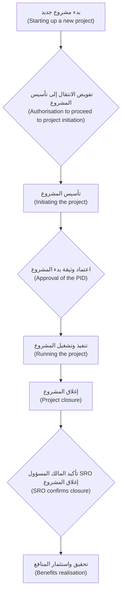
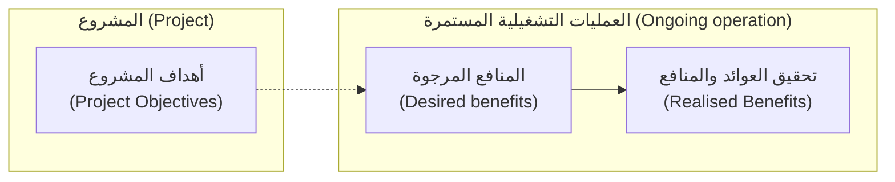
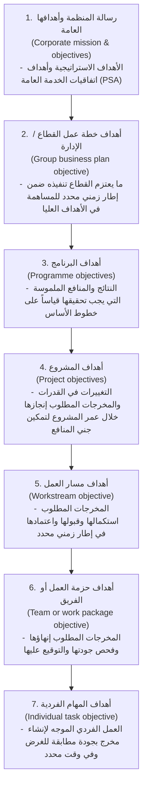
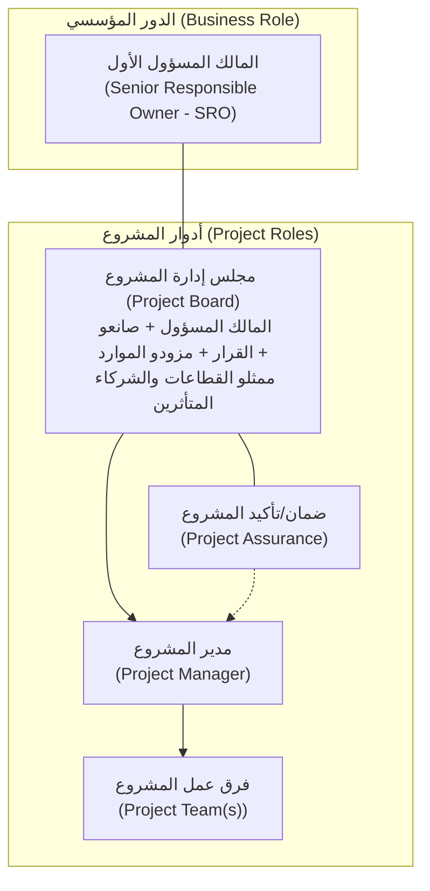
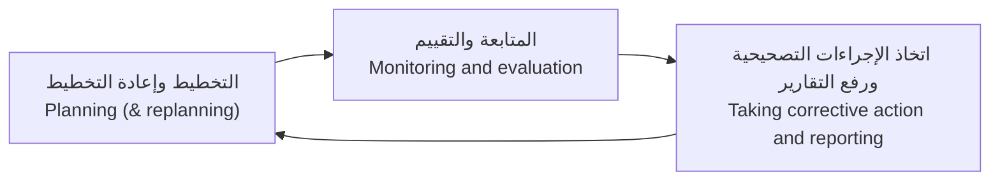
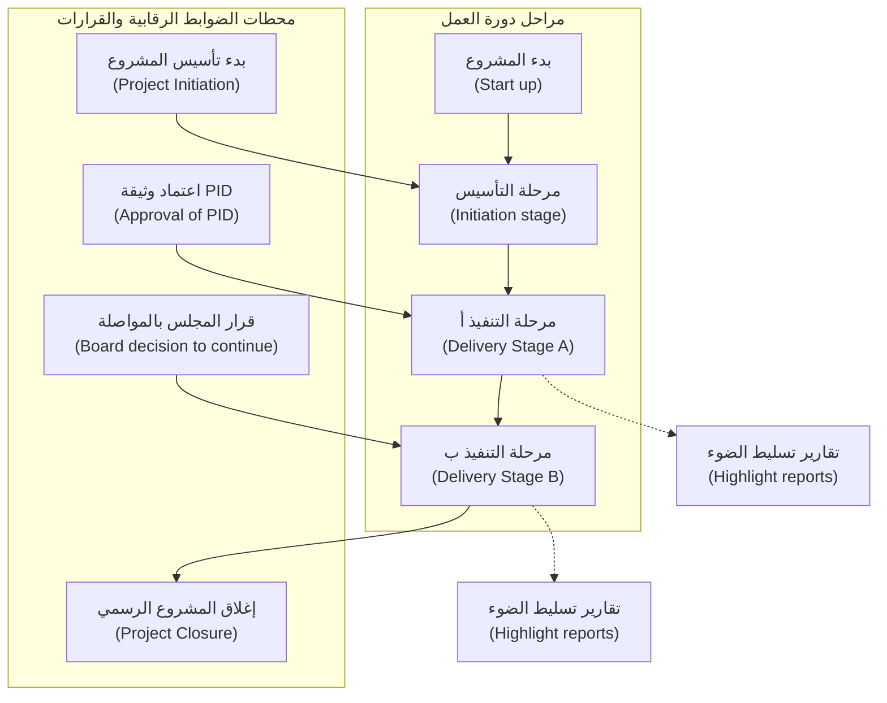
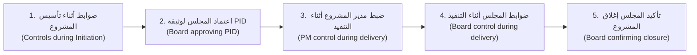

# إرشادات إدارة المشاريع: كيفية تنظيم وتخطيط ومراقبة المشاريع
## (GUIDELINES FOR MANAGING PROJECTS: How to organise, plan and control projects)

**الجهة المصدرة:** وزارة الأعمال والابتكار والمهارات البريطانية (Department for Business Innovation & Skills - BIS)  
**تاريخ الإصدار الأصلي:** نوفمبر 2010  
**الحالة:** وثيقة كاملة ومدمجة باللغة العربية تشمل كافة أقسام وصفحات الدليل الـ 45.

> [!NOTE]
> هذا الملف وثائقي وتوجيهي عام حول منهجيات إدارة المشاريع ومعايير الحوكمة وضبط المخرجات (المتوافقة مع منهجية PRINCE2)، وهو ملف مرجعي مستقل ولا علاقة له بالنظام البرمجي أو المحاسبي للمشروع.

---


<!-- ============================================================ -->
<!-- بداية محتوى الصفحة 1 من الوثيقة الأصلية -->
<!-- ============================================================ -->

# إرشادات إدارة المشاريع

## كيفية تنظيم وتخطيط ومراقبة المشاريع

**وزارة الأعمال والابتكار والمهارات (BIS - Department for Business Innovation & Skills)**  
**تاريخ الإصدار:** نوفمبر 2010

---

### وثيقة توجيهية

دليل عملي حول كيفية تنظيم المشاريع وتخطيطها وضبط مسارها لضمان تحقيق الأهداف والنتائج المرجوة بكفاءة وفعالية.

---


<!-- ============================================================ -->
<!-- بداية محتوى الصفحة 2 من الوثيقة الأصلية -->
<!-- ============================================================ -->

# جدول المحتويات (Contents)

- **القسم 0: الغرض من إرشادات إدارة المشاريع** .......................................................................... 3
  - ما هو المشروع الناجح؟ .................................................................................................... 3
  - هل تختلف المشاريع عن الأعمال الأخرى؟ .............................................................................. 3
  - لماذا نستخدم هذه الإرشادات؟ ........................................................................................... 3
  - ما تغطيه هذه الإرشادات - وما لا تغطيه .............................................................................. 4
  - دورة حياة المشروع ........................................................................................................ 5
  - حوكمة البرامج والمشاريع ................................................................................................ 7
  - تكييف ومواءمة إدارة المشاريع بما يناسب مشروعك ................................................................ 8
  - استخدام نماذج إدارة المشاريع .......................................................................................... 8

- **القسم 1: بدء مشروع جديد (Starting up a new project)** ..................................................... 9
  - موجز المشروع (The Project Brief) .................................................................................... 9
  - إعداد موجز المشروع ليتناسب مع سياق المشروع .................................................................... 10
  - تحديد نطاق المشروع وأهدافه ........................................................................................... 11
  - تحديد الفوائد والمنافع (Benefits) ....................................................................................... 15
  - تصميم الهيكل التنظيمي للمشروع ...................................................................................... 17

- **القسم 2: مرحلة التأسيس والإطلاق (Initiating the Project)** ............................................... 21
  - وثيقة بدء المشروع (Project Initiation Document - PID) ..................................................... 21
  - كيف تُستخدم وثيقة بدء المشروع (PID) ................................................................................ 21
  - إعداد وتطوير وثيقة بدء المشروع ....................................................................................... 21
  - دراسة الجدوى / مبررات الأعمال (The Business Case) .......................................................... 22
  - تحليل وإدارة أصحاب المصلحة (Stakeholders) ..................................................................... 24
  - تخطيط المشروع ........................................................................................................... 27
  - خطوات التخطيط .......................................................................................................... 27
  - إدارة المخاطر - تجنب العقبات واستغلال الفرص .................................................................... 30
  - اعتماد والموافقة على وثيقة بدء المشروع (PID) ..................................................................... 33

- **القسم 3: تنفيذ وتشغيل المشروع (Running the project)** ................................................... 34
  - الضبط والتحكم - مفتاح نجاح المشروع ................................................................................ 34
  - تهيئة البيئة المناسبة للضبط والرقابة ................................................................................... 34
  - تقسيم المشروع إلى مراحل قابلة للإدارة ............................................................................... 35
  - ضوابط المالك المسؤول الأول (SRO) ومجلس إدارة المشروع .................................................... 36
  - ضوابط مدير المشروع .................................................................................................... 37
  - التعامل مع الانحرافات الكبيرة عن الخطة ............................................................................. 38
  - إدارة القضايا والمشكلات والتغييرات ................................................................................... 39
  - تغيير منهجية حوكمة المشروع ........................................................................................... 40
  - ضبط إصدارات الوثائق وإدارة التكوين ................................................................................. 40
  - ملخص ضوابط المشروع بعد اعتماد موجز المشروع ................................................................ 42

- **القسم 4: إغلاق المشروع (Closing the Project)** ................................................................ 43
  - قائمة التحقق لإغلاق المشروع .......................................................................................... 43

- **القسم 5: تحقيق المنافع (Realising the Benefits)** ............................................................ 44
  - خطة تحقيق المنافع (The Benefits Realisation Plan) ............................................................. 44

- **الملحق أ: نماذج وثائق إدارة المشاريع (Appendix A)** .......................................................... 45

---


<!-- ============================================================ -->
<!-- بداية محتوى الصفحة 3 من الوثيقة الأصلية -->
<!-- ============================================================ -->

# القسم 0: الغرض من إرشادات إدارة المشاريع

## (Section 0: The Purpose of the Project Management Guidelines)

الغرض من هذه الإرشادات هو مساعدتك في **تنظيم المشاريع وتخطيطها وضبطها**. لقد صُممت لمساعدتك على تعظيم فرص نجاح مشاريعك من خلال معالجة كل عنصر من عناصر المشروع في الوقت المناسب وبالمستوى المناسب من التفصيل بما يلائم حجم المشروع وتعقيده.

---

### ما هو المشروع الناجح؟ (What is a successful project?)

لكي يكون المشروع ناجحاً، يجب عليه أن:

- يُحقق **النتائج والمنافع** المطلوبة من قِبل المنظمة وشركاء التنفيذ والجهات المعنية الأخرى.
- يُنشئ ويُنفذ **المخرجات (Deliverables)** التي تلبي المتطلبات المتفق عليها.
- يلتزم **بالأهداف والمواعيد الزمنية**.
- يلتزم **بالميزانيات المالية** المحددة دون تجاوزها.
- يُشرك **جميع الأشخاص والجهات المناسبة**.
- يستثمر **الموارد** المتاحة في المنظمة وخارجها بأفضل طريقة ممكنة.
- يأخذ في الحسبان **التغييرات** في طريقة عمل المنظمة.
- يُدير بفعالية أي **مخاطر** قد تهدد النجاح.
- يُراعي احتياجات الموظفين وأصحاب المصلحة الذين سيتأثرون بالتغييرات الناتجة عن المشروع.

---

### هل تختلف المشاريع عن الأعمال التشغيلية الأخرى؟ (Are projects different from the other work?)

تختلف المشاريع عن العمليات التشغيلية اليومية المعتادة للمنظمة في النقاط التالية:

- تمتلك **أهدافاً محددة** لتقديم منافع جديدة للمكلفين بدفع الضرائب، أو الشركات، أو عامة الناس، أو الحكومة، أو المنظمة الراعية، أو أصحاب المصلحة وشركاء التنفيذ.
- قد تُدخل **تغييرات جوهرية** على طريقة إدارة الأعمال وأسلوب العمل.
- تُنشئ **مخرجات/نواتج جديدة** تمكّن من تحقيق المنافع واستثمارها.
- تمتلك **هيكلاً إدارياً مؤقتاً وترتيبات حوكمة خاصة** يتم إنشاؤها خصيصاً طوال فترة المشروع.
- تكون **عُرضة لمخاطر غير معتادة** لا تُصادف في العمليات التشغيلية اليومية للمنظمة.
- تُشرك **مجموعة واسعة من أصحاب المصلحة** من مختلف قطاعات المنظمة وخارجها.
- قد تستخدم **أساليب وأدوات عمل جديدة** أو غير مألوفة للمنظمة.

---

### لماذا نستخدم هذه الإرشادات؟ (Why use these guidelines?)

للأسف، تفشل بعض المشاريع أحياناً في تحقيق أهدافها لأسباب متعددة كان بالإمكان تجنبها، مثل:

- الإخفاق في مراعاة احتياجات وتأثيرات أصحاب المصلحة.
- الإخفاق في التواصل المستمر وإبقاء أصحاب المصلحة على اطلاع بالتطورات.
- قلة الاهتمام بتأثير عمل المشروع على الأعمال والعمليات التشغيلية المعتادة للمنظمة.
- إنتاج حلول باهظة ومبالغ فيها ("Gold-plated solutions") في حين أن الحلول البسيطة والقابلة للتطبيق كانت تكفي وتفي بالغرض.
- الفشل في تحديد ومعالجة المخاطر المتعددة التي يمكن أن تعرقل تحقيق أهداف المشروع.
- عدم إيلاء الاهتمام الكافي بتخطيط ومتابعة ومراقبة أعمال المشروع.

---


<!-- ============================================================ -->
<!-- بداية محتوى الصفحة 4 من الوثيقة الأصلية -->
<!-- ============================================================ -->

# ما تغطيه هذه الإرشادات - وما لا تغطيه

## (What these guidelines cover - and do not cover)

تساعدك هذه الإرشادات على إدارة المشكلات الشائعة التي يمكن تجنبها. ومع ذلك، **لا ينبغي التعامل معها كمجموعة من المعايير الجامدة التي يجب اتباعها بحرفية عمياء في جميع الظروف**.

على العكس من ذلك، هناك العديد من القرارات التي يتعين عليك اتخاذها بشأن **درجة الدقة والانضباط الإداري** التي تراها ضرورية لتعظيم فرص النجاح وتقليل احتمالية فشل المشروع. وسيساعدك هذا الدليل في اتخاذ تلك القرارات بطريقة متوازنة.

---

### ما تغطيه هذه الإرشادات (What these guidelines cover)

لمساعدتك في إدارة مشاريعك، يقدم هذا الدليل - والذي يمكن تطبيقه على أي نوع من المشاريع في المنظمة ولدى شركائها التنفيذيين:

- **"ماذا، ولماذا، ومن، ومتى، وكيف"** الخاصة بأنشطة إدارة المشاريع.
- نصائح حول **تكييف وتوسيع نطاق إدارة المشاريع (Scaling)** لتلائم المشاريع ذات الأحجام والمدد الزمنية ودرجات الأهمية والخطورة المختلفة.
- **مخططات سير عمل (Flowcharts) وقوائم فحص (Checklists)** لإرشادك خلال مهام إدارة المشاريع الأساسية.
- إمكانية الوصول إلى **نماذج وقوالب جاهزة** لوثائق واستمارات إدارة المشاريع الحيوية.

---

### ما لا تغطيه هذه الإرشادات (What is not addressed)

الموضوعات التالية لم يتم التطرق إليها تفصيلياً في هذا الدليل، ولكنها متاحة من خلال مصادر ومراجع أخرى متنوعة:

- **النظرية العامة لإدارة المشاريع** (General project management theory).
- **التفاصيل الموسعة لمنهجية PRINCE2®** (على الرغم من أن هذا الدليل يتوافق تماماً وينسجم مع منهجية PRINCE2).
- التدريب العملي على كيفية تطبيق **تقنيات وأدوات إدارة المشاريع العامة**.
- **المهارات الشخصية والقيادية (Soft Skills)** الضرورية للإدارة الفعالة للمشاريع (مثل مهارات التفاوض، القيادة، وحل النزاعات).

---


<!-- ============================================================ -->
<!-- بداية محتوى الصفحة 5 من الوثيقة الأصلية -->
<!-- ============================================================ -->

# دورة حياة المشروع

## (The Project Lifecycle)

لكي تتم إدارة المشروع بفعالية، من المفيد جداً فهم **دورة الحياة النموذجية للمشروع** وكيف تنطبق على مشروعك المحدد. يجب أن تقرر كيف سيتم إنجاز الأنشطة الإدارية لكل خطوة من خطوات دورة الحياة، ومن سيشارك فيها بالتحديد. كما يجب أن تتأكد من استيعابك لدورك في تحقيق هذه المهام بالطريقة الصحيحة وفي الوقت المناسب.

يقع العبء الأكبر لجهود إدارة المشروع عبر دورة الحياة على عاتق:

1. **المالك المسؤول الأول (Senior Responsible Owner - SRO)** للمشروع (الراعي/المتبني الرئيسي للمشروع).
2. **مدير المشروع (Project Manager)**.

ولتحقيق النجاح، سيحتاج كلاهما بالتأكيد إلى الاعتماد على مهارات وخبرات العديد من الأشخاص الآخرين داخل المنظمة، ومن الشركاء والموردين الخارجيين.

---

### دورة حياة المشروع في وزارة BIS (The BIS Project Lifecycle)


#### الوثائق الرئيسية المرتبطة بكل خطوة

- **الخطوة 1 (بدء المشروع):** موجز المشروع (*Project Brief*).
- **الخطوة 2 (تأسيس المشروع):** وثيقة بدء المشروع (*Project Initiation Document - PID*).
- **الخطوة 3 (تشغيل وتنفيذ المشروع):** خطة المشروع (*Project Plan*)، تقرير تسليط الضوء الإخباري (*Progress / Highlight Report*)، سجل المخاطر (*Risk Register*)، وإدارة التغيير (*Change Control*).
- **الخطوة 4 (إغلاق المشروع):** تقرير الدروس المستفادة (*Lessons Learned*).
- **الخطوة 5 (تحقيق المنافع):** مراجعة ما بعد المشروع (*Post Project Review*).

---

> [!IMPORTANT]
> على الرغم من أن **الخطوة 3 (تشغيل وتنفيذ المشروع)** هي الأكثر استهلاكاً للموارد والوقت على الإطلاق، إلا أن **العناية والجهد المبذولين في بدء المشروع وتأسيسه (الخطوتان 1 و 2)** هما العامل الحاسم والأكثر تأثيراً في تحقيق نجاح المشروع.

---


<!-- ============================================================ -->
<!-- بداية محتوى الصفحة 6 من الوثيقة الأصلية -->
<!-- ============================================================ -->

# مخطط دورة حياة المشروع والمهام الإدارية

## (The BIS Project Lifecycle Tasks)

يوضح المخطط التالي تسلسل خطوات دورة حياة المشروع والمسؤوليات الأساسية في كل مرحلة:



---

### تفاصيل الإجراءات والمسؤوليات في كل مرحلة

#### 1. بدء مشروع جديد (Starting up a new project)

**يتعين على المالك المسؤول الأول (SRO) أو صاحب فكرة المشروع المحتمل:**

- تحديد الحاجة إلى المشروع وتبريرها.
- تحديد وصياغة وتوثيق النتيجة المرجوة والمنافع المتوقعة والاتفاق عليها.
- تعيين مدير المشروع (Project Manager) وتشكيل مجلس إدارة المشروع (Project Board) إذا اقتضى الأمر.
- التأكد من توضيح أسباب المشروع ونطاق عمله (TOR) في **موجز المشروع (Project Brief)**.
- ضمان مواءمة المشروع مع الخطة الاستراتيجية وخطة العمل للمنظمة.

#### 2. تفويض الانتقال لمرحلة التأسيس (Authorisation to proceed)

- يتخذ **المالك المسؤول الأول (SRO) / مجلس إدارة المشروع** قراراً بما إذا كان من المنطقي والعملي الانتقال إلى مرحلة تأسيس المشروع.

#### 3. تأسيس المشروع (Initiating the project)

**يتعين على فريق إدارة المشروع:**

- التخطيط لكيفية تحقيق النتائج والمنافع المطلوبة.
- تحديد أسلوب إدارة العلاقات مع أصحاب المصلحة الرئيسيين.
- تحديد منهجية إدارة عملية التنفيذ والتسليم.
- تحديد الاحتياجات من الموارد وضمان إمكانية توفيرها في الأوقات المحددة.
- إعداد **دراسة الجدوى ومبررات الأعمال (Business Case)** لتمكين المجلس من اتخاذ قرار التبرير المالي وإدارة المخاطر.
- توثيق الفهم الكامل للمشروع وكيفية إدارته ضمن **وثيقة بدء المشروع (PID)**.

#### 4. اعتماد وثيقة بدء المشروع (Approval of the PID)

- يقوم **المالك المسؤول الأول / مجلس المشروع** بتقييم وثيقة (PID) - وبخاصة دراسة الجدوى - لتحديد ما إذا كان المشروع مجدياً، قابلاً للتطبيق، ذا تكلفة محتملة، ومناسباً للبدء فيه حالياً.

#### 5. تشغيل وتنفيذ المشروع (Running the project)

**يتعين على فريق إدارة المشروع:**

- حشد الكوادر والموارد اللازمة لبناء المنتجات والمخرجات التي تحقق النتيجة المطلوبة.
- تخطيط ومتابعة وضبط أعمال وموارد المشروع.
- إدارة المخاطر والمشكلات فور ظهورها.
- الحفاظ على قنوات اتصال مستمرة مع المتأثرين بالمشروع ومخرجاته.
- رفع تقارير التقدم والقضايا للمالك المسؤول، ومجلس المشروع، وأصحاب المصلحة.
- اتخاذ القرارات بشأن استمرارية جدوى المشروع في ضوء الممارسة الفعلية وتغير المتطلبات.
- التأكد من أن المخرجات ملائمة للغرض المنشود وتمكّن من تحقيق المنافع.

#### 6. إغلاق المشروع (Project closure)

**يتعين على فريق إدارة المشروع:**

- تقييم نتائج المشروع ومقارنتها بما ورد في وثيقة (PID).
- ضمان تعميم وتوثيق الدروس المستفادة ومشاركتها مع الجهات التي قد تستفيد منها.
- تحرير الموارد المستخدمة في المشروع وإعادتها.
- مراجعة وتقييم أي منافع تم تحقيقها بالفعل بنهاية المشروع.

#### 7. تأكيد الإغلاق من قِبل المالك المسؤول (SRO confirms closure)

**يتعين على المالك المسؤول الأول (SRO) إغلاق المشروع والتأكد من:**

- وجود خطط لمراجعة ما بعد المشروع لقياس مدى تحقق المنافع على أرض الواقع.
- تحديد الحاجة إلى أي تحسينات أو تعديلات مستقبلية.
- تسليم المشروع ومخرجاته رسمياً إلى المسؤول التشغيلي الذي سيتولى إدارتها واستثمار نتائجها.

#### 8. تحقيق المنافع (Benefits realisation)

**يتعين على المالك المسؤول الأول (SRO) ضمان ما يلي:**

- إجراء مراجعات ما بعد المشروع لقياس درجة تحقيق المنافع.
- تحديث دراسة الجدوى لتعكس الواقع التشغيلي الفعلي.
- تغذية التحسينات والتغييرات والفرص المكتشفة في عملية التخطيط الاستراتيجي للمنظمة لدراستها.

---


<!-- ============================================================ -->
<!-- بداية محتوى الصفحة 7 من الوثيقة الأصلية -->
<!-- ============================================================ -->

# حوكمة البرامج والمشاريع

## (Programme and Project Governance)

> **"الحوكمة: هي الوظائف والمسؤوليات والعمليات والإجراءات التي تحدد كيفية إعداد البرنامج/المشروع وإدارته وضبطه."**  
> *(المصدر: دليل إدارة البرامج الناجحة OGC Managing Successful Programmes)*

---

### الغرض من الحوكمة (Purpose)

تنطوي جميع المشاريع على اتخاذ قرارات وإدارة علاقات أصحاب المصلحة في نقاط ومحطات مختلفة من دورة حياة المشروع وعلى مستويات متعددة.

يجب أن يضمن عنصر اتخاذ القرار عدم بدء أي مشروع جديد أو استمراره ما لم يكن:

- **ذا جدوى وقيمة (Worthwhile)**.
- **قابلاً للتطبيق العملي (Viable)**.
- **مقدوراً على تكلفته وميسور التكلفة (Affordable)**.
- **مجدياً اقتصادياً ويحقق عائداً مقابل الإنفاق (Good value for money)**.
- **مخططاً ومضبوطاً بإحكام (Planned and controlled)**.
- **ضمن الحدود المقبولة للمخاطر (Within tolerances for acceptable risk)**.

توفر الحوكمة الإطار الهيكلي لاتخاذ مثل هذه القرارات. ويجب تصميم ترتيبات حوكمة المشروع أثناء مرحلة بدء المشروع (Project Start-up)، وعادة ما تكون مزيجاً مخصصاً يجمع بين المتطلبات الأساسية الإلزامية في المنظمة والترتيبات الخاصة التي تلبي احتياجات المشروع المحددة.

ويعتمد هذا التخصيص على عوامل مثل: المنافع المتوقعة، والتكلفة، ودرجة الاستعجال، والتعقيد، والمخاطر، ونوعية وعدد أصحاب المصلحة.

---

### ما تشتمل عليه حوكمة المشروع (What Project Governance involves)

توفر حوكمة المشروع إطاراً شاملاً للإدارة، ويجب أن تغطي الجوانب التالية:

- التبرير الأولي والمستمر لجدوى المشروع.
- تأسيس هيكل تنظيمي إداري ملائم ومناسب للمشروع.
- وضع إطار واضح لاتخاذ القرارات (الأدوار / المسؤوليات / الصلاحيات).
- ضمان إعداد خطط متكاملة ودقيقة وتحديثها كلما لزم الأمر.
- تنفيذ استراتيجية إدارة أصحاب المصلحة.
- تطبيق استراتيجية إدارة الجودة وضمانها.
- تأسيس وتشغيل نظام فعال لمتابعة المشروع وضبطه ورقابته.
- إدارة أوجه عدم اليقين (التهديدات والفرص).
- إدارة المشكلات والقضايا وطلبات التغيير.

يتم تأسيس إطار الحوكمة الأساسي عند بدء المشروع، وينتج عنه اتخاذ قرار بالموافقة على المضي قدماً في المقترح الموثق في **موجز المشروع (Project Brief)** أو رفضه. ويتخذ هذا القرار **المالك المسؤول الأول (SRO)**، مدعوماً في الغالب بأصحاب المصلحة الرئيسيين الآخرين كأعضاء في **مجلس إدارة المشروع (Project Board)**، وهو ما يمثل نقطة الانطلاق الرسمية للمشروع.

يجب مراجعة ترتيبات الحوكمة باستمرار وتعديلها إذا اقتضت الحاجة مع تقدم وتطور أعمال المشروع.

---


<!-- ============================================================ -->
<!-- بداية محتوى الصفحة 8 من الوثيقة الأصلية -->
<!-- ============================================================ -->

# مواءمة وتكييف إدارة المشاريع واستخدام النماذج

## (Scaling project management to suit your project)

يجب تقييم كل مشروع وفقاً لظروفه ومعطياته الخاصة عند اتخاذ القرار بشأن **درجة الدقة والانضباط المنهجي المطلوبة** في إدارته. وتتضمن العوامل التي تؤثر على قرارك بمدى التوسع والصرامة في تطبيق هذه الإرشادات ما يلي:

- **الأهمية والحيوية (Criticality):** مدى أهمية المشروع لعمل المنظمة و/أو شركائها التنفيذيين.
- **قيمة المنافع المتوقعة (Value of benefits):** حجم العوائد الإيجابية المتوقعة من المشروع.
- **درجة الخطورة (Degree of risk):** مستوى وحجم المخاطر المرتبطة بالمشروع.
- **المدة الزمنية المحتملة (Likely duration):** الفترة المتوقعة لإنجاز المشروع.
- **حجم الجهد المطلوب للتنفيذ (Amount of effort):** الموارد البشرية وساعات العمل المطلوبة.
- **درجة التعقيد (Complexity):** التشابك الفني والتقني والتنظيمي.
- **الإنفاق المالي المتوقع (Likely spend):** حجم الميزانية والالتزامات المالية.
- **المتطلبات متعددة التخصصات (Multi-disciplinary requirements):** تنوع التخصصات والخبرات المطلوبة.
- **مصدر التمويل (Source of funding):** طبيعة الجهة الممولة وشروطها.
- **مستوى التأثير (Degree of impact):** مدى التأثير على مختلف قطاعات المنظمة وخارجها.
- **الحاجة لموردين خارجيين (External suppliers):** متطلبات إشراك شركاء خارجيين ومقاولين وموردين في المشروع.

---

### استخدام نماذج وقوالب إدارة المشاريع

### (Using project management templates)

هذه الإرشادات مدعومة بمجموعة شاملة من النماذج والأمثلة المصممة لمساعدتك في جميع مراحل دورة حياة المشروع. ويتم توفيرها كوثائق مستقلة بصيغ قابلة للاستخدام والتعديل حسب حاجتك (مثل تنسيقات Word أو Excel).

توجد قائمة بجميع النماذج المقترحة في **الملحق أ (Appendix A)** من هذا الدليل.

يتم تحديث هذه النماذج والإرشادات بصفة دورية لتحسين سهولة استخدامها وضمان مواكبتها لأفضل الممارسات المهنية الناشئة.

---


<!-- ============================================================ -->
<!-- بداية محتوى الصفحة 9 من الوثيقة الأصلية -->
<!-- ============================================================ -->

# القسم 1: بدء مشروع جديد

## (Section 1: Starting up a new project)

تبدأ مرحلة بدء المشروع عندما يوافق أو يقرر **المالك المسؤول الأول (SRO)** تولي مسؤولية مبادرة جديدة يُرى أنه من الأفضل إدارتها كمشروع. وقد يأتي الدافع والزناد لهذا الإطلاق من خلال:

- التخطيط الاستراتيجي للأعمال.
- محرك أو إلزام خارجي (مثل تشريعات الاتحاد الأوروبي، متطلبات الامتثال القانوني).
- اكتشاف مشكلة كبيرة وملحة لا يمكن التعامل معها بالوسائل والروتين المعتاد.

في نهاية مرحلة البدء، يتم اتخاذ **قرار رسمي** بشأن المضي قدماً أم لا. ويُبنى هذا القرار في ضوء المعلومات التي جُمعت خلال هذه المرحلة وسُجلت في **موجز المشروع (Project Brief)**.

يوضح موجز المشروع جوهرياً: **لماذا يُعد المشروع ضرورياً، وما الذي يجب أن يُحققه، ومن يجب أن يشارك فيه**.

لا توجد طريقة واحدة ثابتة لإجراء مرحلة البدء؛ بل يعتمد ذلك عملياً على حجم العمل وتعقيده، وما إذا كانت قد أجريت دراسة جدوى سابقة أم لا.

---

### متطلبات إنهاء مرحلة بدء المشروع

بنهاية مرحلة بدء المشروع، يجب أن تكون جميع الأطراف المعنية مقتنعة تماماً بأن الجوانب التالية محددة بوضوح ومفهومة للجميع:

1. **أسباب المشروع** (The reasons for the project).
2. **المنافع المرجوة والجهة المسؤولة عن تحقيقها** (Desired benefits and who will realise them).
3. **نطاق المشروع** - ما يقع ضمن النطاق وما هو خارجه (Scope - what's in and what's out).
4. **الأهداف** - أن تكون محددة وقابلة للقياس والتحقيق (SMART objectives).
5. **الخلفية والسياق العام** - لماذا يحتاج هذا المشروع إلى التنفيذ ولماذا الآن؟
6. **القيود والمحددات** التي يجب أخذها في الاعتبار أثناء المشروع (Constraints).
7. **الافتراضات الأساسية** (Assumptions).
8. **أي مخاطر معروفة** (Known risks).
9. **التبعيات والارتباطات** بمشاريع أو أنشطة أو قرارات أخرى (Dependencies).
10. **أصحاب المصلحة** الداخليين والخارجيين (Stakeholders).
11. **المخرجات والنواتج المستهدفة** (Deliverables/outcomes).
12. **الجدول الزمني التقديري** (Estimated timescale).
13. **تقديرات الموارد المطلوبة** (Estimates for resources required).
14. **الدروس المستفادة** من مشاريع مماثلة سابقة أو من أصحاب الخبرات المشابهة.

---

### موجز المشروع (The Project Brief)

#### الغرض منه (Purpose)

موجز المشروع هو رؤية أولية لما يهدف المشروع إلى تحقيقه، ويحدد العناصر والخطوات الأساسية التي سيتم اتباعها للوصول إلى الأهداف. ويمثل أساس الاتفاق المتبادل بين **المالك المسؤول الأول (SRO)** من جهة، و**مدير المشروع وفريقه** من جهة أخرى، ويعطي الإذن الرسمي بالمضي قدماً في المشروع لإجراء التخطيط التفصيلي.

#### كيفية استخدامه (How the project brief is used)

في بداية المشروع، قد يكون هناك تكليف بسيط (غالباً ما يكون مجرد بريد إلكتروني) من أحد المديرين التنفيذيين يوضح ما هو مطلوب. وبعد المناقشات والمراجعات لكيفية تحقيق الأهداف، يصبح من الضروري توثيق هذه التفاصيل في "موجز المشروع" لضمان الحصول على الدعم والالتزام والموافقة (Buy-in) من الإدارة العليا وأصحاب المصلحة قبل الارتباط بتكاليف أو تخصيص موارد كبيرة.

---


<!-- ============================================================ -->
<!-- بداية محتوى الصفحة 10 من الوثيقة الأصلية -->
<!-- ============================================================ -->

# تطوير واعتماد موجز المشروع

## (Developing and Approving the Project Brief)

إن استكمال جميع أقسام موجز المشروع يضمن التفكير العميق في كافة المجالات الحيوية للمشروع والحصول على الالتزام والتأييد اللازمين.

---

### اعتماد موجز المشروع (Approval of the Project Brief)

يُعد اعتماد موجز المشروع بمثابة **البداية الرسمية للمشروع**، حيث يجب على المالك المسؤول الأول (SRO) وأعضاء مجلس إدارة المشروع تأكيد ما يلي:

- فهمهم وموافقتهم على الشروط المرجعية ونطاق اختصاص المشروع (Terms of Reference).
- استعدادهم وقدرتهم على تخصيص وقتهم لتوجيه المشروع وقيادته.
- استعدادهم لتحمل الملكية المشتركة للمشروع.
- استعدادهم لتزويد مدير المشروع بالوقت والموارد اللازمة لتخطيط المشروع بالتفصيل وإعداد وثيقة بدء المشروع (PID).

تختلف درجة رسمية هذا الإجراء الرقابي؛ فقد يستخدم أعضاء مجلس المشروع أو المالك المسؤول البريد الإلكتروني لتفويض مدير المشروع بالانتقال إلى مرحلة تأسيس المشروع، أو قد يُعقد اجتماع رسمي في المشاريع الكبرى (ربما للمرة الأولى معاً في نفس القاعة) لضمان الفهم المشترك والالتزام التام.

---

### محتويات موجز المشروع (Contents of the Project Brief)

يغطي موجز المشروع جميع المجالات الأساسية للمشروع، ويقدم تفاصيل حول:

1. **الأهداف** (Objectives).
2. **النطاق** (Scope).
3. **المخرجات والتسليمات** (Deliverables).
4. **منافع الأعمال** (Business Benefits).
5. **الافتراضات** (Assumptions).
6. **القيود** (Constraints).
7. **المخاطر** (Risks).
8. **مجالات العمل الأخرى المتأثرة بالمشروع** (Other Areas of Business Affected).
9. **التبعيات والاعتماديات الرئيسية** (Major Dependencies).
10. **أصحاب المصلحة والموارد** (Stakeholders & Resources).
11. **تقديرات أولية للوقت والتكلفة** (Outline estimates of time and cost).

---

### إعداد موجز المشروع ليتناسب مع سياق المشروع

### (Developing a Project Brief to suit the project context)

يجب إعداد موجز المشروع، الذي يوضح التوقعات المنتظرة من المشروع، في مرحلة مبكرة من عمر المشروع، ويقوم بإعداده المالك المسؤول الأول (SRO) أو مدير المشروع بناءً على المعلومات والتوجيهات الواردة من المالك المسؤول.

- **في المشاريع الصغيرة:** تكون هذه الوثيقة موجزة للغاية، وغالباً ما تقتصر على بضع جمل لكل قسم.
- **في المشاريع الكبيرة:** قد يتطلب الأمر تفاصيل أوسع لضمان توثيق النطاق الكامل للمشروع واستيعاب درجة تعقيده.

> [!TIP]
> إذا كان المشروع قصير المدة، ومحدد المعالم بدقة فائقة، وكان من المؤكد تماماً ضرورة تنفيذه، فقد يكون من المناسب الانتقال مباشرة إلى إعداد **وثيقة بدء المشروع (PID)** بعد مرحلة بدء سريعة ومركزة، دون الحاجة للمرور بالخطوة الوسيطة المتمثلة في موجز المشروع.

---


<!-- ============================================================ -->
<!-- بداية محتوى الصفحة 11 من الوثيقة الأصلية -->
<!-- ============================================================ -->

# تحديد نطاق المشروع وأهدافه

## (Defining project scope and objectives)

### العلاقة بين منافع المشروع ونطاقه وأهدافه

### (The relationship between a project's benefits, scope and objectives)

يجب معالجة أهداف المشروع ونطاقه والمنافع المرجوة منه عند بدء المشروع، وتوثيقها في **موجز المشروع (Project Brief)**، ثم تنقيحها وتفصيلها لاحقاً في **وثيقة بدء المشروع (PID)** أثناء التحديد والتخطيط التفصيلي.

قد يكون من الصعب أحياناً تجنب بعض التداخل بين ما يتم تعريفه في النطاق والأهداف والمنافع، ولكن حاول تقليل التكرار مع الحفاظ على الاتساق والوضوح وقابلية القياس.

يوضح الشكل التالي العلاقة المتبادلة بين أهداف المشروع والمنافع الناتجة عنه:



> **ملاحظة:** يتم تحديد المنافع والنطاق والأهداف أثناء مرحلة بدء المشروع. ويجب تعريف نطاق المشروع بطريقة تضمن تحقيق الأهداف وتمكين جني المنافع المرجوة ضمن هذا النطاق، وبذلك يمثل كل عنصر منها أداة فحص وتدقيق مقابلة للعناصر الأخرى.

---

### ماذا يُقصد بـ "نطاق المشروع"؟ (What is meant by the 'Scope' of a project?)

عند تحديد نطاق المشروع، فإنك تسعى لتحقيق عدة أمور:

- التأكد من أن **الحدود الفاصلة** بين هذا المشروع والمشاريع والبرامج الأخرى مفهومة بوضوح، لمنع أي فجوات أو تداخلات في الأعمال المطلوبة لتحقيق الأهداف العليا للمنظمة.
- التأكد من أن **الأعمال التي يجب على المشروع إنجازها**، وما تم **استبعاده صراحةً** من أعمال المشروع، محددة ومتفق عليها بين جميع الأطراف المعنية.
- إنشاء **خط أساس (Baseline)** للتحكم في التغييرات لاحقاً، للحد من الآثار السلبية لظاهرة **"زحف النطاق" (Scope Creep)**.

> [!NOTE]
> عند تحديد نطاق المشروع، لا توجد حاجة عادةً لإعادة تكرار الأهداف أو المنافع. ويمكن في كثير من الأحيان التعبير عن النطاق كقائمة من المخرجات والمسلمات، مصحوبة ببعض العبارات التوضيحية لما يدخل وما يخرج من النطاق.

---


<!-- ============================================================ -->
<!-- بداية محتوى الصفحة 12 من الوثيقة الأصلية -->
<!-- ============================================================ -->

# أمثلة على صياغة النطاق وتحديد أهداف SMART

## (Scope Examples & Setting SMART Objectives)

### أمثلة على تعريف ما يدخل في النطاق وما يخرج منه

#### المشروع (أ) - Project A

- **داخل النطاق (In scope):** تحديد مجالات المكاسب المحتملة للكفاءة وإعداد خطة عمل ذات أولويات.
- **خارج النطاق (Out of scope):** تنفيذ وتطبيق خطة العمل.

#### المشروع (ب) - Project B

- **داخل النطاق (In scope):** تنفيذ العناصر المتفق عليها من خطة كفاءة XYZ، وإعداد مواصفات التحسينات المطلوبة لأنظمة المعلومات.
- **خارج النطاق (Out of scope):** التعديلات على أنظمة المعلومات التي ستُنفذ كجزء من المشروع المستقل (Z).

#### المشروع (ج) - Project C

- **داخل النطاق (In scope):** تعديل التشريعات القائمة لتلبية متطلبات الاتحاد الأوروبي رقم X.
- **خارج النطاق (Out of scope):** التعديلات التشريعية الخاصة بإسكتلندا أو أيرلندا الشمالية.

#### المشروع (د) - Project D

- **داخل النطاق (In scope):** تعديل شروط خدمة الموظفين للغرض P.
- **خارج النطاق (Out of scope):** الموظفون الذين انضموا للعمل قبل التاريخ المحدد (dd/mm/yy).

> [!TIP]
> ستجد أن قضاء الوقت في مناقشة النطاق والاتفاق عليه مع أصحاب المصلحة أثناء مرحلة بدء المشروع هو وسيلة فعالة للغاية لإدارة توقعات أولئك الذين يصعب عليهم التمييز بين العناصر **"الضرورية والإلزامية" (Must haves)** والعناصر **"المحبذة أو الثانوية" (Nice to haves)**. وتُعد **ورشة عمل بدء المشروع (Project Startup Workshop)** وسيلة مثالية لتحقيق ذلك.

---

### صياغة أهداف المشروع الذكية (Setting SMART project objectives)

يُعد تحديد الأهداف أداة إدارية بالغة الأهمية على جميع مستويات المنظمة، حيث يمكّن الأطراف المعنية وأصحاب المصلحة من الاتفاق في بداية العمل على:

- ما يحاولون تحقيقه بالضبط.
- ما يجب إنجازه لاعتبار العمل مكتملاً.
- كيف سيعرفون ويتأكدون من أن العمل قد نجح.
- الموعد النهائي المحدد لإنجاز العمل.

يتم تحديد الأهداف على مستويات متعددة وبمستويات متزايدة من التفصيل وقابلية القياس كلما انتقلت من الرؤية الاستراتيجية العامة للمنظمة نزولاً إلى مستوى المهام الفردية لأعضاء فريق المشروع.

---


<!-- ============================================================ -->
<!-- بداية محتوى الصفحة 13 من الوثيقة الأصلية -->
<!-- ============================================================ -->

# التدرج الهرمي للأهداف وصياغة أهداف SMART

## (Hierarchy of Objectives & Defining SMART Objectives)

### التسلسل الهرمي المحتمل للأهداف (Possible hierarchy of objectives)



---

### كيفية تحديد أهداف المشروع وفق معايير SMART

### (How to define SMART project objectives)

تحدد أهداف المشروع ما يجب أن يحققه المشروع لكي يُحكم عليه بأنه **مكتمل وناجح** وبالتالي يمكن إغلاقه.

أما **المنافع (Benefits)**، فقد تبدأ في الظهور فقط عند نهاية المشروع وتستمر في التحقق لفترات طويلة بعد انتهائه. *(ملاحظة: إذا كانت هناك منافع محددة وقابلة للقياس يجب تحقيقها أثناء عمر المشروع، فيمكن التعبير عنها كأهداف بالإضافة إلى ظهورها في دراسة الجدوى)*.

تُعد الأهداف المحددة والمتفق عليها شرطاً مسبقاً أساسياً لإجراء التخطيط التفصيلي. ولكي تكون الأهداف مفيدة في إدارة المشروع، يجب أن تتوافر فيها الخصائص التالية:

#### 1. محددة (Specific)

يجب أن يكون الهدف خاصاً بالمشروع وواقعاً في نطاقه.  

- *مثال غير محدد:* "تحسين كفاءة تفاعلنا مع العملاء" (هذا هدف غامض جداً، وهو هدف عام مشترك لعدة برامج ومشاريع وأنشطة تشغيلية).  
- *مثال محدد:* "تقليص متوسط أوقات الاستجابة لاستفسارات العملاء حول الموضوع X" (هذا بيان أكثر وضوحاً لما يجب أن يفعله المشروع، ولكنه لا يزال يحتاج إلى معيار قياس).

---


<!-- ============================================================ -->
<!-- بداية محتوى الصفحة 14 من الوثيقة الأصلية -->
<!-- ============================================================ -->

# معايير SMART وعواقب الأهداف غير الدقيقة

## (SMART Criteria & Consequences of Non-SMART Objectives)

### استكمال معايير SMART

#### 2. قابلة للقياس (Measurable)

يجب تحديد ما يجب إنجازه بأوضح المصطلحات القابلة للقياس الموضوعي. وتعتمد قابلية القياس على طبيعة الهدف؛ فقد تكون في صورة: الأداء، التكلفة، الجهد، نسبة مئوية للتغيير، مدة زمنية، مخرجات معينة، مستويات جودة، عدد الفعاليات، الموافقات، بدء أو إنهاء نشاط، عدد المستفيدين، أو منفعة تُحقق خلال عمر المشروع.  

- *تطوير المثال السابق:* "تقليص متوسط أوقات الاستجابة لاستفسارات العملاء حول الموضوع X بنسبة 30% مقارنة بأرقام عام 2006". *(مع التأكد عند وضع المستهدف من إمكانية تحقيقه)*.

#### 3. قابلة للتحقيق (Achievable)

يجب أن يكون تحقيق الهدف ممكناً عملياً وواقعياً وضمن المهلة الزمنية المحددة. ويجب مراعاة القيود المتعلقة بالتكنولوجيا والموارد البشرية والعمليات، بالإضافة إلى متطلبات الاستشارات ومواعيد البدء الرسمية وإجراءات المشتريات والمناقصات (مثل OJEU). يجب أن تكون الأهداف واقعية وطموحة في آنٍ واحد دون مبالغة في التحفظ.

#### 4. ذات صلة (Relevant)

هل الهدف متسق مع أهداف المستوى الأعلى (البرنامج، الوزارة/القطاع) ويساهم في تحقيقها؟ يجب التأكد من أن المشروع ليس مجرد رغبة شخصية عابرة أو خاضعاً لأجندات لا تتوافق مع الغرض الجوهري للمنظمة.

#### 5. محددة زمنياً وقابلة للتتبع (Time Bound & Trackable)

من الضروري وجود تاريخ مستهدف لتحقيق كل هدف. قد يكون هناك موعد نهائي واحد لكافة الأهداف، أو قد يتطلب كل هدف إطاراً زمنياً خاصاً به، بالإضافة إلى محطات زمنية مرحلية (Milestones) لقياس مدى التقدم واتخاذ إجراءات مبكرة عند التعثر.  

- *الصيغة الكاملة للهدف:* **"تقليص متوسط أوقات الاستجابة لاستفسارات العملاء حول الموضوع X بنسبة 20% مقارنة بأرقام 2009 بحلول تاريخ d1/m1/y1، وبنسبة 10% إضافية بحلول d2/m2/y2."**

---

### مخاطر وعواقب الأهداف غير المحددة (Non-SMART Objectives)

إن غياب معايير SMART يؤدي إلى مشاكل خطيرة، منها:

- **نقص المعلومات** اللازمة لإعداد خطط تفصيلية لعدم وضوح ما ينبغي تحقيقه.
- **إهدار الجهد** في إعداد خطط بديلة متعددة لمحاولة استيعاب احتمالات الأهداف الفضفاضة.
- **عجز ونقص الموارد**، حيث يصبح توفير الأفراد والمهارات والميزانيات محكوماً بالعرض المتاح بدلاً من الاحتياج المخطط له بدقة.
- **رفض مخرجات المشروع** من أصحاب المصلحة بحجة: *"هذا ليس ما طلبناه! ما نحتاجه فعلياً هو..."*.
- **عدم تلبية احتياجات الأطراف المعنية** الخارجية، مما يسبب الإحباط ويضر بسمعة المنظمة.

> [!WARNING]
> إذا كان من الصعب أو المستحيل صياغة أهدافك وفق معايير SMART، أو تعذر الاتفاق عليها، فيجب أن تكون على وعي تام بالمخاطر التي يفرضها ذلك، والجهد الإضافي المضاعف الذي سيتعين على المالك المسؤول (SRO) ومدير المشروع بذله لضبط المشروع وإدارة توقعات أصحاب المصلحة.

---


<!-- ============================================================ -->
<!-- بداية محتوى الصفحة 15 من الوثيقة الأصلية -->
<!-- ============================================================ -->

# تحديد المنافع ومقاييسها (الجزء 1)

## (Defining the Benefits - Part 1)

يجب تحديد وتعريف المنافع المتوقعة من المشروع بأدق العبارات القابلة للقياس والاتفاق عليها مع المسؤولين عن تحقيقها بعد انتهاء المشروع. ويتم استكشاف هذه المنافع من خلال المناقشات مع المالك المسؤول الأول (SRO) وأصحاب المصلحة أثناء مرحلة بدء المشروع.

وعند إعداد **دراسة الجدوى (Business Case)** أثناء مرحلة التأسيس، يجب صياغة المنافع في صورة مستهدفات كمية وتوقيتات محددة لتحققها بالتوازي مع إعداد خطة المشروع.

---

### أنواع المنافع (Types of Benefit)

1. **منافع ملموسة وقابلة للقياس والتحقيق المباشر:**
   - الامتثال للتشريعات والقوانين الجديدة.
   - تجنب نفقات أو خفض التكاليف التشغيلية.
   - تقليل الأخطاء عند معالجة المعاملات والملفات.
   - تقليص حجم الجهد والوقت المطلوبين لمتابعة الأخطاء ومعالجة الشكاوى.

2. **منافع يصعب قياسها كمياً ولكنها جوهرية:**
   - تحديث بيئة وظروف عمل الموظفين.
   - تحسين جودة اتخاذ القرارات وسلامتها.

3. **منافع ناعمة أو غير ملموسة (Soft Benefits):**
   - رفع الروح المعنوية ورضا الموظفين.
   - تحسين الصورة الذهنية وسمعة المنظمة لدى المجتمع.

---

### أمثلة على المنافع ومقاييسها الكمية

| المنفعة المرجوة (Benefit) | مقاييس التحقق والقياس (Quantified measures) |
| :--- | :--- |
| **الامتثال للتشريعات الجديدة**<br>*(To comply with new legislation)* | - الاعتماد والتوقيع الرسمي من سلطة الامتثال.<br>- تجنب الغرامات والعقوبات المالية. |
| **توفير عمليات أكثر كفاءة وفعالية**<br>*(More efficient and effective operation)* | - عدد المعاملات والملفات المنجزة يومياً.<br>- تكلفة الموظفين لكل معاملة منجزة. |
| **تقديم خدمة أفضل للجمهور**<br>*(Provide a better service to the public)* | - زمن الاستجابة للاستفسارات.<br>- الوقت المستغرق للحصول على المعلومات المطلوبة.<br>- تجنب تكاليف التعويضات والتسويات. |
| **تجنب أو خفض التكاليف المستقبلية**<br>*(Avoid or reduce future costs)* | - تقديرات التكاليف الرأسمالية المتجنبة.<br>- تقديرات تكاليف التشغيل المخفضة. |
| **تحديث بيئة وظروف العمل للموظفين**<br>*(Modernise the working environment)* | - القياس المرجعي مقارنة بمعايير بيئات العمل الحكومية والخدمية. |
| **تحسين الاتصال داخل وخارج المنظمة**<br>*(Improve communication)* | - سرعة وتكلفة التواصل.<br>- تنوع قنوات الاتصال.<br>- أنواع المعلومات الممكن تبادلها.<br>- إمكانية الوصول للأنظمة والبيانات عن بُعد. |
| **تقليل الجهد لمعالجة الأخطاء والشكاوى**<br>*(Reduce effort for mistakes/complaints)* | - ساعات الجهد الموفرة للموظفين.<br>- التكاليف والغرامات المتجنبة. |
| **تحسين جودة المعلومات واتخاذ القرار**<br>*(Improve quality of info & decisions)* | - سرعة الوصول إلى المعلومات والتقارير.<br>- طرق وأساليب عرض المعلومات.<br>- اكتمال وحداثة وإيجاز ودقة وموثوقية البيانات. |

---


<!-- ============================================================ -->
<!-- بداية محتوى الصفحة 16 من الوثيقة الأصلية -->
<!-- ============================================================ -->

# تحديد المنافع ومقاييسها (الجزء 2)
## (Defining the Benefits - Part 2)

### استكمال أمثلة المنافع ومقاييسها الكمية:

| المنفعة المرجوة (Benefit) | مقاييس التحقق والقياس (Quantified measures) |
| :--- | :--- |
| **الاستفادة من التقنيات الحديثة**<br>*(To take advantage of new technology)* | - المكاسب التشغيلية والوفورات المالية الناتجة عن الوظائف الجديدة المتاحة عبر أنظمة تكنولوجيا المعلومات والاتصالات (ICT)، الإنترنت، الشبكة الداخلية (Intranet)، وتطبيقات الأجهزة المحمولة. |
| **تمكين مبادرات أخرى من تحقيق منافع**<br>*(Enable other initiatives to deliver benefits)* | - توثيق وربط المخرجات بالمشاريع الأخرى التي ستعتمد على نتائج هذا المشروع لتحقيق أهدافها ومنافعها. |
| **زيادة الروح المعنوية وتحفيز الموظفين**<br>*(Increase morale and motivation of staff)* | - انخفاض معدل دوران الموظفين (Staff turnover).<br>- انخفاض عدد الأخطاء ومعدلات شكاوى العملاء.<br>- انخفاض معدلات الإجازات المرضية والتغيب.<br>- انخفاض تكاليف التوظيف والاستقطاب. |

---

### تحديد المستهدفات (Setting Targets)
لكل منفعة مطلوبة، قد تتوفر مجموعة من المقاييس والمؤشرات التي تمنحك الفرصة لوضع أهداف رقمية ومستهدفات واضحة للمشروع، مما يسهل قياس نجاحه لاحقاً في مرحلة مراجعة ما بعد المشروع.

---


<!-- ============================================================ -->
<!-- بداية محتوى الصفحة 17 من الوثيقة الأصلية -->
<!-- ============================================================ -->

# تصميم الهيكل التنظيمي للمشروع
## (Designing the Project Organisation)

يجب أن يكون لكل مشروع **هيكل إداري وتنظيمي خاص به يُحدد في بدايته ويتم حله وتفكيكه عند نهايته**. إن تحديد الأدوار الإدارية والمسؤوليات والعلاقات والمساءلات والصلاحيات يشكل الركيزة الأساسية لترتيبات حوكمة المشروع. 

> [!NOTE]
> من غير المحتمل إطلاقاً أن يكون الهيكل الإداري الوظيفي المعتاد في المنظمة كافياً أو مناسباً للاستخدام كهيكل لإدارة المشروع، باستثناء المهام الصغيرة جداً التي تُدار داخل وحدة عمل واحدة دون أي تأثير خارجي.

---

### الهيكل التنظيمي المعتمد على نموذج PRINCE2®:



---

### أسس تصميم الهيكل التنظيمي:
إن التنظيم المصمم جيداً سيشرك الأشخاص المناسبين ذوي المهارات الملائمة ومستويات الصلاحية الصحيحة، بحيث يمكن للمشروع بمجرد اعتماده أن يمضي قدماً بأقل قدر من الحاجة للرجوع إلى خارج هيكل المشروع، إلا في حالات الاستثناءات التي تتجاوز صلاحيات المالك المسؤول الأول. 

**لا يوجد نموذج واحد "يناسب الجميع"؛ بل يجب تصميم الهيكل التنظيمي ليلائم:**
- **حيوية وأهمية المشروع** لأعمال المنظمة (Criticality to the business).
- **حجم المشروع ودرجة تعقيده** (Size/complexity).
- **مستوى التأثير** داخل المنظمة الأم (Degree of impact within the parent body).

---


<!-- ============================================================ -->
<!-- بداية محتوى الصفحة 18 من الوثيقة الأصلية -->
<!-- ============================================================ -->

# عوامل التصميم التنظيمي ودور المالك المسؤول الأول
## (Organisational Design & Role of the SRO)

### استكمال عوامل تصميم الهيكل التنظيمي:
- **درجة التأثير على الجهات الخارجية** (مثل الإدارات والوزارات الأخرى OGDs، أو القطاع الخاص).
- **التكلفة المالية الإجمالية** للمشروع (£).
- **الموارد البشرية المطلوبة** وحجم الكوادر.
- **نوعية ومستويات أصحاب المصلحة والأطراف المعنية**.

> [!IMPORTANT]
> يستغرق تصميم الهيكل وإقناع الأشخاص بقبول الأدوار وقتاً، وقد يتطلب مفاوضات ومناقشات عديدة مع الإدارة العليا على المستويات المناسبة.

---

### الأدوار القيادية الرئيسية (The Key Roles)

#### المالك المسؤول الأول (Senior Responsible Owner - SRO)
*(يُعرف في بعض البيئات أو الهيئات باسم راعي المشروع Project Sponsor أو مدير البرنامج Programme Director)*.

المالك المسؤول هو **مالك المشروع والمدافع الأول عنه (Champion)**، وهو المسؤول النهائي أمام المنظمة عن تسليم المشروع بنجاح، وعليه تقع المسؤوليات التالية:
1. توفير **القيادة والتوجيه** لأعضاء مجلس إدارة المشروع ولمدير المشروع.
2. ضمان **التزام جميع أصحاب المصلحة** الرئيسيين بالمشروع وتمثيلهم بشكل كافٍ في الهيكل التنظيمي للمشروع.
3. ضمان **التزام أصحاب الميزانيات وملاك الموارد** بالمشروع وتوفير الأموال والموارد المطلوبة في أوقاتها.
4. التأكد من وضع **ترتيبات حوكمة** للمشروع تتسم بالصرامة والانضباط المناسبين.
5. **إحاطة كبار أصحاب المصلحة** دورياً بالوضع الحالي والتوقعات المستقبلية للمشروع.
6. استلام ودراسة **تقارير وإحاطات مدير المشروع** بانتظام واتخاذ الإجراءات اللازمة بشأنها.
7. **رئاسة اجتماعات مجلس إدارة المشروع** (Project Board).
8. التأكد من أن جميع أعضاء مجلس المشروع يفهمون أدوارهم والتزاماتهم لضمان تحقيق النتائج والمنافع.
9. تمكين مدير المشروع وتفويضه لقيادة المشروع وتسيير أعماله اليومية.
10. التأكد من معرفة مدير المشروع **بحدود صلاحياته** وضرورة تصعيد المشكلات التي تتجاوزها إلى المالك المسؤول فوراً.
11. **التفاوض مع كبار أصحاب المصلحة** للتوصل إلى حلول للمشكلات التي تتجاوز صلاحيات مدير المشروع.
12. تحديد كيفية تلبية مسؤولية **ضمان المشروع (Project Assurance)** العائدة له، مثل تفويضها لشخص مؤهل.

> **الخلاصة:** كما ترى، المالك المسؤول الأول ليس مجرد منصب شرفي؛ بل هو دور قيادي فاعل وعضو أساسي وحيوي في فريق إدارة المشروع. وإذا كان المشروع يضم عدة جهات تعمل معاً أو له تأثيرات متداخلة، فيمكن تشكيل مجلس إدارة المشروع برئاسة المالك المسؤول لتوفير سلطة اتخاذ القرار المشتركة.

---


<!-- ============================================================ -->
<!-- بداية محتوى الصفحة 19 من الوثيقة الأصلية -->
<!-- ============================================================ -->

# مجلس إدارة المشروع وضمان المشروع
## (The Project Board & Project Assurance)

### مجلس إدارة المشروع (The Project Board)

#### تشكيل المجلس:
يجب أن يضم مجلس إدارة المشروع:
- **المالك المسؤول الأول (SRO):** يمثل مصالح "الأعمال" للمنظمة الراعية ككل *(الدور التنفيذي Executive في منهجية PRINCE2)*.
- **ممثلو المستخدمين الرئيسيين (Senior User):** ممثلون رفيعو المستوى من القطاعات والإدارات التي ستتأثر بنتائج المشروع ويجب عليها تبني التغييرات وتطبيقها.
- **ممثلو الموردين الرئيسيين (Senior Supplier):** ممثلون رفيعو المستوى من الجهات أو الشركات التي ستتولى تصميم الحل وبنائه وتنفيذه لتلبية متطلبات العمل.

#### مسؤوليات المجلس المشتركة:
- تهيئة بيئة ملائمة تمكّن المشروع من النجاح في تسليم التغييرات اللازمة لتحقيق المنافع.
- تحديد التوجه العام للمشروع والموافقة على المحطات الزمنية الرئيسية (Milestones).
- اعتماد والموافقة على **وثيقة بدء المشروع (PID)**.
- ضمان توفير الموارد المناسبة وفقاً لأحدث نسخة معتمدة من خطة المشروع.
- اتخاذ القرارات اللازمة طوال عمر المشروع.
- منح مدير المشروع الصلاحية الكاملة لقيادة المشروع في أعماله اليومية.
- تحديد أسلوب التحقق والتأكد من نزاهة وجودة جوانب المشروع الخاضعة لمساءلتهم (من خلال تعيين مسؤولين عن ضمان المشروع).

---

### ضمان/تأكيد المشروع (Project Assurance)

يجب على المالك المسؤول وأعضاء مجلس المشروع التأكد بأنفسهم من أن المشروع مخطط ومنظم ومضبوط بشكل صحيح. ولتخفيف عبء مراجعة التفاصيل الدقيقة (مثل الخطط التفصيلية، تقارير التقدم، وضوابط الجودة)، يجوز لهم **تفويض مسؤولية ضمان المشروع** إلى شخص أو أكثر من ذوي الكفاءة.

يتطلب هذا الدور **تنسيقاً وثيقاً مع مدير المشروع** (وقادة الفرق) لجمع المعلومات لتقييم حالة المشروع والتأكد من انضباطه.

#### مهام دور ضمان المشروع (غالباً ما يكون بدوام جزئي):
- إحاطة أعضاء مجلس المشروع المعنيين دورياً وعند المحطات الرئيسية لدعم قراراتهم وتوجيهاتهم.
- التأكد من اتباع أفضل ممارسات إدارة المشاريع وتحديد نقاط الضعف واقتراح التحسينات.
- مراجعة وتقديم المشورة حول **سلامة دراسة الجدوى (Business Case)** عند تأسيس المشروع وتحديثاتها.
- مراجعة نزاهة واكتمال وثيقة (PID) وخطة المشروع وخطط المراحل (مستوى التفاصيل، كفاية الموارد، واقعية الجدول الزمني، هوامش الطوارئ، وإدارة المخاطر).
- تقييم تقدم المشروع نحو تحقيق النتائج والمنافع (بما في ذلك حضور اجتماعات محددة لفريق المشروع).
- التأكد من أن التواصل مع المستخدمين فعال ومناسب وأن مصالحهم مأخوذة بعين الاعتبار.

---


<!-- ============================================================ -->
<!-- بداية محتوى الصفحة 20 من الوثيقة الأصلية -->
<!-- ============================================================ -->

# استكمال ضمان المشروع ودور مدير المشروع
## (Project Assurance cont. & Role of Project Manager)

### استكمال مهام ضمان المشروع (Project Assurance):
- المساعدة في رصد وإبلاغ المشكلات المحتملة والفعلية في الوقت المناسب لمعالجتها قبل أن تؤثر سلباً على سلامة المشروع.
- تقديم المشورة حول آثار أي طلبات تغيير (Requests for Change) تُرفع لمجلس المشروع.
- المساهمة الفعالة في جلسة مراجعة الدروس المستفادة عند إغلاق المشروع.

---

### مدير المشروع (Project Manager)

يكون مدير المشروع مسؤولاً نيابة عن المالك المسؤول الأول (SRO) عن **التنفيذ اليومي لخطة المشروع والتعامل مع المشكلات** التي قد تعرقل تنفيذها.

#### واجبات ومسؤوليات مدير المشروع:
1. إعداد **وثيقة بدء المشروع (Project Initiation Document - PID)**.
2. تقديم وثيقة (PID) لمجلس إدارة المشروع للاعتماد والمصادقة.
3. تقديم أي نسخ معدلة من خطة المشروع أو دراسة الجدوى لمجلس المشروع للموافقة عليها.
4. متابعة سير العمل ورصد وتصحيح أي استثناءات أو انحرافات قد تعرض أهداف المشروع للخطر.
5. إنشاء والحفاظ على **سجل المخاطر (Risk Register/Log)** وإدارتها بفعالية ضمن حدود صلاحياته المفوضة.
6. تصعيد التوصيات بإجراءات معالجة المخاطر التي تتجاوز حدود صلاحياته إلى مجلس المشروع.
7. رفع تقارير التقدم والحصول على المشورة والتوجيه من المالك المسؤول بصفة منتظمة حسب الاتفاق.
8. **إدارة علاقات أصحاب المصلحة والتواصل معهم** وفقاً لخطة الاتصال المتفق عليها.
9. التنسيق والتعاون المستمر مع مسؤولي ضمان المشروع المعينين طوال فترة المشروع.

---


<!-- ============================================================ -->
<!-- بداية محتوى الصفحة 21 من الوثيقة الأصلية -->
<!-- ============================================================ -->

# القسم 2: تأسيس وإطلاق المشروع
## (Section 2: Initiating the Project)

مرحلة تأسيس المشروع هي المرحلة التي تضع فيها **خط أساس متين وموثوق لإدارة المشروع**، وذلك من خلال أخذ الفهم الأولي لـ *"ماذا ولماذا"* الموثق في موجز المشروع، وتوسيعه وتعميقه ليشمل تعريفاً تفصيلياً لـ *"كيف، ومتى، وبواسطة من"* في **وثيقة بدء المشروع (Project Initiation Document - PID)**.

---

### وثيقة بدء المشروع (Project Initiation Document - PID)

#### الغرض من وثيقة (PID):
الغرض الأساسي من وثيقة (PID) هو توفير المعلومات الشاملة التي تحتاجها الإدارة العليا وأصحاب المصلحة لتمكينهم من الالتزام بالموارد والجداول الزمنية المقترحة. وتُعتبر الوثيقة بمثابة **"عقد واتفاق عمل"** بين مدير المشروع والمالك المسؤول الأول / مجلس المشروع، يُحدد كيفية إدارة وتنفيذ المشروع.

تقدم الوثيقة مقترحاً تفصيلياً يمكن قياس النجاح بالاستناد إليه؛ حيث تبني على ما ورد في موجز المشروع لتحدد بالتفصيل كيف سيتم تطوير المشروع ومتى سيتم تسليمه. كما توفر فهماً عميقاً ودقيقاً لتكاليف ومنافع المشروع، وبشكل خاص الموارد المطلوبة والمخاطر والمواعيد الزمنية اللازمة للتسليم الناجح.

#### كيف تُستخدم وثيقة (PID):
تُعرض وثيقة (PID) على المالك المسؤول الأول / مجلس المشروع للنظر في وجهات نظر وتطلعات أصحاب المصلحة الرئيسيين. وهذه محطة أساسية لضمان تفاعل وتأييد وموافقة جميع الأطراف على النتائج المقترحة.

إن قبول واعتماد وثيقة (PID) يمثل **نقطة انطلاق المرحلة التالية** من المشروع، حيث يتم تجميع وتعبئة فرق العمل لتنفيذ أنشطة المشروع عبر الجدول الزمني المتفق عليه تحت مسؤولية ومساءلة المالك المسؤول.

> [!TIP]
> من الممكن جداً أن يكشف التحليل التفصيلي الذي يُجرى لإعداد وثيقة (PID) عن ارتفاع غير مبرر في التكاليف أو تزايد في المخاطر بما يستدعي **إلغاء المشروع**. ويُعد هذا ميزة وقوة في منهجية المراحل المتتابعة، حيث يمنع هدر موارد كبيرة في مشاريع غير مجدية.

---

### إعداد وتطوير وثيقة بدء المشروع (PID)
تختص وثيقة (PID) بشرح كيفية تسليم المشروع وإدارته بالتفصيل. وستقوم بتحديث موجز المشروع في كافة جوانبه، ولكنها يجب أن تتضمن على وجه الخصوص:
1. **المساءلات والأدوار والمسؤوليات** لكل عضو في فريق المشروع، بما في ذلك الأعضاء بدوام جزئي (*من سيفعل ماذا*).
2. **خطة الأنشطة والعمليات** (مثل مخطط غانت Gantt Chart) توضح متى يجب إنجاز كل مخرج (*من سيفعل ماذا ومتى*). ويشمل ذلك التبعيات والمحطات الزمنية (Milestones).
3. **تقييم محدث للمخاطر**، يشمل احتمالية حدوثها وأثرها، بالإضافة إلى خطط التخفيف والتدابير الاحتياطية (Contingency).
4. **تحليل محدث للتكلفة والعائد (Cost/Benefit analysis)**، وبخاصة خطة تفصيلية للموارد والجدول الزمني (نظراً لتأثيرهما المباشر المتبادل).
5. **خطة الحوكمة** التي توضح تفصيلياً كيفية متابعة المشروع وضبطه من حيث: نقاط اتخاذ القرار، دورات التقارير وأنواعها، وما إذا كانت التحديثات دورية منتظمة أو قائمة على الاستثناءات (Exception reporting).
6. **خطة الاتصال والتواصل (Communications Plan)** التي تبدأ في تحديد كيفية مخاطبة الجماهير المختلفة، بما في ذلك وسائل الإعلام والصحافة.

---


<!-- ============================================================ -->
<!-- بداية محتوى الصفحة 22 من الوثيقة الأصلية -->
<!-- ============================================================ -->

# ورش التخطيط ودراسة الجدوى ومبررات الأعمال
## (Planning Workshops & The Business Case)

عند تحديد مشروع جديد، غالباً ما يكون من المفيد جداً عقد **ورشة عمل لتخطيط المشروع (Project Planning Workshop)** بحضور ممثلين عن القطاعات المتأثرة بالمنظمة (والمنظمات الشريكة إن وجدت). تسرّع هذه الخطوة من العملية وتضمن التقاء جميع الأطراف المعنية في مرحلة مبكرة للاتفاق على ما يهدف المشروع لتحقيقه، وبشكل عام، كيفية إنجازه (يمكن استخدام عناصر وثيقة PID المذكورة سابقاً كجدول أعمال للورشة).

يجب أن توثق وثيقة (PID) الهيكل الإداري للمشروع وأصحاب المصلحة المهتمين بنتائجه. ويتعين على مدير المشروع تحديد الأفراد المناسبين والحصول على التزامهم بالمشاركة في أدوار إدارة المشروع.

> [!IMPORTANT]
> إذا كان أي شخص معين في دور بالمشروع يفتقر إلى الخبرة في العمل في بيئة المشاريع، فيجب على مدير المشروع إحاطته وإدارة توقعاته للتأكد من فهمه التام لطبيعة التزاماته فيما يتعلق بـ:
> - الوقت والجهد المطلوب تخصيصهما للمشروع.
> - طبيعة القرارات التي يجب عليه اتخاذها.
> - نوعية الموارد التي يتعين عليه الالتزام بتقديمها للمشروع.
> - الأفراد والجهات التي سيتعين عليه التواصل معهم.
> - نوعية المخاطر التي سيتعين عليه دراستها وأخذها بعين الاعتبار.
> - دوره في استثمار وتحقيق المنافع بعد انتهاء المشروع من أعماله.

---

### دراسة الجدوى ومبررات الأعمال (The Business Case)

#### الغرض منها (Purpose):
توثق دراسة الجدوى **مبررات وأسباب إطلاق المشروع**، بناءً على تكاليف التطوير والتنفيذ مقارنة بالمنافع المتوقع جنيها. وتقدم تقييماً أولياً للخيارات والبدائل المتاحة، وتقود وتوجه عمليات اتخاذ القرار، وتُستخدم باستمرار للتأكد من مواءمة تقدم المشروع مع تحقيق أهداف الأعمال.

تُستخدم دراسة الجدوى الأولية للحصول على التزام الإدارة العليا وأصحاب المصلحة في نهاية مرحلة التأسيس. ثم يتم تحديثها لاحقاً لتقييم استمرارية جدوى المشروع واتخاذ القرارات المصيرية. وبعد إغلاق المشروع، يحتاجها المالك المسؤول الأول لمقارنة المنافع المرجوة بما تحقق فعلياً أثناء مرحلة تحقيق المنافع.

#### ما يجب أن تُثبته دراسة الجدوى:
- أن الحل المقترح **يلبي حاجة العمل الفعلية**.
- أن التكلفة **معقولة ومن المرجح أن تحقق قيمة مقابل المال** (Value for money).
- أن المشروع **ممكن وقابل للتحقيق عملياً** في الوقت المتاح.
- أنه تم اختياره بعد **دراسة وتقييم البدائل المناسبة** (بما في ذلك خيار "عدم فعل أي شيء - Do Nothing") ومنافع وتكاليف ومخاطر كل خيار.
- وجود وضوح تام لما يحدد **النتيجة الناجحة**.
- التوافق والاتساق مع **الاستراتيجية العامة للمنظمة**.
- تحديد المنافع بوضوح وكيفية تحقيقها.
- وضوح **كيفية توفير التمويل اللازم**.

---

### إعداد دراسة الجدوى لتناسب سياق المشروع - المتطلبات الدنيا:
كحد أدنى، يجب أن تقدم دراسة الجدوى: نظرة عامة على المشروع، نطاقه وأهدافه، الملاءمة الاستراتيجية، تقييم الخيارات والبدائل، القدرة على تحمل التكاليف، وقابلية الإنجاز. في المشاريع البسيطة، قد تكون مجرد بند أو عنوان داخل وثيقة (PID)، أما في العديد من المشاريع فيجب إعداد دراسة جدوى مفصلة ومستقلة، ويعتمد مستوى التفصيل على حجم المشروع، تكلفته، مخاطره، وعدد أطرافه المعنية.

---


<!-- ============================================================ -->
<!-- بداية محتوى الصفحة 23 من الوثيقة الأصلية -->
<!-- ============================================================ -->

# استخدام دراسة الجدوى عبر مراحل المشروع
## (Using the Business Case Across Lifecycle)

في مرحلة بدء المشروع (Start-up)، يجب استخدام **دراسات الجدوى الأولية/الموجزة (Outline Business Cases)** في عملية التخطيط الاستراتيجي للمساعدة في تحديد المشاريع التي تقدم أعلى قيمة مقابل المال وأفضل تحقيق للأولويات الاستراتيجية.

في هذه المرحلة، يجب أن تحتوي دراسة الجدوى على معلومات كافية لتمكين المالك المسؤول / مجلس المشروع من تقرير ما إذا كان المشروع قابلاً للتطبيق، ميسور التكلفة، ويستحق دراسته بمزيد من التفصيل. ويجب أن توضح:
- حاجة العمل ولماذا يجب تنفيذ المشروع الآن.
- التوافق مع استراتيجية المنظمة الشاملة.
- المنافع الرئيسية وعوامل النجاح الحرجة (Critical Success Factors) وكيفية قياسها.
- أهداف المشروع، نطاقه، مخاطره، وتقديرات أولية للوقت والتكلفة.
- في المشاريع الكبرى وتلك التي تتطلب التزامات مالية ضخمة، قد ترغب أيضاً في تضمين تحليل رفيع المستوى للتكلفة والعائد (Cost-Benefit Analysis) للخيارات والبدائل المختلفة.

---

### استخدام دراسة الجدوى (Using the Business Case):

#### 1. أثناء تنفيذ المشروع (During the project):
يجب تحديث دراسة الجدوى بانتظام لتعكس:
- التكاليف الفعلية المتكبدة حتى تاريخه.
- أي تغييرات في التكاليف التقديرية المستقبلية والمنافع المتوقعة.
- تُستخدم هذه المعلومات المحدثة من قِبل المالك المسؤول ومجلس المشروع لتقييم ما إذا كان المشروع لا يزال مجدياً ومبرراً، ولاتخاذ القرارات بناءً على ذلك.

#### 2. عند إغلاق المشروع (At project closure):
يجب تسليم دراسة الجدوى المحدثة إلى **الجهة أو المسؤول الذي سيتولى المسؤولية طويلة الأجل عن تحقيق المنافع التشغيلية** (وهو المالك المسؤول الأول SRO افتراضياً).

#### 3. في مرحلة تحقيق واستثمار المنافع (Benefits realisation stage):
تُستخدم دراسة الجدوى بمثابة **خط الأساس المرجعي** الذي يُقاس عليه مدى تحقق المنافع الفعلية على أرض الواقع، ولتوجيه أي قرارات تترتب على ذلك. 

ويجب الاستناد إلى **خطة تحقيق المنافع (Benefits Realisation Plan)** التي أُعدت قرب نهاية المشروع لتحديد:
- ماهية كل منفعة بالتحديد.
- وحدات القياس المناسبة لها.
- التوقيت الأمثل لإجراء القياس.
- منهجية وأسلوب القياس.
- المسؤوليات والمساءلات المحددة عن تحقيق كل منفعة وقياسها.

---


<!-- ============================================================ -->
<!-- بداية محتوى الصفحة 24 من الوثيقة الأصلية -->
<!-- ============================================================ -->

# تحليل وإدارة أصحاب المصلحة
## (Stakeholder Analysis and Management)

### عملية إدارة أصحاب المصلحة (The Stakeholder Management Process)

لإدارة العلاقات مع أصحاب المصلحة بنجاح، يتعين عليك اتباع الخطوات التالية:
1. **تحديد أصحاب المصلحة (Identify the stakeholders):** حصر كافة الأفراد والجهات المعنية والمتأثرة بالمشروع.
2. **تحليل مواقفهم واحتياجات مشاركتهم:** فهم مواقفهم، ومدى حاجتهم للمشاركة في المشروع. ويمكن تلخيص ذلك باستخدام **مصفوفة القوة والأثر لأصحاب المصلحة (Stakeholder Power/Impact Matrix)** (انظر أدناه).
3. **وضع استراتيجية إدارة أصحاب المصلحة:** لضمان تبني نهج متسق ومناسب واقتصادي عبر المشروع (قد تُصاغ رسمياً كـ *وثيقة استراتيجية إدارة أصحاب المصلحة*).
4. **تحديد أساليب التفاعل والتواصل:** تحديد الطرق المحتملة للتواصل الثنائي وبناء العلاقات مع كل طرف من أصحاب المصلحة.
5. **اختيار الأساليب الفعالة والمناسبة:** اختيار الآليات التي تتسم بالفاعلية والتناسب والجدوى الاقتصادية (وتوثيقها في *خطة الاتصال Communications Plan*)، ودمجها في خطة المشروع كأنشطة مجدولة ومزودة بالموارد اللازمة.
6. **تنفيذ الخطة ومتابعتها:** تطبيق الخطة ومراقبة مدى فاعليتها وتحديثها كلما دعت الحاجة.

---

### مصفوفة القوة والأثر لأصحاب المصلحة (Stakeholder Power/Impact Matrix)

تساعد هذه المصفوفة في تصنيف أصحاب المصلحة وتحديد استراتيجية التعامل المناسبة مع كل فئة وفقاً لأهميتهم وتأثيرهم:

```mermaid
quadrantChart
    title مصفوفة إدارة أصحاب المصلحة (Power / Impact Matrix)
    x-axis أهمية منخفضة --> أهمية وتأثير مرتفع (Importance/Power)
    y-axis أثر منخفض --> أثر وتأثير مرتفع للمشروع (Potential Impact)
    quadrant-1 لاعبون رئيسيون يحتاجون تأييداً قوياً (Key players - need strong buy-in)
    quadrant-2 استشارة نشطة وتفاعل مستمر (Active consultation)
    quadrant-3 إبقاؤهم على اطلاع دوري (Keep informed)
    quadrant-4 الحفاظ على الاهتمام والرضا (Maintain interest)
```

- **لاعبون رئيسيون (Key players - High Power / High Impact):** يتطلبون مشاركة وثيقة واكتساب تأييد ودعم قوي ومستمر.
- **استشارة نشطة (Active consultation - High Impact / Medium-High Power):** إشراكهم بالاستشارة الدائمة في القرارات والتصميم.
- **الحفاظ على الاهتمام (Maintain interest):** تزويدهم بالمعلومات الكافية لإبقاء دعمهم للمشروع.
- **إبقاؤهم على اطلاع (Keep informed - Low Power / Low Impact):** إمدادهم بالتحديثات العامة في القنوات المناسبة دون إرهاقهم بالتفاصيل.

---


<!-- ============================================================ -->
<!-- بداية محتوى الصفحة 25 من الوثيقة الأصلية -->
<!-- ============================================================ -->

# تحليل أصحاب المصلحة وتحديد سبل إشراكهم
## (Analysing the Stakeholders)

عند تحليل كل طرف من أصحاب المصلحة، يجب التفكير في الأسئلة التالية:
- ما هو **اهتمامهم ومصلحتهم** في المشروع؟
- ما مدى **أهميتهم** لنجاح المشروع؟

### هل سيقوم المشروع بتغيير أمور تخصهم، مثل:
- طريقة عملهم (مثل إدخال عمليات أو معلومات أو تكنولوجيا جديدة)؟
- توجهاتهم وسلوكياتهم (تجاه العملاء، الموردين، أصحاب العمل، أو الجمهور)؟
- سرعة وإنتاجية عملهم؟
- الأشخاص الذين يعملون معهم أو يتواصلون معهم؟
- مستوى مسؤولياتهم وسلطاتهم وصلاحياتهم؟
- توقيت الأحداث في يوم عملهم أو مدتها؟
- بيئة العمل أو مواقع عملهم؟
- ما هي جوانب المشروع التي قد يرغبون أو يحاولون التأثير عليها؟
- ما مدى القوة والنفوذ الذي يمتلكونه للتأثير على المشروع؟ (تساعد مصفوفة القوة/الأثر في توضيح ذلك).
- هل هم في الغالب **مؤيدون للمشروع أم معارضون له**؟

---

### هل سيشاركون في:
- تحديد أو مراجعة التوجه الاستراتيجي الذي أطلق البرنامج/المشروع؟
- العمل كـ **"مدافع أو سفير" (Champion or Ambassador)** للمشروع وللتغيير الذي سيحققه؟
- تحديد مخرجات المشروع ومنافعه ونطاقه وأهدافه وأولوياته؟
- تحديد وتوصيف منتجات وتسليمات المشروع؟
- تغيير الطريقة التي تعمل بها إدارتهم لاستيعاب وتطبيق مخرجات المشروع؟
- استخدام مخرجات وتسليمات المشروع بعد انتهائه؟
- دعم وصيانة مخرجات المشروع بعد انتهائه؟
- تقديم مهارات تخصصية للمشروع (مثل: الشؤون القانونية، تكنولوجيا المعلومات، السياسات، إدارة المشاريع)؟
- توفير موارد غير بشرية (مثل: التمويل المالي، أماكن العمل والمكاتب، المعدات، التسهيلات)؟
- تقديم المعلومات والآراء والمشورة الفنية؟
- اتخاذ قرارات مؤثرة على مسار وتوجه المشروع (مثل طلبات التغيير)؟
- فحص واختبار جودة مخرجات وتسليمات المشروع؟

---

### ما يجب عليك تحديده بدقة:
1. **جهة الاتصال اليومية الرئيسية** داخل منظمة صاحب المصلحة، ومن هو الشخص المسؤول في فريق المشروع عن إدارة العلاقة والتواصل معه؟
2. **مسؤول التصعيد:** من هو الشخص داخل منظمة صاحب المصلحة الذي يتم تصعيد القضايا المستعصية إليه؟ ومن في المشروع يتولى هذا التصعيد؟
3. **خريطة اهتمامات أصحاب المصلحة (Stakeholder Interest Map):** هل من الواضح ما هي الجوانب الأكثر أهمية لكل صاحب مصلحة؟

---


<!-- ============================================================ -->
<!-- بداية محتوى الصفحة 26 من الوثيقة الأصلية -->
<!-- ============================================================ -->

# تحديد أفضل السبل لإشراك أصحاب المصلحة
## (Deciding How Best to Involve Stakeholders)

بناءً على التحليل السابق لأصحاب المصلحة، يتعين اتخاذ القرارات بشأن أفضل السبل لمشاركتهم وتفاعلهم:

- **المشاركة النشطة في توجيه المشروع:**  
  هل ينبغي إشراكهم كأعضاء فاعلين في توجيه المشروع (على سبيل المثال: كمالك مسؤول أول SRO، أو أعضاء في مجلس إدارة المشروع Project Board / اللجنة التوجيهية Steering Group)؟

- **المشاركة في فريق العمل التخصصي:**  
  هل ينبغي ضمهم كأعضاء في فريق المشروع للقيام بأعمال تخصصية لبناء وإنشاء المخرجات والمسلمات؟

- **المشاركة في أنشطة ضبط وضمان الجودة:**  
  هل يجب إشراكهم في أنشطة توكيد الجودة (Quality Assurance) وضبط الجودة (Quality Control) ومراجعة المخرجات؟

- **تشكيل "مجموعة اهتمام أصحاب المصلحة" (Stakeholder Interest Group):**  
  هل يُفضل تكوين مجموعة مخصصة لتمثيل أصحاب المصلحة لإبقائهم على اطلاع واستطلاع آرائهم وملاحظاتهم بانتظام؟

- **التواصل الرسمي المنتظم:**  
  هل يتم إبقاؤهم على اطلاع وإحاطة بصفة منتظمة ورسمية من خلال التقارير الدورية؟

- **التواصل حسب الحاجة والحدث (Ad-hoc basis):**  
  هل تكفي موافاتهم بالمعلومات عند وقوع أحداث أو مستجدات معينة؟

- **توفير الوصول الذاتي للمعلومات:**  
  هل يكفي تعريفهم بالقنوات والمستودعات التي يمكنهم من خلالها الحصول على معلومات المشروع كلما رغبوا في ذلك (مثل: مواقع الإنترنت، الشبكة الداخلية للمنظمة Intranet، أو مستودع الوثائق والأرشفة)؟

---


<!-- ============================================================ -->
<!-- بداية محتوى الصفحة 27 من الوثيقة الأصلية -->
<!-- ============================================================ -->

# تخطيط المشروع وخطوات التخطيط
## (Planning the project)

دون تخطيط دقيق ومحكم، من المرجح جداً أن يخفق مشروعك في تحقيق أهدافه. 
- **في المشاريع الصغيرة:** من الممكن استخدام خطة واحدة لتحديد النطاق الكامل للعمل وكافة الموارد اللازمة لتنفيذه.
- **في المشاريع الكبيرة:** يتم التخطيط على مستويات متعددة من التفصيل وفي أوقات ومراحل مختلفة.
- **في جميع أنواع وأحجام المشاريع:** يجب أن تكون مستعداً دائماً **لإعادة التخطيط (Re-plan)** في ضوء الخبرات والتجارب والواقع العملي.

> [!IMPORTANT]
> تذكر أن الخطط أدوات أساسية وجوهرية للضبط والرقابة المستمرة على المشروع، ويجب استخدامها وتحديثها بانتظام طوال عمر المشروع بأكمله.

---

### محتويات خطة المشروع (The contents of the project plan)
تتضمن خطة المشروع - التي تشكل نسختها الأولى جزءاً لا يتجزأ من وثيقة (PID) - عادةً العناصر التالية:
1. **وصف الخطة (Plan Description):** وصف سردي موجز لغرض الخطة وما تغطيه من أعمال.
2. **المتطلبات والشروط المسبقة (Pre-requisites):** الأمور والمتطلبات التي يجب توافرها لكي تنجح الخطة.
3. **التبعيات الخارجية (External dependencies):** مثل الالتزامات والاعتمادات المطلوبة من جهات وهيئات خارجية.
4. **افتراضات التخطيط (Planning Assumptions):** مثل مدى توافر الموارد والكوادر في مواعيد معينة.
5. **مخطط غانت / المخطط الشريطي (Gantt/Bar chart):** يوضح المراحل والأنشطة والجدول الزمني.
6. **الميزانية المالية (Financial budget):** النفقات المالية المخططة والمجدولة.
7. **احتياجات الموارد (Resource requirements):** في جدول مفصل (باستخدام جداول البيانات أو أدوات تخطيط المشاريع).
8. **الموارد المحددة المطلوبة والمخصصة بالاسم والنوع**.

---

### خطوات التخطيط (The steps in planning)
يجب تنفيذ خطوات التخطيط بالترتيب الموضح أدناه، مع مراعاة أن التكرار والتنقيح المرحلي بين بعض الخطوات أو كلها سيكون ضرورياً لجميع الخطط باستثناء أبسطها:
1. فهم واستيعاب **النتائج المرجوة للمشروع، ونطاقه، وأهدافه، وقيوده، وافتراضاته**، والغرض ومستوى التفصيل المطلوب في الخطة.
2. تحديد **المخرجات والتسليمات (Deliverables)** المطلوب إنشاؤها كنتيجة للخطة.
3. تحديد **الأنشطة والمهام** اللازمة لتطوير تلك المخرجات.
4. ترتيب الأنشطة في **تسلسل منطقي** مع مراعاة العلاقات والتبعيات التبادلية بينها.
5. تقدير **احتياجات الموارد** (الأفراد، المهارات، ساعات الجهد، التمويل، وغيرها) لكل نشاط.
6. تقدير **المدة الزمنية** اللازمة لكل نشاط (المدة المستغرقة الفعلية).
7. جدولة الأعمال والأنشطة انطلاقاً من تاريخ البدء المستهدف وما بعده.
8. تحديد **نقاط ومحطات الرقابة على التقدم ونقاط اتخاذ القرار**.
9. تحديد **المخاطر وأوجه عدم اليقين** ومعالجتها ووضع خطط مواجهتها.
10. توثيق الخطة صراحةً في صيغتها الرسمية.
11. الحصول على **الموافقة والاعتماد الرسمي** للمضي قدماً في تنفيذ الخطة.

---

### قائمة التحقق للتخطيط (Planning checklist)
يمكن استخدام قائمة التحقق التالية عند التخطيط لمشروع بأكمله، أو لمرحلة معينة داخل المشروع، أو لنشاط داخل مرحلة، أو لمهمة تساهم في إنجاز نشاط. كما يمكن الاستفادة منها عند تطبيق أساليب إدارة المشاريع لإدارة الأعمال التشغيلية غير المرتبطة بالمشاريع.

---


<!-- ============================================================ -->
<!-- بداية محتوى الصفحة 28 من الوثيقة الأصلية -->
<!-- ============================================================ -->

# قائمة التحقق للتخطيط (أ، ب، ج)
## (Planning Checklist: Scope, Deliverables & Activities)

### (أ) تأكيد النطاق والغرض من الخطة (Confirm scope and purpose)
- هل أنت على وضوح تام بشأن **الغرض من الخطة**؟ (مثال: للحصول على الالتزام والاعتماد للمشروع/المرحلة، للإدارة اليومية والرقابة، لإثبات الجدوى وقابلية التطبيق، أو لتحديد خطط الطوارئ البديلة).
- هل تفهم وتستوعب **الأهداف** المطلوب تحقيقها من خلال هذه الخطة؟
- هل من الواضح ما الذي يقع **ضمن نطاق** هذا الجزء من العمل المخطط له؟
- هل توجد أي **قيود ومحددات** (مثل توافر الموارد، أو تواريخ تسليم ملزمة قانونياً)؟
- هل تفهم الهيكل رفيع المستوى للخطة؟ (مثال لمرحلة مشتريات: تحديد المتطلبات -> طرح المناقصات -> تقييم العروض -> ترسية العقد).
- هل توجد أي **افتراضات** أساسية يجب اعتمادها لبناء الخطة؟

---

### (ب) تحديد المخرجات والمسلمات (Define the deliverables)
- تحديد المخرجات النهائية وأي **مخرجات مرحلية/وسيطة** مطلوبة من المشروع.
- تحديد المواصفات التالية لكل مخرج:
  - ماذا يجب أن يتضمن ويغطي بالتحديد؟
  - من سيكون الشخص/الفريق المسؤول عن تطويره وإنجازه؟
  - على ماذا يعتمد هذا المخرج (مثل: معلومات معينة، موارد متخصصة)؟
  - خصائص الجودة الإلزامية التي يجب تضمينها وبناؤها فيه.
  - أنواع وأساليب فحوصات الجودة التي ستطبق عليه.
  - المهارات والموارد والأفراد المطلوبون لتطوير المخرج وتطبيق فحوصات الجودة عليه.
- تحديد **الترتيب المنطقي لتطوير المخرجات** (ما يجب تطويره بالتسلسل والتعاقب، وما يمكن تنفيذه بالتوازي والتزامن).

---

### (ج) تحديد وتقدير الأنشطة والمهام (Identify and estimate activities)
- مراعاة الحاجة لإشراك **الخبراء المتخصصين** الذين يستوعبون تفاصيل عمليات التطوير (مثل: خبراء السياسات، القانونيين، موظفي تكنولوجيا المعلومات، والمتخصصين في المشتريات).
- حصر وتحديد جميع الأنشطة والخطوات اللازمة لبناء وتطوير كل مخرج.
- حصر جميع الأنشطة اللازمة لضبط جودة وفحص كل مخرج.
- الاتفاق على الترتيب والتسلسل الذي يجب أن تُنفذ به الأنشطة.
- تضمين الأنشطة التي تراعي وتستوعب اهتمامات أصحاب المصلحة الذين سيستخدمون مخرجات المشروع ويشغلونها ويصينونها.
- تفكيك وتجزئة الأنشطة "الكبيرة" التي يصعب تقديرها بدقة إلى مجموعات من الأنشطة الأصغر حجماً بحيث يمكن تقدير مواردها ومددها بثقة.
- تحديد أنواع المهارات المطلوبة لتنفيذ كل نشاط.
- تقدير حجم الجهد المطلوب (Effort) والعدد الأمثل من الأفراد لإنجازه.
- تحديد وتقدير أي موارد غير بشرية أو خدمات مساندة مطلوبة.
- حساب التكلفة التقديرية لتطوير كل منتج/مخرج إذا طُلب ذلك، وحساب التكلفة الإجمالية لكافة الأنشطة.
- **التأكد من استخدام وحدات قياس مناسبة تأخذ في الحسبان واقعية توافر الموظفين:**
  - *مثال:* 3 موظفي سياسات مطلوب من كل منهم التزام بـ 10 أيام عمل لنشاط ما، ولديهم إمكانية تخصيص 25% فقط من وقتهم للمشروع:  
    إجمالي الجهد = 30 يوم عمل فردي.  
    الحد الأدنى للمدة الزمنية المستغرقة = 40 يوم عمل = 8 أسابيع عمل كاملة.
- التأكد من وضع **مخصصات وهوامش كافية** لأمور حتمية مثل:
  - الاستشارات والمراجعات الرسمية.
  - الوقت المستغرق لموافقات وتوقيعات الإدارة العليا والوزراء.
  - **"الوقت الضائع / الانتظار" (Dead time)** (مثل الفترات التي تستغرقها الجهات الخارجية لمراجعة المقترحات، دراسة التوصيات، والردود).

---


<!-- ============================================================ -->
<!-- بداية محتوى الصفحة 29 من الوثيقة الأصلية -->
<!-- ============================================================ -->

# قائمة التحقق للتخطيط (د، هـ، و)
## (Planning Checklist: Scheduling, Risks & Documentation)

### استكمال تقدير الأنشطة:
- الفترات الزمنية اللازمة للتوريد من الموردين (Supplier lead times).
- **أسبوع العمل الفعلي الواقعي:** (على مدى الفترات الطويلة لن تتمكن من تحقيق 5 أيام عمل كاملة أسبوعياً لكل فرد؛ إن معدل 4 إلى 4.5 أيام عمل أسبوعياً هو الرقم الواقعي الذي يراعي الأنشطة "غير الإنتاجية" مثل الدورات التدريبية، الإجازات المرضية، العطلات، تقييم الأداء، والاجتماعات غير المتعلقة بالمشروع).
- الوقت المخصص للمشاركة في اجتماعات المتابعة الدورية وأنشطة مراقبة الجودة.

---

### (د) جدولة الأعمال والموارد (Schedule the work and resources)
- هل استندت جدولة الأنشطة إلى تاريخ بدء واقعي، وهل راعت عطلات نهاية الأسبوع والعطلات الرسمية وأيام التوقف عن العمل؟
- هل ستكون الموارد والمهارات متاحة بالكميات الكافية وفي الأوقات المحددة للحاجة إليها؟
- هل توجد أي مهام أو فعاليات داخلية أو خارجية لأصحاب المصلحة تتزامن مع المشروع وتحد من توافر الموارد؟
- هل هناك أفراد مجدولون للعمل في مشاريع أخرى في نفس الأوقات التي تحتاجهم فيها؟
- هل سيتعرض أي فرد أو فئة مهارية لحمل عمل زائد ومفرط (Overload) في أي وقت؟
- هل قمت بتعديل التوقيت وتوزيع الأعمال لموازنة أعباء العمل بشكل متساوٍ ومنتظم؟
- هل يمكنك الالتزام بالمحددات الزمنية وتواريخ التسليم المستهدفة؟
- هل تحتاج إلى تضمين أنشطة توظيف، أو مشتريات، أو تدريب، أو برامج تعريفية وإعداد؟

---

### (هـ) تحديد المخاطر وتصميم الضوابط الرقابية (Identify risks & design controls)
- هل من الواضح متى يجب على المالك المسؤول / مجلس المشروع مراجعة الجدوى واتخاذ القرارات؟
- هل من الحكمة تقسيم مشروعك إلى سلسلة من المراحل المخططة بشكل منفصل لتقليل المخاطر وتمكين رقابة المجلس؟
- هل حددت **المحطات الزمنية الرئيسية (Milestones)** بدقة (مثل اعتمادات وتسليمات المخرجات)؟
- هل تحدد الخطة ضوابط الجودة الرسمية وأنشطة التدقيق والمراجعة؟
- هل حددت المخاطر التي قد تعيق تنفيذ الخطة والتسليم: وفق المواصفات والقدرة على جلب المنافع؟ في الوقت المحدد؟ ضمن الميزانية؟ دون المساس بسمعة المنظمة؟
- هل أنت واثق من وفاء المنظمات الشريكة والموردين بالتزاماتهم وفقاً للخطة؟
- هل تتضمن خطتك **هامش طوارئ (Contingency)** للوقت والجهد لمراعاة الأنشطة غير المخططة التي ستكتشف حتماً أثناء التنفيذ؟
- هل يعكس حجم هامش الطوارئ درجة عدم اليقين والشك في دقة تقديراتك للجهد والتكاليف والجداول الزمنية؟
- هل يمكنك التنبؤ بأي أحداث في سنة العمل قد تتزامن مع الأنشطة الهامة (مثل الإجازات البرلمانية، التدقيق، تقارير نهاية العام)؟
- هل التزم جميع "ملاك الموارد" بالخطة رسمياً؟

---

### (و) توثيق الخطة واعتمادها (Document and gain approval for the plan)
- هل صُممت الخطة بالشكل والصيغة التي يفهمها جمهورها المستهدف؟
- هل تتضمن نسخة الخطة المقدمة للمالك المسؤول / مجلس المشروع كحد أدنى:
  - نصاً سردياً يصف الغرض، والمؤلفين، والحالة الراهنة، والافتراضات، والقيود، والمتطلبات المسبقة، والتوصيات، والإجراءات التالية المطلوبة.
  - تعريفاً وتحديداً للمخرجات والمسلمات.

---


<!-- ============================================================ -->
<!-- بداية محتوى الصفحة 30 من الوثيقة الأصلية -->
<!-- ============================================================ -->

# توثيق الخطة وإدارة المخاطر
## (Plan Approval & Risk Management: Avoiding Pitfalls)

### استكمال متطلبات توثيق الخطة واعتمادها:
- تقييم المخاطر والتدابير المضادة لمواجهتها.
- مخططات غانت / المخططات الشريطية التي توضح الجدول الزمني للأنشطة الرئيسية.
- جداول توزيع الموارد التي توضح الاحتياجات من الموارد عبر الزمن.
- هل تغطي خطة العمل التشغيلية لإدارة المشروع والفريق مستوى كافياً ودقيقاً من التفاصيل لأغراض الضبط والمتابعة؟ *(مثال: يجب ألا تتجاوز مدة النشاط الواحد في أدنى مستوى من الخطة اليومية 10 أيام عمل متصلة، وتكون مسندة لشخص محدد بالاسم أو لفريق عمل صغير محدد)*.
- هل الخطة مقبولة لدى الأطراف المسؤولة عن:
  - توفير الكوادر البشرية؟
  - توفير الموارد غير البشرية والخدمات؟
  - الالتزام بالموارد والاعتمادات المالية؟
  - تنفيذ الأعمال وبناء المخرجات والمسلمات؟

---

### إدارة المخاطر - تجنب العقبات واستغلال الفرص
### (Risk management - avoiding pitfalls and managing opportunities)

**الخطر (Risk)** هو أي مجال من مجالات عدم اليقين يمثل **تهديداً (Threat)** أو **فرصة (Opportunity)** للمشروع. 
ينصب معظم الاهتمام على المخاطر لتجنب أو تقليل احتمالية وقوع الأحداث التي قد تعرقل مسار المشروع وتخرجه عن مساره. ولإدارة المخاطر والتخفيف منها، يتعين عليك أولاً **تحديدها، وتقييم احتمالية حدوثها، وتقدير الأثر** الذي قد تحدثه على مشروعك. ويُعد تحديد المخاطر والتفكير فيها جزءاً لا يتجزأ من إدارة المشاريع وتحقيق التغيير الناجح.

تُتخذ القرارات في بيئة المشاريع بناءً على الأدلة والافتراضات المنطقية، لكن النتائج لا تكون متوقعة بالكامل مطلقاً. وغالباً ما يتعين اتخاذ قرارات صعبة بسرعة أو دون توفر معلومات كاملة. ومع ذلك، **فإن إدارة المخاطر لا تعني أبداً اللجوء إلى الخيار الآمن بأي ثمن وتجنب كل المخاطر**؛ فنظراً لأن المشاريع تتعامل مع التغيير، فإن قدراً معيناً من خوض المخاطر المحسوبة أمر حتمي لكي يحقق المشروع أهدافه ويستفيد من الفرص التي قد تظهر.

تهدف الإدارة الجيدة للمشاريع إلى التحكم في تعرض المشروع للمخاطر من خلال دفع الإجراءات لتحسين السيطرة على عدم اليقين والحد من فرص الفشل. ويجب على مدير المشروع مراجعة المخاطر دورياً، كما ينبغي على المالك المسؤول ومجلس المشروع المشاركة النشطة في إدارة المخاطر وتصعيد المخاطر المستجدة.

---

### تتطلب إدارة المخاطر الجيدة منك:
- **الفهم الواضح لما تحاول تحقيقه** (وهو أمر ليس بسيطاً دائماً ولكنه بالغ الأهمية).
- **التركيز المتساوي على الفرص:** التفكير في *"ما الذي يمكننا تحقيقه في أفضل الظروف؟"* بنفس قدر التفكير في *"ما الذي قد يعرقلنا؟"* لضمان عدم تفويت الفرص الواعدة.

### إدارة المخاطر ليست:
- **ليست علماً دقيقاً:** بل تعتمد غالباً على التقديرات والأحكام النوعية والذاتية.
- **ليست مقتصرة على الجانب المالي فقط:** بل تنطبق على جميع القرارات ويجب أن تراعي السمعة المؤسسية، العوامل التشغيلية، والاشتراطات التنظيمية.
- **ليست تمريناً بيروقراطياً أو شكلياً:** فوجود سجل للمخاطر (Risk Log) لا يعني إطلاقاً أنك تُدير المخاطر؛ بل يجب استخدام المنطق السليم والمتابعة الفعلية.

> [!NOTE]
> إن إدارتك الفعالة لمخاطر المشروع تساعدك على إثبات قدرتك وكفاءتك أمام المالك المسؤول، ومجلس المشروع، والزملاء، وأصحاب المصلحة، وتؤكد أنك على دراية كاملة بالتحديات، وأنك درست الخيارات بعناية، وأن المشروع يسير نحو تحقيق النجاح بثبات.

---


<!-- ============================================================ -->
<!-- بداية محتوى الصفحة 31 من الوثيقة الأصلية -->
<!-- ============================================================ -->

# خطوات عملية إدارة المخاطر وتوثيقها
## (The Risk Management Process & Documentation)

### خطوات إدارة المخاطر (The Risk Management Process):

1. **تحديد المخاطر (Risk identification):**  
   يجب ربط المخاطر مباشرة بأهداف المشروع والاتفاق عليها بين فريق إدارة المشروع وأصحاب المصلحة. تعني إدارة المخاطر تحديد وإدارة أوجه عدم اليقين المحيطة بتحقيق الأهداف، وليس إدارة المشاكل المستمرة القائمة بالفعل. فالتركيز على المشكلات القائمة فقط يوقع الفريق في فخ "إطفاء الحرائق المستمر". يتم تسجيل تفاصيل المخاطر في **سجل المخاطر (Risk Log / Risk Register)**.

2. **تقييم المخاطر (Risk evaluation):**  
   ما هو أثر كل خطر في حال حدوثه على: المنافع، الوقت، التكلفة، الجودة، السمعة، الأفراد، إلخ؟ وما مدى احتمالية وقوعه؟ يمكن قياس الاحتمالية والأثر باستخدام مقاييس رقمية أو نوعية (مثل: مرتفع / متوسط / منخفض - High / Medium / Low). ويمكن استخدام **ملف تعريف المخاطر (Risk Profile)** لإظهار النمط العام للمخاطر.

3. **ترتيب أولويات المخاطر (Risk prioritisation):**  
   ما هي أولوية كل خطر؟ إن **عجلة الخطر وأهميته ليسا أمراً واحداً**؛ يجب التعامل مع المخاطر العاجلة بسرعة، والتعامل مع المخاطر الهامة بشكل شامل ومتعمق.

4. **تخطيط إدارة المخاطر واستراتيجيات المواجهة (Risk management planning):**  
   هل لديك استراتيجية لتخفيف المخاطر ومنع المشروع من الخروج عن مساره؟ ما الإجراءات والموارد المطلوبة لتقليل الأثر أو احتمالية الحدوث؟ من المفيد دراسة الخيارات التالية:
   - **المنع والتجنب:** إما بوضع تدابير مضادة أو تغيير موقع المشروع لتفادي أثر الخطر تماماً.
   - **التقليص والتخفيف:** اتخاذ إجراءات لتقليل احتمالية الوقوع و/أو تخفيف شدة الأثر.
   - **النقل أو المشاركة:** نقل الخطر لطرف ثالث (مثل التأمين) أو مشاركته (المخاطر المشتركة والمكاسب المشتركة).
   - **الخطط البديلة للطوارئ (Contingency):** ما الذي سنفعله إذا وقع الخطر بالفعل؟
   - **القبول:** ما هي تداعيات قبول الخطر مع التأكد من إدراك جميع أصحاب المصلحة للنتائج المحتملة.

5. **التخطيط وتخصيص الموارد (Planning and resourcing):**  
   يجب دمج إجراءات مواجهة المخاطر صراحةً ضمن خطط المشروع وميزانياته. وإذا قُرّر قبول خطر معين دون اتخاذ إجراء، فيجب إبلاغ أصحاب المصلحة بذلك.

6. **مراقبة ومتابعة المخاطر (Risk monitoring):**  
   يجب مراجعة المخاطر الفردية، ومدى تعرض المشروع الكلي للمخاطر، باستمرار طوال عمر المشروع، وتعديل إجراءات التخفيف أو مراجعة دراسة الجدوى والافتراضات كلما تغيرت الظروف.

---

### توثيق المخاطر والإجراءات (Documenting risks and actions)
- **في المشاريع الصغيرة:** قد تكون إدارة المخاطر عملية غير رسمية؛ حيث يكتفي مدير المشروع بتسجيل المخاطر والإجراءات المقترحة كجزء من وثيقة (PID) وفي التقارير اللاحقة للمجلس.
- **في المشاريع المتوسطة:** يجب إنشاء **سجل مخاطر أساسي (Basic Risk Log)** للمساعدة في تسجيل المخاطر وإدارتها وتتبعها وإبلاغ إجراءات تخفيفها.
- **في المشاريع الكبيرة:** من الحكمة عقد **ورشة عمل للمخاطر (Risk Workshop)** تضم كبار أصحاب المصلحة أثناء مرحلة التأسيس، ينتج عنها سجل مخاطر شامل يُحدّث طوال عمر المشروع.

تُصنف الاحتمالية والأثر عادةً باستخدام **نظام إشارات المرور (RAG - Red, Amber, Green)** حيث يمثل الأحمر الدرجة الأعلى خطورة.

---


<!-- ============================================================ -->
<!-- بداية محتوى الصفحة 32 من الوثيقة الأصلية -->
<!-- ============================================================ -->

# مصفوفة تقييم المخاطر وتتبع حالاتها
## (Risk Evaluation Matrix & Risk Status Tracking)

### جدول تقييم المخاطر (Likelihood / Impact Matrix):

| احتمالية الحدوث (Likelihood) | درجة الأثر (Impact) | حالة الخطر (RAG Status) |
| :--- | :--- | :--- |
| **مرتفعة (High)** | **مرتفع (High)** | **أحمر (RED)** |
| **مرتفعة (High)** | **متوسط (Moderate)** | **أحمر (RED)** |
| **مرتفعة (High)** | **منخفض (Low)** | **كهرماني / برتقالي (AMBER)** |
| **متوسطة (Moderate)** | **مرتفع (High)** | **أحمر (RED)** |
| **متوسطة (Moderate)** | **متوسط (Moderate)** | **كهرماني / برتقالي (AMBER)** |
| **متوسطة (Moderate)** | **منخفض (Low)** | **أخضر (GREEN)** |
| **منخفضة (Low)** | **مرتفع (High)** | **كهرماني / برتقالي (AMBER)** |
| **منخفضة (Low)** | **متوسط (Moderate)** | **أخضر (GREEN)** |
| **منخفضة (Low)** | **منخفض (Low)** | **أخضر (GREEN)** |

---

### تتبع ومتابعة حالة الخطر (Tracking the Status of each risk)

من المفيد جداً تتبع **حالة (Status)** كل خطر، وذلك لتركيز اهتمام الإدارة على المخاطر الأكثر حدة أو التي تتجه نحو التفاقم، وتجنب هدر الجهد في مخاطر لم تعد تشكل تهديداً. 

وتشمل تصنيفات حالة الخطر ما يلي:

- **مفتوح (Open):** تم تحديد الخطر والتعرف عليه ولكن لم يتم الاتفاق على إجراءات بعد.
- **تم اتخاذ إجراء (Actioned):** تم الاتفاق على إجراءات التخفيف وتحديد المسؤول عنها بالاسم.
- **مغلق (Closed):** لم يعد الخطر يمثل أي تهديد لهذا المشروع.
- **في تصاعد وتزايد (Increasing):** زادت احتمالية حدوث الخطر و/أو شدة أثره منذ آخر مراجعة وتقييم.
- **في تراجع وانخفاض (Decreasing):** تراجعت احتمالية حدوث الخطر و/أو شدة أثره منذ آخر مراجعة.
- **تحول إلى مشكلة واقعة (Issue):** وقع الخطر وتحول إلى أمر واقع، وأصبح الآن "مشكلة / قضية" تتطلب إدارة ومواجهة مباشرة وفورية.

---


<!-- ============================================================ -->
<!-- بداية محتوى الصفحة 33 من الوثيقة الأصلية -->
<!-- ============================================================ -->

# اعتماد وثيقة بدء المشروع (PID)
## (Approving the Project Initiation Document)

في نهاية مرحلة التأسيس، وقبل بدء مرحلة التنفيذ والتسليم المكلفة والمستهلكة للموارد والجهد، يجب على **المالك المسؤول الأول (SRO) / مجلس إدارة المشروع** اتخاذ القرار بشأن:
1. **الموافقة على وثيقة بدء المشروع (PID) واعتمادها**.
2. **منح مدير المشروع الصلاحية والتفويض للانتقال إلى مرحلة تنفيذ وتسليم المشروع**.

---

### ماذا يعني اعتماد وثيقة (PID)؟
إن اعتماد وثيقة (PID) يعني أن جميع أعضاء مجلس المشروع والمالك المسؤول يوافقون رسمياً على:
- **أهداف المشروع** (Project objectives).
- **نطاق العمل والاستثناءات** المستبعدة صراحةً (Scope and exclusions).
- **الأسباب والمبررات** الموثقة في دراسة الجدوى (Business Case).
- **المنافع المتحققة للمنظمة** والمسؤولين عن تحقيقها على أرض الواقع.
- **المخرجات والتسليمات** المطلوبة من المشروع.
- **كيفية ضمان وتأكيد جودة** هذه المخرجات.
- **المنهجية والأساليب والأدوات** المتبعة لتحقيق الأهداف.
- **تكاليف التطوير** وتكاليف التشغيل والصيانة اللاحقة للمخرجات أثناء الخدمة.
- **الجداول الزمنية والمواعيد المستهدفة**.
- **التزامات الكوادر والموارد** الأخرى المخصصة للمشروع.
- **الالتزامات والاعتمادات المالية** والميزانية.
- **الأدوار والمسؤوليات والمساءلات**.
- **المخاطر وإجراءات التخفيف منها**.
- **كيفية مراقبة وضبط المشروع والرقابة عليه**.
- **حدود الصلاحيات المفوضة (Tolerances)** وكيفية التعامل مع حالات الاستثناء وتصعيدها.
- **ترتيبات رفع التقارير وقنوات الاتصال والتواصل**.

---

### طريقة اعتماد وثيقة (PID) - Method of PID approval
يقرر المالك المسؤول ومجلس المشروع الطريقة التي يفضلونها لاعتماد الوثيقة:
- قد تكون **طريقة رسمية** من خلال عقد اجتماع رسمي يضم المالك المسؤول، وأعضاء مجلس المشروع، ومدير المشروع، ومسؤولي ضمان المشروع.
- قد تكفي في بعض الأحيان **طريقة أقل رسمية** عبر المراسلات الرسمية أو البريد الإلكتروني.

> [!IMPORTANT]
> في كلتا الحالتين، **يجب الاحتفاظ بسجل وتوثيق رسمي للموافقة على الانتقال إلى مرحلة التنفيذ** في ملف إدارة المشروع (مثل: محضر اجتماع موقع، استمارات اعتماد موقعة، أو نسخ من رسائل البريد الإلكتروني الرسمية).

---


<!-- ============================================================ -->
<!-- بداية محتوى الصفحة 34 من الوثيقة الأصلية -->
<!-- ============================================================ -->

# القسم 3: تشغيل وتنفيذ المشروع وضوابط التحكم
## (Section 3: Running the project - Control)

### الضبط والتحكم - مفتاح نجاح المشروع
### (Control - the key to a successful project)

لكي تدرك كيف يعمل ضبط ومراقبة المشروع، يجب أن تفهم أولاً أنه **على الرغم من كل الجهد المبذول في تطوير الخطة والحصول على الالتزام بها، فإن فرصة أن يسير المشروع بدقة وحرفية تامة وفقاً لتلك الخطة ضئيلة جداً**.

هذا لا يعني أبداً أنك ستفشل في تحقيق أهداف الخطة - بل على العكس، يجب أن تكون لديك ثقة عالية جداً بقدرتك على تحقيق الأهداف وتسليم النطاق كاملاً، مطابقاً للغرض، وفي الوقت المحدد، وضمن الميزانية.

تصف الخطة ما تود القيام به، ولكنها تمثل مساراً واحداً فقط من بين عدد لا نهائي من المسارات المحتملة للانتقال من نقطة انطلاقك الحالية إلى وجهتك المنشودة. وعملياً، سيسلك مشروعك مساراً مختلفاً عن المسار المرسوم في الخطة (ولا يمكنك التنبؤ به مسبقاً)، لكنك ستحتاج إلى **الضبط والرقابة (Control)** للتأكد من أنه مسار يوصلك إلى المكان المطلوب، في الوقت المحدد، وبتكلفة مقدور عليها.

> **قوة الخطة تكمن في أنها تمنحك "خط أساس" (Baseline)** تقارن به الإنجاز الفعلي والتكلفة والوقت المنقضي لتحديد حجم الانحراف عن الخطة، ومن ثم اتخاذ الإجراءات التصحيحية عند الحاجة.

المطلب الأساسي للضبط هو توفر خطة يتم رصد ومتابعة التقدم بالاستناد إليها لتكون محفزاً للإجراءات الإدارية عند حدوث أي انحراف. ويتحول الضبط حينئذٍ إلى **حلقة تكرارية مستمرة ودورية** من:



---

### تهيئة البيئة المناسبة للضبط والرقابة
### (Creating the right environment for control)

تتمثل المتطلبات الأساسية للضبط والرقابة فيما يلي:
1. **خطة عمل:**
   - واقعية (Realistic).
   - موثوقة وقابلة للتصديق (Credible).
   - مفصلة بدرجة كافية للتنفيذ.
   - مقبولة لدى المنفذين (مدير المشروع وفرق العمل).
   - معتمدة من قِبل المسؤولين عن تحقيقها (المالك المسؤول الأول / مجلس المشروع).
2. **عملية واضحة لمتابعة وإدارة التقدم واستخدام الموارد**.
3. **هيكل لإدارة المشروع** يضم أشخاصاً مؤهلين يتمتعون بالصلاحية والوقت الكافيين للتخطيط والمتابعة ورفع التقارير واتخاذ القرارات ومعالجة الاستثناءات.
4. **آلية لإجراء التصحيحات والتعديلات الطفيفة** للتعامل مع الانحرافات والسهو البسيط عن الخطة.

---


<!-- ============================================================ -->
<!-- بداية محتوى الصفحة 35 من الوثيقة الأصلية -->
<!-- ============================================================ -->

# استكمال بيئة الضبط وتقسيم المشروع لمراحل
## (Control Environment cont. & Project Stages)

### استكمال المتطلبات الأساسية للضبط والرقابة:
5. **التزام الجهات الممولة والمزودة للموارد** المحددة في الخطة (المالك المسؤول SRO، مجلس المشروع، أصحاب المصلحة، وملاك الموارد في المنظمة الأم والجهات التابعة).
6. **سلطة وصلاحية صريحة وتفويض رسمي** للمضي قدماً ممنوح من المسؤولين النهائيين عن المشروع (المالك المسؤول ومجلس المشروع).

> [!CAUTION]
> **إذا لم تتوفر لديك كل هذه العناصر والمتطلبات الستة، فلا جدوى تذكر من المضي قدماً في المشروع.**

---

### تقسيم المشروع إلى مراحل قابلة للإدارة
### (Breaking the project down into manageable stages)

في جميع المشاريع باستثناء أصغرها أو أقصرها مدة، يجب التفكير في **تقسيم المشروع إلى "أجزاء وحزم" قابلة للإدارة تُسمى مراحل (Stages)**. 

يتكون كل مشروع كحد أدنى من **مرحلتين**: المرحلة الأولى هي **تأسيس المشروع (Project Initiation)**. أما المشاريع الكبيرة فتضم عدة مراحل، ولكل مرحلة خطتها التفصيلية الخاصة بها (*خطة المرحلة Stage Plan*).

عند تصميم هيكل مراحل مشروعك، ابحث عن النقاط والمحطات المفصلية التي يتعين فيها على المالك المسؤول / مجلس المشروع:
- **مراجعة الإنجازات** المحققة حتى تاريخه وتقييم استمرار جدوى المشروع وصلاحيته.
- **اتخاذ القرارات الجوهرية والرئيسية** التي تتجاوز صلاحيات وحدود تفويض مدير المشروع.
- **الموافقة والاعتماد لخطة تفصيلية** لمرحلة العمل التالية.
- **الالتزام بتخصيص الموارد** وفقاً لخطة المشروع أو خطة المرحلة القادمة.
- **تقييم أثر أي حدث خارجي جوهري** قد يؤثر على مسار المشروع (مثل: صدور تشريعات جديدة، نقطة قرار في مشروع آخر، أو مراجعة وإعادة هيكلة العمليات التشغيلية).

> [!TIP]
> يستطيع مدير المشروع تحديد الحدود الفاصلة بين المراحل من خلال التفكير في: **إلى أي مدى زمني مستقبلي يكون من المنطقي والعملي التخطيط بالتفصيل الدقيق اللازم للضبط اليومي؟**  
> عملياً، يتم إعداد الخطة التفصيلية للمرحلة التالية قرب نهاية المرحلة التي تسبقها مباشرة، عندما تتوفر المعلومات والمعطيات الواقعية اللازمة للتخطيط.

---


<!-- ============================================================ -->
<!-- بداية محتوى الصفحة 36 من الوثيقة الأصلية -->
<!-- ============================================================ -->

# ضوابط المالك المسؤول ومجلس إدارة المشروع
## (SRO and Project Board Controls)

ترتبط الضوابط الرقابية التي يطبقها المالك المسؤول الأول (SRO) ومجلس إدارة المشروع مباشرة **بالمراحل المعتمدة في المشروع**، وتعتمد كلياً على المعلومات الموثوقة حول الحالة الراهنة للمشروع وخططه المستقبلية التي يقدمها مدير المشروع.

---

### مخطط ضوابط ومحطات المشروع (Project Plan: P01)



---

### قرارات المالك المسؤول ومجلس المشروع أثناء التنفيذ
### (SRO/Project Board decisions during delivery)

عند المحطات الرئيسية أثناء التنفيذ، قد يرغب المالك المسؤول ومجلس المشروع في مراجعة وتقييم مسار المشروع للتأكد من أن الاستمرار فيه أمر منطقي وذو جدوى. وللقيام بذلك، يجب التأكد من:
- أن **جودة المخرجات** المنتجة حتى تاريخه مقبولة ومطابقة للمواصفات.
- أن **المنافع المطلوبة** لا تزال قابلة للتحقيق والوصول.
- أن **التكاليف الفعلية** المتكبدة بالإضافة إلى التقديرات المعدلة للتكاليف المستقبلية مقبولة وفي الحدود المعقولة.
- إمكانية **توفير الموارد المطلوبة** لأعمال المراحل المستقبلية المخططة.
- أن **الحاجة للمشروع** لم تتغير وظلت قائمة.
- أن **المخاطر** مقبولة ومسيطر عليها.
- أن **المشروع ككل لا يزال مجدياً وقابلاً للنجاح**.

ويتعين على مدير المشروع تزويد المجلس بالمعلومات والوثائق اللازمة لاتخاذ هذه القرارات.

---


<!-- ============================================================ -->
<!-- بداية محتوى الصفحة 37 من الوثيقة الأصلية -->
<!-- ============================================================ -->

# تقارير تسليط الضوء وضوابط مدير المشروع
## (Highlight Reports & Project Manager's Controls)

### استكمال قرارات المجلس:
يحتاج المالك المسؤول ومجلس المشروع غالباً للاطلاع على نسخ محدثة من: **سجل المخاطر، خطة المشروع، ودراسة الجدوى والمنافع**.

---

### تقارير تسليط الضوء الدورية الموجزة (Highlight Reports)

لإبقاء مجلس إدارة المشروع على اطلاع دائم ومستمر بحالة المرحلة، وبالتغييرات الجوهرية والقضايا التي تطرأ بين تقييمات نهاية المراحل، يجب على مدير المشروع تقديم تقارير موجزة بانتظام تغطي:
1. اسم المشروع، والتاريخ، والفترة الزمنية المغطاة بالتقرير.
2. التقدم المحرز قياساً على الخطة الحالية (مثل المخرجات المكتملة).
3. استخدام الموارد (الموارد الفعلية مقارنة بالمخططة).
4. حالة الميزانية والإنفاق (الفعلي مقارنة بالمخطط).
5. المشكلات والاستثناءات الفعلية أو المحتملة.
6. أثر القضايا والتغييرات (مثل طلبات تعديل المتطلبات).
7. المنتجات والمخرجات المقرر إنجازها خلال الفترة القادمة.
8. التوقعات المعدلة للتكلفة والجدول الزمني.

يحدد مجلس المشروع / المالك المسؤول وتيرة تقديم هذه التقارير (عادةً كل أسبوعين أو شهرياً) أثناء تأسيس المشروع، وتتم مراجعتها وتعديلها عند اعتماد كل مرحلة جديدة.

> [!IMPORTANT]
> **إرشادات هامة حول تقارير تسليط الضوء:**
> - يجب على أعضاء المجلس أو المالك المسؤول فحص كل تقرير بعناية، ومتابعته فوراً للاستيضاح وطلب معلومات إضافية إن لزم الأمر.
> - يجب قراءة التقرير والتصرف بناءً عليه فوراً؛ فقد يحتوي على مؤشرات إنذار مبكر للفشل.
> - يُعد إعداد هذا التقرير واجباً أساسياً لمدير المشروع - ولا يجوز التسامح مع أي تأخير في رفعه.
> - قد يقرر المجلس أو المالك المسؤول الاجتماع لمناقشة التقرير إذا رأوا جدوى من ذلك.
> - يمثل إعداد هذه التقارير تمريناً مفيداً ومثيراً للاهتمام لمديري المشاريع الذين يديرون أكثر من مشروع أو يتحملون مسؤوليات تشغيلية أخرى.

---

### ضوابط مدير المشروع والرقابة اليومية
### (Project Manager's Controls)

بمجرد تفويض المجلس ببدء العمل، يتولى مدير المشروع إدارة العمليات اليومية وضبط المشروع ليجري بأقرب ما يكون للخطة المعتمدة، ويشمل ذلك:
- توزيع المهام على فرق العمل وفقاً للخطة.
- متابعة التقدم أثناء تطوير المنتجات والمخرجات من قِبل الفرق.
- ضمان مطابقة المخرجات لمستويات الجودة المحددة.
- التأكد من تسليم المخرجات المكتملة إلى وجهاتها المحددة.
- مراقبة التكاليف واستخدام الموارد.
- إبلاغ التقدم والاستثناءات للمجلس عبر تقارير تسليط الضوء.

---

### نقاط الفحص والتحقق (Checkpoints)
تُعد تقارير نقاط الفحص من قِبل مديري الفرق ومسؤولي مسارات العمل لتقديم تحذير مبكر لمدير المشروع من أي انحرافات، وتوفر مقارنة منتظمة للتقدم الفعلي والموارد والتوقعات مقابل الخطة.

---


<!-- ============================================================ -->
<!-- بداية محتوى الصفحة 38 من الوثيقة الأصلية -->
<!-- ============================================================ -->

# تصميم نقاط الفحص والتعامل مع الانحرافات الكبيرة
## (Checkpoint Design & Handling Deviations)

### الغرض من نقاط الفحص والتحقق (Checkpoints)
يتمثل الغرض الأساسي لنقطة الفحص في الإجابة على الأسئلة الثلاثة التالية:
1. **ما الذي يسير وفقاً للخطة؟**
2. **ما الذي لا يسير وفقاً للخطة؟**
3. **ما الذي يُرجح ألا يسير وفقاً للخطة مستقبلاً؟**

تُعد نقاط الفحص ضوابط رقابية بالغة الحيوية؛ وتفويت نقاط الفحص أو إهمالها يمثل عادةً إنذاراً مبكراً بفشل المشروع. ويجب توثيق المعلومات الناتجة عنها في **تقارير نقاط الفحص (Checkpoint Reports)** والاستفادة منها في صياغة تقارير تسليط الضوء (Highlight Reports).

#### تصميم نقاط الفحص (Checkpoint design):
توجد طرق متعددة لتنفيذ نقاط الفحص؛ ولا يلزم أن تقتصر على تقارير مكتوبة واجتماعات مطولة، بل يجب اتباع أسلوب يوازن بين متطلبات الاتصال والرقابة وبين تجنب الإفراط في التدخل الإداري في الأعمال الجارية. ويشمل تصميمها:
- **وتيرة رفع التقارير** (Frequency).
- **التوقيت** (اليوم والوقت المحدد أسبوعياً).
- **المعلومات المطلوبة من أعضاء الفريق** (تقارير شفهية، جداول ساعات العمل Timesheets، تقارير مكتوبة).
- **طريقة إجراء نقطة الفحص** (دردشة غير رسمية، اجتماعات رسمية، هاتف، بريد إلكتروني).
- **المشاركون** (مدير المشروع، مسؤولو الضمان، أعضاء الفريق، الموردون).
- **محتوى التقرير** المستخدم لنقل النتائج.
- تتراوح الوتيرة من أسبوعين (مثل فترات المشتريات) إلى وتيرة يومية (أثناء التدريب والتنفيذ المباشر).

---

### التعامل مع الانحرافات الكبيرة عن الخطة
### (Handling significant deviations from plan)

عادة ما يكون أعضاء مجلس المشروع مديرين كباراً ولديهم وقت محدود للمشاركة في تفاصيل المشروع. ولتحقيق مبدأ **"الإدارة بالاستثناء" (Management by Exception)**، يجب منح مدير المشروع الصلاحية للتعامل مع الانحرافات الطفيفة الحتمية. 

أما في حالة الانحرافات الكبيرة (الناتجة عن طلبات تغيير، تقديرات خاطئة، تأخير توريدات الموردين)، فيحتاج المجلس ومدير المشروع إلى **عملية متفق عليها لإدارة الاستثناءات** تتضمن:

1. **تحديد حدود التفاوت المسموح بها (Setting Tolerances):**  
   يضع المجلس حدوداً قصوى مسموحاً بها للانحراف عن التكلفة المخططة والجدول الزمني المخطط، ليعرف مدير المشروع حجم الصلاحيات المفوضة له لإدارة الانحرافات داخلياً دون الرجوع للمجلس.
2. **رفع تقارير الاستثناءات (Exception reporting):**  
   يستخدم مدير المشروع "تقرير تسليط ضوء استثنائي" لإخطار المجلس فوراً بأي انحراف متوقع أو فعلي يتجاوز حدود التفاوت المفوضة. كما ينبغي الإبلاغ عن الاستثناءات الإيجابية (مثل إنهاء العمل مبكراً أو استهلاك موارد أقل).
3. **تخطيط الاستثناء واتخاذ القرار (Exception planning & decision making):**  
   قد يطلب المجلس من مدير المشروع إعداد **خطة استثنائية جديدة** لتحل محل الخطة الحالية إذا لم تعد صالحة وقابلة للتطبيق، وتُقدم للمجلس لاتخاذ قرار بشأن اعتمادها.

---


<!-- ============================================================ -->
<!-- بداية محتوى الصفحة 39 من الوثيقة الأصلية -->
<!-- ============================================================ -->

# إدارة القضايا والمشكلات والتغييرات
## (Handling Issues, Problems and Changes)

تظهر في جميع المشاريع قضايا ومشكلات قد تحيد بالمشروع عن مساره المخطط له. لذلك، يلزم توفير آلية اتصال مباشرة وواضحة تمكّن أي شخص مرتبط بالمشروع من إبلاغ مدير المشروع بأي مشكلة يعتقد أنها تتطلب اهتماماً إدارياً، مثل:
- **تعديلات وتغييرات في المتطلبات:** (طلبات تعديل النطاق، الأهداف، المواعيد، أو المخرجات).
- **العيوب والأخطاء (Faults/errors):** (اكتشاف أن منتجاً تم التوقيع عليه وقبوله بعد مراقبة الجودة تبين لاحقاً عدم مطابقته للمواصفات).
- **المشكلات والعقبات (Problems):** (إخفاق صاحب مصلحة رئيسي أو مورد في الوفاء بالتزاماته).
- **المخاطر التي أصبحت واقعاً:** (تعثر مورد، إضراب عمالي).
- **فقدان المهارات والكوادر الأساسية:** (استقالة، ترقية، نقل، مرض).
- **المخاوف بشأن المشروع أو مخرجاته:** (الشك في القدرة على تحقيق المنافع المرجوة).
- **الاستفسارات والتساؤلات:** (حول كيفية تطبيق واستخدام المنتجات المسلمة).

في كثير من الحالات، يمتلك مدير المشروع الصلاحية لمعالجة هذه المشكلات ضمن الإدارة اليومية. ولكن التغييرات المحتملة التي تتجاوز صلاحياته يجب إحالتها إلى المالك المسؤول / مجلس المشروع عبر **عملية منضبطة للتحكم في التغيير (Change Control)**.

---

### معالجة التغييرات (Processing changes)

قد تفرض المتغيرات في طريقة عمل المنظمة تعديل أهداف المشروع ونطاقه ومنافعه حتى بعد اعتمادها في وثيقة (PID). وتتضمن عملية إدارة التغيير (وتصحيح العيوب) تقييم الآثار المترتبة لتمكين المجلس من اتخاذ قرار سليم بشأن جدوى المضي قدماً في التغيير.

بمجرد إخطار مدير المشروع بتغيير محتمل أو عيب يتطلب إصلاحاً، تشمل خطوات المعالجة:
1. **تسجيل وتتبع الحالة**، باستخدام **سجل القضايا والمشكلات (Issues Log)**.
2. **التحقق من طبيعة الحالة:** هل هي بالفعل مطلب جديد (*طلب تغيير Request for Change*) أم أنها سهو أو عيب في منتج اجتاز فحص الجودة مسبقاً؟
3. **حساب وتقييم الأثر** على الأعمال المنجزة بالفعل وعلى خطط المرحلة الحالية والمشروع ككل.
4. **تحليل التداعيات** على المنظمة، والمشاريع الأخرى، والشركاء التنفيذيين.
5. **حساب التكاليف الإجمالية** لتنفيذ التغيير.
6. **حساب التأثير على المنافع المخططة** ومواعيد تحقيقها.
7. **تحديد المخاطر الجديدة** الناتجة وتقييم أساليب وتكاليف التخفيف منها.
8. **تحديد درجة الأولوية** للتغيير.
9. **اتخاذ القرار على المستوى المناسب** (المالك المسؤول، المجلس، أو مدير المشروع حسب الصلاحيات).
10. **تعديل الخطط وتطبيقها** لتحقيق النطاق والمتطلبات الجديدة.
11. **إجراء فحوصات الجودة** على أي منتجات معدلة وأي منتجات جديدة يتم إنشاؤها.

---


<!-- ============================================================ -->
<!-- بداية محتوى الصفحة 40 من الوثيقة الأصلية -->
<!-- ============================================================ -->

# أولويات التغيير والقرارات وإدارة التكوين
## (Prioritising Changes, Governance & Configuration)

### تحديد أولويات القضايا والتغييرات (Prioritising an issue)
يمكن تصنيف أولوية طلب التغيير أو تصحيح العيوب وفق الفئات التالية:
- **أساسي وجوهري (Essential - Must have):** لا بد من تنفيذه لنجاح المشروع.
- **مرغوب ومفيد (Desirable):** يحقق منافع إضافية ويستحق التنفيذ إن أمكن.
- **شكلي أو تحسيني (Cosmetic):** يؤثر على الشكل العام والمظهر الخارجي ولكنه لا يؤثر على القدرة على تحقيق المنافع.
- **لا تغيير (No change):** لا توجد أي قيمة أو جدوى من تنفيذ التغيير أو تصحيح العيب في هذا التوقيت.

يساعد تحديد الأولويات المجلس في اتخاذ القرار بالموافقة أو الرفض، خاصة عند تعدد المشكلات ومحدودية الموارد.

---

### اتخاذ القرار بشأن التغيير (Making the decision)
يجب على مدير المشروع **إحالة التغيير إلى المالك المسؤول / مجلس المشروع** لاتخاذ القرار في الحالات التالية:
- إذا كان التنفيذ سيؤدي إلى تغيير الميزانية أو الموارد أو الجدول الزمني بما يتجاوز حدود التفاوت المفوضة لمدير المشروع.
- إذا تطلب تعديل مخرجات تم قبولها واعتمادها مسبقاً من قِبل المجلس في مراحل سابقة.
- إذا كان هناك تزايد في المخاطر أو في تكاليف تخفيفها يستدعي انتباه المجلس.
- إذا كان هناك فقدان أو تأثير سلبي جوهري على المنافع المتوقعة.

عند اتخاذ القرار، يجب على المجلس دراسة الآثار على **خطة تحقيق المنافع (Benefits Realisation Plan)** (هل تغيرت قيمة المنافع؟ هل تأخر توقيت جنيها؟ هل نتجت منافع جديدة؟ هل التغيير مبرر مقابل التكاليف والمخاطر الإضافية؟). ويتعين على مدير المشروع تحديث خطة تحقيق المنافع في حال الموافقة.

---

### تعديل منهجية حوكمة المشروع
### (Changing the approach to project governance)
قد تتطلب مسيرة المشروع تعديل ترتيبات الحوكمة؛ مثل إيلاء مزيد من الاهتمام لإدارة توقعات أصحاب المصلحة، أو تبسيط مستوى التفاصيل في تقارير التقدم لجمهور معين. وتتم دراسة هذه التعديلات وإقرارها على المستوى الإداري المناسب.

---

### ضبط إصدارات الوثائق وإدارة التكوين
### (Document version control and configuration management)
يؤدي تنفيذ التغييرات وتصحيح العيوب حتماً إلى إصدار نسخ جديدة من المنتجات والمخرجات (الوثائق، النماذج، أدلة الإجراءات، البرامج التدريبية، التجهيزات، والأنظمة التقنية).

يجب إدارة تغير الإصدارات بفاعلية ليعرف الجميع أي نسخة هي المعتمدة والجارية حالياً. والحد الأدنى المطلوب هو الاحتفاظ بنظام إداري يسجل: **المالك، رقم الإصدار، التاريخ، وتفاصيل التوقيع على ضبط الجودة**.

---


<!-- ============================================================ -->
<!-- بداية محتوى الصفحة 41 من الوثيقة الأصلية -->
<!-- ============================================================ -->

# إدارة التكوين وتكامل المخرجات
## (Configuration Management)

### استكمال إدارة التكوين وضبط الإصدارات:

في المشاريع الأكثر تعقيداً (على سبيل المثال، المشاريع التي تشتمل على عنصر تكنولوجي أو برمجيات وتقنية معلومات رئيسية)، قد يتطلب الأمر اتباع نهج أكثر صرامة وانضباطاً مثل ذلك الموصوف في مكون **إدارة التكوين (Configuration Management)** في منهجية PRINCE2®.

يهدف هذا النهج إلى:
- ضمان **سلامة وتكامل وموثوقية المنتجات والمخرجات والوثائق** عبر كافة مراحل دورة حياتها التطويرية والتشغيلية.
- تتبع حالة كل عنصر من عناصر التكوين (Configuration Item) وموقعه وإصداره وتاريخه.
- منع استخدام نسخ قديمة أو غير معتمدة أو متضاربة أثناء البناء والتسليم والتشغيل.

---


<!-- ============================================================ -->
<!-- بداية محتوى الصفحة 42 من الوثيقة الأصلية -->
<!-- ============================================================ -->

# ملخص ضوابط المشروع بعد اعتماد موجز المشروع
## (Summary of Project Controls After Approval of Project Brief)

يقدم المخطط والجدول التالي ملخصاً متكاملاً لكافة الضوابط الرقابية المطبقة عبر مراحل المشروع المتتالية:



---

### جدول مقارنة ومصفوفة الضوابط عبر المراحل:

| المرحلة 1: أثناء تأسيس المشروع | المرحلة 2: اعتماد وثيقة (PID) | المرحلة 3: رقابة مدير المشروع أثناء التنفيذ | المرحلة 4: رقابة المجلس أثناء التنفيذ | المرحلة 5: تأكيد إغلاق المشروع |
| :--- | :--- | :--- | :--- | :--- |
| **إعداد خطة المشروع**<br>*(Produce a project plan)* | **هل الخطة قابلة للتطبيق؟** وهل يمكن توفير الموارد المطلوبة؟ | **تفويض الفريق لبدء العمل**<br>*(Authorise team to start)* | **تحليل تقارير تسليط الضوء** وطلب توضيحات للقضايا المثارة | **هل جميع المخرجات مكتملة** ومقبولة وتم تسليمها رسمياً؟ |
| **تحديد نقاط قرار المجلس**<br>*(Identify decision points)* | **هل المخاطر مقبولة ومتحكم بها؟**<br>*(Are risks acceptable?)* | **عقد نقاط الفحص دورياً**<br>*(Checkpoints at intervals)* | **دراسة تداعيات الاستثناءات** وتوجيه مدير المشروع بكيفية التصرف | **هل روجع المشروع مقابل PID؟** وهل استخلصت ونشرت الدروس المستفادة؟ |
| **تحديد وتيرة تقارير الإحاطة**<br>*(Highlight reporting freq.)* | **هل التكاليف والمنافع تبرر الاستمرار؟**<br>*(Do costs/benefits justify?)* | **مقارنة الأداء الفعلي بالخطة** وتحديد انحرافات التكلفة والوقت والجودة | **دراسة طلبات التغيير** وتحديد أولوياتها واتخاذ قرارات قبولها/رفضها | **هل توجد خطة لمراجعة ما بعد التنفيذ** لقياس تحقق المنافع الفعلية؟ |
| **تحديد وتيرة نقاط الفحص**<br>*(Checkpoint frequency)* | **هل حُددت حدود التفاوت المسموح بها للانحرافات؟**<br>*(Tolerances set?)* | **إجراء التصحيحات الطفيفة** وتصعيد ما يتجاوز الصلاحيات المفوضة | **إبلاغ أصحاب المصلحة** داخل الوزارة وخارجها بالتقدم والمشكلات | **هل سُلمت كافة الطلبات والمشكلات والمخاطر المتبقية** لجهات الاختصاص؟ |
| **توثيق ترتيبات الضبط والتقارير** في وثيقة (PID) | **إعطاء الموافقة والاعتماد** للمضي قدماً استناداً لوثيقة (PID) | **رفع تقارير تسليط الضوء** للمجلس في المواعيد المحددة | **دراسة استمرارية الجدوى** للخطط والمنافع والتكاليف والمخاطر | **حل وتفكيك هيكل المشروع** وإطلاق الموارد المتبقية وتحريرها |

---


<!-- ============================================================ -->
<!-- بداية محتوى الصفحة 43 من الوثيقة الأصلية -->
<!-- ============================================================ -->

# القسم 4: إغلاق المشروع
## (Section 4: Closing the Project)

قد يحدث إغلاق المشروع كما هو مخطط له في نهاية المشروع، أو قد يحدث في وقت مبكر إذا لم تعد الحاجة أو التبرير الاقتصادي للمشروع قائماً. وتنطبق الخطوات التالية بشكل أساسي على **الإغلاق والإنهاء الطبيعي المخطط له للمشروع**.

يجب تسليم **دراسة الجدوى (Business Case)** المحدثة إلى الجهة أو الشخص الذي سيتولى المسؤولية طويلة الأجل عن تحقيق المنافع المرجوة واستدامتها.

قرب نهاية المشروع، يقوم مدير المشروع بإجراء **تقييم شامل للمشروع ومقارنته بما كان محدداً في وثيقة بدء المشروع (PID)**، ويرفع تقريره إلى المالك المسؤول الأول / مجلس المشروع ليتمكن من إغلاق المشروع رسمياً، ربما من خلال عقد اجتماع رسمي مخصص للإغلاق.

---

### قائمة التحقق لإغلاق المشروع (Project closure checklist)
تساعد قائمة التحقق التالية المالك المسؤول ومجلس المشروع في التأكد من إمكانية إغلاق المشروع بصورة سليمة:

- [ ] **اكتمال الأعمال:** هل اكتملت كافة أعمال المشروع قياساً بما نصت عليه وثيقة (PID) وأي تغييرات معتمدة لاحقة؟
- [ ] **تسليم المخرجات:** هل تم إنشاء كافة مخرجات المشروع وفحص جودتها وقبولها واعتمادها وتسليمها رسمياً للجهات التي ستتولى تشغيلها وصيانتها؟
- [ ] **بيانات الأخطاء المعروفة:** هل تم نقل وتوضيح المعلومات المتعلقة بالأخطاء أو الملاحظات المعروفة لمن سيستخدم/يشغل/يصين المخرجات؟
- [ ] **المسؤولية التشغيلية والتدريب:** هل تم قبول المسؤولية عن التشغيل المستمر، وتدريب الموظفين، والصيانة الدورية للمخرجات من قِبل القطاعات المعنية في المنظمة؟
- [ ] **إخطار مموني الموارد:** هل تم إخطار الجهات والأطراف التي وفرت الموارد بقرب الإغلاق الرسمي للمشروع؟
- [ ] **تحويل طلبات التغيير المعلقة:** هل تم تحويل وتسليم كافة طلبات التغيير المعلقة التي لم تُنفذ إلى "ملاكها" المناسبين في العمليات التشغيلية؟
- [ ] **إحالة المخاطر المتبقية:** هل تم إبلاغ ونقل كافة المخاطر التشغيلية المتبقية التي قد تؤثر على تحقيق المنافع إلى "مالك" مناسب داخل المنظمة؟
- [ ] **خطة مراجعة ما بعد التنفيذ:** هل وُضعت خطة معتمدة لـ **"مراجعة ما بعد التنفيذ" (Post Implementation Review)** لقياس التحقق الفعلي للمنافع (متضمنة الشروط المرجعية، والتوقيت، والمسؤوليات المحددة)؟
- [ ] **توثيق ونشر الدروس المستفادة:** هل تم توثيق الدروس المستفادة ونشرها ومشاركتها مع الجهات المعنية للاستفادة منها؟
- [ ] **أرشفة الوثائق:** هل تم حفظ وأرشفة جميع وثائق ومستندات إدارة المشروع للرجوع إليها مستقبلاً؟

> [!TIP]
> قد ترغب في عقد **ورشة عمل للدروس المستفادة (Lessons Learnt Workshop)** حتى تستفيد أنت وفريقك والآخرون من تجربة ما سار على ما يرام وما كان يمكن تحسينه وأداؤه بشكل أفضل.

---

### النتيجة القانونية والتنظيمية للإغلاق:
بمجرد تأكيد المالك المسؤول ومجلس المشروع لإغلاق المشروع رسمياً، **يتم حل وتفكيك الهيكل التنظيمي للمشروع، وتنتهي وتلغى كافة أدوار ومسؤوليات المشروع**. ولا يجوز بعد ذلك "تحميل" أي تكاليف أو نفقات أو موارد إضافية على حساب مشروع مغلق.

---


<!-- ============================================================ -->
<!-- بداية محتوى الصفحة 44 من الوثيقة الأصلية -->
<!-- ============================================================ -->

# القسم 5: تحقيق المنافع وخطة استثمارها
## (Section 5: Realising the Benefits)

يجب تجنب الوقوع في الخطأ الشائع المتمثل في تسليم منشأة تشغيلية أو نظام تقني أو خدمة جديدة دون وجود **خطة واضحة ومتفق عليها لكيفية تحديد المنظمة لمدى تحقيق المشروع للمنافع المرجوة منه**.

توفر **خطة تحقيق المنافع (Benefits Realisation Plan)** الأساس المتين لإجراء مراجعات وتدقيق ما بعد المشروع لقياس مدى تحقق المنافع. ولكي تنجح هذه المراجعات أو عمليات التدقيق، يجب على أعضاء مجلس المشروع والمالك المسؤول الأول التأكد (قبل إغلاق المشروع رسمياً) من:
1. أن كل منفعة أصبحت **مملوكة لمدير تشغيلي محدد** سيكون خاضعاً للمساءلة عن تحقيق تلك المنفعة.
2. أن هناك شخصاً يتمتع **بالصلاحيات والموارد الكافية** مسؤولاً عن ضمان قياس المنافع الفعلية ورفع التقارير بها إلى المالك المسؤول.
3. تكليف شخص آخر غير "مالك المنفعة" بإجراء قياس تحقيق المنافع كجزء من واجباته الوظيفية الطبيعية و/أو كجزء من نشاط مراجعة مستقل (مثل: *مراجعة ما بعد المشروع / مراجعة ما بعد التنفيذ*).
4. الاتفاق المسبق على **الشروط المرجعية، والتوقيت، ومنهجية التنفيذ، والموارد المطلوبة** لأي مراجعة لما بعد التنفيذ.

> [!NOTE]
> إن مراجعة ما بعد المشروع للمنافع **ليست جزءاً من المشروع ذاته** (فالمشروع قد انتهى وأُغلق)؛ بل يقع على عاتق "مالك المراجعة التشغيلي" ضمان تنفيذها وفقاً للخطة الموضوعة عند الإغلاق.

---

### خطة تحقيق المنافع (The Benefits Realisation Plan)
إذا كان تعقيد المنافع واتساعها وعمقها يجعل من الصعب استيعابها بسهولة، فيجب وضع خطة لتحقيق المنافع لتجميع كافة المعلومات المتعلقة بالمنافع ومقاييسها. وتوثق الخطة ما يلي:
- ما هي **أنواع المنافع** المتوقعة؟
- كيف يتم **تعريفها وتوصيفها** بدقة؟
- ما هي **وحدات القياس** المناسبة لكل منها؟
- ما هي **القيم والمستهدفات الرقمية المتفق عليها** لكل مقياس كمي؟
- **متى** سيتم تحقيق وجني هذه المنافع؟
- ما هي **الإدارات والجهات (داخل المنظمة وخارجها)** التي ستجني وتستفيد من هذه المنافع؟
- ما هي المنافع العائدة على **أصحاب المصلحة الخارجيين** والجمهور؟
- **من المسؤول** عن تحقيق وجني كل منفعة؟
- **كيف** سيتم قياس كل منفعة (المنهجية والأدوات)؟
- **متى** يتم قياسها وتوقيت ذلك؟
- **من الذي سيقوم بالقياس** الفعلي؟
- **من الذي سيتصرف ويتخذ الإجراءات** بناءً على النتائج المكتشفة؟

> [!IMPORTANT]
> يجب على **المالك المسؤول الأول (SRO)** تولي ملكية "خطة تحقيق المنافع" عند إغلاق المشروع، وعليه أن يضمن بعد ذلك تنفيذها وتطبيق نتائجها والتصرف بناءً على ما تكشفه المراجعات.

---


<!-- ============================================================ -->
<!-- بداية محتوى الصفحة 45 من الوثيقة الأصلية -->
<!-- ============================================================ -->

# الملحق أ: نماذج وثائق إدارة المشاريع وحقوق النشر
## (Appendix A: Project Management Documentation Templates)

### قائمة نماذج وثائق واستمارات إدارة المشاريع المقترحة:
1. **خطة تحقيق المنافع** (*Benefits Realisation Plan*).
2. **دراسة الجدوى ومبررات الأعمال** (*Business Case*).
3. **تقرير نقطة الفحص والتحقق** (*Checkpoint Report*).
4. **تقرير تسليط الضوء الإخباري الدوري** (*Highlight Report*).
5. **سجل القضايا والمشكلات** (*Issues Log*).
6. **موجز المشروع** (*Project Brief*).
7. **وثيقة بدء المشروع** (*Project Initiation Document - PID*).
8. **مصفوفة القوة والأثر لأصحاب المصلحة وخريطة أصحاب المصلحة** (*Stakeholder Power/Impact Matrix & Map*).
9. **سجل المخاطر** (*Risk Log / Risk Register*).

> **ملاحظة الوثيقة الأصلية:** للوصول إلى النماذج والقوالب المقترحة القابلة للتنزيل والتعديل، يمكن الرجوع إلى الموقع الإلكتروني الرسمي لوزارة الأعمال والابتكار والمهارات (BIS).

---

### حقوق النشر والمعلومات الرسمية (Crown Copyright 2010):
- **حقوق النشر الملكية التاج البريطاني © 2010 (Crown copyright 2010)**.
- يجوز إعادة استخدام هذه المعلومات (باستثناء الشعارات الرسمية) مجاناً وبأي صيغة أو وسيط، بموجب شروط رخصة الحكومة المفتوحة (Open Government Licence).
- للاطلاع على الرخصة: تفضل بزيارة:  
  [http://www.nationalarchives.gov.uk/doc/open-government-licence/](http://www.nationalarchives.gov.uk/doc/open-government-licence/)  
  أو مراسلة فريق سياسة المعلومات في الأرشيف الوطني البريطاني:  
  *(Information Policy Team, The National Archives, Kew, London TW9 4DU, e-mail: psi@nationalarchives.gsi.gov.uk)*.
- هذا المنشور متوفر أيضاً عبر الموقع الرسمي:  
  [http://www.bis.gov.uk](http://www.bis.gov.uk)

#### الاستفسارات الرسمية عن الوثيقة:
تُوجه الاستفسارات المتعلقة بهذه الوثيقة إلى:  
**وزارة الأعمال والابتكار والمهارات (Department for Business, Innovation and Skills)**  
العنوان: 1 Victoria Street, London SW1H 0ET  
الهاتف: 5000 7215 020  
البريد الإلكتروني للطلبات بالصيغ البديلة: enquiries@bis.gsi.gov.uk  

**الرقم المرجعي الموحد للمنشور (URN):** `URN 10/1257`

---
