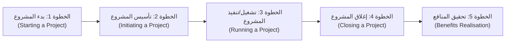

# دورة حياة المشروع

## (The Project Lifecycle)

لكي تتم إدارة المشروع بفعالية، من المفيد جداً فهم **دورة الحياة النموذجية للمشروع** وكيف تنطبق على مشروعك المحدد. يجب أن تقرر كيف سيتم إنجاز الأنشطة الإدارية لكل خطوة من خطوات دورة الحياة، ومن سيشارك فيها بالتحديد. كما يجب أن تتأكد من استيعابك لدورك في تحقيق هذه المهام بالطريقة الصحيحة وفي الوقت المناسب.

يقع العبء الأكبر لجهود إدارة المشروع عبر دورة الحياة على عاتق:

1. **المالك المسؤول الأول (Senior Responsible Owner - SRO)** للمشروع (الراعي/المتبني الرئيسي للمشروع).
2. **مدير المشروع (Project Manager)**.

ولتحقيق النجاح، سيحتاج كلاهما بالتأكيد إلى الاعتماد على مهارات وخبرات العديد من الأشخاص الآخرين داخل المنظمة، ومن الشركاء والموردين الخارجيين.

---

### دورة حياة المشروع في وزارة BIS (The BIS Project Lifecycle)

#### الوثائق الرئيسية المرتبطة بكل خطوة

- **الخطوة 1 (بدء المشروع):** موجز المشروع (*Project Brief*).
- **الخطوة 2 (تأسيس المشروع):** وثيقة بدء المشروع (*Project Initiation Document - PID*).
- **الخطوة 3 (تشغيل وتنفيذ المشروع):** خطة المشروع (*Project Plan*)، تقرير تسليط الضوء الإخباري (*Progress / Highlight Report*)، سجل المخاطر (*Risk Register*)، وإدارة التغيير (*Change Control*).
- **الخطوة 4 (إغلاق المشروع):** تقرير الدروس المستفادة (*Lessons Learned*).
- **الخطوة 5 (تحقيق المنافع):** مراجعة ما بعد المشروع (*Post Project Review*).

---

> [!IMPORTANT]
> على الرغم من أن **الخطوة 3 (تشغيل وتنفيذ المشروع)** هي الأكثر استهلاكاً للموارد والوقت على الإطلاق، إلا أن **العناية والجهد المبذولين في بدء المشروع وتأسيسه (الخطوتان 1 و 2)** هما العامل الحاسم والأكثر تأثيراً في تحقيق نجاح المشروع.
