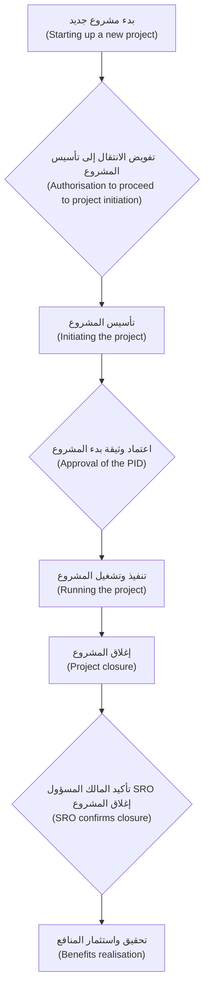

# مخطط دورة حياة المشروع والمهام الإدارية

## (The BIS Project Lifecycle Tasks)

يوضح المخطط التالي تسلسل خطوات دورة حياة المشروع والمسؤوليات الأساسية في كل مرحلة:

---

### تفاصيل الإجراءات والمسؤوليات في كل مرحلة

#### 1. بدء مشروع جديد (Starting up a new project)

**يتعين على المالك المسؤول الأول (SRO) أو صاحب فكرة المشروع المحتمل:**

- تحديد الحاجة إلى المشروع وتبريرها.
- تحديد وصياغة وتوثيق النتيجة المرجوة والمنافع المتوقعة والاتفاق عليها.
- تعيين مدير المشروع (Project Manager) وتشكيل مجلس إدارة المشروع (Project Board) إذا اقتضى الأمر.
- التأكد من توضيح أسباب المشروع ونطاق عمله (TOR) في **موجز المشروع (Project Brief)**.
- ضمان مواءمة المشروع مع الخطة الاستراتيجية وخطة العمل للمنظمة.

#### 2. تفويض الانتقال لمرحلة التأسيس (Authorisation to proceed)

- يتخذ **المالك المسؤول الأول (SRO) / مجلس إدارة المشروع** قراراً بما إذا كان من المنطقي والعملي الانتقال إلى مرحلة تأسيس المشروع.

#### 3. تأسيس المشروع (Initiating the project)

**يتعين على فريق إدارة المشروع:**

- التخطيط لكيفية تحقيق النتائج والمنافع المطلوبة.
- تحديد أسلوب إدارة العلاقات مع أصحاب المصلحة الرئيسيين.
- تحديد منهجية إدارة عملية التنفيذ والتسليم.
- تحديد الاحتياجات من الموارد وضمان إمكانية توفيرها في الأوقات المحددة.
- إعداد **دراسة الجدوى ومبررات الأعمال (Business Case)** لتمكين المجلس من اتخاذ قرار التبرير المالي وإدارة المخاطر.
- توثيق الفهم الكامل للمشروع وكيفية إدارته ضمن **وثيقة بدء المشروع (PID)**.

#### 4. اعتماد وثيقة بدء المشروع (Approval of the PID)

- يقوم **المالك المسؤول الأول / مجلس المشروع** بتقييم وثيقة (PID) - وبخاصة دراسة الجدوى - لتحديد ما إذا كان المشروع مجدياً، قابلاً للتطبيق، ذا تكلفة محتملة، ومناسباً للبدء فيه حالياً.

#### 5. تشغيل وتنفيذ المشروع (Running the project)

**يتعين على فريق إدارة المشروع:**

- حشد الكوادر والموارد اللازمة لبناء المنتجات والمخرجات التي تحقق النتيجة المطلوبة.
- تخطيط ومتابعة وضبط أعمال وموارد المشروع.
- إدارة المخاطر والمشكلات فور ظهورها.
- الحفاظ على قنوات اتصال مستمرة مع المتأثرين بالمشروع ومخرجاته.
- رفع تقارير التقدم والقضايا للمالك المسؤول، ومجلس المشروع، وأصحاب المصلحة.
- اتخاذ القرارات بشأن استمرارية جدوى المشروع في ضوء الممارسة الفعلية وتغير المتطلبات.
- التأكد من أن المخرجات ملائمة للغرض المنشود وتمكّن من تحقيق المنافع.

#### 6. إغلاق المشروع (Project closure)

**يتعين على فريق إدارة المشروع:**

- تقييم نتائج المشروع ومقارنتها بما ورد في وثيقة (PID).
- ضمان تعميم وتوثيق الدروس المستفادة ومشاركتها مع الجهات التي قد تستفيد منها.
- تحرير الموارد المستخدمة في المشروع وإعادتها.
- مراجعة وتقييم أي منافع تم تحقيقها بالفعل بنهاية المشروع.

#### 7. تأكيد الإغلاق من قِبل المالك المسؤول (SRO confirms closure)

**يتعين على المالك المسؤول الأول (SRO) إغلاق المشروع والتأكد من:**

- وجود خطط لمراجعة ما بعد المشروع لقياس مدى تحقق المنافع على أرض الواقع.
- تحديد الحاجة إلى أي تحسينات أو تعديلات مستقبلية.
- تسليم المشروع ومخرجاته رسمياً إلى المسؤول التشغيلي الذي سيتولى إدارتها واستثمار نتائجها.

#### 8. تحقيق المنافع (Benefits realisation)

**يتعين على المالك المسؤول الأول (SRO) ضمان ما يلي:**

- إجراء مراجعات ما بعد المشروع لقياس درجة تحقيق المنافع.
- تحديث دراسة الجدوى لتعكس الواقع التشغيلي الفعلي.
- تغذية التحسينات والتغييرات والفرص المكتشفة في عملية التخطيط الاستراتيجي للمنظمة لدراستها.
