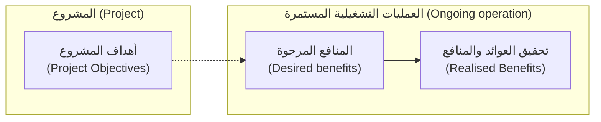

# تحديد نطاق المشروع وأهدافه

## (Defining project scope and objectives)

### العلاقة بين منافع المشروع ونطاقه وأهدافه

### (The relationship between a project's benefits, scope and objectives)

يجب معالجة أهداف المشروع ونطاقه والمنافع المرجوة منه عند بدء المشروع، وتوثيقها في **موجز المشروع (Project Brief)**، ثم تنقيحها وتفصيلها لاحقاً في **وثيقة بدء المشروع (PID)** أثناء التحديد والتخطيط التفصيلي.

قد يكون من الصعب أحياناً تجنب بعض التداخل بين ما يتم تعريفه في النطاق والأهداف والمنافع، ولكن حاول تقليل التكرار مع الحفاظ على الاتساق والوضوح وقابلية القياس.

يوضح الشكل التالي العلاقة المتبادلة بين أهداف المشروع والمنافع الناتجة عنه:

> **ملاحظة:** يتم تحديد المنافع والنطاق والأهداف أثناء مرحلة بدء المشروع. ويجب تعريف نطاق المشروع بطريقة تضمن تحقيق الأهداف وتمكين جني المنافع المرجوة ضمن هذا النطاق، وبذلك يمثل كل عنصر منها أداة فحص وتدقيق مقابلة للعناصر الأخرى.

---

### ماذا يُقصد بـ "نطاق المشروع"؟ (What is meant by the 'Scope' of a project?)

عند تحديد نطاق المشروع، فإنك تسعى لتحقيق عدة أمور:

- التأكد من أن **الحدود الفاصلة** بين هذا المشروع والمشاريع والبرامج الأخرى مفهومة بوضوح، لمنع أي فجوات أو تداخلات في الأعمال المطلوبة لتحقيق الأهداف العليا للمنظمة.
- التأكد من أن **الأعمال التي يجب على المشروع إنجازها**، وما تم **استبعاده صراحةً** من أعمال المشروع، محددة ومتفق عليها بين جميع الأطراف المعنية.
- إنشاء **خط أساس (Baseline)** للتحكم في التغييرات لاحقاً، للحد من الآثار السلبية لظاهرة **"زحف النطاق" (Scope Creep)**.

> [!NOTE]
> عند تحديد نطاق المشروع، لا توجد حاجة عادةً لإعادة تكرار الأهداف أو المنافع. ويمكن في كثير من الأحيان التعبير عن النطاق كقائمة من المخرجات والمسلمات، مصحوبة ببعض العبارات التوضيحية لما يدخل وما يخرج من النطاق.
