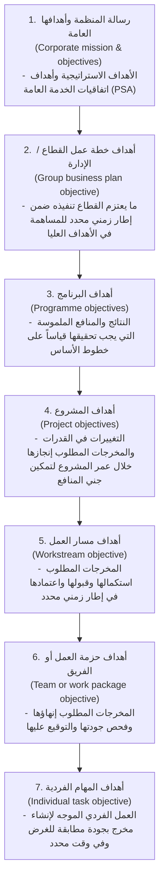

# التدرج الهرمي للأهداف وصياغة أهداف SMART

## (Hierarchy of Objectives & Defining SMART Objectives)

### التسلسل الهرمي المحتمل للأهداف (Possible hierarchy of objectives)

---

### كيفية تحديد أهداف المشروع وفق معايير SMART

### (How to define SMART project objectives)

تحدد أهداف المشروع ما يجب أن يحققه المشروع لكي يُحكم عليه بأنه **مكتمل وناجح** وبالتالي يمكن إغلاقه.

أما **المنافع (Benefits)**، فقد تبدأ في الظهور فقط عند نهاية المشروع وتستمر في التحقق لفترات طويلة بعد انتهائه. *(ملاحظة: إذا كانت هناك منافع محددة وقابلة للقياس يجب تحقيقها أثناء عمر المشروع، فيمكن التعبير عنها كأهداف بالإضافة إلى ظهورها في دراسة الجدوى)*.

تُعد الأهداف المحددة والمتفق عليها شرطاً مسبقاً أساسياً لإجراء التخطيط التفصيلي. ولكي تكون الأهداف مفيدة في إدارة المشروع، يجب أن تتوافر فيها الخصائص التالية:

#### 1. محددة (Specific)

يجب أن يكون الهدف خاصاً بالمشروع وواقعاً في نطاقه.  

- *مثال غير محدد:* "تحسين كفاءة تفاعلنا مع العملاء" (هذا هدف غامض جداً، وهو هدف عام مشترك لعدة برامج ومشاريع وأنشطة تشغيلية).  
- *مثال محدد:* "تقليص متوسط أوقات الاستجابة لاستفسارات العملاء حول الموضوع X" (هذا بيان أكثر وضوحاً لما يجب أن يفعله المشروع، ولكنه لا يزال يحتاج إلى معيار قياس).
