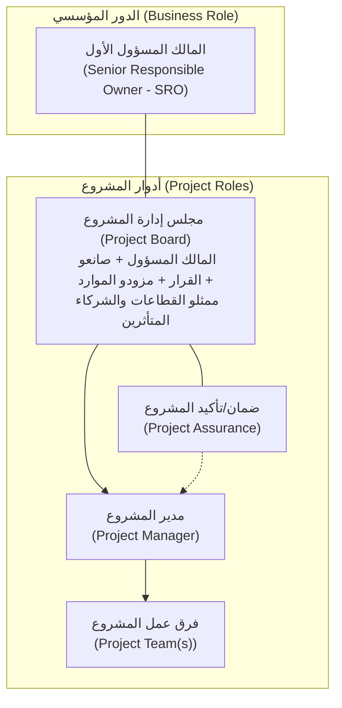

# تصميم الهيكل التنظيمي للمشروع

## (Designing the Project Organisation)

يجب أن يكون لكل مشروع **هيكل إداري وتنظيمي خاص به يُحدد في بدايته ويتم حله وتفكيكه عند نهايته**. إن تحديد الأدوار الإدارية والمسؤوليات والعلاقات والمساءلات والصلاحيات يشكل الركيزة الأساسية لترتيبات حوكمة المشروع.

> [!NOTE]
> من غير المحتمل إطلاقاً أن يكون الهيكل الإداري الوظيفي المعتاد في المنظمة كافياً أو مناسباً للاستخدام كهيكل لإدارة المشروع، باستثناء المهام الصغيرة جداً التي تُدار داخل وحدة عمل واحدة دون أي تأثير خارجي.

---

### الهيكل التنظيمي المعتمد على نموذج PRINCE2®

---

### أسس تصميم الهيكل التنظيمي

إن التنظيم المصمم جيداً سيشرك الأشخاص المناسبين ذوي المهارات الملائمة ومستويات الصلاحية الصحيحة، بحيث يمكن للمشروع بمجرد اعتماده أن يمضي قدماً بأقل قدر من الحاجة للرجوع إلى خارج هيكل المشروع، إلا في حالات الاستثناءات التي تتجاوز صلاحيات المالك المسؤول الأول.

**لا يوجد نموذج واحد "يناسب الجميع"؛ بل يجب تصميم الهيكل التنظيمي ليلائم:**

- **حيوية وأهمية المشروع** لأعمال المنظمة (Criticality to the business).
- **حجم المشروع ودرجة تعقيده** (Size/complexity).
- **مستوى التأثير** داخل المنظمة الأم (Degree of impact within the parent body).
