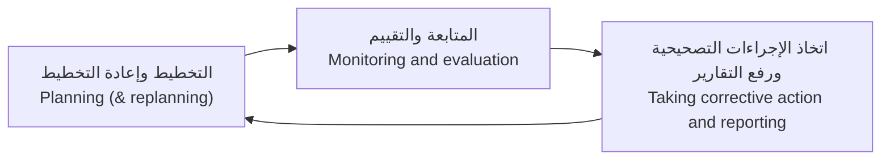

# القسم 3: تشغيل وتنفيذ المشروع وضوابط التحكم
## (Section 3: Running the project - Control)

### الضبط والتحكم - مفتاح نجاح المشروع
### (Control - the key to a successful project)

لكي تدرك كيف يعمل ضبط ومراقبة المشروع، يجب أن تفهم أولاً أنه **على الرغم من كل الجهد المبذول في تطوير الخطة والحصول على الالتزام بها، فإن فرصة أن يسير المشروع بدقة وحرفية تامة وفقاً لتلك الخطة ضئيلة جداً**.

هذا لا يعني أبداً أنك ستفشل في تحقيق أهداف الخطة - بل على العكس، يجب أن تكون لديك ثقة عالية جداً بقدرتك على تحقيق الأهداف وتسليم النطاق كاملاً، مطابقاً للغرض، وفي الوقت المحدد، وضمن الميزانية.

تصف الخطة ما تود القيام به، ولكنها تمثل مساراً واحداً فقط من بين عدد لا نهائي من المسارات المحتملة للانتقال من نقطة انطلاقك الحالية إلى وجهتك المنشودة. وعملياً، سيسلك مشروعك مساراً مختلفاً عن المسار المرسوم في الخطة (ولا يمكنك التنبؤ به مسبقاً)، لكنك ستحتاج إلى **الضبط والرقابة (Control)** للتأكد من أنه مسار يوصلك إلى المكان المطلوب، في الوقت المحدد، وبتكلفة مقدور عليها.

> **قوة الخطة تكمن في أنها تمنحك "خط أساس" (Baseline)** تقارن به الإنجاز الفعلي والتكلفة والوقت المنقضي لتحديد حجم الانحراف عن الخطة، ومن ثم اتخاذ الإجراءات التصحيحية عند الحاجة.

المطلب الأساسي للضبط هو توفر خطة يتم رصد ومتابعة التقدم بالاستناد إليها لتكون محفزاً للإجراءات الإدارية عند حدوث أي انحراف. ويتحول الضبط حينئذٍ إلى **حلقة تكرارية مستمرة ودورية** من:

---

### تهيئة البيئة المناسبة للضبط والرقابة
### (Creating the right environment for control)

تتمثل المتطلبات الأساسية للضبط والرقابة فيما يلي:
1. **خطة عمل:**
   - واقعية (Realistic).
   - موثوقة وقابلة للتصديق (Credible).
   - مفصلة بدرجة كافية للتنفيذ.
   - مقبولة لدى المنفذين (مدير المشروع وفرق العمل).
   - معتمدة من قِبل المسؤولين عن تحقيقها (المالك المسؤول الأول / مجلس المشروع).
2. **عملية واضحة لمتابعة وإدارة التقدم واستخدام الموارد**.
3. **هيكل لإدارة المشروع** يضم أشخاصاً مؤهلين يتمتعون بالصلاحية والوقت الكافيين للتخطيط والمتابعة ورفع التقارير واتخاذ القرارات ومعالجة الاستثناءات.
4. **آلية لإجراء التصحيحات والتعديلات الطفيفة** للتعامل مع الانحرافات والسهو البسيط عن الخطة.
