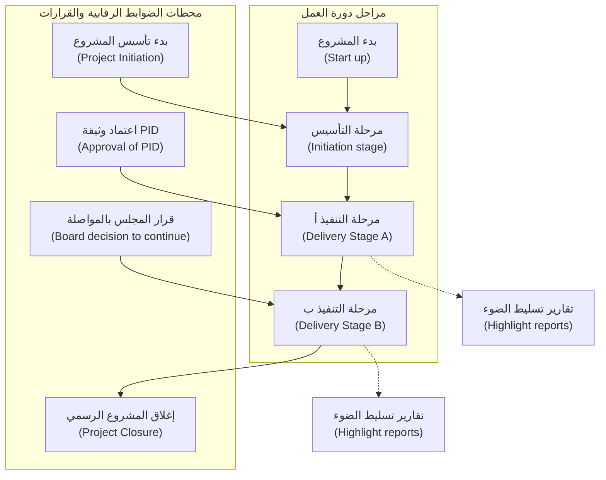

# ضوابط المالك المسؤول ومجلس إدارة المشروع
## (SRO and Project Board Controls)

ترتبط الضوابط الرقابية التي يطبقها المالك المسؤول الأول (SRO) ومجلس إدارة المشروع مباشرة **بالمراحل المعتمدة في المشروع**، وتعتمد كلياً على المعلومات الموثوقة حول الحالة الراهنة للمشروع وخططه المستقبلية التي يقدمها مدير المشروع.

---

### مخطط ضوابط ومحطات المشروع (Project Plan: P01)

---

### قرارات المالك المسؤول ومجلس المشروع أثناء التنفيذ
### (SRO/Project Board decisions during delivery)

عند المحطات الرئيسية أثناء التنفيذ، قد يرغب المالك المسؤول ومجلس المشروع في مراجعة وتقييم مسار المشروع للتأكد من أن الاستمرار فيه أمر منطقي وذو جدوى. وللقيام بذلك، يجب التأكد من:
- أن **جودة المخرجات** المنتجة حتى تاريخه مقبولة ومطابقة للمواصفات.
- أن **المنافع المطلوبة** لا تزال قابلة للتحقيق والوصول.
- أن **التكاليف الفعلية** المتكبدة بالإضافة إلى التقديرات المعدلة للتكاليف المستقبلية مقبولة وفي الحدود المعقولة.
- إمكانية **توفير الموارد المطلوبة** لأعمال المراحل المستقبلية المخططة.
- أن **الحاجة للمشروع** لم تتغير وظلت قائمة.
- أن **المخاطر** مقبولة ومسيطر عليها.
- أن **المشروع ككل لا يزال مجدياً وقابلاً للنجاح**.

ويتعين على مدير المشروع تزويد المجلس بالمعلومات والوثائق اللازمة لاتخاذ هذه القرارات.
