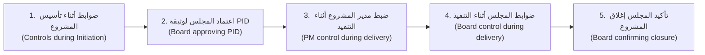

# ملخص ضوابط المشروع بعد اعتماد موجز المشروع
## (Summary of Project Controls After Approval of Project Brief)

يقدم المخطط والجدول التالي ملخصاً متكاملاً لكافة الضوابط الرقابية المطبقة عبر مراحل المشروع المتتالية:

---

### جدول مقارنة ومصفوفة الضوابط عبر المراحل:

| المرحلة 1: أثناء تأسيس المشروع | المرحلة 2: اعتماد وثيقة (PID) | المرحلة 3: رقابة مدير المشروع أثناء التنفيذ | المرحلة 4: رقابة المجلس أثناء التنفيذ | المرحلة 5: تأكيد إغلاق المشروع |
| :--- | :--- | :--- | :--- | :--- |
| **إعداد خطة المشروع** *(Produce a project plan)* | **هل الخطة قابلة للتطبيق؟** وهل يمكن توفير الموارد المطلوبة؟ | **تفويض الفريق لبدء العمل** *(Authorise team to start)* | **تحليل تقارير تسليط الضوء** وطلب توضيحات للقضايا المثارة | **هل جميع المخرجات مكتملة** ومقبولة وتم تسليمها رسمياً؟ |
| **تحديد نقاط قرار المجلس** *(Identify decision points)* | **هل المخاطر مقبولة ومتحكم بها؟** *(Are risks acceptable?)* | **عقد نقاط الفحص دورياً** *(Checkpoints at intervals)* | **دراسة تداعيات الاستثناءات** وتوجيه مدير المشروع بكيفية التصرف | **هل روجع المشروع مقابل PID؟** وهل استخلصت ونشرت الدروس المستفادة؟ |
| **تحديد وتيرة تقارير الإحاطة** *(Highlight reporting freq.)* | **هل التكاليف والمنافع تبرر الاستمرار؟** *(Do costs/benefits justify?)* | **مقارنة الأداء الفعلي بالخطة** وتحديد انحرافات التكلفة والوقت والجودة | **دراسة طلبات التغيير** وتحديد أولوياتها واتخاذ قرارات قبولها/رفضها | **هل توجد خطة لمراجعة ما بعد التنفيذ** لقياس تحقق المنافع الفعلية؟ |
| **تحديد وتيرة نقاط الفحص** *(Checkpoint frequency)* | **هل حُددت حدود التفاوت المسموح بها للانحرافات؟** *(Tolerances set?)* | **إجراء التصحيحات الطفيفة** وتصعيد ما يتجاوز الصلاحيات المفوضة | **إبلاغ أصحاب المصلحة** داخل الوزارة وخارجها بالتقدم والمشكلات | **هل سُلمت كافة الطلبات والمشكلات والمخاطر المتبقية** لجهات الاختصاص؟ |
| **توثيق ترتيبات الضبط والتقارير** في وثيقة (PID) | **إعطاء الموافقة والاعتماد** للمضي قدماً استناداً لوثيقة (PID) | **رفع تقارير تسليط الضوء** للمجلس في المواعيد المحددة | **دراسة استمرارية الجدوى** للخطط والمنافع والتكاليف والمخاطر | **حل وتفكيك هيكل المشروع** وإطلاق الموارد المتبقية وتحريرها |
