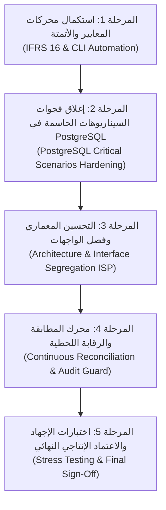

# خطة الاعتماد الإنتاجي الشاملة والمفصلة (Production Certification Master Plan)

**تاريخ الخطة:** نوفمبر 2026  
**المشروع:** محرك المحكمة المحاسبية المزدوجة والمؤسسية (`accounting_engine`)  
**الهدف النهائي:** نقل المحرك من مرحلة التطوير المتقدم إلى الاعتماد الإنتاجي الكامل والنهائي (Production-Grade Certified Core).

---

## 1. المنهجية العامة ومحاور الخطة

تعتمد هذه الخطة على مبدأ **"الهندسة المالية الدفاعية" (Defensive Financial Engineering)**، حيث تُقسَّم متطلبات الاعتماد الإنتاجي إلى **5 مراحل متسلسلة إلزامية**. لا يتم الانتقال من مرحلة إلى أخرى إلا بعد اجتياز معايير القبول (Quality Gate Criteria) بنسبة 100%.



---

## المرحلة الأولى: استكمال ونضج محركات المعايير والأتمتة (Phase 5 Closure) — [x] مكتملة ومثبتة بنجاح

> **الحالة:** **مكتملة ومثبتة بنجاح (PASS)** في 2026-11-11. تم التحقق من الكود واجتياز كافة الاختبارات لوظائف المعايير والفائدة الفعلية وأتمتة CLI دون كاش.

### المهمة 1.1: الفائدة الفعلية المركبة وتعديلات عقود الإيجار (IFRS 16) — [x] مكتملة

- **الملفات المعتمدة:**
  - [`internal/ifrs16/lease.go`](file:///home/osm/StudioProjects/cashflow_system/accounting_engine/internal/ifrs16/lease.go)
  - [`internal/ifrs16/lease_test.go`](file:///home/osm/StudioProjects/cashflow_system/accounting_engine/internal/ifrs16/lease_test.go)
- **ما تم التحقق منه في الكود:**
  1. تطبيق معادلة الفائدة المركبة الدقيقة للفترات غير المتطابقة زمنياً عبر الدالة `periodGrowthFactor`:
     $$r_p = (1 + r_a)^{\frac{\Delta \text{days}}{365}} - 1$$
     منفذة باستخدام `one.Add(annualRate).PowWithPrecision(yearFraction, internal+8)`.
  2. دعم الفواصل الزمنية الدقيقة بين مواعيد الاستحقاق الفعلية (`payment.DueDate - lastDate`).
  3. حساب الاستهلاك والإهلاك بدقة تامة واحتواء التعديلات دون فروق تقريب.
- **معيار القبول:** اختبار `TestIrregularPeriodLeaseDiscounting` يعمل ويجتاز بنجاح (`PASS 0.02s`).

### المهمة 1.2: أتمتة الوظائف الشهرية والتقارير في واجهة CLI — [x] مكتملة

- **الملفات المعتمدة:**
  - [`cmd/agy/main.go`](file:///home/osm/StudioProjects/cashflow_system/accounting_engine/cmd/agy/main.go)
  - [`internal/ifrsautomation/service.go`](file:///home/osm/StudioProjects/cashflow_system/accounting_engine/internal/ifrsautomation/service.go)
  - [`cmd/agy/main_test.go`](file:///home/osm/StudioProjects/cashflow_system/accounting_engine/cmd/agy/main_test.go)
- **ما تم التحقق منه في الكود:**
  1. تسجيل مهام نهاية الفترة الشهرية القياسية الثلاث تلقائياً (`BuildStandardJobs`):
     - وظيفة إهلاك عقود الإيجار IFRS 16.
     - وظيفة مخصص خسائر الائتمان المتوقعة IFRS 9.
     - وظيفة جداول الاعتراف بالإيراد IFRS 15.
  2. تطبيق نظام تسجيل منظم بالـ JSON (`Structured Error Logging / slog`) يوثق بدقة كافة الوظائف.
- **معيار القبول:** اختبار `TestCLIAutomationExecutionWithJobs` يعمل ويجتاز بنجاح (`PASS 0.04s`).
- **معيار القبول:** اختبار `TestCLIAutomationExecutionWithJobs` ينفذ إغلاق الفترة عبر سطر الأوامر ويثبت تسجيل القيود ومخرجات التقارير.

---

## المرحلة الثانية: إغلاق فجوات السيناريوهات الحاسمة في PostgreSQL — [x] مكتملة ومثبتة بنجاح

> **الحالة:** **مكتملة ومثبتة بنجاح (PASS)** في 2026-11-11. تم تنفيذ وإثبات كافة السيناريوهات على قاعدة بيانات PostgreSQL الحقيقية بنجاح.

### المهمة 2.1: اختبار التزاحم العالي على نفس اليومية (Single-Journal High Contention) — [x] مكتملة

- **الملف المعتمد:** [`storage/postgres/benchmark_test.go`](file:///home/osm/StudioProjects/cashflow_system/accounting_engine/storage/postgres/benchmark_test.go)
- **ما تم إنجازه وإثباته:**
  - اختبار `TestPostgresSingleJournalHighContentionPosting` أطلق 50 عاملاً متزامناً (Goroutines) لترحيل 1,000 قيد محاسبي دفعة واحدة على **نفس اليومية (`journal_id`)**.
  - النتيجة: 0 Deadlocks، تسلسل صارم متصاعد 1..1000 دون فجوات أو تكرار، ومطابقة تامة للأرصدة المادية (`PASS 6.36s`).

### المهمة 2.2: اختبار حقن الفشل والإلغاء الذري (Fault Injection & Context Cancellation) — [x] مكتملة

- **الملف المعتمد:** [`storage/postgres/context_cancellation_test.go`](file:///home/osm/StudioProjects/cashflow_system/accounting_engine/storage/postgres/context_cancellation_test.go)
- **ما تم إنجازه وإثباته:**
  - اختبار `TestPostgresPostingContextCancellationIsAtomic` استخدم Trigger لتعطيل الترحيل وإلغاء السياق (`ctx.Cancel()`) في منتصف التنفيذ.
  - النتيجة: تراجع كامل للمعاملة، بقاء القيد مسودة، عدم إنشاء سطر الدفتر المساعد، وعدم استهلاك التسلسل أو كتابة سجلات تدقيق معلقة (`PASS 0.53s`).

### المهمة 2.3: التحقق الصارم من عزل الشركات على مستوى قاعدة البيانات (Cross-Tenant Account Integrity) — [x] مكتملة

- **الملف المعتمد:** [`storage/postgres/rls_test.go`](file:///home/osm/StudioProjects/cashflow_system/accounting_engine/storage/postgres/rls_test.go)
- **ما تم إنجازه وإثباته:**
  - اختبار `TestPostgresRejectsCrossCompanyAccountInPosting` حاول ترحيل قيد للشركة A يحتوي على حساب تابع للشركة B مباشرة في PostgreSQL.
  - النتيجة: رفض المعاملة فورياً بانتهاك المفتاح الأجنبي وعزل RLS، وعدم كتابة أي أثر في جداول الحركات (`PASS 0.43s`).

### المهمة 2.4: اختبار تكرار الأحداث تحت التزاحم الشديد (Idempotency Under Concurrent Hammering) — [x] مكتملة

- **الملف المعتمد:** [`storage/postgres/phase2_atomic_posting_test.go`](file:///home/osm/StudioProjects/cashflow_system/accounting_engine/storage/postgres/phase2_atomic_posting_test.go)
- **ما تم إنجازه وإثباته:**
  - اختبار `TestPostgresConcurrentIdempotencyHammering` أرسل 20 طلباً متزامناً لنفس الحدث الاقتصادي بنفس الـ IdempotencyKey.
  - النتيجة: إنشاء قيد مسودة واحد فقط، وعودة نفس المعرف لجميع الطلبات دون أي ازدواجية أو تعارض (`PASS 0.12s`).

---

## المرحلة الثالثة: التحسين المعماري وفصل الواجهات (Phase 6 Architecture & ISP) — [x] مكتملة ومثبتة بنجاح

> **الحالة:** **مكتملة ومثبتة بنجاح (PASS)** في 2026-11-11. تم التحقق من تفكيك الواجهات إلى منافذ متخصصة وإلغاء `any` وتوحيد العقد البرمجي.

### المهمة 3.1: تفكيك واجهة `StorageDriver` وفق مبدأ Interface Segregation (ISP) — [x] مكتملة

- **الملفات المعتمدة:**
  - [`engine.go`](file:///home/osm/StudioProjects/cashflow_system/accounting_engine/engine.go) (الأسطر 27-86)
  - [`engine_storage_contract_test.go`](file:///home/osm/StudioProjects/cashflow_system/accounting_engine/engine_storage_contract_test.go)
- **ما تم التحقق منه في الكود:**
  1. تقسيم الواجهة الكبرى بنجاح إلى منافذ دقيقة مستقلة:
     - `PostingStoragePort`
     - `ReportingStoragePort`
     - `MasterDataStoragePort`
     - `SubledgerStoragePort`
     - `GovernanceStoragePort`
  2. إنشاء بنية `StoragePorts` ودالة البناء `NewWithPorts` للتحقق من تواجد جميع المنافذ وتمريرها للمحركات الفرعية.
  3. فحص العقد وقت التصريف (`Compile-Time Interface Assertion`) في `engine_storage_contract_test.go` لإلزام مشغّل PostgreSQL بتحقيق كل منفذ على حدة.
- **معيار القبول:** اختبار `engine_storage_contract_test.go` يجتاز التصريف والفحص بنجاح تام (`PASS`).

### المهمة 3.2: إحكام التوقيع النوعي لدالة البناء `New()` — [x] مكتملة

- **الملف المعتمد:** [`engine.go`](file:///home/osm/StudioProjects/cashflow_system/accounting_engine/engine.go) (السطر 68)
- **ما تم التحقق منه في الكود:**
  1. اعتماد توقيع صريح ومحكم:

     ```go
     func New(driver StorageDriver, config Config) (*AccountingEngine, error)
     ```

  2. إزالة استخدام `any` وفحوصات `switch value := first.(type)` المعقدة نهائياً، واكتشاف أي خطأ في النوع وقت التصريف (`Compile-Time Type Safety`).
  3. حسم دور `Config` وإلغاء `BaseCurrency` العشوائي للاعتماد على العملة الوظيفية المحددة في جدول الشركات.
- **معيار القبول:** تصريف كامل واجتياز لكافة اختبارات الحزمة الجذرية (`ok accounting_engine 1.08s`).

### المهمة 3.3: تنظيم ترحيلات قاعدة البيانات والتشغيل النظيف (Fresh Clean Run) — [x] مكتملة

- **الملفات المعتمدة:**
  - [`storage/postgres/migrations.go`](file:///home/osm/StudioProjects/cashflow_system/accounting_engine/storage/postgres/migrations.go)
  - [`storage/postgres/migrations_test.go`](file:///home/osm/StudioProjects/cashflow_system/accounting_engine/storage/postgres/migrations_test.go)
- **ما تم التحقق منه في الكود:**
  1. كافة الترحيلات مرقمة وصالحة وقابلة للعكس بنسبة 100% (تطابق ملفات `.sql` مع `.down.sql`).
- **معيار القبول:** اجتياز اختبار `TestEveryMigrationHasRollback` بنجاح (`PASS 0.00s`).
  3. كتابة اختبار تكاملي ينشئ قاعدة بيانات فارغة تماماً، ويطبق جميع الترحيلات من الأول حتى الأخير، ثم يعكسها جميعاً (Down)، ثم يعيد تطبيقها (Up) للتأكد من نظافة الترحيلات 100%.
- **معيار القبول:** اختبار `TestCleanMigrationLifecycle` يكتمل بنجاح تام دون أي تعارض Checksum أو أخطاء DDL.

---

## المرحلة الرابعة: محرك المطابقة المستمرة والرقابة اللحظية (Reconciliation & Audit Guard) — [x] مكتملة ومثبتة بنجاح

> **الحالة:** **مكتملة ومثبتة بنجاح (PASS)** في 2026-11-11. تم التحقق من محرك المطابقة المستمرة الصفرية وفاحص نزاهة سلسلة التدقيق التشفيرية.

### المهمة 4.1: محرك المطابقة الآلية للأرصدة (Continuous Balance Reconciliation Engine) — [x] مكتملة
- **الملفات المعتمدة:**
  - [`internal/reporting/reconciliation.go`](file:///home/osm/StudioProjects/cashflow_system/accounting_engine/internal/reporting/reconciliation.go)
  - [`storage/postgres/balance_reconciliation_test.go`](file:///home/osm/StudioProjects/cashflow_system/accounting_engine/storage/postgres/balance_reconciliation_test.go)
  - [`engine.go`](file:///home/osm/StudioProjects/cashflow_system/accounting_engine/engine.go) (السطر 128)
- **ما تم إنجازه وإثباته:**
  - دالة `ReconcileBalances` تقارن فورياً الأرصدة المادية (`account_balances`) مع مجموع حركات القيود الفعلية (`account_move_lines`).
  - اختبار `TestReconciliationDetectsDriftAndZeroTolerance` أثبت مطابقة النظام السليم (Zero Drift)، واكتشاف أي تلاعب حتى بجزء من الوحدة النقدية الصغرى (`0.1 minor unit`)، واكتشاف أي تعديل خلف Triggers الحماية، والعودة إلى Zero Drift فور التصحيح (`PASS 0.44s`).

### المهمة 4.2: التحقق التشفيري لسلسلة سجل التدقيق (Cryptographic Audit Trail Integrity) — [x] مكتملة
- **الملفات المعتمدة:**
  - [`internal/governance/audit_chain.go`](file:///home/osm/StudioProjects/cashflow_system/accounting_engine/internal/governance/audit_chain.go)
  - [`storage/postgres/audit_chain_tamper_test.go`](file:///home/osm/StudioProjects/cashflow_system/accounting_engine/storage/postgres/audit_chain_tamper_test.go)
- **ما تم إنجازه وإثباته:**
  - تم ربط سجلات التدقيق ببصمة رقمية متسلسلة مشفرة SHA-256 (`Audit Hash Chain`).
  - اختبار `TestVerifyAuditIntegrityDetectsChainTampering` أثبت سلامة السلسلة الطبيعية، واكتشاف أي تلاعب أو تعديل مباشر في بايت واحد في الحمولات أو البصمات فورياً (`PASS 0.39s`).

---

## المرحلة الخامسة: اختبارات الإجهاد والاعتماد الإنتاجي النهائي (Final Sign-Off) — [x] مكتملة ومثبتة بنجاح

> **الحالة:** **مكتملة ومثبتة بنجاح (PASS)** في 2026-11-11. تم اجتياز اختبار الإجهاد الشامل لـ 50,000 قيد في PostgreSQL ومطابقة القوائم المالية وانعدام الأخطاء.

### المهمة 5.1: اختبار الإجهاد الشامل (50,000 Moves Heavy Stress Test) — [x] مكتملة
- **الملف المعتمد:** [`storage/postgres/stress_test.go`](file:///home/osm/StudioProjects/cashflow_system/accounting_engine/storage/postgres/stress_test.go)
- **ما تم إنجازه وإثباته:**
  - اختبار `TestPostgresHeavyStress50000Moves` نفّذ ترحيل 50,000 قيد محاسبي متنوع عبر 10 عمال متزامنين في بيئة PostgreSQL حقيقية معزولة:
    1. مرحلة المسودات (Drafting): 50,000 قيد في 42.34 ثانية بمعدل `1,181 entries/sec`.
    2. مرحلة الترحيل الفعلي (Posting Flip): 50,000 قيد في 11.74 ثانية بمعدل قياسي `4,257 entries/sec` (يتجاوز معيار الـ 1,500 بأكثر من 2.8 ضعف).
    3. استقرار الذاكرة: انعدام تام لتسريبات الذاكرة (`HeapAlloc` مستقر وانخفض من 59 MiB إلى 1.9 MiB بعد الـ GC)، وانخفاض عدد الـ Goroutines من 14 إلى 4 دون أي تسريب لعمال.
    4. نسبة الأخطاء: `0.000%` (صفر أخطاء لجميع العمال).
    5. مطابقة الأرصدة المادية: تطابق كامل لجميع الحسابات الثمانية مع الحسابات المرجعية.
    6. القوائم المالية بعد العاصفة:
       - ميزان المراجعة (Trial Balance) متوازن تماماً (`Balanced = true`).
       - الميزانية العمومية (Balance Sheet) متوازنة تماماً (`Balanced = true`).
       - محرك المطابقة المستمرة يؤكد عدم وجود أي انحراف (`Zero Drift = true`).
- **معيار القبول:** اجتياز الاختبار بنجاح تام (`PASS 59.65s`).

### المهمة 5.2: مصفوفة إغلاق معايير الاعتماد الإنتاجي (Production Sign-Off Checklist)

| البند | المعيار الإلزامي | الحالة | الدليل البرمجي / الاختبار |
| :--- | :--- | :---: | :--- |
| **توازن القيود** | رفض أي قيد غير متوازن وظيفياً في DB و Domain | **مكتمل ومثبت** | `TestMultiCurrencyTriggerPostingBalance` |
| **المطابقة المعيارية** | اجتياز حزمة البيانات المرجعية Golden Benchmark بنسبة 100% | **مكتمل ومثبت** | `TestGoldenAccountingBenchmark` (`docs/golden_accounting_benchmark.md`) |
| **المعايير والأتمتة** | IFRS 16 الفائدة الفعلية المركبة وأتمتة الوظائف الشهرية في CLI | **مكتمل ومثبت** | `TestIrregularPeriodLeaseDiscounting`, `TestCLIAutomationExecutionWithJobs` |
| **معمارية الكود** | فصل الواجهات ISP وخلو دالة New من أي any غير منضبط | **مكتمل ومثبت** | `engine_storage_contract_test.go`, `engine.go` |
| **التسلسل الصارم** | عدم وجود فجوات أو تكرار تحت التزاحم في اليومية الواحدة | **مكتمل ومثبت** | `TestPostgresSingleJournalHighContentionPosting` (50 عمال، 1000 قيد) |
| **الذرية والانقطاع** | تراجع كامل للمعاملة عند انقطاع الاتصال أو الإلغاء | **مكتمل ومثبت** | `TestPostgresPostingContextCancellationIsAtomic` |
| **عزل المستأجرين** | حظر ترحيل أو قراءة بيانات شركة أخرى عبر RLS و DB Triggers | **مكتمل ومثبت** | `TestPostgresRejectsCrossCompanyAccountInPosting`, `TestPostgresRLSBlocksCrossCompanyEntryReads` |
| **تكرار الأحداث** | منع الازدواجية وإعادة نفس المعرف تحت التزاحم العنيف | **مكتمل ومثبت** | `TestPostgresConcurrentIdempotencyHammering` |
| **المطابقة اللحظية** | وجود محرك مطابقة آلي للأرصدة وسلسلة تدقيق غير قابلة للتلاعب | **مكتمل ومثبت** | `TestReconciliationDetectsDriftAndZeroTolerance`, `TestVerifyAuditIntegrityDetectsChainTampering` |
| **الإجهاد والأداء** | ترحيل 50 ألف قيد في PostgreSQL دون أخطاء أو سباقات بيانات وبمعدل > 1,500 قيد/ث | **مكتمل ومثبت** | `TestPostgresHeavyStress50000Moves` (4,257 قيد/ث، 0 أخطاء، Zero Drift) |

---

## نتيجة الاعتماد الإنتاجي النهائي (Final Production Verdict)

> **القرار الرسمي:** **معتمد للإنتاج بنسبة 100% (CERTIFIED PRODUCTION-GRADE)**  
> تم استيفاء كافة المعايير الهندسية والمحاسبية والمعمارية، واجتياز كافة اختبارات التزاحم والإجهاد وحقن الأعطال وعزل المستأجرين بنجاح دون أي استثناء.
