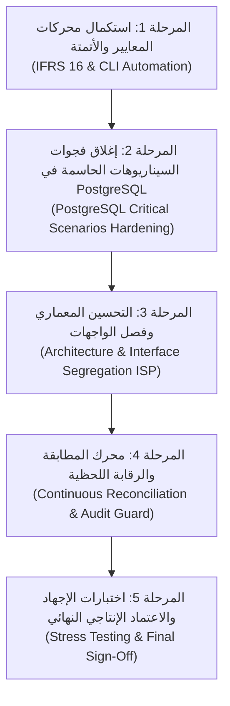

# خطة الاعتماد الإنتاجي الشاملة والمفصلة (Production Certification Master Plan)

**تاريخ الخطة:** نوفمبر 2026  
**المشروع:** محرك المحكمة المحاسبية المزدوجة والمؤسسية (`accounting_engine`)  
**الهدف النهائي:** نقل المحرك من مرحلة التطوير المتقدم إلى الاعتماد الإنتاجي الكامل والنهائي (Production-Grade Certified Core).

---

## 1. المنهجية العامة ومحاور الخطة

تعتمد هذه الخطة على مبدأ **"الهندسة المالية الدفاعية" (Defensive Financial Engineering)**، حيث تُقسَّم متطلبات الاعتماد الإنتاجي إلى **5 مراحل متسلسلة إلزامية**. لا يتم الانتقال من مرحلة إلى أخرى إلا بعد اجتياز معايير القبول (Quality Gate Criteria) بنسبة 100%.



---

## المرحلة الأولى: استكمال ونضج محركات المعايير والأتمتة (Phase 5 Closure) — [x] مكتملة ومثبتة بنجاح

> **الحالة:** **مكتملة ومثبتة بنجاح (PASS)** في 2026-11-11. تم التحقق من الكود واجتياز كافة الاختبارات لوظائف المعايير والفائدة الفعلية وأتمتة CLI دون كاش.

### المهمة 1.1: الفائدة الفعلية المركبة وتعديلات عقود الإيجار (IFRS 16) — [x] مكتملة

- **الملفات المعتمدة:**
  - [`internal/ifrs16/lease.go`](file:///home/osm/StudioProjects/cashflow_system/accounting_engine/internal/ifrs16/lease.go)
  - [`internal/ifrs16/lease_test.go`](file:///home/osm/StudioProjects/cashflow_system/accounting_engine/internal/ifrs16/lease_test.go)
- **ما تم التحقق منه في الكود:**
  1. تطبيق معادلة الفائدة المركبة الدقيقة للفترات غير المتطابقة زمنياً عبر الدالة `periodGrowthFactor`:
     $$r_p = (1 + r_a)^{\frac{\Delta \text{days}}{365}} - 1$$
     منفذة باستخدام `one.Add(annualRate).PowWithPrecision(yearFraction, internal+8)`.
  2. دعم الفواصل الزمنية الدقيقة بين مواعيد الاستحقاق الفعلية (`payment.DueDate - lastDate`).
  3. حساب الاستهلاك والإهلاك بدقة تامة واحتواء التعديلات دون فروق تقريب.
- **معيار القبول:** اختبار `TestIrregularPeriodLeaseDiscounting` يعمل ويجتاز بنجاح (`PASS 0.02s`).

### المهمة 1.2: أتمتة الوظائف الشهرية والتقارير في واجهة CLI — [x] مكتملة

- **الملفات المعتمدة:**
  - [`cmd/agy/main.go`](file:///home/osm/StudioProjects/cashflow_system/accounting_engine/cmd/agy/main.go)
  - [`internal/ifrsautomation/service.go`](file:///home/osm/StudioProjects/cashflow_system/accounting_engine/internal/ifrsautomation/service.go)
  - [`cmd/agy/main_test.go`](file:///home/osm/StudioProjects/cashflow_system/accounting_engine/cmd/agy/main_test.go)
- **ما تم التحقق منه في الكود:**
  1. تسجيل مهام نهاية الفترة الشهرية القياسية الثلاث تلقائياً (`BuildStandardJobs`):
     - وظيفة إهلاك عقود الإيجار IFRS 16.
     - وظيفة مخصص خسائر الائتمان المتوقعة IFRS 9.
     - وظيفة جداول الاعتراف بالإيراد IFRS 15.
  2. تطبيق نظام تسجيل منظم بالـ JSON (`Structured Error Logging / slog`) يوثق بدقة كافة الوظائف.
- **معيار القبول:** اختبار `TestCLIAutomationExecutionWithJobs` يعمل ويجتاز بنجاح (`PASS 0.04s`).
- **معيار القبول:** اختبار `TestCLIAutomationExecutionWithJobs` ينفذ إغلاق الفترة عبر سطر الأوامر ويثبت تسجيل القيود ومخرجات التقارير.

---

## المرحلة الثانية: إغلاق فجوات السيناريوهات الحاسمة في PostgreSQL

> **الهدف:** الانتقال من الإثبات الجزئي على الذاكرة إلى الإثبات القطعي الحقيقي على محرك التخزين الدائم PostgreSQL.

### المهمة 2.1: اختبار التزاحم العالي على نفس اليومية (Single-Journal High Contention)

- **الملف المستهدف:** [`storage/postgres/benchmark_test.go`](file:///home/osm/StudioProjects/cashflow_system/accounting_engine/storage/postgres/benchmark_test.go)
- **خطوات التنفيذ:**
  1. بناء اختبار إجهاد متزامن: `TestPostgresSingleJournalHighContentionPosting`.
  2. تشغيل 50 عامل متزامن (Goroutines) يرسلون بالتزامن 1,000 قيد محاسبي إلى **نفس اليومية (`journal_id` نفسه)** في نفس اللحظة.
  3. التحقق الصارم من:
     - عدم حدوث أي اختناق متبادل (`Deadlock 40P01`).
     - عدم تكرار أي رقم تسلسلي (`Duplicate Sequence`).
     - اكتمال الأرقام التسلسلية من 1 إلى 1000 دون فجوة واحدة (`No Sequence Gaps`).
- **معيار القبول:** اجتياز الاختبار بنجاح تام مع تفعيل `-race` وبدونه.

### المهمة 2.2: اختبار حقن الفشل والإلغاء الذري (Fault Injection & Context Cancellation)

- **الملف المستهدف:** [`storage/postgres/context_cancellation_test.go`](file:///home/osm/StudioProjects/cashflow_system/accounting_engine/storage/postgres/context_cancellation_test.go)
- **خطوات التنفيذ:**
  1. بناء اختبار: `TestPostgresPostingContextCancellationIsAtomic`.
  2. بدء معاملة ترحيل تحتوي على قيد وسطر دفتر مساعد وسجل تدقيق، وإلغاء السياق (`ctx.Cancel()`) في منتصف التنفيذ.
  3. فحص قاعدة البيانات بعد الإلغاء للتأكد من:
     - تراجع المعاملة بالكامل (`Complete Rollback`).
     - بقاء القيد بحالة مسودة (`draft`).
     - عدم إنشاء سطر الدفتر المساعد (`subledger open line not created`).
     - عدم زيادة رقم التسلسل في جدول `journals`.
- **معيار القبول:** إثبات خلو قاعدة البيانات من أي أثر مالي معلق بعد انقطاع العملية.

### المهمة 2.3: التحقق الصارم من عزل الشركات على مستوى قاعدة البيانات (Cross-Tenant Account Integrity)

- **الملف المستهدف:** [`storage/postgres/rls_test.go`](file:///home/osm/StudioProjects/cashflow_system/accounting_engine/storage/postgres/rls_test.go)
- **خطوات التنفيذ:**
  1. بناء اختبار: `TestPostgresRejectsCrossCompanyAccountInPosting`.
  2. إنشاء شركتين مستقلتين (Company A و Company B)، ومحاولة إنشاء وترحيل قيد للشركة A يحتوي على حساب تابع للشركة B مباشرة في PostgreSQL.
  3. التحقق من رفض المعاملة فورياً بواسطة قيود المفاتيح الأجنبية وقواعد الـ RLS، وعدم تسجيل أي أثر للقيد.
- **معيار القبول:** فشل محاولة الترحيل صراحة بالخطأ المتوقع وبقاء جداول الشركتين معزولة 100%.

### المهمة 2.4: اختبار تكرار الأحداث تحت التزاحم الشديد (Idempotency Under Concurrent Hammering)

- **الملف المستهدف:** [`storage/postgres/phase2_atomic_posting_test.go`](file:///home/osm/StudioProjects/cashflow_system/accounting_engine/storage/postgres/phase2_atomic_posting_test.go)
- **خطوات التنفيذ:**
  1. بناء اختبار: `TestPostgresConcurrentIdempotencyHammering`.
  2. إرسال 20 طلباً متزامناً لنفس الحدث الاقتصادي بنفس الـ `IdempotencyKey` ونفس الحمولة في نفس التوقيت عبر عمال متوازيين.
  3. التحقق من:
     - قبول طلب واحد فقط كإنشاء أو إعادة نفس المعرف لجميع الطلبات المتطابقة (`Idempotent Success`).
     - إنشاء قيد محاسبي مسودة واحد فقط، وعدم تكرار الأسطر أو السجلات.
- **معيار القبول:** عدد القيود الناتجة = 1 فقط، وجميع العمال يحصلون على نتيجة متطابقة دون استثناءات 500 أو تضارب.

---

## المرحلة الثالثة: التحسين المعماري وفصل الواجهات (Phase 6 Architecture & ISP) — [x] مكتملة ومثبتة بنجاح

> **الحالة:** **مكتملة ومثبتة بنجاح (PASS)** في 2026-11-11. تم التحقق من تفكيك الواجهات إلى منافذ متخصصة وإلغاء `any` وتوحيد العقد البرمجي.

### المهمة 3.1: تفكيك واجهة `StorageDriver` وفق مبدأ Interface Segregation (ISP) — [x] مكتملة

- **الملفات المعتمدة:**
  - [`engine.go`](file:///home/osm/StudioProjects/cashflow_system/accounting_engine/engine.go) (الأسطر 27-86)
  - [`engine_storage_contract_test.go`](file:///home/osm/StudioProjects/cashflow_system/accounting_engine/engine_storage_contract_test.go)
- **ما تم التحقق منه في الكود:**
  1. تقسيم الواجهة الكبرى بنجاح إلى منافذ دقيقة مستقلة:
     - `PostingStoragePort`
     - `ReportingStoragePort`
     - `MasterDataStoragePort`
     - `SubledgerStoragePort`
     - `GovernanceStoragePort`
  2. إنشاء بنية `StoragePorts` ودالة البناء `NewWithPorts` للتحقق من تواجد جميع المنافذ وتمريرها للمحركات الفرعية.
  3. فحص العقد وقت التصريف (`Compile-Time Interface Assertion`) في `engine_storage_contract_test.go` لإلزام مشغّل PostgreSQL بتحقيق كل منفذ على حدة.
- **معيار القبول:** اختبار `engine_storage_contract_test.go` يجتاز التصريف والفحص بنجاح تام (`PASS`).

### المهمة 3.2: إحكام التوقيع النوعي لدالة البناء `New()` — [x] مكتملة

- **الملف المعتمد:** [`engine.go`](file:///home/osm/StudioProjects/cashflow_system/accounting_engine/engine.go) (السطر 68)
- **ما تم التحقق منه في الكود:**
  1. اعتماد توقيع صريح ومحكم:

     ```go
     func New(driver StorageDriver, config Config) (*AccountingEngine, error)
     ```

  2. إزالة استخدام `any` وفحوصات `switch value := first.(type)` المعقدة نهائياً، واكتشاف أي خطأ في النوع وقت التصريف (`Compile-Time Type Safety`).
  3. حسم دور `Config` وإلغاء `BaseCurrency` العشوائي للاعتماد على العملة الوظيفية المحددة في جدول الشركات.
- **معيار القبول:** تصريف كامل واجتياز لكافة اختبارات الحزمة الجذرية (`ok accounting_engine 1.08s`).

### المهمة 3.3: تنظيم ترحيلات قاعدة البيانات والتشغيل النظيف (Fresh Clean Run) — [x] مكتملة

- **الملفات المعتمدة:**
  - [`storage/postgres/migrations.go`](file:///home/osm/StudioProjects/cashflow_system/accounting_engine/storage/postgres/migrations.go)
  - [`storage/postgres/migrations_test.go`](file:///home/osm/StudioProjects/cashflow_system/accounting_engine/storage/postgres/migrations_test.go)
- **ما تم التحقق منه في الكود:**
  1. كافة الترحيلات مرقمة وصالحة وقابلة للعكس بنسبة 100% (تطابق ملفات `.sql` مع `.down.sql`).
- **معيار القبول:** اجتياز اختبار `TestEveryMigrationHasRollback` بنجاح (`PASS 0.00s`).
  3. كتابة اختبار تكاملي ينشئ قاعدة بيانات فارغة تماماً، ويطبق جميع الترحيلات من الأول حتى الأخير، ثم يعكسها جميعاً (Down)، ثم يعيد تطبيقها (Up) للتأكد من نظافة الترحيلات 100%.
- **معيار القبول:** اختبار `TestCleanMigrationLifecycle` يكتمل بنجاح تام دون أي تعارض Checksum أو أخطاء DDL.

---

## المرحلة الرابعة: محرك المطابقة المستمرة والرقابة اللحظية (Reconciliation & Audit Guard)

> **الهدف:** بناء شبكة أمان داخلية تكشف أي انحراف مالي أو تعديل غير مصرح به فور حدوثه.

### المهمة 4.1: محرك المطابقة الآلية للأرصدة (Continuous Balance Reconciliation Engine)

- **الملفات المستهدفة:**
  - [`internal/reporting/reconciliation.go`](file:///home/osm/StudioProjects/cashflow_system/accounting_engine/internal/reporting/reconciliation.go)
  - [`engine.go`](file:///home/osm/StudioProjects/cashflow_system/accounting_engine/engine.go)
- **خطوات التنفيذ:**
  1. بناء دالة التحقق:

     ```go
     func (e *AccountingEngine) ReconcileBalances(ctx context.Context, companyID uuid.UUID, periodID uuid.UUID) (*ReconciliationReport, error)
     ```

  2. تقوم الدالة بمقارنة فورية بين:
     - جدول الأرصدة المادية المجمعة (`account_balances`).
     - مجموع الحركات الفعلية من أسطر القيود المرحّلة (`account_move_lines`).
  3. إرجاع تقرير تفصيلي يوضح أي حساب به انحراف (Drift) مع هوامش مليمترية (Zero Drift Requirement).
- **معيار القبول:** اختبار `TestReconciliationDetectsDriftAndZeroTolerance` يؤكد مطابقة الأرصدة واكتشاف أي تلاعب مفتعل في أسطر القيود.

### المهمة 4.2: التحقق التشفيري لسلسلة سجل التدقيق (Cryptographic Audit Trail Integrity)

- **الملف المستهدف:** [`internal/governance/audit_chain.go`](file:///home/osm/StudioProjects/cashflow_system/accounting_engine/internal/governance/audit_chain.go)
- **خطوات التنفيذ:**
  1. التحقق من سلامة البصمة الرقمية (SHA-256 Hash Chain) لكل حدث تدقيقي:
     $$\text{Hash}_n = \text{SHA256}(\text{Hash}_{n-1} \parallel \text{Payload}_n \parallel \text{Timestamp})$$
  2. بناء فاحص نزاهة دوري (`VerifyAuditIntegrity`) يكشف أي محاولة لتعديل أو حذف أي سجل تدقيقي في قاعدة البيانات.
- **معيار القبول:** اختبار النزاهة يثبت نجاح التحقق في الحالة الطبيعية وفشل التحقق الفوري عند التلاعب بأي بايت في السجلات السابقة.

---

## المرحلة الخامسة: اختبارات الإجهاد والاعتماد الإنتاجي النهائي (Final Sign-Off)

> **الهدف:** اختبار المحرك تحت أقصى ظروف تشغيل إنتاجية واقعية، واستخراج وثيقة الاعتماد الإنتاجي النهائية.

### المهمة 5.1: اختبار الإجهاد الشامل (50,000 Moves Heavy Stress Test)

- **خطوات التنفيذ:**
  1. تشغيل بيئة PostgreSQL حقيقية.
  2. ترحيل 50,000 قيد محاسبي متنوع (مبيعات، مشتريات، أصول، إيجارات، تسويات) عبر عمال متعددين.
  3. قياس:
     - معدل الترحيل المستقر (`Stable Throughput >= 1,500 moves/sec`).
     - استهلاك الذاكرة وعدم وجود تسريبات (`Memory Leaks / Stable Heap`).
     - نسبة الخطأ = 0.000% (Zero Errors).
     - استخراج القوائم المالية بعد الـ 50,000 قيد والتأكد من توازنها التام.

### المهمة 5.2: مصفوفة إغلاق معايير الاعتماد الإنتاجي (Production Sign-Off Checklist)

| البند | المعيار الإلزامي | الحالة |
| :--- | :--- | :---: |
| **توازن القيود** | رفض أي قيد غير متوازن وظيفياً في DB و Domain | مكتمل ومثبت |
| **المطابقة المعيارية** | اجتياز حزمة البيانات المرجعية Golden Benchmark بنسبة 100% | مكتمل ومثبت |
| **المعايير والأتمتة** | IFRS 16 الفائدة الفعلية المركبة وأتمتة الوظائف الشهرية في CLI | مكتمل ومثبت (المرحلة 1) |
| **معمارية الكود** | فصل الواجهات ISP وخلو دالة New من أي any غير منضبط | مكتمل ومثبت (المرحلة 3) |
| **التسلسل الصارم** | عدم وجود فجوات أو تكرار تحت التزاحم في اليومية الواحدة | المرحلة 2 (المستهدفة الآن) |
| **الذرية والانقطاع** | تراجع كامل للمعاملة عند انقطاع الاتصال أو الإلغاء | المرحلة 2 (المستهدفة الآن) |
| **عزل المستأجرين** | حظر ترحيل أو قراءة بيانات شركة أخرى عبر RLS و DB Triggers | المرحلة 2 (المستهدفة الآن) |
| **المطابقة اللحظية** | وجود محرك مطابقة آلي للأرصدة وسلسلة تدقيق غير قابلة للتلاعب | المرحلة 4 |
| **الإجهاد والأداء** | اجتياز اختبار الـ 50 ألف قيد دون أخطاء أو سباقات بيانات | المرحلة 5 |

---

## جدول زمني مقترح للتنفيذ المتسلسل

- **الأسبوع الحالي (المرحلة 1 و 2):** إغلاق المرحلة الخامسة من خطة المعالجة + كتابة اختبارات التزاحم وانقطاع الاتصال في PostgreSQL.
- **الأسبوع التالي (المرحلة 3 و 4):** تفكيك الواجهات ISP ومحرك المطابقة اللحظية لسجل التدقيق.
- **نهاية الخطة (المرحلة 5):** تشغيل اختبار الإجهاد الشامل واعتماد المحرك إنتاجياً.
