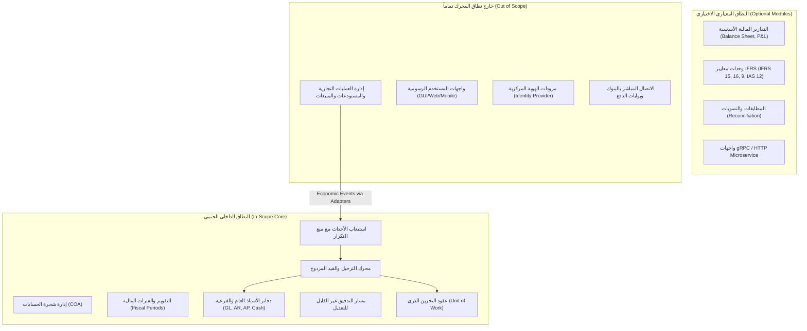
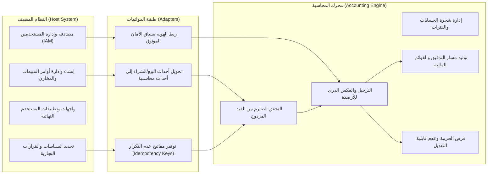
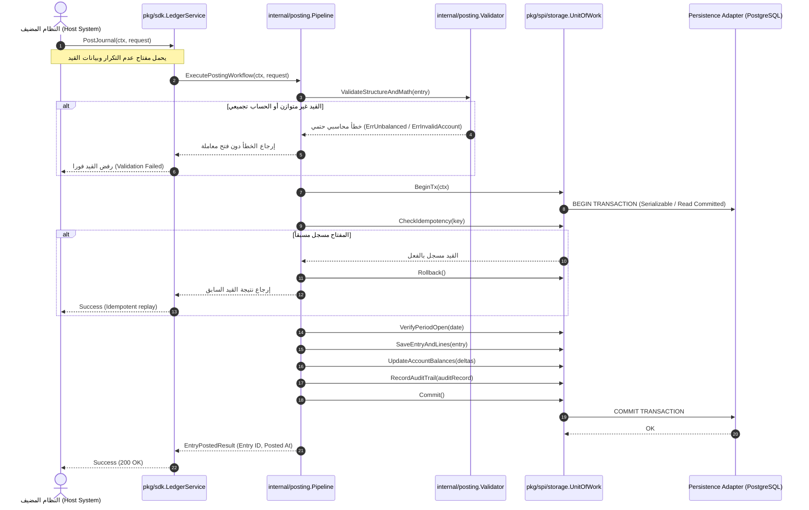

# وثيقة هوية ونطاق ومعمارية مشروع Accounting Engine

> **ملخص تنفيذي:** هذه الوثيقة تمثل المرجع التأسيسي الشامل لمشروع **Accounting Engine**. تحدد الوثيقة بدقة غير قابلة للبس هوية المحرك، نطاقه الوظيفي وحدوده الصارمة، المتطلبات الوظيفية وغير الوظيفية، قواعد العمل المحاسبية والهندسية، مصفوفة المسؤوليات بين المحرك والأنظمة المضيفة، والمعمارية البرمجية المعتمدة. تُعد هذه الوثيقة الحَكَم الأول لأي مراجعة هندسية أو محاسبية أو تطوير مستقبلي.

---

## فهرس المحتويات

1. [القسم الأول: هوية المشروع (Project Identity)](#القسم-الأول-هوية-المشروع-project-identity)
2. [القسم الثاني: نطاق المشروع (Project Scope)](#القسم-الثاني-نطاق-المشروع-project-scope)
3. [القسم الثالث: التزامات المحرك الحتمية وما لن يقوم بتنفيذه إطلاقاً (Commitments & Non-Goals)](#القسم-الثالث-التزامات-المحرك-الحتمية-وما-لن-يقوم-بتنفيذه-إطلاقاً-commitments--non-goals)
4. [القسم الرابع: المتطلبات الوظيفية وغير الوظيفية (Requirements Specification)](#القسم-الرابع-المتطلبات-الوظيفية-وغير-الوظيفية-requirements-specification)
5. [القسم الخامس: قواعد العمل المحاسبية والهندسية (Business & Accounting Rules)](#القسم-الخامس-قواعد-العمل-المحاسبية-والهندسية-business--accounting-rules)
6. [القسم السادس: مصفوفة المسؤوليات وحدودها (Responsibilities & Boundaries)](#القسم-الخامس-مصفوفة-المسؤوليات-وحدودها-responsibilities--boundaries)
7. [القسم السابع: معمارية التصميم البرمجي (Software Design Architecture)](#القسم-السابع-معمارية-التصميم-البرمجي-software-design-architecture)
8. [القسم الثامن: مصفوفة التتبع والامتثال المعماري (Traceability Matrix)](#القسم-الثامن-مصفوفة-التتبع-والامتثال-المعماري-traceability-matrix)

---

# القسم الأول: هوية المشروع (Project Identity)

### 1.1 تعريف المشروع وطبيعته

مشروع **Accounting Engine** هو محرك محاسبي مالي مجرد (Pure Financial Accounting Engine) ومكتوب بلغة **Go**، صُمم ليكون نواة محاسبية موثوقة وعالية الأداء وقابلة للتضمين (Embeddable Core Engine) أو النشر كخدمة مصغرة مستقلة (Microservice).

المحرك ليس نظام إدارة موارد مؤسسية (ERP)، ولا يمتلك واجهات مستخدم، ولا يتدخل في العمليات التجارية أو اللوجستية أو الصناعية؛ بل هو **نظام قياس مالي حتمي** يتعامل حصراً مع:

1. الأحداث الاقتصادية المعيارية (Economic Events).
2. الأثر المالي المتوازن للقيد المزدوج ($\sum \text{Debit} = \sum \text{Credit}$).
3. قياس وتقييم الحركة النقدية والعملات.
4. إثبات وإقفال الفترات المحاسبية.
5. استخراج التقارير المالية والقوائم الختامية المعتمدة دولياً.

```text
+--------------------------------------------------------------------------+
|                     Host / Commercial Systems                            |
|        (Retail POS, E-Commerce, Logistics, Healthcare, Agriculture)      |
+--------------------------------------------------------------------------+
                                     │
                 (Industry Adapters / JSON Events / SDK Calls)
                                     ▼
+==========================================================================+
|                         ACCOUNTING ENGINE                                |
|   ┌──────────────────────────────────────────────────────────────────┐   |
|   │ Public Surface (pkg/sdk, pkg/api, pkg/spi)                       │   |
|   ├──────────────────────────────────────────────────────────────────┤   |
|   │ Core Accounting Logic (Posting, Reversals, COA, Fiscal Periods) │   |
|   ├──────────────────────────────────────────────────────────────────┤   |
|   │ Subledgers & Standards (AR, AP, Cash, Fixed Assets, IFRS)        │   |
|   ├──────────────────────────────────────────────────────────────────┤   |
|   │ Persistence Ports & Unit of Work (PostgreSQL / In-Memory)        │   |
|   └──────────────────────────────────────────────────────────────────┘   |
+==========================================================================+
```

### 1.2 الفلسفة التأسيسية للمحرك (Core Philosophy)

يقوم المحرك على أربعة مبادئ تأسيسية ثابتة:

1. **حيادية القطاع (Industry Independence):** المحرك محايد بالكامل تجاه أي نشاط تجاري (زراعي، طبي، عقاري، تجزئة، صناعي). لا توجد كلمة "فاتورة مبيعات"، "شحنة"، "مريض"، أو "طن قمح" داخل النواة المحاسبية؛ بل قيود، حسابات، مراكز تكلفة، وأطراف مقابلة.
2. **استقلالية التخزين (Storage & Infrastructure Agnostic):** منطق المحاسبة لا يعلم شيئاً عن SQL أو PostgreSQL أو جداول البيانات. كل عمليات التخزين تتم عبر عقود وموانئ مجردة (Persistence Ports & Unit of Work).
3. **استقلالية بروتوكول النقل (Transport Agnostic):** النواة المحاسبية مكتبة برمجية نقية (Library-first). يمكن استخدامها مباشرة عبر Go SDK، أو تغليفها عبر بروتوكولات نقل مثل gRPC أو HTTP REST دون أي تعديل في النواة.
4. **الحرمة المحاسبية وعدم قابلية التعديل (Strict Immutability & Auditability):** كل قيد يُرحل لا يمكن حذفه أو تعديله مطلقاً. أي تصحيح يتم عبر قيد عكسي معتمد، مما يضمن وجود مسار تدقيق غير قابل للكسر متوافق مع متطلبات الحوكمة الجنائية والمالية.

### 1.3 المرجعيات الدولية الحاكمة

يستند المحرك في تصميمه وتقييمه إلى أربعة أطر معيارية دولية:

* **المعايير الهندسية:** ISO/IEC 25010:2023 (نموذج جودة المنتج) و ISO/IEC 25040:2024 (منهجية التقييم).
* **المعايير المحاسبية:** الإطار المفاهيمي للتقارير المالية (IFRS Conceptual Framework) ومعايير المحاسبة الدولية المتخصصة (IAS 1, IAS 8, IAS 21, IFRS 15, IFRS 16, IFRS 9).
* **معايير الأمان وسلامة البيانات:** NIST SSDF (إطار تطوير البرمجيات الآمنة) ومبادئ ACID للمعاملات المالية.
* **المعمارية النظيفة:** مبادئ Hexagonal Architecture ومبادئ SOLID البرمجية.

---

# القسم الثاني: نطاق المشروع (Project Scope)



### 2.1 ما يقع داخل النطاق الحتمي (In-Scope: Core-Required)

1. **القيد المحاسبي المزدوج (Double-Entry Engine):**
   * استقبال أسطر القيود والتحقق من التوازن الصارم بين المدين والدائن ($\sum \text{Debit} = \sum \text{Credit}$).
   * التحقق من سلامة العملة، وتواريخ الاستحقاق والترحيل، والمراجع المحاسبية.
2. **محرك الترحيل والعكس (Posting & Reversal Engine):**
   * ترحيل القيود ذرياً (Atomic Posting) إلى دفتر الأستاذ العام والدفاتر المساعدة.
   * دعم القيود العكسية (Reversals) المرتبطة دلالياً بالقيد الأصلي وتعديل الأرصدة تلقائياً.
3. **البيانات المالية الرئيسية (Financial Master Data):**
   * شجرة الحسابات (Chart of Accounts) متعددة المستويات، والتحقق من نوع وطبيعة كل حساب (أصل، التزام، ملكية، إيراد، مصروف).
   * إدارة العملات وأسعار الصرف التاريخية.
   * إدارة الفترات المالية وحالاتها (مفتوحة، مغلقة مؤقتاً، مقفلة نهائياً).
4. **دفاتر الأستاذ الفرعية (Financial Subledgers):**
   * حسابات المدينين (AR Subledger) ومطابقتها مع حساب المراقبة (Control Account).
   * حسابات الدائنين (AP Subledger) ومطابقتها مع حساب المراقبة.
   * الخزينة والبنوك (Cash/Bank Subledger).
   * الأصول الثابتة وحسابات الإهلاك (Fixed Assets Subledger).
5. **مسار التدقيق غير القابل للتعديل (Immutable Audit Trail):**
   * تسجيل هوية المنفذ (Actor)، سبب العملية، طابعها الزمني الدقيق (Timestamp)، ومعرف التتبع الفرعي.
6. **معالجة الأحداث المحاسبية وعدم التكرار (Idempotent Event Ingestion):**
   * قبول الأحداث الاقتصادية وتحويلها إلى قيود مع التحقق الصارم من مفاتيح عدم التكرار (Idempotency Keys).
7. **طبقة عقود التخزين المجردة (Persistence SPI & Unit of Work):**
   * توفير موانئ التخزين التي تضمن تنفيذ المعاملة بمبدأ الكل-أو-لا-شيء (All-or-Nothing).

### 2.2 ما يقع ضمن القدرات المعيارية الملحقة (Optional / Modular Capabilities)

1. **التقارير المالية الأساسية:** ميزان المراجعة (Trial Balance)، قائمة الدخل (Income Statement)، المركز المالي (Balance Sheet)، وقائمة التدفقات النقدية (Cash Flow).
2. **محرك التسويات والمطابقة (Reconciliation Engine):** مطابقة القيود الداخلية مع كشوف الحسابات الخارجية الممررة للمحرك.
3. **وحدات المعايير الدولية المتخصصة (IFRS Plug-in Modules):**
   * وحدة الاعتراف بالإيراد (IFRS 15).
   * وحدة عقود الإيجار وحق الاستخدام (IFRS 16).
   * وحدة الأدوات المالية والخسائر الائتمانية المتوقعة (IFRS 9).
   * وحدة ضرائب الدخل المؤجلة (IAS 12).
4. **واجهة النقل الشبكي (Transport Layer):** توفير سيرفرات gRPC وHTTP REST اختيارية للمشاريع التي تفضل النشر كخدمة مستقلة.

### 2.3 ما يقع خارج النطاق تماماً (Strictly Out of Scope)

1. **العمليات التجارية واللوجستية:** لا يمتلك المحرك دورات حياة أوامر الشراء، عروض الأسعار، فواتير المبيعات، بوالص الشحن، أذون الاستلام أو الصرف، أو جرد المخزون الفيزيائي.
2. **واجهات المستخدم الرسومية (GUI):** لا يحتوي المحرك على أي واجهة رسومية أو قوالب HTML؛ المحرك هو خدمة خلفية برمجية بالكامل (Headless Backend Core).
3. **إدارة الهوية وكلمات المرور (Identity Provider):** لا يدير المحرك جداول للمستخدمين أو كلمات المرور أو جلسات تسجيل الدخول (JWT/OAuth)؛ هذه مسؤولية النظام المضيف بالكامل.
4. **الاتصال البنكي المباشر وبوابات الدفع:** المحرك لا يتصل بـ SWIFT أو بوابات الدفع (Stripe/Paypal)؛ بل يستقبل الأثر المحاسبي للمعاملة بعد اكتمالها بنجاح خارج المحرك.

---

# القسم الثالث: التزامات المحرك الحتمية وما لن يقوم بتنفيذه إطلاقاً (Commitments & Explicit Non-Goals)

لضمان وضوح الحدود التعاقدية وعدم تضخم المحرك بما يفسد نقاءه المعماري، يحدد هذا القسم بدقة مطلقة ما يلتزم به المحرك إلزاما قاطعاً ويضمنه كـ Invariants غير قابلة للتفاوض، وما يرفض تنفيذه صراحة ولن يقوم به تحت أي ظرف.

### 3.1 ما يلتزم به المحرك إلزاما قاطعاً (Mandatory Commitments & Guarantees — MUST DO)

المحرك يقدم ضمانات محاسبية وهندسية قطعية (Engine Guarantees) تحكم عمله، ولا يجوز لأي تعديل برمجي أو إضافة ميزة الإخلال بها:

1. **الالتزام بالتوازن الحسابي التام ($\sum \text{Debit} - \sum \text{Credit} = 0.0000$):**
   * المحرك ملزم برفض أي قيد غير متوازن فوراً ودون فتح أي معاملة تخزين، مع إرجاع خطأ صريح ومفصل.
2. **الالتزام بالحفظ الذري للمعاملات (Strict Transactional Atomicity / All-or-Nothing):**
   * المحرك ملزم بضمان أن ترحيل القيد، تحديث أرصدة الأستاذ العام، تسجيل حركات الدفاتر الفرعية، وحفظ مسار التدقيق تحدث كلها معاً أو تلغى كلها معاً. لا وجود لأي حالة حفظ جزئي.
3. **الالتزام بالحرمة والأبدية للقيود المرحلة (Strict Immutability):**
   * المحرك ملزم بحماية القيود المرحلة من أي تعديل (`UPDATE`) أو حذف (`DELETE`). أي تصحيح يتم حصراً عبر قيد عكسي جديد يربط دلالياً بالقيد السابق.
4. **الالتزام بمسار تدقيق جنائي كامل وغير قابل للتلاعب (Comprehensive Audit Trail):**
   * المحرك ملزم بتسجيل هوية المنفذ الموثقة (`Actor/Principal`)، الطابع الزمني الدقيق بالنانوثانية، سبب القيد، والمعرف الخارجي، وحفظها ضمن سجلات تتبع دائمة (Append-Only).
5. **الالتزام بمنع تكرار العمليات حتمياً (Strict Idempotency):**
   * المحرك ملزم بالتحقق من مفتاح `Idempotency-Key` لكل طلب، وضمان عدم تكرار ترحيل القيد أو إحداث أثر مالي مضاعف في حال إعادة إرسال نفس الطلب.
6. **الالتزام بالعزل التام بين الشركات والمستأجرين (Multi-Tenancy Isolation):**
   * المحرك ملزم بالتحقق من هوية وسياق الشركة المستأجرة (`tenant_id / company_id`) ومنع أي قراءة أو ترحيل أو تعديل يمس بيانات شركة أخرى.
7. **الالتزام بالحسابات العشرية الدقيقة وحظر الأرقام العائمة (No Floating-Point Math):**
   * المحرك ملزم بتمثيل المبالغ والعمليات الحسابية حصراً عبر قيم صحيحة بأصغر وحدة نقدية (`Int64`) أو مكتبات الحساب العشري الدقيق (`Fixed-point Decimal`) لمنع أخطاء التقريب الحسابي.
8. **الالتزام بحرمة الحسابات التجميعية والفترات المقفلة:**
   * المحرك ملزم بمنع الترحيل قطعياً على أي حساب تجميعي (Header Account)، ومنع الترحيل في أي فترة مالية مغلقة (Locked) أو مقفلة نهائياً (Closed).
9. **الالتزام بالحياد التام واستقلالية التخزين والنقل (Decoupled SPI & SDK):**
   * المحرك ملزم بتقديم واجهات مجردة بالكامل (`pkg/spi/storage`) تتيح تغيير قاعدة البيانات أو آلية التخزين دون الحاجة لتعديل سطر واحد في كود منطق المحاسبة.
10. **الالتزام بمطابقة دفاتر الأستاذ الفرعية مع حسابات المراقبة (Control Accounts Reconciliation):**
    * المحرك ملزم بضمان التوازن والتطابق الحتمي بين مجموع سجلات الدفاتر المساعدة (AR, AP, Cash, Fixed Assets) ورصيد حساب المراقبة المقابل لها في دفتر الأستاذ العام.

---

### 3.2 ما لن يقوم المحرك بتنفيذه إطلاقاً وبشكل صريح (Explicit Non-Goals & Prohibitions — WILL NOT DO)

هناك حدود وظيفية وهندسية قاطعة لن يقوم المحرك بتنفيذها إطلاقاً، وأي محاولة لإقحامها داخل المحرك تُعد مخالفة معمارية جسيمة:

| ما لن يقوم المحرك بتنفيذه إطلاقاً | سبب الرفض والمنع المعماري | الجهة البديلة المسؤولة عن التنفيذ |
| --- | --- | --- |
| **1. منطق العمليات التجارية والقطاعية (No Business / Industry Logic)**<br>لن يدير: فواتير بيع/شراء، تسعير، تخفيضات، بوالص شحن، أوزان محاصيل، خطوط إنتاج، أو دورات مشتريات. | المحرك هو نواة محاسبية مالية مجردة، وإدخال مفاهيم تشغيلية قطاعية يلوث النواة ويحولها إلى ERP قطاعي ضخم يفقد ميزة إعادة الاستخدام. | الأنظمة التشغيلية والتجارية المضيفة (Host Commercial Systems) عبر محولات القطاعات (Adapters). |
| **2. واجهات المستخدم الرسومية (No Graphical UI)**<br>لن يحتوي المحرك على شاشات ويب، تطبيقات موبايل، لوحات تحكم (Dashboards)، أو قوالب HTML. | المحرك هو محرك خدمات ونواة برمجية خلفية (Headless Engine) يُستدعى فقط عبر الـ API أو الـ SDK. | تطبيقات الواجهة الأمامية (Frontend Web/Mobile Apps) التي يبنيها مطورو النظام المضيف. |
| **3. إدارة الهويات وتسجيل الدخول (No Identity / IAM)**<br>لن يخزن المحرك كلمات مرور، ولن يدير جلسات تسجيل الدخول، ولن يصدر توكنات JWT، ولن يوفر التحقق الثنائي (MFA). | إدارة الهوية مسؤولية مركزية تخص بيئة التشغيل ككل؛ خلطها بالمحرك يسبب ازدواجية أمنية واقتراناً غير مرغوب. | مزود الهوية المعتمد في المنشأة (Identity Provider / Keycloak / Auth0 / Host IAM). |
| **4. الاتصال المباشر بالبنوك أو بوابات الدفع (No Banking / Payment Gateways)**<br>لن يتصل المحرك بـ SWIFT، أو أجهزة نقاط البيع الفيزيائية، أو بوابات الدفع الإلكتروني (مثل Stripe / Paymob). | هذه قنوات تشغيلية تتغير واجهاتها وبروتوكولاتها باستمرار وتحتاج موائمات خاصة؛ دور المحرك هو تسجيل الأثر المالي فقط بعد نجاح العملية. | خدمات الدفع والتكامل البنكي في النظام المضيف، مع تمرير النتيجة المالية كحدث محاسبي. |
| **5. التعديل المباشر للأرصدة (No Direct Balance Mutation)**<br>لن يوفر المحرك أي واجهة مثل `SetBalance()` أو أي وسيلة لتعديل جدول الأرصدة مباشرة دون قيد متوازن. | التعديل المباشر يدمر القيد المزدوج، ويفسد مسار التدقيق القانوني، ويفتح ثغرات تلاعب مالي جسيمة. | لا يوجد بديل؛ الطريقة الوحيدة لتعديل أي رصيد هي ترحيل قيد محاسبي مزدوج ومتوازن. |
| **6. تخزين الوثائق والمرفقات والملفات الثنائية (No Document / Blob Storage)**<br>لن يخزن المحرك صور الفواتير، عقود PDF، أو المرفقات الورقية. | قاعدة بيانات المحرك مخصصة للبيانات المالية المعيارية السريعة والمنظمة؛ تخزين الملفات الثنائية يثقل الأداء ويعيق النسخ الاحتياطي السريع. | خدمات تخزين الكائنات (S3 / GCS / Azure Blob) في النظام المضيف، مع تمرير معرف/رابط الوثيقة فقط كمرجع (`Reference`). |
| **7. فرض قاعدة بيانات أو بروتوكول نقل محدد (No Technology Lock-in)**<br>لن يجبر المحرك المستخدم على خادم PostgreSQL، ولن يفرض تشغيل سيرفر gRPC/HTTP إذا رغب المستهلك في تضمينه كمكتبة. | تمكين أقصى درجات المرونة وإعادة الاستخدام في الأنظمة المضمنة، وتطبيقات الأجهزة، والأنظمة الموزعة على حد سواء. | توفير موانئ SPI مفتوحة ونظيفة تتيح للمستهلك تركيب أي Adapter تخزين أو استخدام Go SDK مباشرة. |
| **8. اتخاذ قرارات محاسبية أو إقفالات تلقائية دون أمر صريح (No Autonomous Period Closing)**<br>لن يقفل المحرك الفترات أو السنوات المالية تلقائياً بناءً على التاريخ دون طلب صريح من صاحب الصلاحية. | الإقفال المالي قرار قانوني وإداري له تبعات ضريبية ورقابية حاسمة، ولا يجوز للأتمتة البرمجية اتخاذه نيابة عن الإدارة المالية. | مسؤولو الإدارة المالية عبر استدعاء خدمات الإقفال (`ClosePeriod` / `YearEndClosing`) بعد مراجعة الحسابات. |

---

### 3.3 مصفوفة المقارنة السريعة بين الإلزام والمنع (Obligations vs. Exclusions Matrix)

```text
+----------------------------------------------------+-----------------------------------------------------+
|         ما يلتزم به المحرك حتماً (MUST DO)          |          ما يرفض المحرك تنفيذه (WILL NOT DO)        |
+----------------------------------------------------+-----------------------------------------------------+
| 1. رفض القيود غير المتوازنة (Debit != Credit)     | 1. إدارة تفاصيل المبيعات، المخزون، أو الشحن         |
| 2. الترحيل الذري الكامل (All-or-Nothing UnitOfWork)| 2. توفير واجهات مستخدم رسومية (GUI / Dashboards)    |
| 3. حرمة القيود السابقة (Strict Immutability)       | 3. تخزين كلمات المرور وإدارة تسجيل الدخول (IAM)     |
| 4. توفير مسار تدقيق جنائي غير قابل للتلاعب        | 4. الاتصال المباشر بأجهزة الدفع والشبكات البنكية    |
| 5. منع تكرار المعاملات (Idempotency Enforcement)   | 5. تعديل الأرصدة يدوياً أو مباشرة دون قيد مزدوج     |
| 6. العزل الكامل بين المستأجرين (Tenant Isolation)  | 6. تخزين مرفقات الفواتير والملفات الثنائية (Blobs)  |
| 7. دقة الحسابات العشرية وحظر Floating-point       | 7. إجبار المستهلك على قاعدة بيانات أو بروتوكول محدد |
| 8. حظر الترحيل في الفترات المغلقة والحساب التجميعي | 8. إقفال الفترات والسنوات المالية تلقائياً          |
+----------------------------------------------------+-----------------------------------------------------+
```

---

# القسم الرابع: المتطلبات الوظيفية وغير الوظيفية (Requirements Specification)

### 4.1 المتطلبات الوظيفية (Functional Requirements)

| المعرف | المتطلب الوظيفي | الوصف الدقيق وقواعد القبول |
| --- | --- | --- |
| **FR-01** | إدارة شجرة الحسابات (COA) | تمكين إنشاء وتحديث الحسابات مع تحديد: الرمز، الاسم، التصنيف (أصل، التزام، ملكية، إيراد، مصروف)، العملة، وتحديد ما إذا كان الحساب حساب تجميعي (Header) أو حساب ترحيل (Posting/Leaf). |
| **FR-02** | التحقق من صحة القيد (Validation) | التحقق الحتمي قبل الترحيل من: تساوي إجمالي المدين والدائن بدقة السنت، عدم وجود مبالغ سالبة في السطور، وجود سطرين على الأقل، وصلاحية الحسابات المستخدمة. |
| **FR-03** | الترحيل الذري (Atomic Posting) | ترحيل القيد إلى دفتر الأستاذ العام والدفاتر الفرعية ضمن معاملة ذرية واحدة (Unit of Work). إذا فشل تحديث رصيد حساب واحد، تُلغى المعاملة بالكامل ولا يُحفظ أي جزء من القيد. |
| **FR-04** | الحرمة المحاسبية (Immutability) | منع أي عملية تعديل (UPDATE) أو حذف (DELETE) على أي قيد أو سطر قيد تم ترحيله مسبقاً، وإرجاع خطأ صريح عند محاولة ذلك. |
| **FR-05** | القيود العكسية (Reversals) | دعم إنشاء قيد عكسي لقيد مرحل مع ربط القيد الجديد بالقيد الأصلي توثيقياً وعكس إشارات المدين والدائن وتحديث الأرصدة المتأثرة فوراً. |
| **FR-06** | الفترات المالية والإقفال (Fiscal Calendar) | التحقق من أن تاريخ ترحيل القيد يقع داخل فترة مالية بحالة "مفتوحة" (Open). رفض الترحيل في الفترات المغلقة مؤقتاً (Locked) أو المقفلة نهائياً (Closed). |
| **FR-07** | إقفال نهاية السنة (Year-End Closing) | تصفير حسابات الإيرادات والمصروفات وترحيل صافي الربح أو الخسارة تلقائياً إلى حساب الأرباح المبقاة (Retained Earnings) في بداية السنة الجديدة. |
| **FR-08** | تكامل دفاتر الأستاذ الفرعية (Subledgers) | توجيه العمليات المتعلقة بالعملاء والموردين والنقدية إلى الدفاتر الفرعية المناسبة، وضمان تطابق مجموع الدفتر الفرعي دائماً مع حساب المراقبة في الأستاذ العام. |
| **FR-09** | استيعاب الأحداث مع منع التكرار (Idempotency) | قبول الأحداث المحاسبية الممررة من النظام المضيف ورفض تنفيذ نفس الحدث مرتين إذا تكرر نفس `Idempotency-Key`، مع إرجاع نفس النتيجة الأصلية دون تكرار القيد. |
| **FR-10** | التقارير المالية وميزان المراجعة | توليد ميزان المراجعة اللحظي، قائمة الدخل، وقائمة المركز المالي مع دعم التصفية بحسب الفترات ومراكز التكلفة والعملات. |
| **FR-11** | مسار التدقيق الرقابي (Audit Trail) | حفظ بيانات التدقيق مع كل قيد (معرف المستخدم المنفذ، الطابع الزمني، المصدر، سبب القيد، والمعرف الخارجي) مع منع التعديل على سجل التدقيق. |
| **FR-12** | دعم العملات المتعددة (Multi-Currency) | تسجيل المعاملات بعملتها الأصلية (Transaction Currency) مع تسجيل سعر الصرف المعتمد والتحويل إلى العملة الوظيفية (Functional Currency) بدقة متناهية. |

---

### 4.2 المتطلبات غير الوظيفية (Non-Functional Requirements)

| المعرف | التصنيف (ISO 25010) | المتطلب غير الوظيفي | معيار القياس والتحقق |
| --- | --- | --- | --- |
| **NFR-01** | **Reliability & Data Integrity** | سلامة المعاملات المالية (ACID) | تطبيق معايير ACID الصارمة؛ لا يسمح بحدوث حفظ جزئي تحت أي ظرف من الظروف (All-or-Nothing). |
| **NFR-02** | **Performance Efficiency** | زمن استجابة الترحيل (Latency) | يجب ألا يتجاوز زمن ترحيل القيد العادي 50 ميلي ثانية (p95) تحت حمل تشغيلي اعتيادي. |
| **NFR-03** | **Concurrency & Safety** | التحكم في التزامن ومنع السباق | دعم التزامن العالي دون حدوث تعارض في الأرصدة (Deadlocks or Race Conditions) باستخدام القفل التشاؤمي أو التفاؤلي على مستوى الحساب. |
| **NFR-04** | **Security & Isolation** | العزل الصارم بين الشركات (Multi-Tenancy) | عزل كامل للبيانات بين الشركات؛ لا يمكن لطلب يخص `company_A` قراءة أو تعديل قيود أو أرصدة `company_B`. |
| **NFR-05** | **Maintainability & Architecture** | الفصل المعماري والاعتمادية المعكوسة | طبقة Domain لا تعتمد إطلاقاً على طبقات Infrastructure أو Transport أو SQL؛ توافق كامل مع Clean Architecture. |
| **NFR-06** | **Testability & Quality** | تغطية الاختبارات الآلية | تغطية كود لا تقل عن 80% مع وجود اختبارات تكاملية واختبارات لسيناريوهات الفشل والحالات الحدية (Edge Cases). |
| **NFR-07** | **Portability & Extensibility** | استقلالية بيئة التخزين | إمكانية استبدال قاعدة البيانات (مثل الانتقال من In-Memory إلى PostgreSQL) عبر تحقيق موانئ SPI دون لمس سطر واحد في كود النواة. |
| **NFR-08** | **Auditability & Traceability** | عدم قابلية العبث بالسجلات | سجلات التدقيق (Audit Logs) مشفرة أو محمية بمبدأ Append-Only، بحيث يمكن إثبات أي حركة محاسبية أمام المدققين القانونيين. |

---

# القسم الخامس: قواعد العمل المحاسبية والهندسية (Business & Accounting Rules)

### 5.1 قواعد العمل المحاسبية الصارمة (Strict Accounting Rules)

```text
[قاعدة التوازن الحتمي الصارم]
∑ (Debit Amounts) - ∑ (Credit Amounts) = 0.0000 (Exact Zero)
```

1. **[BR-ACC-01] التوازن الحتمي للقيد المزدوج:**
   * لا يمكن ترحيل أي قيد محاسبي إذا لم يتساو إجمالي حركات المدين مع إجمالي حركات الدائن في العملة الوظيفية بدقة متناهية.
   * لا يجوز استخدام أرقام عائمة (Floating-point) في تمثيل المبالغ؛ يجب استخدام أنواع بيانات دقيقة مثل `Int64` للمبالغ بالأجزاء الصغرى أو مكتبات الحسابات العشرية الدقيقة (Fixed-point Decimal) لمنع أخطاء التقريب.
2. **[BR-ACC-02] الحظر الصارم للترحيل على الحسابات التجميعية:**
   * يمنع منعاً باتاً تسجيل أي قيد على حساب معرف كـ "حساب تجميعي / رئيسي" (Header Account).
   * الترحيل مسموح فقط على "الحسابات الطرفية" (Leaf / Posting Accounts).
3. **[BR-ACC-03] حرمة الفترات المحاسبية المغلقة:**
   * يُرفض أي قيد يحمل تاريخاً يقع ضمن فترة مالية مغلقة (Locked) أو مقفلة نهائياً (Closed).
   * لا يمكن فتح فترة مقفلة نهائياً إلا عبر إجراء حوكمة استثنائي موثق بقرار إداري وسجل تدقيق مستقل.
4. **[BR-ACC-04] عدم القابلية للتعديل أو الحذف (Immutability):**
   * بمجرد أن يحصل القيد على حالة "مرحّل" (`POSTED`)، يصبح سجلاً تاريخياً أبدياً.
   * لا يوجد أمر `UPDATE` أو `DELETE` في قاعدة البيانات يمس جدول القيود أو أسطر القيود أو حركات الأستاذ العام.
5. **[BR-ACC-05] التصحيح المحاسبي بالقيد العكسي الحصري:**
   * تصحيح أي قيد مرحل خاطئ يتم حصراً عبر إنشاء "قيد عكسي" (`REVERSAL_ENTRY`) يعكس أطراف القيد الأصلي تماماً، ويحمل مرجعاً صريحاً لرقم القيد الأصلي مع بيان سبب الإلغاء.
6. **[BR-ACC-06] سلامة قيود العملات الأجنبية:**
   * عند إدخال قيد بعملة أجنبية، يجب توفير سعر الصرف المعتمد لذلك التاريخ.
   * يتم تخزين المبلغ بالعملة الأصلية ومكافئه بالعملة الوظيفية، ويجب أن يتحقق التوازن بالعملة الوظيفية.
7. **[BR-ACC-07] مطابقة دفاتر المراقبة مع الدفاتر الفرعية:**
   * لا يجوز ترحيل قيد مباشر في الأستاذ العام على حساب مراقبة المدينين (AR Control) أو الدائنين (AP Control) دون أن يكون القيد مرتبطاً بسجل طرف فرعي محدد (Subledger Entry) في دفتر الأستاذ المساعد.

---

### 5.2 قواعد العمل الهندسية والتقنية (Strict Engineering Rules)

1. **[BR-ENG-01] الحفظ الذري الكامل (All-or-Nothing Unit of Work):**
   * عملية ترحيل القيد هي معاملة ذرية متكاملة تشمل: (1) حفظ رأس القيد، (2) حفظ أسطر القيد، (3) تحديث أرصدة الحسابات المتأثرة، (4) حفظ أثر دفاتر الأستاذ الفرعية، و(5) تسجيل حركة التدقيق. فشل أي خطوة من هذه الخطوات يستلزم تراجعاً فورياً وكاملاً (Full Rollback).
2. **[BR-ENG-02] التحقق الحتمي من مفتاح عدم التكرار (Idempotency Enforcement):**
   * كل طلب ترحيل قيد أو استيعاب حدث اقتصادي يجب أن يحتوي على `Idempotency-Key` فريد يوفره النظام المضيف.
   * إذا استقبل المحرك طلباً يحمل مفتاحاً تم تنفيذه بنجاح سابقاً، يجب ألا ينفذ المعاملة مجدداً، بل يعيد للمستخدم نتيجة المعاملة السابقة مع كود الحالة نفسه.
3. **[BR-ENG-03] عدم الثقة بمعرف الشركة الممرر في المتن (Tenant Security):**
   * لا يجوز للمحرك الاعتماد فقط على `company_id` الموجود داخل جسم الطلب (Request Payload).
   * يجب التحقق من مطابقة معرف الشركة مع السياق الأمني المعتمد (Security Context / Principal Claims) لضمان منع تسريب البيانات بين الشركات.
4. **[BR-ENG-04] منع تسريب منطق المحاسبة خارج النواة:**
   * لا يجوز للمحرك تصدير أي دوال أو واجهات تسمح للنظام المضيف بالتلاعب بالأرصدة مباشرة دون قيد مزدوج. الأرصدة هي نتيجة حتمية لمجموع القيود، ولا تُعدل مباشرة بقيمة صريحة مطلقاً.

---

# القسم السادس: مصفوفة المسؤوليات وحدودها (Responsibilities & Boundaries)



### 6.1 مصفوفة حدود المسؤولية المشتركة (Responsibility Boundary Matrix)

| الجانب والوظيفة | مسؤولية المحرك (Engine Ownership) | مسؤولية النظام المضيف (Host System) |
| --- | --- | --- |
| **الحدث التجاري الأصلي** | لا يعلم عنه شيئاً؛ يستقبل فقط الأثر المالي المجرد. | يمتلك دورة حياة الفاتورة أو الشحنة أو حركة المخزن بالكامل. |
| **تحويل الحدث إلى قيد** | يوفر واجهات استيعاب الأحداث وعقودها الموحدة (`pkg/api/v1/events`). | يكتب موائم القطاع (Industry Adapter) لتحويل الحدث إلى قيد. |
| **القيد المزدوج والترحيل** | يمتلك التحقق الصارم، توازن المدين والدائن، وتحديث الأرصدة. | يلتزم بتمرير أطراف القيد متوازنة وصحيحة بنيوياً. |
| **الأمان والمصادقة** | يتحقق من وجود تفويض موثوق وصلاحية الوصول لمعرف الشركة. | يدير تسجيل الدخول وكلمات المرور وتوليد التوكنات (Tokens). |
| **مسار التدقيق** | يسجل هوية المنفذ وتاريخ وساعة العملية ورقم القيد. | يمرر هوية المستخدم الحقيقي الموثقة مع كل طلب. |
| **إدارة الفترات المالية** | يفرض المنع الصارم للترحيل في الفترات المغلقة. | يحدد متى تقرر الإدارة إقفال الشهر أو ربع السنة. |
| **التخزين وقواعد البيانات** | يحدد مخطط البيانات وعقود الحفظ الذرية (Unit of Work). | يوفر خادم قاعدة البيانات (مثل خادم PostgreSQL مهيأ). |

---

# القسم السابع: معمارية التصميم البرمجي (Software Design Architecture)

### 7.1 النمط المعماري العام (Hexagonal / Ports & Adapters Architecture)

تم تصميم المحرك المحاسبي وفق نمط **المعمارية السداسية** لضمان العزل التام بين منطق المحاسبة النقي وتفاصيل التقنيات الخارجية.

```text
+-----------------------------------------------------------------------------------+
|                              PRIMARY ADAPTERS                                     |
|     (In-Process Go SDK Caller)   (HTTP REST Handlers)   (gRPC Service Handlers)   |
+-----------------------------------------------------------------------------------+
                                         │
                                         ▼ (Calls Public SDK)
+===================================================================================+
|                         APPLICATION LAYER (pkg/sdk)                               |
|   ┌───────────────────────────────────────────────────────────────────────────┐   |
|   │ Engine | LedgerService | ReportingService | GovernanceService | Ingestion │   |
|   └───────────────────────────────────────────────────────────────────────────┘   |
+===================================================================================+
                                         │
                                         ▼ (Uses Domain Contracts)
+===================================================================================+
|                       CORE DOMAIN LAYER (internal/...)                            |
|   ┌───────────────────────────────────────────────────────────────────────────┐   |
|   │ Entities: Entry, Line, Account, Period, FiscalYear, Balance               │   |
|   │ Rules: DoubleEntryValidator, PostingRules, SubledgerReconciler            │   |
|   │ Workflows: PostingPipeline, YearEndClosingWorkflow, ReversalWorkflow      │   |
|   └───────────────────────────────────────────────────────────────────────────┘   |
+===================================================================================+
                                         │
                                         ▼ (Implements Public SPI Contracts)
+===================================================================================+
|                      SECONDARY PORTS (pkg/spi/storage)                            |
|   ┌───────────────────────────────────────────────────────────────────────────┐   |
|   │ UnitOfWork | AccountStore | EntryStore | BalanceStore | AuditStore        │   |
|   └───────────────────────────────────────────────────────────────────────────┘   |
+===================================================================================+
                                         │
                                         ▼ (Concrete Implementations)
+-----------------------------------------------------------------------------------+
|                             SECONDARY ADAPTERS                                    |
|       (PostgreSQL Adapter / internal/adapters)      (In-Memory Testing Adapter)   |
+-----------------------------------------------------------------------------------+
```

### 7.2 هيكل الحزم وتوزيع المسؤوليات (Package Layout)

المحرك يفرض فصلاً صارماً بين الواجهات العامة والتنفيذ الداخلي:

#### 1. الواجهات العامة المفتوحة للمستهلكين (`pkg/`)

* `pkg/api/v1/`: يحتوي على الكائنات والنماذج المعيارية غير القابلة للتغيير (Immutable Models):
  * `ledger/`: نماذج الحسابات (`Account`)، القيود (`Entry`)، أسطر القيود (`EntryLine`)، والفترات (`Period`).
  * `events/`: نماذج الأحداث الاقتصادية المعيارية وقواعدها وأبعادها.
  * `reporting/`: نماذج التقارير المالية وميزان المراجعة وقائمة التدفق النقدي.
  * `subledger/`: نماذج دفاتر الأستاذ الفرعية (AR/AP/Cash/Fixed Assets).
* `pkg/spi/`: واجهات وموانئ مزودي الخدمة (Service Provider Interface):
  * `storage/`: عقود التخزين المجردة (`UnitOfWork`, `AccountStore`, `EntryStore`, `BalanceStore`, `AuditStore`).
  * `standards/`: عقود تسجيل وتفعيل المعايير الدولية والوحدات التخصصية.
  * `events/`: عقود استقبال ومطابقة الأحداث الخارجية.
* `pkg/sdk/`: مكتبة التطبيق وواجهات المستهلك الرئيسية:
  * `Engine`: الكائن الرئيسي للمحرك الذي يجمع الخدمات.
  * `EngineBuilder`: منشئ المحرك بنمط Builder لتكوين المحرك وربطه بموانئ التخزين المطلوبة.
  * الخدمات العامة: `LedgerService`، `ReportingService`، `GovernanceService`، `EventIngestionService`.

#### 2. المنطق الداخلي المحمي (`internal/`)

* `internal/posting/`: خط أنابيب الترحيل (Posting Pipeline) وإدارة المعاملات والتحقق الرياضي.
* `internal/masterdata/`: إدارة شجرة الحسابات والعملات والسنوات المالية.
* `internal/subledgers/`: تفاصيل دفاتر الأستاذ الفرعية وتتبع أطراف التعامل.
* `internal/adapters/`: المحولات الملموسة لقواعد البيانات (PostgreSQL Adapter و In-Memory Adapter).
* `internal/policy/`: محرك التحقق من السياسات المحاسبية وقواعد الاعتماد.
* `internal/reconciliation/`: محرك مطابقة العمليات الداخلية مع السجلات الخارجية.
* `internal/observability/`: القياس عن بُعد والمقاييس التشغيلية وسجلات الأداء.

#### 3. وحدات المعايير الدولية (`modules/`)

* وحدات مفصولة كإضافات معيارية (`ifrs9`, `ifrs15`, `ifrs16`, `ias12`) تعتمد فقط على عقود SPI ولا تتدخل في النواة المركزية إلا عبر الموانئ الرسمية.

---

### 7.3 دورة حياة الترحيل المالي وتدفق البيانات (Posting Lifecycle Flow)



---

# القسم الثامن: مصفوفة التتبع والامتثال المعماري (Traceability Matrix)

| المتطلب | المكون البرمجي المسؤول | العقد أو الواجهة (Contract) | آلية التحقق البرمجية (Verification) |
| --- | --- | --- | --- |
| **توازن القيد ($\sum D = \sum C$)** | `internal/posting` | `pkg/api/v1/ledger.Entry` | دالة التحقق الرياضية قبل فتح أي معاملة تخزين |
| **حظر الترحيل على الحساب التجميعي** | `internal/masterdata` | `pkg/spi/storage.AccountStore` | فحص حقل `IsHeader == false` مع كل سطر قيد |
| **الحرمة المحاسبية (Immutability)** | `internal/adapters` | `pkg/spi/storage.EntryStore` | غياب أي استعلام `UPDATE` في كود موائمات التخزين |
| **الذرية الكاملة (All-or-Nothing)** | `internal/posting` | `pkg/spi/storage.UnitOfWork` | نمط المعاملة الصارمة وإلغاء `Commit` عند أي خطأ |
| **منع التكرار (Idempotency)** | `internal/posting` | `pkg/spi/storage.UnitOfWork` | جدول وقفل المفاتيح الفريدة قبل تنفيذ المعاملة |
| **عزل الشركات (Multi-Tenancy)** | `internal/serviceauth` | `pkg/sdk.Engine` | تمرير واستخراج `tenant_id` من سياق الأمان الموثوق |
| **استقلالية التخزين** | `pkg/sdk` | `pkg/spi/storage.Ports` | إمكانية تمرير موائم الذاكرة أو موائم PostgreSQL دون تغيير النواة |

---

> **خاتمة وإلزام:**  
> تُشكل هذه الوثيقة العقد الهندسي والمعماري لمشروع **Accounting Engine**. لا يجوز لأي مطور أو وكيل ذكاء اصطناعي إدخال تعديلات تتعارض مع قواعد العمل، حدود المسؤولية، أو الأنماط المعمارية المعتمدة هنا دون تعديل مسبق وموثق لهذه الوثيقة.
