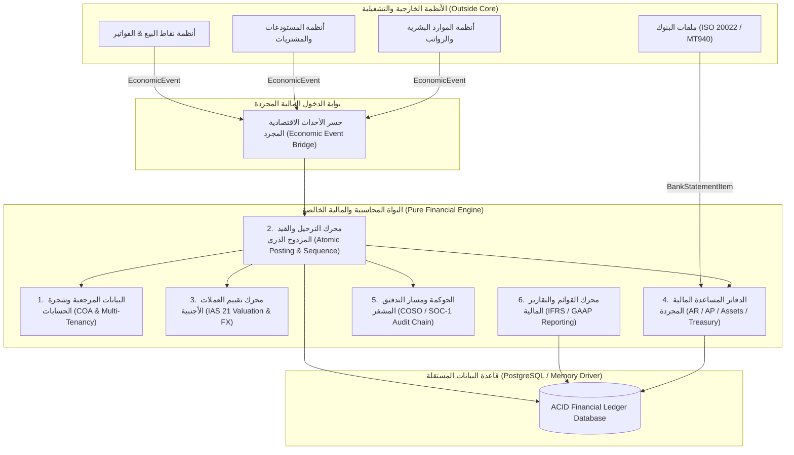

# الخطة التنفيذية الشاملة لتطوير المحرك المحاسبي المالي المجرد

## Pure Financial Accounting Engine - Master Implementation Plan

**تاريخ الخطة:** نوفمبر 2026  
**الهدف الاستراتيجي:** تطوير وتصحيح `accounting_engine` ليتحول إلى نواة محاسبية مالية عالية الاعتمادية (Enterprise-Grade Pure Accounting Engine)، مطابقة بالكامل للمعايير العالمية (IFRS / US GAAP / ISO 4217 / COSO / SOC-1)، مع الالتزام التام بالقاعدة المعمارية الصارمة: **التجريد المالي الخالص (Zero Commercial & Operational Logic)**.

---

## 1. ميثاق النواة المالية والقاعدة الذهبية للتجريد (The Pure Financial Charter)

### 1.1. القاعدة الجوهرية (The Cardinal Rule)
>
> **"المحرك المالي لا يعرف ما هي البضاعة، ولا رقم الشحنة، ولا كمية الصنف في المستودع، ولا العميل كشخص، ولا شروط الدفع التجارية؛ المحرك المالي يتعامل حصراً مع: أحداث اقتصادية مجردة، مبالغ مالية متزنة (مدين/دائن)، عملات، حسابات، فترات محاسبية، وأثر مالي على القوائم الختامية."**

### 1.2. مصفوفة الفصل المعماري الحاسم (Boundary Separation Matrix)

لضمان نقاء المحرك، يُحظر إدخال أي مفاهيم تجارية أو تشغيلية داخل `accounting_engine`. يوضح الجدول التالي الحدود الفاصلة بدقة:

| المجال (Domain) | خارج المحرك المالي (Commercial / Operational Layer) | داخل المحرك المالي المجرد (`accounting_engine`) |
| :--- | :--- | :--- |
| **المبيعات والعملاء** | عروض الأسعار، طلبات البيع، سلة الشراء، الشحن، كتالوج المنتجات، فواتير المبيعات التجارية. | **حدث اقتصادي مالي:** قيد ذمم مدينة (AR)، إيراد تشغيلي، ضريبة مخرجات، أثر على النقدية. |
| **المشتريات والموردين** | أوامر الشراء (PO)، عروض الأسعار، استلام بوالص الشحن، تقييم الموردين. | **حدث اقتصادي مالي:** قيد ذمم دائنة (AP)، التزام مالي، ضريبة مدخلات، استحقاق دفع. |
| **المخزون والمستودعات** | الجرد الفعلي، أرقام السيريال، الباركود، التحويل بين المستودعات، الأوزان، الحبات. | **القيمة النقدية للمخزون:** رصيد دفتر الأستاذ لحساب المخزون، وقيد تكلفة البضاعة المباعة (COGS). |
| **الأصول والممتلكات** | موقع الأصل الفيزيائي، كود الباركود، الصيانة الدورية، استهلاك قطع الغيار. | **القياس النقدي للأصل (IAS 16):** التكلفة التاريخية، مجمع الاستهلاك، خسائر الهبوط (IAS 36)، أرباح/خسائر الاستبعاد. |
| **الرواتب والموظفين** | ساعات الحضور، تقييم الأداء، الإجازات، أرقام الإقامات، الهيكل الإداري. | **قيد الرواتب والأجور:** مصروف رواتب (مدين)، التزام مستحقات (دائن)، مخصص مكافأة نهاية الخدمة (دائن). |
| **الخزينة والمدفوعات** | واجهات بوابات الدفع (Stripe, Moyasar)، البطاقات الائتمانية، نقاط البيع الفيزيائية. | **حركات النقدية والتسوية (IAS 7):** حسابات البنوك، حركة الحساب البنكي المجردة، التسوية، وتوليد القوائم. |

---

## 2. المعمارية الهندسية المستهدفة للنواة (Target Architecture)

---

## 3. المراحل التنفيذية المتسلسلة (Sequenced Implementation Phases)

تم تقسيم الخطة التنفيذية إلى **6 مراحل منطقية متسلسلة وصارمة**، بحيث تبني كل مرحلة على سابقتها دون ترك أي ثغرات محاسبية أو تقنية:

---

### المرحلة 0: التأسيس المعماري وتعدد المنشآت والقياس النقدي (Foundation: Multi-Tenancy & ISO 4217)

**الهدف:** تجهيز البنية التحتية للنواة لدعم المؤسسات والشركات المتعددة (Multi-Entity / Multi-Tenancy) والامتثال الكامل لمعيار العملات الدولي ISO 4217.

#### المهام التنفيذية التفصيلية

1. **تضمين معرف المنشأة القانونية (`CompanyID / TenantID`):**
   - إضافة معرف فريد `CompanyID uuid.UUID` في جميع الكيانات: الحسابات، الدفاتر، السنوات المالية، القيود اليومية، أسطر القيود، وسجلات التدقيق.
   - تعديل واجهات المستودعات (Repositories) لفرض فلترة `CompanyID` في كل عملية قراءة أو كتابة لضمان عزل البيانات المؤسسي وفق معيار IFRS 10.
2. **تطوير محرك العملات الشامل (ISO 4217 Full Registry):**
   - إزالة مصفوفة الـ 8 عملات الثابتة في [`currency.go`](file:///home/osm/StudioProjects/cashflow_system/accounting_engine/internal/types/currency.go).
   - بناء مستودع عملات متكامل يضم كافة عملات ISO 4217 العالمية مع دعم الوحدات الكسرية (`MinorUnit`):
     - عملات بدون كسور (0 Minor Units): الين الياباني `JPY`، الفرنك الرواندي `RWF`.
     - عملات بـ 3 خانات عشرية (3 Minor Units): الدينار الكويتي `KWD`، الدينار البحريني `BHD`، الريال العماني `OMR`.
     - عملات بـ 2 خانة عشرية (2 Minor Units): الريال السعودي `SAR`، الدولار `USD`، اليورو `EUR`، الدرهم `AED`، إلخ.
3. **ضبط دقة القياس النقدي والتقريب (Monetary Scale & Banker's Rounding):**
   - تعديل كائن `types.Money` ليحتفظ بالمبلغ بدقة عالية للحسابات الداخلية، مع توفير وظيفة تقريب نهائي وفق المعيار البنكي (Half-Even / Banker's Rounding) بحسب `MinorUnit` للعملة المعنية.
   - منع استخدام الدقة الثابتة `FinancialScale = 4` على المبالغ النهائية للعملات ذات الخانات الصفرية أو الثلاثية.

---

### المرحلة 1: شجرة الحسابات والبيانات المرجعية والتقويم المالي (Master Data, COA & Fiscal Calendar)

**الهدف:** تصحيح قواعد شجرة الحسابات وفق الأطر المحاسبية الدولية، وتمكين الحسابات العكسية، وضبط الفترات المالية المحاسبية بدون أي تداخلات عشوائية.

#### المهام التنفيذية التفصيلية

1. **تحرير ودعم الحسابات العكسية (Contra Accounts Enablement):**
   - إزالة شرط التطابق الإجباري بين نوع الحساب وطبيعته في [`account.go`](file:///home/osm/StudioProjects/cashflow_system/accounting_engine/internal/masterdata/account.go#L141-L143).
   - السماح الصريح بالحسابات العكسية النظامية مع وسم صريح `IsContraAccount bool`:
     - **Contra-Asset:** حساب مجمع الاستهلاك (Asset + Credit)، ومخصص خسائر الائتمان المتوقعة (Asset + Credit).
     - **Contra-Equity:** حساب أسهم الخزينة (Equity + Debit).
     - **Contra-Revenue:** حساب مردودات ومسموحات المبيعات (Income + Debit)، والخصم المسموح به (Income + Debit).
     - **Contra-Expense:** حساب استرداد المصروفات والخصم المكتسب (Expense + Credit).
2. **هندسة الفترات المالية الخاصة والتسويات (Adjustment Periods 13 & 14):**
   - تصحيح منطق الفترات في [`fiscal_calendar.go`](file:///home/osm/StudioProjects/cashflow_system/accounting_engine/internal/masterdata/fiscal_calendar.go):
     - الفترات من 1 إلى 12 تغطي أيام السنة الفعلية (أشهر تقويمية).
     - الفترتان 13 و 14 تُعرّفان كـ **فترات تسوية منطقية (Special / Adjustment Periods)** مرتبطة بنهاية السنة ولكنها موسومة برقم فترة خاص ونوع `PeriodTypeAdjustment`.
   - تعديل دالة استرجاع الفترة `GetPeriodByDate` بحيث لا تعتمد على النطاق الزمني بالساعات، بل يحدد القيد الفترة المستهدفة صراحة إذا كان قيد تسوية ختامي، مع استبعاد الفترات الخاصة من البحث الزمني التلقائي العادي.
3. **تفعيل وحفظ الأبعاد المالية التحليلية (Financial Dimensions):**
   - ربط أبعاد مراكز التكلفة (`CostCenterID`)، والمشاريع (`ProjectID`)، ووحدات الأعمال (`BusinessUnitID`) بأسطر القيد `JournalEntryLine` في كود Go ومخطط SQL لتمكين التقارير القطاعية المالية (IFRS 8 Operating Segments).

---

### المرحلة 2: محرك الترحيل والقيد المزدوج الذري (Atomic Multi-Currency Posting & ACID Engine)

**الهدف:** تمكين القيود متعددة العملات بموجب IAS 21، وضمان سلامة التسلسل الترقيمي غير المنقطع (Strict Gapless Sequences)، وحماية التزامن الموزع.

#### المهام التنفيذية التفصيلية

1. **دعم القيود متعددة العملات (IAS 21 Multi-Currency Posting):**
   - تعديل فحص توازن القيد في [`entry.go`](file:///home/osm/StudioProjects/cashflow_system/accounting_engine/internal/posting/entry.go):
     - إلغاء شرط `len(currencies) == 1`.
     - السماح بأن يحمل كل سطر عملة معاملته الخاصة `TransactionCurrency` ومبلغ المعاملة `AmountCurrency`.
     - تحويل كل سطر إلى العملة الوظيفية (`Functional/Base Currency`) باستخدام سعر الصرف الساري في تاريخ القيد.
     - فرض قاعدة التوازن الحتمية على مستوى العملة الوظيفية حصراً:
       $$\sum \text{Debit}_{\text{Functional}} = \sum \text{Credit}_{\text{Functional}}$$
2. **توليد التسلسل الترقيمي غير المنقطع داخل المعاملة الذرية (Atomic Gapless Sequences):**
   - نقل استدعاء وزيادة تسلسل الدفتر `GetNextSequence` ليكون **حصرياً داخل معاملة PostgreSQL الذاتية (`tx.Begin`) في `PostAtomic`**.
   - تطبيق قفل صفي تشاؤمي: `SELECT next_sequence FROM journals WHERE id = $1 FOR UPDATE`.
   - في حال فشل أي شرط أو حدوث خطأ أثناء الترحيل، يتم عمل `Rollback` كامل؛ مما يعيد العداد كما كان ويضمن عدم حدوث أي فجوات في الترقيم تلغي اعتمادية النظام أمام الهيئات الضريبية والمدققين.
3. **تصحيح خطأ سكيما دفاتر اليومية في PostgreSQL:**
   - تعديل استعلام الإدراج في [`driver.go`](file:///home/osm/StudioProjects/cashflow_system/accounting_engine/storage/postgres/driver.go) ليشمل حقل `code` الإلزامي و `company_id`.
4. **إعادة هندسة آلية العكس المحاسبي (Reversal Architecture):**
   - تعديل [`reversal.go`](file:///home/osm/StudioProjects/cashflow_system/accounting_engine/internal/posting/reversal.go):
     - السماح بتمرير تاريخ القيد العكسي `reversalDate` بدلاً من فرض `time.Now()`.
     - فصل منشئ القيد العكسي عن مرحّله للامتثال لقاعدة `Maker-Checker`.
     - منع حذف أسطر القيد الأصلي (`DELETE FROM account_move_lines`) لتفادي كسر التكامل المرجعي مع التسويات، والاكتفاء بتحديث رأس القيد:
       `UPDATE account_moves SET status = 'reversed', reversed_by_move_id = $1 WHERE id = $2`.

---

### المرحلة 3: الدفاتر المساعدة المالية المجردة (Pure Financial Subledgers)

**الهدف:** استكمال وظائف دفاتر الأستاذ الفرعية المالية (AR / AP / Assets / Treasury) دون إدخال أي تفاصيل تجارية أو لوجستية، والربط المحكم بدفتر الأستاذ العام.

#### المهام التنفيذية التفصيلية

1. **دفتر الأصول الثابتة المالي (Financial Fixed Assets - IAS 16 & IAS 36):**
   - **جدول الاستهلاك الدوري:** إضافة جدول تتبع تاريخي للاستهلاكات المسجلة لكل أصل لمنع استهلاك الأصل مرتين في نفس الفترة المحاسبية.
   - **قيد هبوط القيمة (Impairment Posting):** تعديل دالة `Impair` لتوليد قيد يومية فوري ومتزن في الأستاذ العام:
     - مدين: مصروف خسائر هبوط الأصول (P&L Expense).
     - دائن: مجمع هبوط قيمة الأصول الثابتة (Contra-Asset).
   - **استبعاد وتخريد الأصول (Asset Disposal & Derecognition):**
     - بناء دالة `DisposeAsset(assetID, disposalDate, proceedsMoney, journalID)`:
     - إقفال التكلفة التاريخية ومجمع الاستهلاك ومجمع الهبوط.
     - إثبات المقبوضات النقدية (إن وجدت).
     - الاعتراف الآلي بالأرباح أو الخسائر الرأسمالية الناتجة عن الاستبعاد في قائمة الدخل.
2. **دفتر الذمم المدينة والدائنة المالي (Financial AR & AP Subledgers):**
   - تطوير محرك المقاصة والمطابقة (Matching & Clearing Engine):
     - دعم مطابقة فواتير وسدادات بعملات مختلفة (Cross-Currency Clearing).
     - الاحتساب الآلي لفروق أسعار الصرف المحققة (Realized FX Gain/Loss) وتوليد قيد التسوية فورياً في الأستاذ العام.
   - مصفوفة خسائر الائتمان المتوقعة (IFRS 9 ECL Matrix):
     - احتساب مخصص التعثر الائتماني وفق أعمار الديون وتوليد قيد المخصص الدوري.
3. **دفتر الخزينة والتسوية البنكية المجرد (Pure Treasury & Bank Reconciliation):**
   - تعديل دالة المطابقة `Reconcile` لتشمل نافذة سماح زمني (Value Date Tolerance Window من يوم إلى 5 أيام) لمراعاة فترات المقاصة المصرفية.
   - حفظ وتثبيت نتائج المطابقة في قاعدة البيانات في جدول `bank_reconciliations`.
   - توليد قيود التسوية للرسوم والمصروفات البنكية غير المثبتة تلقائياً.

---

### المرحلة 4: محرك القوائم والتقارير المالية المعيارية (Reporting Engine IAS 1 / IAS 7)

**الهدف:** تخليص التقارير المالية من الاعتماد على النصوص الإنجليزية الهشة، وإصلاح تضاعف الأرصدة الافتتاحية، وتحقيق الامتثال التام لمعايير عرض القوائم المالية.

#### المهام التنفيذية التفصيلية

1. **إعادة بناء قائمة التدفقات النقدية (IAS 7 Cash Flow Engine):**
   - إلغاء المطابقة النصية (`strings.Contains("depreciation")`) نهائياً.
   - الاعتماد الحصري على التصنيف المالي الصريح للحساب:
     - تصنيف الحساب: `CashFlowActivity` (تشغيلي، استثماري، تمويلي، غير نقدي).
     - وسم الحساب: `IsCashEquivalent`, `IsNonCashAdjustment`.
   - تصحيح حركة التدفقات الاستثمارية بحيث تظهر التدفقات الداخلة من بيع الأصول كقيم موجبة، والمدفوعات الرأسمالية كقيم سالبة.
   - تقديم خياري: الطريقة المباشرة (Direct Method) والطريقة غير المباشرة (Indirect Method).
2. **تصحيح المركز المالي (IAS 1 Balance Sheet):**
   - إعادة كتابة دالة `isCurrent` لتعتمد على دورة التشغيل وطبيعة الحساب المعيارية:
     - تصنيف الذمم المدينة والمخزون والمصروفات المدفوعة مقدماً تلقائياً كأصول متداولة.
     - تصنيف الذمم الدائنة والمستحقات والتسهيلات قصيرة الأجل كالتزامات متداولة.
3. **تفعيل الدخل الشامل الآخر وقائمة الأرباح (IAS 1 & IFRS 18 P&L):**
   - احتساب بنود الدخل الشامل الآخر `OCI` في قائمة الدخل وعكسها في تقرير الدخل الشامل الإجمالي.
   - التوقف عن استخدام `amount.Abs()` في الإيرادات والمصروفات لتمكين أثر الحسابات العكسية والمردودات والخصومات بشكل صحيح.
4. **حسم معضلة الأستاذ العام المستمر وقيد الإقفال السنوي (Perpetual GL):**
   - تعديل [`general_ledger.go`](file:///home/osm/StudioProjects/cashflow_system/accounting_engine/internal/reporting/general_ledger.go) و [`closing_engine.go`](file:///home/osm/StudioProjects/cashflow_system/accounting_engine/internal/reporting/closing_engine.go):
   - في المحاسبة المستمرة (Perpetual Accounting): لا يتم توليد قيد افتتاحي لحسابات الميزانية؛ لأن أرصدتها مستمرة بطبيعتها، ويقتصر قيد نهاية السنة على إقفال الإيرادات والمصروفات في الأرباح المبقاة.
   - أو في حال اختيار أسلوب القيود الختامية والافتتاحية الصريحة، يجب على محرك الأستاذ العام قراءة رصيد بداية السنة من قيد الافتتاح فقط دون جمع الحركات السابقة تفادياً لمضاعفة الأرصدة (Double-Counting Bug).

---

### المرحلة 5: الحوكمة والرقابة ومسار التدقيق المشفر (Governance, COSO & Audit Chain)

**الهدف:** ترقية مسار التدقيق إلى درجة الموثوقية الجنائية الرقمية، ومنع التلاعب بالسجلات القديمة، وتأمين سلامة السلسلة التزامنية.

#### المهام التنفيذية التفصيلية

1. **تصحيح معادلة الهاش المشفرة (Tamper-Evident SHA-256 Fix):**
   - تعديل `CalculateHash` في [`audit_chain.go`](file:///home/osm/StudioProjects/cashflow_system/accounting_engine/internal/governance/audit_chain.go):
   - تضمين `PayloadBefore` و `CompanyID` كاملاً داخل المدخلات المشفرة:
     $$\text{Hash} = \text{SHA256}(\text{PrevHash} + \text{CompanyID} + \text{EntityType} + \text{EntityID} + \text{Action} + \text{ActorID} + \text{PayloadBefore} + \text{PayloadAfter} + \text{Timestamp})$$
   - منع أي ثغرة تسمح بتعديل البيانات التاريخية في قاعدة البيانات دون اكتشافها.
2. **منع انشطار سلسلة التدقيق (Chain Forking Prevention):**
   - إضافة قيد فريد في قاعدة البيانات على `previous_log_hash` لكل منشأة لمنع وجود كتلتين بنفس الهاش السابق.
   - استخدام قفل تسلسلي في قاعدة البيانات أثناء إضافة سجل جديد لضمان خطية السلسلة (Strict Linear Chain).
3. **تطبيق سياسات الفصل بين المهام (SoD & Maker-Checker Policy):**
   - فرض سياسة الصانع والمراجع (Maker-Checker) تلقائياً عند تجاوز المبالغ المحددة أو العمليات الحساسة (مثل القيود اليدوية والتسويات السنوية).

---

### المرحلة 6: سائق قاعدة البيانات، التكاملات، والاختبارات الشاملة (Database Driver & Enterprise Hardening)

**الهدف:** تحديث مخطط PostgreSQL وتطبيق فهارس الأداء، وإجراء محاكاة محاسبية شاقة للتحقق من عدم وجود أي فجوات متبقية.

#### المهام التنفيذية التفصيلية

1. **ترقية مخطط قاعدة البيانات (`storage/postgres/schema.sql`):**
   - إضافة عمود `company_id uuid NOT NULL` لكافة الجداول وإنشاء فهارس مركبة `(company_id, ...)` لجميع الاستعلامات.
   - تحسين قيود التكامل المرجعي لمنع التعارض أثناء عمليات العكس أو التسوية.
2. **حزمة اختبارات المحاكاة المالية المتقدمة (Chaos & Stress Simulation Tests):**
   - محاكاة ترحيل 50,000 قيد متزامن في بيئة متعددة الخيوط والتحقق من عدم وجود أي فجوة في الترقيم المتسلسل.
   - محاكاة إقفال 5 سنوات مالية متتالية والتأكد من مطابقة ميزان المراجعة والميزانية العمومية دون أي تضاعف في الأرصدة.
   - اختبار سيناريوهات القيود متعددة العملات مع تقلبات أسعار الصرف (IAS 21 Revaluation Stress Test).
   - اختبار كشف التلاعب بسجلات التدقيق (Tamper Detection Verification).

---

## 4. مصفوفة المسؤوليات وجدول التسليم المتسلسل

| المرحلة | نطاق العمل | المدة المقدرة | المعيار المرجعي | مخرجات الاعتماد (Deliverables) |
| :---: | :--- | :---: | :--- | :--- |
| **المرحلة 0** | تعدد المنشآت + مستودع عملات ISO 4217 | أسبوع 1 | ISO 4217 / IFRS 10 | نواة تدعم `CompanyID` وقاموس العملات الكامل بكسوره الدقيقة. |
| **المرحلة 1** | تصحيح شجرة الحسابات والفترات المالية | أسبوع 2 | IFRS / COA | دعم الحسابات العكسية، وضبط فترات التسوية الخاصة 13 و 14. |
| **المرحلة 2** | الترحيل متعدد العملات والترقيم المتسلسل الذري | أسبوع 3 | IAS 21 / ZATCA / GoBD | قيد متزن وظيفياً، تسلسل ترقيمي لا يقبل الفجوات في PostgreSQL. |
| **المرحلة 3** | استكمال الدفاتر المساعدة المالية المجردة | أسبوع 4 | IAS 16, 36 / IFRS 9 | هبوط الأصول بقيد دفتري، تخريد الأصول، ومقاصة العملات. |
| **المرحلة 4** | إعادة بناء محرك التقارير المالية IAS 1 / 7 | أسبوع 5 | IAS 1 / IAS 7 / IFRS 18 | تدفقات نقدية موثوقة بدون نصوص هشة، وتصنيف سليم للأصول المتداولة. |
| **المرحلة 5** | سلسلة التدقيق المشفرة والرقابة الداخلية | أسبوع 6 | COSO / AICPA SOC-1 | هاش تدقيق يشمل `PayloadBefore` وسلسلة غير قابلة للتلاعب أو الانشطار. |
| **المرحلة 6** | ترقية PostgreSQL واختبارات المحاكاة | أسبوع 7 | Enterprise Production | اجتياز اختبارات الضغط والمحاكاة لعدة سنوات بنجاح 100%. |

---

## 5. شروط ومعايير القبول النهائي (Definition of Done & KPIs)

تعتبر النواة المحاسبية `accounting_engine` مكتملة وجاهزة للإنتاج فقط عند تحقق الشروط التالية:

1. **توازن القيد المزدوج الحتمي:** عدم وجود أي قيد مرحل يختلف فيه مجموع المدين عن الدائن بالعملة الوظيفية ($\Delta = 0$).
2. **صفر فجوات في الترقيم:** عدم وجود أي انقطاع في الأرقام المتسلسلة لدفاتر اليومية تحت ظروف الفشل البرمجي وضغط التزامن.
3. **اتزان الميزانية العمومية التام:** مطابقة الأصول مع الالتزامات وحقوق الملكية ($\text{Assets} = \text{Liabilities} + \text{Equity}$) في كل الفترات المالية وتحت أي عملة تقرير.
4. **تدقيق جنائي مشفر بنسبة 100%:** قدرة أداة التحقق الرقابية `verifier.go` على كشف أي تعديل مباشر في قاعدة البيانات على السجلات السابقة.
5. **النقاء المعماري الخالص:** عدم وجود أي استيراد أو معالجة لمفاهيم بضائع، شحنات، مبيعات، أو عمليات تشغيلية داخل مجلدات المحرك.
