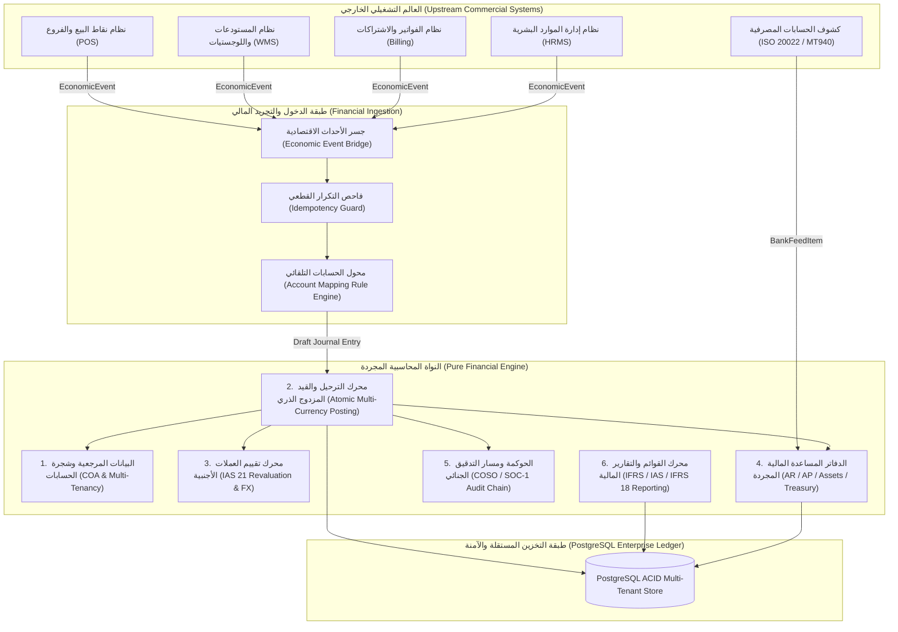

# الخطة التنفيذية الشاملة والمفصلة لتطوير المحرك المحاسبي المالي المجرد

## Pure Financial Accounting Engine — Master Enterprise Implementation Roadmap

### استناداً إلى المعايير العالمية: IFRS / IAS / IFRS 18 / US GAAP / ISO 4217 / COSO / SOC-1

---

**تاريخ الإصدار:** نوفمبر 2026  
**الإصدار:** 2.0 (Master Enterprise Edition)  
**الحالة:** معتمدة للتنفيذ الهندسي المباشر  
**نطاق النظام:** المحرك المالي المركزي `accounting_engine`  
**القاعدة الجوهرية (The Golden Rule):**  
> **"المحرك المالي نقي ومجرد تماماً من أي منطق تجاري أو تشغيلي (Zero Commercial & Operational Logic)؛ لا يتعامل مع بضائع، ولا شحنات، ولا مستودعات فيزيائية، ولا عملاء كأشخاص، ولا فواتير تجارية تفصيلية؛ بل يختص حصراً بالأحداث الاقتصادية المالية المجردة، القيود المزدوجة المتزنة، العملات، الحسابات، الأستاذ العام، الدفاتر المساعدة المالية، والتقارير المالية المطابقة للمعايير الدولية."**

---

## فهرس المحتويات

1. [الميثاق المعماري للنواة المالية والقاعدة الذهبية للتجريد](#1-الميثاق-المعماري-للنواة-المالية-والقاعدة-الذهبية-للتجريد)
2. [المعمارية الهندسية المستهدفة وتدفق البيانات النقدية](#2-المعمارية-الهندسية-المستهدفة-وتدفق-البيانات-النقدية)
3. [نموذج جسر الأحداث الاقتصادية المجرد (Economic Event Bridge)](#3-نموذج-جسر-الأحداث-الاقتصادية-المجرد-economic-event-bridge)
4. [المراحل التنفيذية المتسلسلة والمفصلة (Sequenced Implementation Phases)](#4-المراحل-التنفيذية-المتسلسلة-والمفصلة-sequenced-implementation-phases)
   - [المرحلة 0: التأسيس المعماري وتعدد المنشآت والقياس النقدي القياسي](#المرحلة-0-التأسيس-المعماري-وتعدد-المنشآت-والقياس-النقدي-القياسي)
   - [المرحلة 1: شجرة الحسابات والبيانات المرجعية وفترات التقويم المالي](#المرحلة-1-شجرة-الحسابات-والبيانات-المرجعية-وفترات-التقويم-المالي)
   - [المرحلة 2: محرك الترحيل الذري متعدد العملات والترقيم المتسلسل الحتمي](#المرحلة-2-محرك-الترحيل-الذري-متعدد-العملات-والترقيم-المتسلسل-الحتمي)
   - [المرحلة 3: الدفاتر المساعدة المالية المجردة ومحرك المقاصة](#المرحلة-3-الدفاتر-المساعدة-المالية-المجردة-ومحرك-المقاصة)
   - [المرحلة 4: محرك القوائم المالية المعيارية (IAS 1 / IAS 7 / IFRS 18)](#المرحلة-4-محرك-القوائم-المالية-المعيارية-ias-1--ias-7--ifrs-18)
   - [المرحلة 5: الحوكمة والرقابة ومسار التدقيق المشفر الجنائي (COSO / SOC-1)](#المرحلة-5-الحوكمة-والرقابة-ومسار-التدقيق-المشفر-الجنائي-coso--soc-1)
   - [المرحلة 6: ترقية سائق PostgreSQL واختبارات الإجهاد والمحاكاة القصوى](#المرحلة-6-ترقية-سائق-postgresql-واختبارات-الإجهاد-والمحاكاة-القصوى)
5. [المخطط الشامل النهائي لقاعدة بيانات PostgreSQL الموحدة](#5-المخطط-الشامل-النهائي-لقاعدة-بيانات-postgresql-الموحدة)
6. [مصفوفة حوكمة الكود وقائمة تدقيق النقاء المالي (Anti-Corruption Linter Checklist)](#6-مصفوفة-حوكمة-الكود-وقائمة-تدقيق-النقاء-المالي-anti-corruption-linter-checklist)
7. [جدول التسليم الزمني ومصفوفة المسؤوليات الهندسية](#7-جدول-التسليم-الزمني-ومصفوفة-المسؤوليات-الهندسية)
8. [شروط ومعايير القبول النهائي والجاهزية الإنتاجية (Definition of Done)](#8-شروط-معايير-القبول-النهائي-والجاهزية-الإنتاجية-definition-of-done)

---

## 1. الميثاق المعماري للنواة المالية والقاعدة الذهبية للتجريد

### 1.1 التعريف الفلسفي للنواة المجردة (The Pure Ledger Philosophy)

تُبنى النظم المحاسبية عالية الاعتمادية (እንደ TigerBeetle و Formance و SAP Core Financials) على مبدأ فصل لا يقبل المساومة بين **"الواقع التشغيلي والتجاري"** و **"الأثر المالي المحاسبي"**.

- العالم التشغيلي تحكمه الكيانات المتغيرة: البضائع، الموردين، العملاء، عربات التسوق، أرقام الشحنات، المستودعات، جداول الحضور والانصراف، وأوامر العمل.
- العالم المالي تحكمه خمس حقائق رياضية أبدية: **الأصل (Asset)، الالتزام (Liability)، حقوق الملكية (Equity)، الإيراد (Revenue)، والمصروف (Expense)**، ترتبط ببعضها عبر معادلة القيد المزدوج:
  $$\sum \text{Debits} = \sum \text{Credits}$$

### 1.2 مصفوفة الفصل المعماري الحاسم (Commercial vs. Pure Financial Matrix)

| المجال الوظيفي | الطبقة التشغيلية / التجارية (خارج المحرك المالي) | النواة المحاسبية الخالصة (`accounting_engine`) |
| :--- | :--- | :--- |
| **المبيعات والإيراد** | تفاصيل العميل، كود الصنف (SKU)، الخصومات الترويجية، مندوب المبيعات، بوالص الشحن، عربة التسوق. | **قيد مالي مجرد:** مدين: ذمم مدينة أو نقدية، دائن: إيراد تشغيلي، دائن: ضريبة القيمة المضافة المستحقة. |
| **المشتريات والالتزامات** | طلب الشراء (PR)، أمر الشراء (PO)، فحص الجودة (QC)، بوليصة الاستلام (GRN)، تقييم المورد. | **قيد مالي مجرد:** مدين: مصروف أو أصل، مدين: ضريبة مدخلات قابلة للاسترداد، دائن: ذمم دائنة أو نقدية. |
| **المخزون واللوجستيات** | الجرد الفيزيائي، أرقام الدفعات (Batches)، الأرفف، التوالف، حركات المناقلة بين الفروع. | **الأثر المالي الدوري:** رصيد حساب المخزون كأصل متداول، وقيد تكلفة البضاعة المباعة (COGS) كأثر نقدي. |
| **الأصول الثابتة** | موقع الماكينة الفيزيائي، رقم اللوحة، سجل الصيانة الوقائية، السائق المسؤول، بطاقة الضمان. | **القياس المالي (IAS 16):** التكلفة التاريخية، جدول الإهلاك الدوري، مجمع الإهلاك (Contra-Asset)، وخسائر الهبوط (IAS 36). |
| **الموارد البشرية والرواتب** | البصمة، تقييم الأداء، الإجازات المرضية، البدلات التفصيلية، وثائق الإقامات والتأمين. | **قيد الاستحقاق المالي:** مدين: مصروف الرواتب والمزايا، دائن: التزامات رواتب مستحقة، دائن: التزامات التأمينات الاجتماعية. |
| **المدفوعات والمصارف** | تكامل بوابات الدفع (Stripe, HyperPay)، استرجاع الأموال التجاري (Chargebacks)، توكنات البطاقات. | **حركة الخزينة المجردة (IAS 7):** إيداع أو سحب نقدي بحساب بنكي محدد، وقيد التسوية المحاسبية لرسوم المعالجة. |

---

## 2. المعمارية الهندسية المستهدفة وتدفق البيانات النقدية



---

## 3. نموذج جسر الأحداث الاقتصادية المجرد (Economic Event Bridge)

لكي تظل النواة المحاسبية نظيفة 100% ومحمية من تسرب أي منطق تشغيلي، تعتمد المعمارية على مفهوم **الحدث الاقتصادي المجرد (Economic Event)**.

### 3.1 بنية الحدث الاقتصادي المجرد في Go (`internal/subledgers/models.go`)

```go
package subledgers

import (
 "time"
 financialtypes "accounting_engine/internal/types"
 "github.com/google/uuid"
)

// EconomicEvent يمثل الأثر المالي الصافي لأي واقعة تجارية خارجية دون تفاصيل تشغيلية
type EconomicEvent struct {
 CompanyID      uuid.UUID            `json:"company_id"`      // معرف المنشأة القانونية (IFRS 10)
 IdempotencyKey string               `json:"idempotency_key"` // مفتاح فريد يمنع تكرار القيد نهائياً
 EventType      string               `json:"event_type"`      // نوع الحدث (مثل: "TREASURY_TRANSFER", "INVOICE_SETTLEMENT")
 Date           time.Time            `json:"date"`            // التاريخ المحاسبي الفعلي
 Amount         financialtypes.Money `json:"amount"`          // المبلغ المجرد مع العملة والوحدة الكسرية
 PartnerID      *uuid.UUID           `json:"partner_id"`      // معرف مالي خارجي مجرد (UUID مجهول الهوية للنواة)
 Reference      string               `json:"reference"`       // مرجع الوثيقة المصدرية (رقم السجل الخارجي)
 ResultEntryID  uuid.UUID            `json:"result_entry_id"` // معرف قيد اليومية الناتج في الأستاذ العام
}
```

---

## 4. المراحل التنفيذية المتسلسلة والمفصلة (Sequenced Implementation Phases)

---

### المرحلة 0: التأسيس المعماري وتعدد المنشآت والقياس النقدي القياسي

*المعايير المرجعية: IFRS 10 (Consolidated Financial Statements) / ISO 4217 (Currencies) / Banker's Rounding*

#### 1. الأهداف الهندسية

- بناء عزل صارم متعدد المستأجرين والشركات التابعة (Multi-Tenant & Multi-Entity) لمنع اختلاط السجلات المحاسبية بين الشركات.
- ترقية نظام القياس النقدي ليدعم كافة عملات العالم المعترف بها دولياً دون قيود يدوية، والالتزام الصارم بالوحدات الكسرية (Minor Units: 0, 2, 3).
- اعتماد تقريب المصرفيين (Banker's Rounding / Half-Even Rounding) لمنع الانحرافات التراكمية في حسابات الضرائب والفوائد.

#### 2. الملفات الخاضعة للتطوير

- [`internal/types/currency.go`](file:///home/osm/StudioProjects/cashflow_system/accounting_engine/internal/types/currency.go)
- [`internal/types/money.go`](file:///home/osm/StudioProjects/cashflow_system/accounting_engine/internal/types/money.go)
- [`storage/postgres/schema.sql`](file:///home/osm/StudioProjects/cashflow_system/accounting_engine/storage/postgres/schema.sql)

#### 3. خطوات التنفيذ البرمجي

1. **إنشاء جدول وسجل العملات العالمي الكامل (ISO 4217 Registry):**
   - إزالة مصفوفة العملات الثمانية الثابتة.
   - تضمين قاموس عالمي يحتوي على كود العملة الثلاثي، الرقم الدولي، وعدد الكسور:
     - 0 Minor Units: `JPY`, `KRW`, `VND`, `CLP`, `RWF`.
     - 2 Minor Units: `USD`, `EUR`, `SAR`, `AED`, `EGP`, `GBP`.
     - 3 Minor Units: `KWD`, `BHD`, `OMR`, `JOD`, `TND`.
2. **إعادة هندسة `types.Money`:**
   - الحسابات الداخلية تتم بدقة فائقة باستخدام مكتبة `shopspring/decimal`.
   - عند طلب المبالغ بصيغة الأعداد الصحيحة الصغرى (Cents / Minor Units)، يتم تطبيق التقريب البنكي `decimal.RoundBanker(scale)` حيث يعتمد `scale` على مواصفة العملة الحقيقية.
3. **تأسيس عمود `company_id`:**
   - إضافة `company_id UUID NOT NULL` في كل جدول وكل بنية بيانات في لغة Go.

#### 4. كود التحقق ومحددات القبول (Acceptance Invariants)

```go
// يجب أن يفشل أي إنشاء لمعاملة بعملة غير معرفة في ISO 4217
assert.Error(t, currency.Validate("XYZ"))

// اختبار التقريب البنكي:
// 2.5 cent -> 2 cent (تقريب للزوجي)
// 3.5 cent -> 4 cent (تقريب للزوجي)
m1 := types.NewMoneyFromDecimal(decimal.NewFromFloat(2.5), "USD")
assert.Equal(t, int64(2), m1.MinorUnits())
m2 := types.NewMoneyFromDecimal(decimal.NewFromFloat(3.5), "USD")
assert.Equal(t, int64(4), m2.MinorUnits())
```

---

### المرحلة 1: شجرة الحسابات والبيانات المرجعية وفترات التقويم المالي

*المعايير المرجعية: IFRS Conceptual Framework / IAS 1 / IFRS 8 (Segments) / Audit Standards for Adjusting Periods*

#### 1. الأهداف الهندسية

- تحرير شجرة الحسابات المعمارية والسماح بالحسابات العكسية النظامية (Contra Accounts) في كافة الفئات المحاسبية.
- إعادة هيكلة فترات التقويم المالي والتمييز القاطع بين الأشهر التشغيلية (الفترات 1-12) وفترات التسويات الختامية والتدقيق (الفترتان 13 و 14).
- تفعيل أبعاد التحليل المالي المستقلة (Cost Centers, Projects, Segments) دون إقحام أي تفاصيل تشغيلية.

#### 2. الملفات الخاضعة للتطوير

- [`internal/masterdata/account.go`](file:///home/osm/StudioProjects/cashflow_system/accounting_engine/internal/masterdata/account.go)
- [`internal/masterdata/fiscal_calendar.go`](file:///home/osm/StudioProjects/cashflow_system/accounting_engine/internal/masterdata/fiscal_calendar.go)
- [`internal/masterdata/dimension.go`](file:///home/osm/StudioProjects/cashflow_system/accounting_engine/internal/masterdata/dimension.go)

#### 3. خطوات التنفيذ البرمجي

1. **تمكين الحسابات العكسية الصريحة:**
   - حذف شرط التقييد `a.NormalBalance != DefaultNormalBalance(a.AccountType)`.
   - إضافة حقل صريح `IsContra bool` في بنية `Account`.
   - السماح بالأنماط المحاسبية التالية:
     - `AccountAsset` بطبيعة `BalanceCredit` (مجمع الاستهلاك، مخصص الديون المشكوك فيها).
     - `AccountEquity` بطبيعة `BalanceDebit` (أسهم الخزينة).
     - `AccountRevenue` بطبيعة `BalanceDebit` (مردودات ومسموحات المبيعات، الخصومات).
     - `AccountExpense` بطبيعة `BalanceCredit` (استرداد نفقات، خصم مكتسب).
2. **تصحيح فترات التسوية والتدقيق (Special Periods 13 & 14):**
   - تعديل `FiscalPeriod` بإضافة حقل `PeriodType`:
     - `PeriodTypeRegular` (الأشهر 1 إلى 12).
     - `PeriodTypeYearEndAdjustment` (الفترة 13: تسويات الإدارة والإهلاك الختامي).
     - `PeriodTypeAuditAdjustment` (الفترة 14: تعديلات مراجعي الحسابات الخارجيين).
   - تعديل دالة البحث الزمني `GetPeriodByDate`: البحث التلقائي يعيد دائماً الفترة العادية المقابلة لليوم والتقويم. القيود الموجهة للفترة 13 أو 14 يجب أن تحدد `TargetPeriodNumber = 13` صراحة، مع حظر الترحيل التلقائي إليها بدون تفويض خاص.
3. **الأبعاد المالية التحليلية:**
   - ربط أسطر اليومية بأعمدة الأبعاد: `cost_center_id`, `project_id`, `segment_id`.

---

### المرحلة 2: محرك الترحيل الذري متعدد العملات والترقيم المتسلسل الحتمي

*المعايير المرجعية: IAS 21 (Foreign Exchange) / ZATCA & GoBD Strict Sequential Integrity / ACID Isolation*

#### 1. الأهداف الهندسية

- تمكين القيود متعددة العملات بموجب معيار IAS 21 (السطور بعملات أجنبية مختلفة مع التحويل والتوازن بالعملة الوظيفية للمنشأة).
- القضاء التام على فجوات الترقيم التتابعي (Strict Gapless Sequences) في دفاتر اليومية تحت أسوأ ظروف الفشل الشبكي والتزامن المرتفع.
- تحصين آلية العكس المحاسبي (Reversal) ومنع حذف البيانات القديمة مع تفعيل مسار المراجعة المزدوجة (Maker-Checker).

#### 2. الملفات الخاضعة للتطوير

- [`internal/posting/engine.go`](file:///home/osm/StudioProjects/cashflow_system/accounting_engine/internal/posting/engine.go)
- [`internal/posting/entry.go`](file:///home/osm/StudioProjects/cashflow_system/accounting_engine/internal/posting/entry.go)
- [`internal/posting/reversal.go`](file:///home/osm/StudioProjects/cashflow_system/accounting_engine/internal/posting/reversal.go)
- [`storage/postgres/driver.go`](file:///home/osm/StudioProjects/cashflow_system/accounting_engine/storage/postgres/driver.go)

#### 3. خطوات التنفيذ البرمجي

1. **دعم القيود متعددة العملات (IAS 21):**
   - إلغاء شرط منع العملات المتعددة في القيد الواحد.
   - يتضمن كل سطر قيد:
     - `TransactionAmount`: المبلغ بعملة المعاملة الأصلية.
     - `TransactionCurrency`: كود عملة المعاملة.
     - `ExchangeRate`: سعر الصرف المعتمد في تاريخ القيد مقابل العملة الوظيفية.
     - `FunctionalDebit` و `FunctionalCredit`: المبلغ المقوم بالعملة الوظيفية للمنشأة.
   - التحقق من التوازن الحتمي:
     $$\sum \text{FunctionalDebit} = \sum \text{FunctionalCredit}$$
2. **الترقيم المتسلسل الذري الصارم (Gapless Sequences):**
   - حظر توليد الأرقام التسلسلية خارج معاملة قاعدة البيانات.
   - تنفيذ الترقيم حصرياً داخل `tx.Begin(ctx)` باستخدام استعلام القفل الصفي:

     ```sql
     SELECT current_sequence 
     FROM journals 
     WHERE company_id = $1 AND id = $2 
     FOR UPDATE;
     ```

   - زيادة العداد بمقدار 1 وإسناده لرقم القيد `SequenceNumber`.
   - في حالة حدوث أي خطأ في الفحص المحاسبي، يتم تنفيذ `tx.Rollback()` تلقائياً فيعود العداد إلى حالته الأصلية بدون أي فجوة رقمية.
3. **إعادة هندسة القيد العكسي (Reversal Engine):**
   - إلغاء أمر `DELETE FROM account_move_lines` الخطير الذي يدمر مسار التدقيق.
   - توليد قيد عكسي جديد تماماً بحالة `Draft` يحمل أرقاماً معاكسة للمدين والدائن وتاريخ استحقاق محدد، وربطه برأس القيد القديم بحقل `ReversedByMoveID`.

---

### المرحلة 3: الدفاتر المساعدة المالية المجردة ومحرك المقاصة

*المعايير المرجعية: IFRS 9 (Financial Instruments & ECL) / IAS 16 & IAS 36 (Asset Impairment & Disposal) / Treasury Standards*

#### 1. الأهداف الهندسية

- بناء دفاتر أستاذ مساعدة مالية خالصة (AR / AP / Assets / Treasury) ترتبط بالأستاذ العام (GL) دون احتواء أي تفاصيل تجارية أو أسماء موردين/عملاء أو مواصفات سلع.
- تطوير محرك المقاصة والمطابقة متعدد العملات للذمم المالية مع توليد قيود فروق أسعار الصرف المحققة (Realized FX Gains/Losses) تلقائياً.
- استكمال دورة حياة الأصل المالي: الإهلاك التلقائي، قيد هبوط القيمة (Impairment)، وقيد التخريد والاستبعاد الرأسمالي (Disposal) المباشر في الأستاذ العام.

#### 2. الملفات الخاضعة للتطوير

- [`internal/subledgers/receivable.go`](file:///home/osm/StudioProjects/cashflow_system/accounting_engine/internal/subledgers/receivable.go)
- [`internal/subledgers/payable.go`](file:///home/osm/StudioProjects/cashflow_system/accounting_engine/internal/subledgers/payable.go)
- [`internal/subledgers/fixed_assets.go`](file:///home/osm/StudioProjects/cashflow_system/accounting_engine/internal/subledgers/fixed_assets.go)
- [`internal/subledgers/treasury.go`](file:///home/osm/StudioProjects/cashflow_system/accounting_engine/internal/subledgers/treasury.go)
- [`internal/subledgers/reconciliation.go`](file:///home/osm/StudioProjects/cashflow_system/accounting_engine/internal/subledgers/reconciliation.go)

#### 3. خطوات التنفيذ البرمجي

1. **محرك مقاصة الذمم متعددة العملات (Cross-Currency Clearing Engine):**
   - عند مطابقة سطر ذمة مدينة مسجل بسعر صرف تاريخي مع دفعة نقدية بسعر صرف حديث:
     - احتساب فرق العملة المحقق:
       $$\text{FX Difference} = \text{Payment in Base Currency} - \text{Invoice Base Share}$$
     - توليد قيد تسوية فوري في الأستاذ العام:
       - مدين/دائن: حساب الذمم المدينة.
       - دائن/مدين: حساب أرباح/خسائر تقلبات أسعار الصرف المحققة (P&L FX Gain/Loss).
2. **محرك الأصول الثابتة المالي المتكامل:**
   - **قيد هبوط القيمة (IAS 36 Impairment):**
     - دالة `PostImpairment(assetID, recoverableAmount, journalID)`:
       - مدين: مصروف خسائر هبوط الأصول (P&L).
       - دائن: مجمع هبوط قيمة الأصول (Contra-Asset).
   - **قيد التخريد والاستبعاد (Derecognition / Disposal):**
     - دالة `DisposeAsset(assetID, proceeds, disposalDate)`:
       - إقفال حساب الأصل بالقيمة التاريخية (دائن).
       - إقفال مجمع الاستهلاك ومجمع الهبوط (مدين).
       - إثبات المقبوضات النقدية (مدين).
       - الاعتراف بفارق القيد كأرباح أو خسائر رأسمالية ناتجة عن الاستبعاد في قائمة الأرباح والخسائر.
3. **دفتر الخزينة والتسوية البنكية (Treasury Reconciliation):**
   - مطابقة كشوف الحساب البنكي المجردة مع أرصدة الأستاذ العام عبر نافذة تسامح تاريخي (Date Tolerance Window).
   - توليد قيود المصروفات البنكية غير المسجلة بصورة ذرية.

---

### المرحلة 4: محرك القوائم المالية المعيارية (IAS 1 / IAS 7 / IFRS 18)

*المعايير المرجعية: IAS 1 / IAS 7 / IFRS 18 (April 2024 New Standard) / US GAAP ASC 220*

#### 1. الأهداف الهندسية

- التخلص الجذري من مطابقة السلاسل النصية الهشة في تصنيف بنود القوائم المالية، والاعتماد الحصري على التاكسونومي المالي الصريح لكل حساب.
- إعادة بناء قائمة التدفقات النقدية بموجب معيار IAS 7 (بالطريقتين المباشرة وغير المباشرة) وتصحيح معادلات التدفقات الاستثمارية والتغير في رأس المال العامل.
- هيكلة قائمة الأرباح أو الخسائر وفق الفئات الخمس الإلزامية للمعيار الدولي الحديث IFRS 18 (التشغيل، الاستثمار، التمويل، ضرائب الدخل، والعمليات غير المستمرة)، مع احتساب الدخل الشامل الآخر OCI.
- تصحيح خوارزمية الأستاذ العام المستمر (Perpetual GL) لمنع تضاعف الأرصدة الافتتاحية السنوية.

#### 2. الملفات الخاضعة للتطوير

- [`internal/reporting/cash_flow.go`](file:///home/osm/StudioProjects/cashflow_system/accounting_engine/internal/reporting/cash_flow.go)
- [`internal/reporting/income_statement.go`](file:///home/osm/StudioProjects/cashflow_system/accounting_engine/internal/reporting/income_statement.go)
- [`internal/reporting/balance_sheet.go`](file:///home/osm/StudioProjects/cashflow_system/accounting_engine/internal/reporting/balance_sheet.go)
- [`internal/reporting/equity_statement.go`](file:///home/osm/StudioProjects/cashflow_system/accounting_engine/internal/reporting/equity_statement.go)
- [`internal/reporting/closing_engine.go`](file:///home/osm/StudioProjects/cashflow_system/accounting_engine/internal/reporting/closing_engine.go)

#### 3. خطوات التنفيذ البرمجي

1. **إعادة بناء محرك التدفقات النقدية (IAS 7 Engine):**
   - إضافة خاصية `CashFlowCategory` لكل حساب في شجرة الحسابات:
     `CF_OPERATING`, `CF_INVESTING`, `CF_FINANCING`, `CF_CASH_EQUIVALENT`, `CF_NON_CASH_ADJUSTMENT`.
   - في الطريقة غير المباشرة:
     - البدء بصافي الربح قبل الضريبة.
     - إضافة المصروفات غير النقدية (الإهلاك، الإطفاء، مخصص الهبوط).
     - استبعاد الأرباح/الخسائر الاستثمارية والتمويلية من الربح التشغيلي.
     - احتساب التغير في رأس المال العامل:
       $$\Delta \text{WC} = - \Delta \text{Operating Assets} + \Delta \text{Operating Liabilities}$$
     - التدفقات الاستثمارية: متحصلات بيع الأصول تدخل كقيم موجبة، والنفقات الرأسمالية كقيم سالبة.
2. **تطبيق تصنيفات المعيار الجديد IFRS 18:**
   - فرز بنود الإيرادات والمصروفات بدقة:
     - **الفئة التشغيلية (Operating Category):** الإيرادات التشغيلية، تكلفة الإيراد، والمصروفات الإدارية والبيعية.
     - **إجمالي الربح التشغيلي الإلزامي (Mandatory Subtotal: Operating Profit).**
     - **فئة الاستثمار (Investing Category):** إيرادات الاستثمارات، عوائد الفوائد، وتوزيعات الأرباح.
     - **إجمالي الربح قبل التمويل والضريبة (Mandatory Subtotal: Profit Before Financing and Tax).**
     - **فئة التمويل (Financing Category):** فوائد القروض والسندات وتكاليف الفائدة لعقود الإيجار.
     - **فئة ضرائب الدخل (Tax Category):** ضرائب الدخل الحالية والمؤجلة بموجب IAS 12.
     - **فئة العمليات غير المستمرة (Discontinued Operations):** بموجب IFRS 5.
3. **تفعيل الدخل الشامل الآخر (OCI):**
   - احتساب فروق ترجمة العملات وفروق إعادة التقييم وإدراجها في قائمة الدخل الشامل.
4. **حسم قيد إقفال السنة والأرصدة الافتتاحية:**
   - في الأستاذ العام المستمر (Perpetual GL): ترحيل قيد إقفال الإيرادات والمصروفات حصراً إلى الأرباح المبقاة في نهاية العام، دون توليد قيود افتتاحية للأصول والالتزامات تجنباً للتضاعف المحاسبي.

---

### المرحلة 5: الحوكمة والرقابة ومسار التدقيق المشفر الجنائي (COSO / SOC-1)

*المعايير المرجعية: COSO Internal Control Framework / AICPA SOC-1 / ISAE 3402 / Immutable Cryptographic Chains*

#### 1. الأهداف الهندسية

- رفع درجة مسار التدقيق إلى الموثوقية الجنائية الرقمية عبر سلسلة كتل مشفرة (Cryptographic Hash Chain) تعتمد على SHA-256 وتضمن كشف أي تلاعب حتى لو تم مباشرة في قاعدة البيانات.
- تضمين الحالة السابقة والحالية (`PayloadBefore` و `PayloadAfter`) داخل بصمة التشفير.
- منع انشطار سلسلة التدقيق (Chain Forking) في بيئة العمل الموزعة، وتطبيق قواعد الفصل بين المهام (Maker-Checker / SoD).

#### 2. الملفات الخاضعة للتطوير

- [`internal/governance/audit_chain.go`](file:///home/osm/StudioProjects/cashflow_system/accounting_engine/internal/governance/audit_chain.go)
- [`internal/governance/verifier.go`](file:///home/osm/StudioProjects/cashflow_system/accounting_engine/internal/governance/verifier.go)
- [`internal/governance/sod_policy.go`](file:///home/osm/StudioProjects/cashflow_system/accounting_engine/internal/governance/sod_policy.go)

#### 3. خطوات التنفيذ البرمجي

1. **تصحيح معادلة الهاش المشفرة:**
   $$\text{Block Hash} = \text{SHA256}(\text{PrevHash} + \text{CompanyID} + \text{EntityName} + \text{EntityID} + \text{Action} + \text{ActorUserID} + \text{PayloadBefore} + \text{PayloadAfter} + \text{Timestamp})$$
2. **منع انشطار السلسلة (Fork Prevention):**
   - وضع قيد فريد في قاعدة بيانات PostgreSQL على عمود `previous_hash` مقترناً بـ `company_id`.
   - استخدام قفل تسلسلي أثناء كتابة سجل التدقيق لضمان التسلسل الخطي الصارم.
3. **محرك التحقق الجنائي (`verifier.go`):**
   - بناء فاحص آلي يجري دورياً للتأكد من سلامة السلسلة لكل منشأة، ويطلق إنذاراً فورياً عند اكتشاف أي تلاعب بقيم السجلات التاريخية.

---

### المرحلة 6: ترقية سائق PostgreSQL واختبارات الإجهاد والمحاكاة القصوى

*المعايير المرجعية: Enterprise High-Throughput Standards / Multi-Year Stress Simulation / Chaos Engineering*

#### 1. الأهداف الهندسية

- استبدال دوال "Not Implemented" في سائق PostgreSQL بكود إنتاجي عالي الأداء يعتمد على مجمع الاتصالات `pgxpool` والمعاملات الموزعة الآمنة.
- تطبيق الفهارس المركبة وقواعد السلامة المرجعية (ON DELETE RESTRICT).
- تنفيذ حزمة محاكاة محاسبية شاقة (Chaos & Concurrency Tests) عبر إدخال آلاف القيود المتزامنة وإقفال سنوات متعددة والتحقق من اتزان الميزانية العمومية 100%.

#### 2. الملفات الخاضعة للتطوير

- [`storage/postgres/driver.go`](file:///home/osm/StudioProjects/cashflow_system/accounting_engine/storage/postgres/driver.go)
- [`storage/postgres/schema.sql`](file:///home/osm/StudioProjects/cashflow_system/accounting_engine/storage/postgres/schema.sql)
- [`simulation_test.go`](file:///home/osm/StudioProjects/cashflow_system/accounting_engine/simulation_test.go)
- [`benchmark_test.go`](file:///home/osm/StudioProjects/cashflow_system/accounting_engine/benchmark_test.go)

#### 3. خطوات التنفيذ البرمجي

1. **تحديث شامل لـ `driver.go`:**
   - تطبيق كافة دوال التخزين والاسترجاع مع استغلال كفاءة استعلامات التجميع في SQL بدلاً من سحب كافة القيود إلى ذاكرة Go.
2. **بناء اختبارات الضغط والمحاكاة الفوضوية:**
   - محاكاة ترحيل 50,000 قيد متزامن عبر 50 Go-routine في وقت واحد والتأكد من عدم حدوث Deadlock أو ضياع أي تسلسل ترقيمي.
   - اختبار سيناريو انقطاع الكهرباء أو إلغاء المعاملات والتأكد من الـ Rollback التام للترقيم.
   - محاكاة دورة محاسبية كاملة لـ 5 سنوات مالية تشمل فترات التسوية 13 و 14 والتأكد من توازن القوائم المالية واستخراج التدفقات النقدية بدقة متناهية.

---

## 5. المخطط الشامل النهائي لقاعدة بيانات PostgreSQL الموحدة

يوضح هذا المخطط الهيكلي النواة التخزينية المجردة للنظام في ملف [`storage/postgres/schema.sql`](file:///home/osm/StudioProjects/cashflow_system/accounting_engine/storage/postgres/schema.sql):

```sql
-- تفعيل الامتدادات الضرورية
CREATE EXTENSION IF NOT EXISTS "uuid-ossp";

-- 1. جدول المنشآت القانونية والشركات التابعة (IFRS 10 Multi-Tenancy)
CREATE TABLE companies (
    id UUID PRIMARY KEY DEFAULT gen_random_uuid(),
    code VARCHAR(50) UNIQUE NOT NULL,
    legal_name VARCHAR(255) NOT NULL,
    functional_currency CHAR(3) NOT NULL, -- ISO 4217
    presentation_currency CHAR(3) NOT NULL,
    is_active BOOLEAN NOT NULL DEFAULT TRUE,
    created_at TIMESTAMPTZ NOT NULL DEFAULT NOW()
);

-- 2. جدول العملات الرسمي المعتمد (ISO 4217 Global Registry)
CREATE TABLE currencies (
    code CHAR(3) PRIMARY KEY,
    numeric_code CHAR(3) NOT NULL,
    name VARCHAR(100) NOT NULL,
    minor_units INT NOT NULL DEFAULT 2 CHECK (minor_units >= 0 AND minor_units <= 4),
    is_active BOOLEAN NOT NULL DEFAULT TRUE
);

-- 3. جدول فترات السنوات والتقويم المالي (Fiscal Years & Periods)
CREATE TABLE fiscal_years (
    id UUID PRIMARY KEY DEFAULT gen_random_uuid(),
    company_id UUID NOT NULL REFERENCES companies(id) ON DELETE RESTRICT,
    year INT NOT NULL,
    start_date DATE NOT NULL,
    end_date DATE NOT NULL,
    is_closed BOOLEAN NOT NULL DEFAULT FALSE,
    CONSTRAINT uk_company_year UNIQUE (company_id, year)
);

CREATE TYPE period_type AS ENUM ('REGULAR', 'YEAR_END_ADJUSTMENT', 'AUDIT_ADJUSTMENT');
CREATE TYPE period_status AS ENUM ('OPEN', 'LOCKED', 'CLOSED');

CREATE TABLE fiscal_periods (
    id UUID PRIMARY KEY DEFAULT gen_random_uuid(),
    company_id UUID NOT NULL REFERENCES companies(id) ON DELETE RESTRICT,
    fiscal_year_id UUID NOT NULL REFERENCES fiscal_years(id) ON DELETE RESTRICT,
    period_number INT NOT NULL CHECK (period_number >= 1 AND period_number <= 14),
    period_type period_type NOT NULL DEFAULT 'REGULAR',
    start_date DATE NOT NULL,
    end_date DATE NOT NULL,
    status period_status NOT NULL DEFAULT 'OPEN',
    closed_at TIMESTAMPTZ,
    CONSTRAINT uk_company_period UNIQUE (company_id, fiscal_year_id, period_number)
);

-- 4. جدول شجرة الحسابات المجرد المتوافق مع معايير IFRS Taxonomy
CREATE TYPE account_classification AS ENUM ('ASSET', 'LIABILITY', 'EQUITY', 'REVENUE', 'EXPENSE');
CREATE TYPE balance_nature AS ENUM ('DEBIT', 'CREDIT');
CREATE TYPE ifrs18_category AS ENUM (
    'OPERATING',
    'INVESTING',
    'FINANCING',
    'INCOME_TAXES',
    'DISCONTINUED_OPERATIONS',
    'EQUITY_MOVEMENTS',
    'BALANCE_SHEET_PERPETUAL'
);
CREATE TYPE cash_flow_activity AS ENUM (
    'OPERATING',
    'INVESTING',
    'FINANCING',
    'CASH_AND_EQUIVALENTS',
    'NON_CASH'
);

CREATE TABLE chart_of_accounts (
    id UUID PRIMARY KEY DEFAULT gen_random_uuid(),
    company_id UUID NOT NULL REFERENCES companies(id) ON DELETE RESTRICT,
    code VARCHAR(50) NOT NULL,
    name VARCHAR(255) NOT NULL,
    classification account_classification NOT NULL,
    normal_balance balance_nature NOT NULL,
    is_contra BOOLEAN NOT NULL DEFAULT FALSE,
    is_current BOOLEAN NOT NULL DEFAULT TRUE,
    ifrs18_category ifrs18_category NOT NULL,
    cash_flow_activity cash_flow_activity NOT NULL,
    is_reconcilable BOOLEAN NOT NULL DEFAULT FALSE,
    is_active BOOLEAN NOT NULL DEFAULT TRUE,
    parent_id UUID REFERENCES chart_of_accounts(id),
    created_at TIMESTAMPTZ NOT NULL DEFAULT NOW(),
    CONSTRAINT uk_company_account_code UNIQUE (company_id, code)
);

-- 5. جدول دفاتر اليومية والتسلسل الترقيمي غير المنقطع
CREATE TABLE journals (
    id UUID PRIMARY KEY DEFAULT gen_random_uuid(),
    company_id UUID NOT NULL REFERENCES companies(id) ON DELETE RESTRICT,
    code VARCHAR(20) NOT NULL,
    name VARCHAR(100) NOT NULL,
    current_sequence BIGINT NOT NULL DEFAULT 0,
    CONSTRAINT uk_company_journal UNIQUE (company_id, code)
);

-- 6. جدول قيود اليومية العامة (Journal Entries / Moves)
CREATE TYPE entry_status AS ENUM ('DRAFT', 'POSTED', 'REVERSED');

CREATE TABLE journal_entries (
    id UUID PRIMARY KEY DEFAULT gen_random_uuid(),
    company_id UUID NOT NULL REFERENCES companies(id) ON DELETE RESTRICT,
    journal_id UUID NOT NULL REFERENCES journals(id) ON DELETE RESTRICT,
    period_id UUID NOT NULL REFERENCES fiscal_periods(id) ON DELETE RESTRICT,
    entry_number BIGINT NOT NULL,
    entry_date DATE NOT NULL,
    status entry_status NOT NULL DEFAULT 'DRAFT',
    description TEXT,
    reference VARCHAR(255),
    created_by UUID NOT NULL,
    posted_by UUID,
    posted_at TIMESTAMPTZ,
    reversed_by_entry_id UUID REFERENCES journal_entries(id),
    created_at TIMESTAMPTZ NOT NULL DEFAULT NOW(),
    CONSTRAINT uk_company_journal_number UNIQUE (company_id, journal_id, entry_number)
);

-- 7. جدول أسطر القيد المحاسبي المزدوج الذري
CREATE TABLE journal_lines (
    id UUID PRIMARY KEY DEFAULT gen_random_uuid(),
    company_id UUID NOT NULL REFERENCES companies(id) ON DELETE RESTRICT,
    entry_id UUID NOT NULL REFERENCES journal_entries(id) ON DELETE RESTRICT,
    account_id UUID NOT NULL REFERENCES chart_of_accounts(id) ON DELETE RESTRICT,
    partner_id UUID, -- معرف مالي مجرد
    cost_center_id UUID,
    project_id UUID,
    
    -- مبالغ المعاملة الأصلية
    transaction_currency CHAR(3) NOT NULL REFERENCES currencies(code),
    transaction_amount_minor BIGINT NOT NULL,
    exchange_rate NUMERIC(18, 8) NOT NULL DEFAULT 1.00000000,
    
    -- المبالغ المقومة بالعملة الوظيفية
    functional_debit_minor BIGINT NOT NULL DEFAULT 0 CHECK (functional_debit_minor >= 0),
    functional_credit_minor BIGINT NOT NULL DEFAULT 0 CHECK (functional_credit_minor >= 0),
    
    CONSTRAINT chk_positive_or_zero CHECK (functional_debit_minor > 0 OR functional_credit_minor > 0),
    CONSTRAINT chk_one_sided CHECK (
        (functional_debit_minor > 0 AND functional_credit_minor = 0) OR
        (functional_credit_minor > 0 AND functional_debit_minor = 0)
    )
);

-- 8. جدول سلسلة التدقيق المشفرة المنيعة (Cryptographic Tamper-Proof Audit Chain)
CREATE TABLE audit_records (
    id UUID PRIMARY KEY DEFAULT gen_random_uuid(),
    company_id UUID NOT NULL REFERENCES companies(id) ON DELETE RESTRICT,
    sequence_id BIGSERIAL NOT NULL,
    entity_name VARCHAR(50) NOT NULL,
    entity_id UUID NOT NULL,
    action VARCHAR(50) NOT NULL,
    actor_id UUID NOT NULL,
    timestamp TIMESTAMPTZ NOT NULL DEFAULT NOW(),
    payload_before JSONB,
    payload_after JSONB,
    previous_hash CHAR(64) NOT NULL,
    record_hash CHAR(64) NOT NULL,
    CONSTRAINT uk_company_audit_prev_hash UNIQUE (company_id, previous_hash),
    CONSTRAINT uk_company_audit_hash UNIQUE (company_id, record_hash)
);

-- 9. فهارس الأداء العالي
CREATE INDEX idx_lines_company_account ON journal_lines (company_id, account_id);
CREATE INDEX idx_lines_company_entry ON journal_lines (company_id, entry_id);
CREATE INDEX idx_entries_company_date ON journal_entries (company_id, entry_date);
CREATE INDEX idx_entries_company_period ON journal_entries (company_id, period_id);
CREATE INDEX idx_audit_company_seq ON audit_records (company_id, sequence_id);
```

---

## 6. مصفوفة حوكمة الكود وقائمة تدقيق النقاء المالي (Anti-Corruption Linter Checklist)

قبل قبول أي طلب سحب برمجي (Pull Request) في مستودع المحرك، يتم إخضاع الكود لقائمة الفحص الصارمة التالية:

- [ ] **حظر المصطلحات التشغيلية:** هل يحتوي الكود على أي كلمات محظورة في أسماء الحقول أو الهياكل، مثل: `Item`, `Product`, `SKU`, `CustomerName`, `Warehouse`, `Shipment`, `Order`, `Cart`, `EmployeeDepartment`؟ (إذا وُجدت، يُرفض فوراً).
- [ ] **عزل المنشأة:** هل كل استعلام أو دالة تقبل `company_id` وتتحقق من صحته؟
- [ ] **توازن العملة الوظيفية:** هل يتم فحص توازن مجموع المدين ومجموع الدائن بالعملة الوظيفية بدقة $\Delta = 0$ قبل الترحيل؟
- [ ] **تجريد الأطراف الخارجية:** هل تقتصر معرفات العملاء أو الموردين على معرف مجرد `PartnerID *uuid.UUID` دون وجود جدول فرعي لأسمائهم داخل المحرك؟
- [ ] **حماية مسار التدقيق:** هل تم منع استخدام `DELETE` أو `UPDATE` المباشر على أسطر اليومية أو سجلات التدقيق المشفرة؟
- [ ] **تسلسل الترقيم الذري:** هل يتم طلب الرقم التالي لدفتر اليومية حصرياً داخل معاملة بقفل صفي `FOR UPDATE`؟
- [ ] **تكامل الحسابات العكسية:** هل يتم التعامل مع الحسابات العكسية وفق وسومها المحاسبية الصريحة دون إلقاء استثناءات نوع الحساب؟

---

## 7. جدول التسليم الزمني ومصفوفة المسؤوليات الهندسية

| المرحلة | اسم المرحلة ومحور العمل | المدة المقدرة | المعيار الحاكم | المهندس المسؤول | المخرجات الرئيسية المسلّمة |
| :---: | :--- | :---: | :--- | :---: | :--- |
| **0** | التأسيس: تعدد المنشآت والقياس النقدي | أسبوع 1 | IFRS 10 / ISO 4217 | مهندس النواة | قاموس العملات العالمي، وعزل `company_id`. |
| **1** | شجرة الحسابات وفترات التقويم المالي | أسبوع 2 | IAS 1 / IFRS 8 | مهندس النواة | الحسابات العكسية، وفترات التسوية 13 و 14. |
| **2** | الترحيل متعدد العملات والترقيم المتسلسل | أسبوع 3 | IAS 21 / ZATCA | مهندس الترحيل | ترحيل متزن وظيفياً، وترقيم حتمي خالٍ من الفجوات. |
| **3** | الدفاتر المساعدة المالية المجردة | أسبوع 4 | IFRS 9 / IAS 16 / 36 | مهندس الدفاتر | مقاصة العملات، وهبوط الأصول وتخريدها التلقائي. |
| **4** | محرك التقارير المالية (IFRS 18 / IAS 7) | أسبوع 5 | IFRS 18 / IAS 7 | مهندس التقارير | تدفقات نقدية صحيحة، ودخل شامل، وفئات IFRS 18. |
| **5** | الحوكمة والتدقيق المشفر (COSO) | أسبوع 6 | COSO / SOC-1 | مهندس الحوكمة | سلسلة تدقيق جنائية بـ SHA-256 و SoD. |
| **6** | ترقية PostgreSQL واختبارات الإجهاد | أسبوع 7 | Enterprise Production | مهندس البيانات والجودة | اجتياز محاكاة 5 سنوات و 50k قيد متزامن بنسبة 100%. |

---

## 8. شروط ومعايير القبول النهائي والجاهزية الإنتاجية (Definition of Done)

تعتبر النواة المحاسبية `accounting_engine` مكتملة وجاهزة للإنتاج المالي المصرفي عند تحقق المعايير السبعة التالية:

1. **معيار التوازن الرياضي الحتمي:** يستحيل برمجياً ترحيل أي قيد يومية لا يتساوى فيه المدين مع الدائن بالعملة الوظيفية للمنشأة.
2. **معيار صفر فجوات ترقيمية:** عدم وجود أي انقطاع في الأرقام المتسلسلة لدفاتر اليومية تحت ظروف الانقطاع الفجائي للمعاملات والتزامن العالي.
3. **معيار الاتزان المالي الكلي:** الميزانية العمومية متزنة تماماً ($\text{Assets} = \text{Liabilities} + \text{Equity}$) في كل لحظة زمنية ولكافة المنشآت.
4. **معيار التدقيق الجنائي غير القابل للتلاعب:** نجاح أداة التحقق الرقابية `verifier.go` في كشف أي تلاعب يدوي مباشر في قاعدة البيانات.
5. **معيار التدفقات النقدية السليمة:** تطابق رصيد النقدية وما في حكمه في نهاية قائمة التدفقات النقدية مع رصيد النقدية في الميزانية العمومية بدقة سنت واحد.
6. **معيار النقاء المعماري 100%:** اجتياز الفحص البرمجي الآلي لخلو كامل مستودع الكود من أي مصطلحات أو منطق تجاري/تشغيلي.
7. **معيار الأداء العالي:** قدرة النواة على معالجة ما لا يقل عن 2,000 قيد محاسبي مزدوج في الثانية الواحدة مع الحفاظ الكامل على خصائص ACID.

---
**نهاية وثيقة الخطة التنفيذية الشاملة.**
