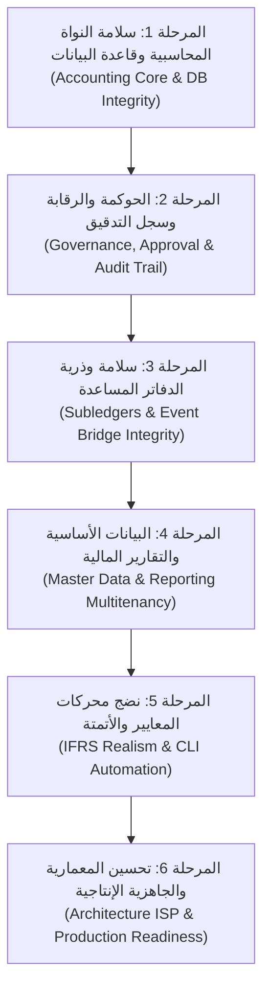

# خطة التنفيذ الشاملة لمعالجة الفجوات والعيوب الهندسية والمحاسبية

## Accounting Engine Remediation & Modernization Execution Plan

**تاريخ الخطة:** نوفمبر 2026  
**المرجعيات:**

- تقرير التحقق الميداني: [`docs/engine_errors_verification_report.md`](file:///home/osm/StudioProjects/cashflow_system/accounting_engine/docs/engine_errors_verification_report.md)
- التقرير الفني التحليلي: [`docs/engine_errors_analysis.md`](file:///home/osm/StudioProjects/cashflow_system/accounting_engine/docs/engine_errors_analysis.md)

> **حالة التنفيذ:** ✅ مكتملة 100% لجميع المراحل الست. راجع [تقرير إغلاق خطة المعالجة](./remediation_execution_report.md) لأدلة التنفيذ والاختبارات.

---

## 1. فلسفة الخطة ومبادئ التنفيذ الحاكمة

لتحويل المحرك من مرحلة **Advanced Prototype** إلى **Production-Grade Enterprise Core**، تعتمد الخطة المبادئ التالية:

1. **النواة المحاسبية كمصدر وحيد للحقيقة (Single Source of Accounting Truth):**  
   لا يسمح لأي دفتر مساعد أو محرك تقارير أو خدمة جانبية بالتأثير على الأرصدة المحاسبية إلا من خلال معاملة ذرية متوافقة بالكامل مع قواعد الترحيل والقيد المزدوج.
2. **عدم التراجع أو كسر العقود (Zero Regressions):**  
   كل تعديل في النواة يجب أن يكون مصحوباً باختبارات وحدة واختبارات تكاملية متزامنة، مع الحفاظ على التوافق مع البيئات متعددة الشركات (Multi-Tenant Isolation).
3. **التنفيذ المتسلسل المعتمد على التبعيات:**  
   الترتيب إلزامي من الداخل إلى الخارج: **نواة الترحيل وقاعدة البيانات أولاً** -> **الحوكمة وسجل التدقيق ثانياً** -> **الدفاتر المساعدة ثالثاً** -> **البيانات الأساسية والتقارير رابعاً** -> **محركات المعايير IFRS خامساً** -> **المعمارية والجاهزية الإنتاجية سادساً**.

---



---

## المرحلة الأولى: سلامة النواة المحاسبية وتوازن قاعدة البيانات (Core Integrity)
>
> **الهدف:** القضاء النهائي على أخطاء P0 في توازن العملات، وضمان التسلسل المحاسبي الصارم، وتوحيد سياسة الدقة العشرية.

### المهمة 1.1: تصحيح Trigger فحص توازن القيود في PostgreSQL

- **الملف المستهدف:** [`storage/postgres/schema.sql`](file:///home/osm/StudioProjects/cashflow_system/accounting_engine/storage/postgres/schema.sql)

- **الموقع:** الدالة `check_posted_move_balance_statement()` (الأسطر 330-363).
- **خطوات التنفيذ:**
  1. استبدال الأعمدة المهجورة `SUM(lines.debit)` و `SUM(lines.credit)` بالأعمدة الرسمية `functional_debit_minor` و `functional_credit_minor`.
  2. ضبط التحقق ليكون:

     ```sql
     COALESCE(SUM(lines.functional_debit_minor), 0) AS total_debit,
     COALESCE(SUM(lines.functional_credit_minor), 0) AS total_credit
     ...
     HAVING posted_moves.entry->>'Status' IS DISTINCT FROM 'posted'
         OR COALESCE(SUM(lines.functional_debit_minor), 0) <> COALESCE(SUM(lines.functional_credit_minor), 0)
     ```

  3. إنشاء ملف Migration جديد مرقم: `storage/postgres/migrations/202611110001_fix_balance_trigger.sql` لعكس التغيير بطريقة رسمية قابلة للرجوع (`.down.sql`).
  4. كتابة اختبار تكاملي في `storage/postgres/phase2_atomic_posting_test.go` يرسل قيداً متعدد العملات (مثلاً مدين باليورو ودائن بالدولار متوازنان وظيفياً بالريال السعودي) للتأكد من قبوله، وقيداً غير متوازن وظيفياً للتأكد من رفضه.

### المهمة 1.2: إصلاح الترحيل الجماعي `PostBulk` والتسلسل المحاسبي الصارم

- **الملفات المستهدفة:**
  - [`storage/postgres/posting.go`](file:///home/osm/StudioProjects/cashflow_system/accounting_engine/storage/postgres/posting.go) (الأسطر 502-526)
  - [`storage/postgres/masterdata.go`](file:///home/osm/StudioProjects/cashflow_system/accounting_engine/storage/postgres/masterdata.go) (الأسطر 416-428)
  - [`internal/posting/bulk.go`](file:///home/osm/StudioProjects/cashflow_system/accounting_engine/internal/posting/bulk.go)

- **خطوات التنفيذ:**
  1. **تصحيح `GetNextSequenceWithLock`:**
     - تعديل الاستعلام في `masterdata.go` ليقوم بقفل السجل وتحديثه فعلياً ضمن المعاملة:

       ```sql
       UPDATE journals 
       SET current_sequence = current_sequence + 1 
       WHERE company_id = $1 AND id = $2 
       RETURNING current_sequence;
       ```

  2. **تصحيح `Driver.PostBulk`:**
     - تجميع القيود حسب اليومية (`journal_id`).
     - حجز نطاق الأرقام التسلسلية دفعة واحدة لكل يومية داخل المعاملة ذرية:

       ```sql
       UPDATE journals 
       SET current_sequence = current_sequence + $3 
       WHERE company_id = $1 AND id = $2 
       RETURNING current_sequence - $3 + 1;
       ```

     - تخصيص الأرقام التسلسلية للقيود قبل حفظها بـ `saveEntryTx`.
  3. **تصحيح `Engine.PostBulk`:**
     - جعل الترحيل الجماعي في طبقة الـ Domain ذرياً، بحيث إذا وفر المخزن `BulkRepository` يتم استدعاء الترحيل الجماعي الذري الشامل، وفي حال فشل أي قيد، يتم عمل Rollback للمجموعة كاملة دون ترك قيود معلقة.
  4. كتابة اختبار إجهاد متزامن (Concurrency Test) للتأكد من عدم وجود أرقام مكررة أو فجوات تسلسلية.

### المهمة 1.3: توحيد سياسة الدقة العشرية والتقريب (Rounding Policy Contract)

- **الملفات المستهدفة:**
  - [`internal/types/money.go`](file:///home/osm/StudioProjects/cashflow_system/accounting_engine/internal/types/money.go)
  - [`storage/postgres/posting.go`](file:///home/osm/StudioProjects/cashflow_system/accounting_engine/storage/postgres/posting.go)

- **خطوات التنفيذ:**
  1. توثيق وتطبيق العقد الحسابي الموحد: "الحسابات الداخلية والتحويلات بـ `InternalScale (12)`، والمبالغ المرحّلة والأرصدة بـ `MinorUnits` المعتمدة على العملة (Integer-based minor units)".
  2. منع تخزين أي مبالغ تحتوي على كسور تتجاوز الـ Minor Unit دون تسوية فروق التقريب (Rounding Differences) في حساب تسوية مخصص (`Rounding Difference Account`).
  3. إضافة فحص تطابق (Reconciliation Assertion) بين مجموع القيود وأرصدة `account_balances`.

---

## المرحلة الثانية: الحوكمة والرقابة وسجل التدقيق الإلزامي (Governance & Audit)
>
> **الهدف:** سد الثغرات الأمنية والرقابية في نظام الموافقات، ودمج سجل التدقيق في قلب المعاملات المحاسبية.

### المهمة 2.1: ربط نظام الموافقات بمحتوى القيد الفعلي ومبلغه الوظيفي

- **الملفات المستهدفة:**
  - [`internal/governance/approval.go`](file:///home/osm/StudioProjects/cashflow_system/accounting_engine/internal/governance/approval.go)
  - [`storage/postgres/governance_store.go`](file:///home/osm/StudioProjects/cashflow_system/accounting_engine/storage/postgres/governance_store.go)
  - [`storage/postgres/migrations/202611100005_phase3_governance.sql`](file:///home/osm/StudioProjects/cashflow_system/accounting_engine/storage/postgres/migrations/202611100005_phase3_governance.sql)

- **خطوات التنفيذ:**
  1. **إضافة بصمة القيد ومحتواه لطلب الموافقة:**
     - إضافة عمود `entry_hash` (SHA-256 لبصمة القيد وأسطره) وعمود `functional_amount` لجدول `approval_requests`.
     - إضافة قيد فريد يمنع تكرار الطلبات المتضاربة:

       ```sql
       ALTER TABLE approval_requests ADD CONSTRAINT uq_company_entry UNIQUE (company_id, entry_id);
       ```

  2. **تعديل `ApprovalEngine.Start`:**
     - جعل الدالة تستقبل القيد المخزن أو جلبه مباشرة من المستودع للتحقق من أن المبلغ المقدم يطابق تماماً مجموع مبالغ القيد بالعملة الوظيفية.
     - تخزين بصمة القيد في طلب الموافقة.
  3. **تعديل دالة التحقق `IsEntryApproved`:**
     - التحقق ليس فقط من اكتمال الموافقة، بل أيضاً من تطابق بصمة القيد الحالي مع البصمة التي تمت الموافقة عليها (لمنع تعديل مسودة القيد بعد الموافقة عليها).

### المهمة 2.2: التفعيل الإلزامي لنظام الرقابة (Approval Gate & Maker-Checker)

- **الملفات المستهدفة:**
  - [`engine.go`](file:///home/osm/StudioProjects/cashflow_system/accounting_engine/engine.go) (الأسطر 142-164)
  - [`internal/posting/engine.go`](file:///home/osm/StudioProjects/cashflow_system/accounting_engine/internal/posting/engine.go)

- **خطوات التنفيذ:**
  1. تعديل `NewEngine()` لربط محرك الموافقات بمحرك الترحيل تلقائياً:

     ```go
     postingEngine.SetApprovalGate(governanceEngine.ApprovalGate())
     ```

  2. توفير إمكانية تفعيل سياسة الشركة (Company Policy) للحد الأدنى لصانع ومراجع القيد (`MakerCheckerThreshold`)، بحيث ترفض النواة ترحيل أي قيد يتجاوز الحد ما لم يكن معتمداً.

### المهمة 2.3: الدمج الذري لسجل التدقيق مع مسارات الترحيل والماستر

- **الملفات المستهدفة:**
  - [`storage/postgres/posting.go`](file:///home/osm/StudioProjects/cashflow_system/accounting_engine/storage/postgres/posting.go)
  - [`internal/posting/engine.go`](file:///home/osm/StudioProjects/cashflow_system/accounting_engine/internal/posting/engine.go)

- **خطوات التنفيذ:**
  1. تعديل دالة الترحيل الذرية في PostgreSQL لتتضمن خطوة إلزامية:

     ```text
     BEGIN TX
         -> Check Period & Accounts
         -> Allocate Sequence
         -> Insert/Update Move & Lines
         -> Update Account Balances
         -> AppendAuditLogAtomic(TX, EntryPostedEvent)
     COMMIT TX
     ```

  2. إذا فشل تسجيل التدقيق لأي سبب (مثل انقطاع الـ Hash Chain أو قفل استشاري)، تتراجع المعاملة بالكامل ولا يرحل القيد.
  3. إضافة أحداث التدقيق لعمليات: `ReverseEntry`، `CloseFiscalYear`، و `UpdateAccount`.

---

## المرحلة الثالثة: سلامة وذرية الدفاتر المساعدة (Subledger Integrity)
>
> **الهدف:** منع الازدواجية في الأصول والمدفوعات، وضمان تطابق الدفاتر المساعدة مع دفتر الأستاذ العام.

### المهمة 3.1: تصحيح التحقق من Idempotency في EventBridge

- **الملف المستهدف:** [`internal/subledgers/event_bridge.go`](file:///home/osm/StudioProjects/cashflow_system/accounting_engine/internal/subledgers/event_bridge.go) (الأسطر 109-175)

- **خطوات التنفيذ:**
  1. توليد بصمة رقمية `PayloadHash` (SHA-256) لمحتوى الحدث الاقتصادي (المبلغ، العملة، الحسابات، المرجع).
  2. عند العثور على `IdempotencyKey` مسجل مسبقاً:
     - إذا كانت البصمة متطابقة 100%: إعادة القيد السابق بنجاح (Idempotent Success).
     - إذا كانت البصمة مختلفة: إرجاع خطأ فوري صريح `ErrIdempotencyPayloadConflict` ومنع المعالجة.
  3. كتابة اختبار وحدة مخصص للتحقق من رفض الأحداث ذات المفاتيح المتكررة بحمولات مختلفة.

### المهمة 3.2: ضمان ذرية وقفل دورة حياة الأصول الثابتة (Fixed Assets Mutability)

- **الملف المستهدف:** [`internal/subledgers/fixed_assets.go`](file:///home/osm/StudioProjects/cashflow_system/accounting_engine/internal/subledgers/fixed_assets.go) (الأسطر 630-735)

- **خطوات التنفيذ:**
  1. توحيد مرجع القيد المسودة للاستبعاد والتدني ليكون معتمداً على الأصل وفترته بدلاً من `uuid.New()` عشوائي:
     `disposalReference(asset.ID, disposalDate)`
  2. إضافة حالة تشغيلية معلقة للأصل `PendingOperation: "DISPOSAL" | "IMPAIRMENT"` تمنع إنشاء أكثر من مسودة لنفس العملية في نفس الوقت.
  3. دمج عملية ترحيل القيد وتأكيد حالة الأصل في معاملة قاعدة بيانات واحدة متصلة (Atomic Post & Mutation) لمنع وجود قيد مرحل لاستبعاد أصل فشل تأكيد استبعاده في السجل.
  4. استبدال `context.Background()` بالـ `ctx` الممرر من المستدعي في كافة دوال الحفظ والتأكيد.

### المهمة 3.3: تصحيح تهيئة الدفاتر المساعدة في المحرك الرئيسي

- **الملف المستهدف:** [`engine.go`](file:///home/osm/StudioProjects/cashflow_system/accounting_engine/engine.go) (السطر 153)

- **خطوات التنفيذ:**
  1. إنشاء نمط Factory أو دوال فرعية:
     `ForCompany(companyID uuid.UUID) *CompanySubledgerService`
  2. توفير واجهات واضحة تأخذ `companyID` في كل عملية للدفاتر المساعدة لضمان عزل البيانات وعدم رمي أخطاء `ErrCompanyScopeRequired`.

---

## المرحلة الرابعة: البيانات الأساسية والتقارير المالية (Master Data & Reporting)
>
> **الهدف:** تمكين إدارة شجرة الحسابات دون أخطاء في PostgreSQL، وضمان دقة التقارير في البيئات متعددة الشركات.

### المهمة 4.1: إصلاح `UpdateAccountParent` وتمرير نطاق الشركة

- **الملفات المستهدفة:**
  - [`internal/masterdata/service.go`](file:///home/osm/StudioProjects/cashflow_system/accounting_engine/internal/masterdata/service.go) (الأسطر 90-125)
  - [`storage/postgres/masterdata.go`](file:///home/osm/StudioProjects/cashflow_system/accounting_engine/storage/postgres/masterdata.go)

- **خطوات التنفيذ:**
  1. تعديل `s.repo.GetAccountByID(account.ID)` ليستخدم الدالة المقيدة بالشركة:
     `GetAccountByIDForCompany(ctx, account.CompanyID, account.ID)`
  2. تعديل فحص الدورات `accountWouldCycle` ليستقبل `companyID` و `ctx` ويقرأ الحسابات داخل نطاق الشركة لمنع استدعاء الدالة المهجورة التي ترمي `ErrCompanyScopeRequired`.
  3. كتابة اختبار تكاملي في PostgreSQL لإنشاء شجرة حسابات وتعديل الحساب الأب والتأكد من نجاح العملية واكتشاف الدورات الحلقية.
  4. توفير `UpdateAccountParentContext(ctx, account, parentID)` مع الإبقاء على `UpdateAccountParent` كواجهة توافقية تستخدم سياقاً افتراضياً.

### المهمة 4.2: إضافة `CompanyID` و `Context` لواجهات التقارير في الـ Facade

- **الملف المستهدف:** [`engine.go`](file:///home/osm/StudioProjects/cashflow_system/accounting_engine/engine.go) (الأسطر 73-83)

- **خطوات التنفيذ:**
  1. تعديل توقيع الدوال:
     - `GeneralLedger(ctx context.Context, companyID, accountID uuid.UUID, ...)`
     - `FinancialRatios(ctx context.Context, companyID uuid.UUID, ...)`
     - `StatementBundle(ctx context.Context, companyID uuid.UUID, ...)`
  2. عدم إبقاء أي واجهة تقرير في الـ Facade بلا نطاق شركة؛ لا يمكن توجيه الدوال القديمة بأمان ما لم يتوفر `companyID` صريح.
  3. تمرير السياق والنطاق إلى تطبيقات التقارير متعددة الشركات، وعدم استخدام مسارات التقارير غير المقيدة بالشركة من الـ Facade.

### المهمة 4.3: محرك المطابقة بين الأرصدة المخزنة ودفتر الأستاذ (Balance Reconciliation Engine)

- **إضافة نوعية جديدة:**
  - بناء أداة تحقق داخلية: `internal/reporting/reconciliation.go`
  - تقوم بمقارنة فورية بين `account_balances` (المخزن المادي) ومجموع قيود `account_move_lines` الفعلية لكل حساب للتأكد من عدم وجود أي انحراف (Drift).
  - إتاحة الفحص من خلال `ReconcileBalances(ctx, companyID, fiscalPeriodID, currencyID)` في واجهة المحرك.

---

## المرحلة الخامسة: نضج محركات المعايير والأتمتة (IFRS Realism & Automation)
>
> **الهدف:** ترقية نماذج معايير IFRS لتتوافق مع المبادئ الحسابية الفعلية، وإصلاح CLI الأتمتة.

### المهمة 5.1: ترقية محرك IFRS 16 لحساب الفائدة الفعلية

- **الملف المستهدف:** [`internal/ifrs16/lease.go`](file:///home/osm/StudioProjects/cashflow_system/accounting_engine/internal/ifrs16/lease.go) (الأسطر 152-228)

- **خطوات التنفيذ:**
  1. استبدال القسمة المباشرة على 12 (`annualDiscountRate / 12`) بحساب الفائدة الفعلية المركبة وفق أساس Actual/365:
     \[
     r_p = (1 + r_a)^{\frac{\Delta \text{days}}{365}} - 1
     \]
  2. دعم الفواصل الزمنية الدقيقة بين تاريخ بدء العقد/التعديل وتواريخ الاستحقاق (`payment.DueDate - lastDate`) بدلاً من افتراض أنها دائماً شهر ثابت.
  3. توثيق أن القيمة المتبقية المضمونة الداخلة في الالتزام يجب أن تُدرج ضمن التدفقات التعاقدية، وأن جدول الدفعات المعدل يجب أن يعكس تغييراتها.

### المهمة 5.2: ترقية وتصحيح CLI أتمتة المعايير

- **الملفات المستهدفة:**
  - [`cmd/agy/main.go`](file:///home/osm/StudioProjects/cashflow_system/accounting_engine/cmd/agy/main.go) (الأسطر 75-105)
  - [`internal/ifrsautomation/config.go`](file:///home/osm/StudioProjects/cashflow_system/accounting_engine/internal/ifrsautomation/config.go)
  - [`internal/ifrsautomation/service.go`](file:///home/osm/StudioProjects/cashflow_system/accounting_engine/internal/ifrsautomation/service.go)

- **خطوات التنفيذ:**
  1. تحميل إعدادات الشركات والحسابات وعقود IFRS 16 من JSON عبر `--config` أو `AGY_IFRS_CONFIG_PATH`، وبناء وظائف IFRS 9 وIFRS 15 وIFRS 16 من خلال `BuildStandardJobs`.
  2. عند غياب الإعداد أو فراغه، إصدار تحذير منظم وتخطي التشغيل دون الاتصال بقاعدة البيانات؛ أما الإعداد غير الصحيح فيُرجع خطأ واضحاً.
  3. إيقاف تجاهل أخطاء التشغيل وتسجيل نتيجة كل وظيفة أو فشلها بهيكل منظم، مع استمرار الوظائف المستقلة عند تعثر وظيفة أخرى.
  4. توثيق مخطط الإعداد وأوامر CLI في `docs/ifrs_automation.md` واختبار تنفيذ الوظائف القياسية وقيودها.

---

## المرحلة السادسة: تحسين المعمارية والجاهزية الإنتاجية (Architecture & Production Readiness)
>
> **الهدف:** تفكيك الواجهات الضخمة، وتعزيز أمان الأنواع، وتنظيم إدارة قاعدة البيانات.

### المهمة 6.1: تفكيك واجهة `StorageDriver` وفق مبدأ Interface Segregation (ISP)

- **الملف المستهدف:** [`engine.go`](file:///home/osm/StudioProjects/cashflow_system/accounting_engine/engine.go) (الأسطر 46-60)

- **خطوات التنفيذ:**
  1. تقسيم الواجهة الكبرى إلى منافذ متخصصة (Specialized Ports):
     - `PostingStoragePort`
     - `ReportingStoragePort`
     - `MasterDataStoragePort`
     - `SubledgerStoragePort`
     - `GovernanceStoragePort`
  2. السماح بحقن المنافذ بشكل منفصل في كل وحدة لتسهيل كتابة الـ Mocks والاختبارات المنعزلة دون الحاجة لتنفيذ 50 دالة وهمية في كل اختبار.

### المهمة 6.2: التخلص من استخدام `any` في دالة البناء `New()`

- **الملف المستهدف:** [`engine.go`](file:///home/osm/StudioProjects/cashflow_system/accounting_engine/engine.go) (الأسطر 27-44)

- **خطوات التنفيذ:**
  1. اعتماد توقيع صريح ومحكم النوع:

     ```go
     func New(driver StorageDriver, config Config) (*AccountingEngine, error)
     ```

  2. إزالة فحص `switch value := first.(type)` المعقد، واكتشاف الأخطاء في وقت التصريف (Compile-Time) بدلاً من وقت التشغيل (Runtime).

### المهمة 6.3: حسم دور `Config.BaseCurrency`

- **الملف المستهدف:** [`engine.go`](file:///home/osm/StudioProjects/cashflow_system/accounting_engine/engine.go)

- **خطوات التنفيذ:**
  - إما إزالة هذا الحقل لمنع التضارب مع العملة الوظيفية المحددة في جدول `companies`، أو تحديد مسؤوليته بوضوح كـ "عملة العرض الافتراضية للنظام في حال عدم تحديد عملة في التقرير" وربطه بمحرك التقارير.

### المهمة 6.4: تنظيم ترحيلات قاعدة البيانات وإلغاء تنفيذ `schema.sql` العشوائي

- **الملف المستهدف:** [`storage/postgres/driver.go`](file:///home/osm/StudioProjects/cashflow_system/accounting_engine/storage/postgres/driver.go) (الأسطر 52-66)

- **خطوات التنفيذ:**
  1. تحويل `schema.sql` إلى الترحيل الأساسي الأولي: `202611010001_baseline_schema.sql`.
  2. تعديل `EnsureSchema` لتقوم فقط بتشغيل نظام الـ Migrations المنظم والمرقم، وعدم قفل قاعدة البيانات أو تنفيذ DDL خام غير مرقم عند كل فتح اتصال جديد.

---

## 2. جدول المتابعة ومصفوفة المسؤوليات (RACI Tracking Matrix)

| المرحلة | المكون الأساسي | الملفات الرئيسية | الاختبارات الإلزامية للإغلاق | R | A | C | I | الأولوية | الحالة |
| --- | --- | --- | --- | --- | --- | --- | --- | :---: | :---: |
| **1.1** | توازن العملات في Trigger | `migrations/202611010001_baseline_schema.sql`, `migrations/202611110001_fix_balance_trigger.sql` | `TestMultiCurrencyTriggerPostingBalance` | Core Accounting Engineer | Chief Accounting Architect | DBA, Financial Controller | Product Owner, QA Lead | P0 | ✅ مغلق |
| **1.2** | الترحيل الجماعي والتسلسل | `posting.go`, `masterdata.go`, `bulk.go` | `TestConcurrentSequenceAllocation`, `TestBulkAtomicity` | Core Accounting Engineer | Chief Accounting Architect | DBA, Performance Engineer | Product Owner, QA Lead | P0 | ✅ مغلق |
| **1.3** | الدقة والتقريب | `money.go`, `posting.go` | `TestRoundingDifferenceHandling` | Core Accounting Engineer | Chief Accounting Architect | Financial Controller, IFRS Technical Lead | Product Owner, QA Lead | P0 | ✅ مغلق |
| **2.1** | ربط الموافقات بالقيد | `approval.go`, `governance_store.go` | `TestApprovalAmountTamperingRejection` | Governance & Audit Engineer | Chief Accounting Architect | Financial Controller, Security & Audit Lead | Product Owner, QA Lead | P0 | ✅ مغلق |
| **2.2** | تفعيل بوابة الموافقات | `engine.go`, `posting/engine.go` | `TestMakerCheckerThresholdEnforcement` | Governance & Audit Engineer | Chief Accounting Architect | Financial Controller, Security & Audit Lead | Product Owner, QA Lead | P0 | ✅ مغلق |
| **2.3** | تكامل سجل التدقيق الذري | `posting.go`, `audit_chain.go` | `TestAtomicPostingAuditLogCreation` | Governance & Audit Engineer | Chief Accounting Architect | Security & Audit Lead, DBA | Product Owner, QA Lead | P0 | ✅ مغلق |
| **3.1** | فحص تطابق Idempotency | `event_bridge.go` | `TestEventBridgeRejectsIdempotencyPayloadConflicts`, `TestPhase3_EventBridgeIdempotencyPayloadConflictPostgres` | Subledger Engineer | Chief Accounting Architect | Financial Controller, Integration Lead | Product Owner, QA Lead | P1 | ✅ مغلق |
| **3.2** | ذرية عمليات الأصول | `fixed_assets.go` | `TestConcurrentDisposalDraftsReserveAssetOnce`, `TestPhase3_AtomicAssetDisposalAndImpairmentPostgres` | Subledger Engineer | Chief Accounting Architect | Financial Controller, DBA | Product Owner, QA Lead | P1 | ✅ مغلق |
| **4.1** | شجرة الحسابات بالشركة | `masterdata/service.go`, `postgres/` | `TestUpdateAccountParentPostgresCompanyScope` | Master Data Engineer | Chief Accounting Architect | DBA, Financial Controller | Product Owner, QA Lead | P1 | ✅ مغلق |
| **4.2** | سياق الشركة في التقارير | `engine.go`, `reporting/` | `TestReportFacadeWithCompanyContext` | Reporting Engineer | Chief Accounting Architect | Financial Controller, Reporting Lead | Product Owner, QA Lead | P1 | ✅ مغلق |
| **4.3** | مطابقة الأرصدة مع الأستاذ | `reporting/reconciliation.go`, `postgres/reporting.go` | `TestBalanceReconciliationFacadePassesCompanyScope`, `TestRoundingDifferenceHandling` | Reporting Engineer | Chief Accounting Architect | Financial Controller, DBA | Product Owner, QA Lead | P1 | ✅ مغلق |
| **5.1** | فائدة IFRS 16 الفعلية | `ifrs16/lease.go` | `TestIrregularPeriodLeaseDiscounting` | IFRS Standards Engineer | Chief Accounting Architect | IFRS Technical Lead, Financial Controller | Product Owner, QA Lead | P2 | ✅ مغلق |
| **5.2** | وظائف CLI الأتمتة | `cmd/agy/main.go`, `ifrsautomation/` | `TestCLIAutomationExecutionWithJobs` | IFRS Automation Engineer | Chief Accounting Architect | IFRS Technical Lead, DevOps | Product Owner, QA Lead | P2 | ✅ مغلق |
| **6.1-4** | المعمارية و ISP و Migrations | `engine.go`, `postgres/driver.go` | `TestBaselineMigrationCleanRun`, `TestNewWithPortsAcceptsIndependentStoragePorts`, `TestNewWithPortsRequiresEveryPort`, `TestEveryMigrationHasRollback` | Platform Architect | Chief Accounting Architect | DBA, QA Lead, Security & Audit Lead | Product Owner, QA Lead | P2 | ✅ مغلق |

> **دلالات RACI:** **R** منفّذ المهمة (Phase Owner)، **A** المسؤول النهائي عن القرار، **C** يُستشار قبل الإغلاق، **I** يُبلّغ بالنتيجة. الأدوار وظيفية ويمكن استبدالها بأسماء أعضاء الفريق الفعليين دون تغيير منطق المصفوفة.
>
> **حالة الإغلاق:** جميع الصفوف مغلقة، والاختبارات المذكورة هي أسماء الاختبارات الفعلية المنفذة. راجع [تقرير إغلاق خطة المعالجة](./remediation_execution_report.md#3-مصفوفة-تتبع-الاختبارات-raci-traceability) لأدلة التشغيل.

---

## 3. معايير القبول والإغلاق النهائي (Definition of Done)

لكل مرحلة من المراحل الست، لن يتم اعتبار العمل مكتملاً إلا بعد تحقيق الشروط التالية:

1. **خلو الكود تماماً من الأخطاء والتحذيرات:** تشغيل `go vet` واجتياز الفحص الساكن بنجاح.
2. **نجاح 100% لاختبارات الوحدة والتكامل:** تشغيل الاختبارات مع خيار كشف التسابق (`go test -race ./...`).
3. **اختبارات قاعدة البيانات الحقيقية:** تشغيل كافة اختبارات الـ PostgreSQL والتأكد من نجاح ترحيلات الـ Schema بدون أي تعارض في الـ Checksums.
4. **تحديث الوثائق والمخططات:** توثيق أي تغيير في الـ API أو سلوك المحرك داخل مجلد `docs/`.
