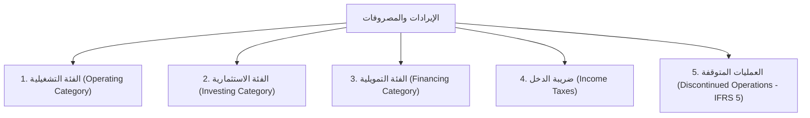

# هيكل العرض والإفصاح في القوائم المالية وفق المعيار الدولي IFRS 18

- **المعيار:** IFRS 18 (Presentation and Disclosure in Financial Statements)
- **الحالة:** معيار دولي صادر يحل محل IAS 1 (تاريخ النفاذ الإلزامي: 1 يناير 2027 مع متطلبات مقارنة لعام 2026).
- **الأثر على النواة المحاسبية:** إعادة هيكلة محرك التقارير المالية لإنتاج الفئات الثلاث الإلزامية والإجماليات الفرعية المعيارية.

---

## 1. الفئات الإلزامية الخمس في قائمة الأرباح أو الخسائر

يلزم معيار IFRS 18 بتبويب كافة الإيرادات والمصروفات بدقة في واحدة من الفئات التالية:

### 1.1 الفئة التشغيلية (Operating Category)

- **المبدأ:** تُعرف الفئة التشغيلية بأنها الفئة المتبقية (Default / Residual Category).
- تشمل كافة بنود الإيرادات والمصروفات الناتجة عن الأنشطة الرئيسية للشركة والتي لا تندرج ضمن الاستثمار أو التمويل أو الضرائب أو العمليات المتوقفة.

### 1.2 الفئة الاستثمارية (Investing Category)

- تشمل العوائد من الاستثمارات في أصول منفصلة لا ترتبط بأنشطة التشغيل الرئيسية (مثل الاستثمار في الشركات الزميلة والمشاريع المشتركة وحصص الأسهم، وعوائد الودائع وأدوات الدين المستقلة).

### 1.3 الفئة التمويلية (Financing Category)

- تشمل تكاليف ومصروفات المعاملات المتعلقة بجمع التمويل (مثل فوائد القروض والسندات)، وفروق العملة والتغيرات في القيمة العادلة المرتبطة بالالتزامات التمويلية.

---

## 2. الإجماليات الفرعية الإلزامية (Mandatory Defined Subtotals)

يفرض معيار IFRS 18 إجماليين فرعيين إلزاميين في صلب قائمة الدخل لتوحيد المقارنة بين الشركات:

1. **الربح التشغيلي (Operating Profit or Loss):**
   $$\text{Operating Profit} = \sum \text{Operating Income} - \sum \text{Operating Expenses}$$
2. **الربح قبل التمويل وضريبة الدخل (Profit or Loss before Financing and Income Taxes):**
   $$\text{Profit before Financing and Taxes} = \text{Operating Profit} + \sum \text{Investing Income} - \sum \text{Investing Expenses}$$

---

## 3. مقاييس الأداء المحددة من قبل الإدارة (Management-defined Performance Measures - MPMs)

- يفرض المعيار إخضاع أي مؤشر مالي فرعي تعلنه الإدارة (مثل Adjusted EBITDA أو Operating FCF) لمتطلبات إفصاح صارمة تشمل:
  1. التسوية التفصيلية (Reconciliation) مع أقرب إجمالي فرعي رسمي في المعيار.
  2. توضيح طريقة الحساب ولماذا يعكس المقياس رؤية الإدارة.
  3. بيان الأثر الضريبي والحصص غير المسيطرة لكل بند تسوية.
