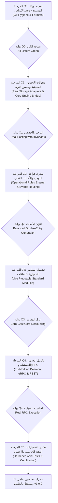

# 🎯 الخطة التنفيذية التكميلية لإنجاز المحرك المحاسبي الشامل المستقل

## Universal Accounting Engine — Completion & Production-Readiness Plan

> **المرجع الأساسي الأول:** [`docs/universal_accounting_engine_redesign.md`](file:///home/osm/StudioProjects/cashflow_system/accounting_engine/docs/universal_accounting_engine_redesign.md)  
> **تقرير التدقيق والتحقق:** مراجعة تنفيذ [`docs/universal_accounting_engine_execution_plan.md`](file:///home/osm/StudioProjects/cashflow_system/accounting_engine/docs/universal_accounting_engine_execution_plan.md)  
> **الحالة:** خطة معتمدة لاستكمال الفجوات وتوصيل النواة الحقيقية  
> **الإصدار المستهدف:** `v1.0.0-standalone-release`  
> **الهدف الهندسي:** الانتقال من مرحلة "الهياكل المجردة والعقود (Scaffolding & Stubs)" إلى **التشغيل الإنتاجي المتكامل للمحرك المستقل**، وربط واجهات الـ SDK بمحرك الترحيل الحقيقي ومخازن البيانات، وتفعيل محرك توجيه الأحداث والوحدات المعيارية.

---

## 🧭 خريطة طريق الإكمال وبوابات الجودة (Quality Gates)



---

## 📋 مصفوفة المراحل التنفيذية لإكمال الفجوات

---

### المرحلة C0: تنظيف المستودع وضبط خط الأساس (Hygiene & Format Baseline)

* **الهدف:** إزالة ملفات البناء المؤقتة التي تسربت للمستودع وضمان نجاح جميع أدوات فحص التنسيق والأمان بصورة مستمرة.
* **البوابة:** `Q0 — Hygiene Purity` (`scripts/check_gofmt.sh` و `scripts/scan_secrets.sh` ينجحان بنسبة 100%).

#### المهام التنفيذية:

| الرمز | المهمة | المدخلات | المخرجات / التسليمات | معيار الإنجاز الصارم (DoD) |
| :--- | :--- | :--- | :--- | :--- |
| **C0-T1** | تنظيف مجلد البناء المؤقت `.gotmp/` | شجرة Git الحالية | ملف `.gitignore` محدث، إزالة `.gotmp/` من Git | - عدم تتبع أي ملفات كاش أو ثنائية (`.gotmp/`).<br/>- إضافة `.gotmp/` إلى `.gitignore`. |
| **C0-T2** | تنسيق الملفات المخالفة لمعيار `gofmt` | `pkg/api/v1/events/rules.go`, `identifiers.go` | ملفات كود منسقة | - تشغيل `gofmt -w` على كافة الحزم.<br/>- اجتياز سكريبت `bash scripts/check_gofmt.sh` بدون أي أخطاء. |

---

### المرحلة C1: محولات التخزين الحقيقية وجسور محرك الترحيل (Real Storage Adapters & Core Bridge)

* **الهدف:** ربط واجهات التخزين الجديدة `pkg/spi/storage` بالمخازن الحقيقية (`storage/memory`, `storage/postgres`)، وربط واجهة `pkg/sdk.LedgerService` بمحرك الترحيل الصارم `internal/posting.Engine` لضمان توازن القيد المزدوج والتحقق من الفترات المالية ومكافحة التلاعب عبر سلسلة التجزئة (Hash-chain).
* **البوابة:** `Q1 — Real Ledger Invariants` (استحالة ترحيل قيد غير متزن أو في فترة مغلقة عبر الـ SDK).

#### المهام التنفيذية:

| الرمز | المهمة | المدخلات | المخرجات / التسليمات | معيار الإنجاز الصارم (DoD) |
| :--- | :--- | :--- | :--- | :--- |
| **C1-T1** | تنفيذ محول الذاكرة `storage/memory` لـ `pkg/spi/storage` | `storage/memory/` | `storage/memory/spi_adapter.go` | - تطبيق واجهة `storage.CoreLedgerStore` و `storage.ReportingStore`.<br/>- استخدام هياكل الذاكرة الفعلية للمحرك بدلاً من كائنات الاختبار المؤقتة. |
| **C1-T2** | تنفيذ محول PostgreSQL لـ `pkg/spi/storage` | `storage/postgres/` | `storage/postgres/spi_adapter.go` | - دعم تشغيل المحرك بالكامل عبر PostgreSQL من خلال واجهات `pkg/spi/storage`.<br/>- دعم استرجاع القيود والتقارير المالية الأساسية. |
| **C1-T3** | جسر التحويل بين كائنات النواة والعقود العامة | `internal/posting/entry.go`, `pkg/api/v1/ledger/` | `internal/facade/adapters.go` | - دوال تحويل ثنائية الاتجاه (Bidirectional Mappers) خالية من التخصيص غير الضروري بين DTOs العامة وكائنات النواة الداخلية. |
| **C1-T4** | ربط `LedgerService` بمحرك الترحيل الحقيقي `internal/posting` | `pkg/sdk/builder.go`, `internal/posting` | `pkg/sdk/ledger_service_impl.go` | - استدعاء `posting.Engine.PostTransaction` الفعلي خلف واجهة `LedgerService.PostEntry`.<br/>- الحفاظ على قواعد التحقق الحسابي، منع الترحيل عند عدم اتزان المدين والدائن، وتوليد الـ Hash Chain. |
| **C1-T5** | تحويل `engine.go` القديم إلى غلاف توافقي (Legacy Compatibility Shim) | `engine.go` | `engine_compat.go` | - إعادة كتابة `New` و `NewWithPorts` كغلاف يستدعي `sdk.NewBuilder` داخلياً.<br/>- ضمان عدم تعطل أي اختبار من الاختبارات القديمة (Backward Compatibility). |

---

### المرحلة C2: محرك قواعد التوجيه وترجمة الأحداث الفعلية (Operational Rules Engine & Events Routing)

* **الهدف:** تمكين `EventIngestionService` من تحويل الأحداث الاقتصادية المجردة إلى قيود محاسبية حقيقية متزنة وذات أسطر مدين ودائن محددة بناءً على قواعد التوجيه.
* **البوابة:** `Q2 — Balanced Double-Entry Generation` (أي حدث تجاري أو زراعي أو خدمي ينتج قيداً حقيقياً متزناً بدقة 100%).

#### المهام التنفيذية:

| الرمز | المهمة | المدخلات | المخرجات / التسليمات | معيار الإنجاز الصارم (DoD) |
| :--- | :--- | :--- | :--- | :--- |
| **C2-T1** | تطوير محرك قواعد التوجيه (Posting Rules Router) | `pkg/api/v1/events/rules.go` | `internal/events/router.go`, `internal/events/evaluator.go` | - دعم تعريف قواعد توجيه مرنة لكل نوع حدث (`EventType`).<br/>- دعم تعيين حسابات المدين والدائن الثابتة أو المشروطة بالأبعاد (مثل مركز التكلفة أو الفرع).<br/>- دعم قوالب القيود متعددة الأسطر (مثل: مبيعات + ضريبة VAT). |
| **C2-T2** | خدمة استقبال وترجمة الأحداث الحقيقية | `pkg/sdk/builder.go` | `internal/events/service.go` | - دالة `ProcessEvent` تستقبل الحدث، تبحث عن القاعدة المناسبة، تنشئ أسطر القيد، وترسلها لمحرك الترحيل `LedgerService`.<br/>- فحص الـ Idempotency الحقيقي لمنع تكرار معالجة نفس الحدث. |
| **C2-T3** | توفير قوالب جاهزة للأنشطة المختلفة (Industry Rule Templates) | متطلبات القطاعات | `pkg/sdk/templates/` (زراعي، تجزئة، اشتراكات) | - دوال جاهزة: `LoadRetailTemplate()`, `LoadAgricultureTemplate()`, `LoadSaaSTemplate()`. |
| **C2-T4** | مجموعة اختبارات محرك الأحداث الشاملة | سيناريوهات أعمال حقيقية | `internal/events/service_test.go` | - اختبار ترجمة أحداث مبيعات بنقاط بيع POS إلى قيود متزنة تشمل حساب النقدية والإيراد وضريبة القيمة المضافة.<br/>- اختبار رفض الأحداث التي لا تملك قواعد مطابقة أو التي تؤدي لعدم اتزان. |

---

### المرحلة C3: تشغيل المعايير المحاسبية كوحدات اختيارية حقيقية (Pluggable Standards Integration)

* **الهدف:** تفريغ كود النواة من الاعتماد الإجباري على المعايير، وربط حزم `modules/ifrs*` بالمنطق الفعلي الموجود داخل `internal/ifrs*`.
* **البوابة:** `Q3 — Zero-Cost Core Decoupling` (تشغيل المحرك الأساسي بدون أي استدعاء لحزم IFRS، وعند حقن الوحدة يتم تسجيل قواعدها وجدولتها بنجاح).

#### المهام التنفيذية:

| الرمز | المهمة | المدخلات | المخرجات / التسليمات | معيار الإنجاز الصارم (DoD) |
| :--- | :--- | :--- | :--- | :--- |
| **C3-T1** | تفعيل وحدة IFRS 15 الحقيقية | `internal/ifrs15/`, `modules/ifrs15/` | `modules/ifrs15/module.go` (مفعل) | - تغليف منطق عقود العملاء والالتزامات الأدائية (Performance Obligations).<br/>- تسجيل قواعد توجيه الإيرادات في محرك الأحداث عبر `RegisterRules`. |
| **C3-T2** | تفعيل وحدة IFRS 16 الحقيقية | `internal/ifrs16/`, `modules/ifrs16/` | `modules/ifrs16/module.go` (مفعل) | - تغليف منطق عقود الإيجار وجداول إطفاء أصول حق الاستخدام (ROU).<br/>- دعم توليد قيود الفوائد والإطفاء الدورية. |
| **C3-T3** | تفعيل وحدات IFRS 9 و IAS 12 | `internal/ifrs9/`, `internal/ias12/` | `modules/ifrs9/`, `modules/ias12/` (مفعل) | - ربط مخصص الخسائر الائتمانية المتوقعة (ECL) وحسابات الضرائب المؤجلة. |
| **C3-T4** | فحص الانفصال التام للنواة عن المعايير | شجرة استيرادات `pkg/` و `engine.go` | تقرير فحص التبعيات | - التأكد من أن `pkg/sdk` و `pkg/api` لا تستورد أياً من حزم `modules/` أو `internal/ifrs*`. |

---

### المرحلة C4: خادم الخدمة المستقلة وبروتوكول gRPC/REST (Standalone Daemon & Dual Packaging)

* **الهدف:** تحويل `cmd/accounting-service` من مجرد Mock HTTP بسيط إلى خادم إنتاجي متكامل يستقبل طلبات gRPC و REST معاً وينفذها على محرك الـ SDK الفعلي.
* **البوابة:** `Q4 — Real RPC Execution` (القدرة على ترحيل قيد واستخراج ميزان المراجعة عبر عميل gRPC أو HTTP cURL).

#### المهام التنفيذية:

| الرمز | المهمة | المدخلات | المخرجات / التسليمات | معيار الإنجاز الصارم (DoD) |
| :--- | :--- | :--- | :--- | :--- |
| **C4-T1** | استكمال ملفات وعقود البروتوكول المحايد (Protobuf v3) | مواصفات الـ API | `proto/accounting/v1/events.proto`, `reporting.proto` | - تعريف رسائل الأحداث ومخرجات التقارير المالية بدقة Proto3.<br/>- توليد كود Go عبر `protoc-gen-go` و `protoc-gen-go-grpc`. |
| **C4-T2** | بناء طبقة خدمة gRPC وربطها بالـ SDK | كود gRPC المولد | `cmd/accounting-service/grpc_server.go` | - تنفيذ واجهة الخادم وربطها بـ `sdk.Engine.Ledger()` و `Reporting()` و `Events()`. |
| **C4-T3** | توفير واجهة HTTP/REST عبر الـ Gateway أو Handlers فعلية | Handlers الخدمة | `cmd/accounting-service/http_server.go` | - معالجة طلبات POST و GET الحقيقية وتحويلها لاستدعاءات داخل الـ SDK بدلاً من الـ Mock JSON الثابت. |
| **C4-T4** | ملفات النشر والتوزيع السحابي الكاملة | متطلبات البيئة | `deployments/docker-compose.yml`, `Dockerfile` | - إعداد بيئة محلية متكاملة تشمل: خدمة المحرك + PostgreSQL + لوحة مقاييس Prometheus. |

---

### المرحلة C5: تشديد الاختبارات المعمارية الثلاثة الحاسمة والاعتماد النهائي (Hardened Acid Tests & Release Signoff)

* **الهدف:** رفع معايير اختبارات الاستقلالية الثلاثة لتتحقق من المنطق المالي الفعلي، والأداء العالي، والمطابقة التامة قبل وسم الإصدار النهائي.
* **البوابة:** `Q5 — 100% Production Certified` (اجتياز الاختبارات الثلاثة الموسعة + عدم انحدار الاختبارات القديمة).

#### المهام التنفيذية:

| الرمز | المهمة | المدخلات | المخرجات / التسليمات | معيار الإنجاز الصارم (DoD) |
| :--- | :--- | :--- | :--- | :--- |
| **C5-T1** | تشديد اختبار الاستهلاك الخارجي (Acid Test 1) | `test/acid/external_consumption_test.go` | اختبار معمق وموسع | - استهلاك خارجي بحت عبر `pkg/sdk` فقط.<br/>- دورة حياة كاملة: إنشاء حسابات -> ترحيل قيود -> عكس قيد -> استخراج ميزان مراجعة حقيقي متزن. |
| **C5-T2** | تشديد اختبار استقلالية الأنشطة (Acid Test 2) | `test/acid/industry_independence_test.go` | اختبار ثلاثي واقعي | - إرسال أحداث حقيقية لثلاثة قطاعات (زراعي: حصاد وتقييم حيوي، تجاري: بيع وضريبة، خدمي: إيراد مؤجل).<br/>- التحقق من إنشاء قيود متزنة حقيقية لكل قطاع واستخراج قوائم مالية صحيحة. |
| **C5-T3** | تشديد اختبار استقلالية البنية التحتية (Acid Test 3) | `test/acid/infrastructure_independence_test.go` | اختبار تحميل حقيقي | - تشغيل **10,000 قيد متزامن** على سائق الذاكرة الفعلي `storage/memory`.<br/>- تنفيذ عملية إقفال فترة مالية بنجاح.<br/>- توفير محول SQLite اختباري لإثبات استقلالية النواة عن نوع قاعدة البيانات. |
| **C5-T4** | دليل المطور الخارجي والتوثيق الرسمي | كود الـ SDK | `docs/sdk_developer_guide.md`, `README.md` | - دليل عملي للمطور يشرح كيفية تضمين المحرك كمكتبة Go أو الاتصال به كخدمة gRPC/REST. |
| **C5-T5** | وسم الإصدار الرسمي والاعتماد النهائي | شجرة المشروع المعتمدة | `Git Tag: v1.0.0-standalone` | - توقيع الاعتماد النهائي وإصدار التاق الرسمي. |

---

## ⏱️ ترتيب الأولويات وخطة التنفيذ الموصى بها

```text
الأولوية 1 (فورية): المرحلة C0 — تنظيف .gotmp وضبط gofmt لجميع الملفات.
الأولوية 2: المرحلة C1 — بناء محولات التخزين الفعلية لـ pkg/spi/storage وتوصيل posting.Engine الحقيقي.
الأولوية 3: المرحلة C2 — كتابة محرك ترجمة الأحداث الحقيقي (Rules Engine) لتوليد قيود متزنة.
الأولوية 4: المرحلة C3 — تفعيل وحدات المعايير modules/ifrs* وتجريد engine.go.
الأولوية 5: المرحلة C4 — استكمال عقود Proto وخدمة gRPC/REST الحقيقية وملف docker-compose.yml.
الأولوية 6: المرحلة C5 — ترقية الاختبارات الثلاثة لاختبارات مالية متكاملة وإصدار التوثيق ووسم v1.0.0.
```

---

## 🎯 معايير القبول النهائي (Final Definition of Done)

1. لا يوجد أي Mock أو Stub وهمي داخل مسارات الترحيل أو الأحداث الأساسية.
2. `pkg/` نظيفة 100% ولا تستورد `internal/` إطلاقاً.
3. المحرك القديم يمرر كل اختباراته السابقة بنسبة 100% بدون أي انحدار (No Regression).
4. جميع اختبارات `test/acid/` تعمل على مخازن حقيقية وتنتج قيوداً متزنة وتقارير مالية فعلية.
5. `cmd/accounting-service` يمكن تشغيله عبر `docker compose up` ويستجيب بنجاح لطلبات الترحيل واستخراج ميزان المراجعة.

