# 🚀 الخطة التنفيذية المعمارية الشاملة: المحرك المحاسبي الشامل المستقل

## Universal Accounting Engine — Master Execution & Refactoring Plan

> **المرجع الأساسي:** [`docs/universal_accounting_engine_redesign.md`](file:///home/osm/StudioProjects/cashflow_system/accounting_engine/docs/universal_accounting_engine_redesign.md)  
> **الحالة:** خطة معتمدة وجاهزة للتنفيذ المرحلي  
> **الإصدار المستهدف:** `v1.0.0-standalone`  
> **الهدف الهندسي:** تحويل المحرك المحاسبي من حزمة مقترنة داخلياً إلى **منتج برمجي عام ومستقل (Universal Reusable Engine)** يمكن حقنه بسهولة في أي نظام تجاري، صناعي، زراعي، أو خدمي، عبر معمارية نظيفة غير قابلة للكسر ومحققة لاختبارات الاستقلالية الثلاثة.

---

## 🧭 خريطة المراحل وبوابات الجودة (Quality Gates)

```mermaid
flowchart TD
    P0["المرحلة 0: استخراج العقود العامة النواة<br/>(pkg/api/v1 & Types Decoupling)"] --> G0{"بوابة G0: نقاء العقود<br/>Zero internal imports"}
    G0 --> P1["المرحلة 1: تجريد التخزين وواجهة Facade<br/>(Storage SPIs & Service Facade)"]
    P1 --> G1{"بوابة G1: حجب التفاصيل<br/>Encapsulated Core"}
    G1 --> P2["المرحلة 2: محرك البناء والاعتماديات المشروطة<br/>(Dependency-Driven Builder)"]
    P2 --> G2{"بوابة G2: أمان التهيئة<br/>Fail-Fast Bootstrap"}
    G2 --> P3["المرحلة 3: طبقة الأحداث وقواعد التوجيه<br/>(Accounting Events & Rules Engine)"]
    P3 --> G3{"بوابة G3: عزل الأنشطة<br/>Domain Neutrality"}
    G3 --> P4["المرحلة 4: تفكيك المعايير لوحدات اختيارية<br/>(Pluggable Standards Modules)"]
    P4 --> G4{"بوابة G4: التركيب الاختياري<br/>Zero-Cost Modules"}
    G4 --> P5["المرحلة 5: التغليف الثنائي والخدمة المستقلة<br/>(Go Library SDK + Standalone gRPC Service)"]
    P5 --> G5{"بوابة G5: الجاهزية الثنائية<br/>Dual-Mode Packaging"}
    G5 --> P6["المرحلة 6: الاختبارات المعمارية الثلاثة والاعتماد<br/>(3 Acid Tests & Production Signoff)"]
    P6 --> Certified["✅ محرك محاسبي شامل مستقل v1.0.0"]
```



---

## 📋 مصفوفة المراحل والمهام التنفيذية

---

### المرحلة 0: استخراج العقود والأنواع العامة النواة (Public Contracts & Types Decoupling)

* **الهدف الاستراتيجي:** كسر حاجز `internal/` وإتاحة جميع الأنواع والعقود التي يحتاجها العالم الخارجي في حزم عامة تحت `pkg/api/v1/` قابلة للاستيراد من أي مشروع Go خارجي.
* **البوابة:** `G0 — Contract Purity` (التحقق الآلي من أن أي ملف داخل `pkg/` لا يستورد إطلاقاً أي حزمة تحتوي على كلمة `internal`).

#### المهام التنفيذية

| رمز المهمة | اسم المهمة | المدخلات | المخرجات / التسليمات | معايير الإنجاز الصارمة (DoD) |
| :--- | :--- | :--- | :--- | :--- |
| **P0-T1** | إنشاء حزمة الأنواع المالية العامة | `internal/types/money.go`, `currency.go` | `pkg/api/v1/types/money.go`, `currency.go`, `identifiers.go` | - استخراج أنواع `Money`, `Currency`, `CompanyID`, `AccountID`, `FiscalPeriodID` كأنواع عامة مستقلة.<br/>- توفير دوال التحويل والفحص الرياضي بدقة 4 خانات عشرية.<br/>- تغطية فحص 100% بدون أي استيراد لـ `internal`. |
| **P0-T2** | استخراج عقود القيود والحسابات العامة | `internal/posting/entry.go`, `internal/masterdata/account.go` | `pkg/api/v1/ledger/entry.go`, `account.go`, `period.go` | - تعريف `JournalEntry`, `EntryLine`, `Account`, `FiscalPeriod` كعقود DTO عامة ونقية.<br/>- إزالة أي حقول تشغيلية داخلية (مثل مؤشرات الأقفال وسلاسل التجزئة الداخلية) من واجهات الاستهلاك الخارجي. |
| **P0-T3** | استخراج كائنات ومخرجات التقارير المالية العامة | `internal/reporting/*.go` | `pkg/api/v1/reporting/reports.go` | - تعريف DTOs عامة لـ: `TrialBalance`, `GeneralLedgerReport`, `BalanceSheetReport`, `IncomeStatementReport`.<br/>- خلو هذه الكائنات من أي نوع بيانات مرتبط بـ PostgreSQL أو مكتبات التخزين. |
| **P0-T4** | جسور التوافق الداخلي (Internal Type Aliases / Mappings) | الحزم الحالية تحت `internal/` | كود داخلي معدل يشير إلى عقود `pkg/` | - تحويل الأنواع الداخلية لتصبح متطابقة أو منسجمة مع أنواع `pkg/` دون كسر الاختبارات القائمة. |
| **P0-T5** | أداة الفحص الآلي لعزل الحزم (Package Boundary Linter) | نصوص CI | سكربت `scripts/check_public_api_purity.sh` | - سكريبت يفحص شجرة الاعتماديات بواسطة `go list` ويرفض أي بناء في حال ظهور `internal` داخل شجرة استيرادات `pkg/`. |

---

### المرحلة 1: تجريد التخزين وتأسيس واجهة الخدمة الموحدة (Storage SPI & Facade Layer)

* **الهدف الاستراتيجي:** حجب تعقيدات التخزين و`posting.Engine` عن المستهلك الخارجي، وتفكيك `StorageDriver` الموحد إلى منافذ دقيقة (Fine-grained SPI Ports).
* **البوابة:** `G1 — Encapsulated Core` (المستهلك يتعامل مع واجهة Facade واحدة ولا يرى هياكل المحرك الداخلية).

#### المهام التنفيذية

| رمز المهمة | اسم المهمة | المدخلات | المخرجات / التسليمات | معايير الإنجاز الصارمة (DoD) |
| :--- | :--- | :--- | :--- | :--- |
| **P1-T1** | تفكيك منافذ التخزين إلى عقود SPI دقيقة | `StorageDriver` الحالي في `engine.go` | `pkg/spi/storage/core.go`, `reporting.go`, `governance.go`, `rates.go` | - تعريف واجهات مستقلة تماماً:<br/>  1. `CoreLedgerStore` (الحسابات، الفترات، ترحيل القيود الذري).<br/>  2. `ReportingStore` (قراءة الأرصدة وخطوط الحركة).<br/>  3. `GovernanceStore` (سجل التدقيق وبصمات الاعتماد).<br/>  4. `ExchangeRateSPI` (توفير أسعار الصرف). |
| **P1-T2** | تصميم واجهة المحرك العامة (Public Engine Facade) | `AccountingEngine` الحالي | `pkg/sdk/engine.go` (واجهة `Engine`) | - واجهة عامة موحدة تعرض خدمات متخصصة:<br/>  - `Ledger() LedgerService`<br/>  - `Reporting() ReportingService`<br/>  - `Governance() GovernanceService`<br/>  - `Valuation() ValuationService`<br/>- اختفاء كامل لأي مؤشرات مباشرة مثل `*posting.Engine` من الواجهة العامة. |
| **P1-T3** | تنفيذ محولات التخزين المعيارية (Storage Adapters) | `storage/postgres/`, `storage/memory/` | محولات محدثة تطبق الواجهات الجديدة المنفصلة | - تقسيم كود `storage/postgres` إلى حزم فرعية أو بنيات تطبق المنافذ الدقيقة كل على حدة.<br/>- تمكين تشغيل المحرك مع مخزن أساسي فقط دون إلزام بوجود مخزن تقارير متقدم. |
| **P1-T4** | تطبيق خدمة الدفتر العام التجريدية (`ledgerServiceImpl`) | `internal/posting/engine.go` | `internal/facade/ledger_service.go` | - تغليف عمليات الترحيل (`PostTransaction`, `ReverseTransaction`, `GetTransaction`) خلف واجهة خدمة آمنة تعيد أخطاء معيارية موحدة (`pkg/api/v1/types/errors.go`). |

---

### المرحلة 2: محرك البناء والاعتماديات المشروطة (Dependency-Driven Builder Pattern)

* **الهدف الاستراتيجي:** استبدال دوال التهيئة القديمة (`New`, `NewWithPorts`) بمنشئ مرن وذكي يمنع تشغيل أي ميزة ما لم تتوفر متطلباتها الصارمة، مع رسائل خطأ دقيقة وفورية (Fail-Fast).
* **البوابة:** `G2 — Fail-Fast Bootstrap` (استحالة بناء نسخة من المحرك في حالة اعتمادية غير متسقة).

#### المهام التنفيذية

| رمز المهمة | اسم المهمة | المدخلات | المخرجات / التسليمات | معايير الإنجاز الصارمة (DoD) |
| :--- | :--- | :--- | :--- | :--- |
| **P2-T1** | كتابة هيكل `Builder` وخيارات التهيئة | مواصفة القسم 5 من وثيقة التصميم | `pkg/sdk/builder.go`, `options.go` | - توفير Fluent Builder يدعم:<br/>  - `WithCoreStorage(store)`<br/>  - `WithReporting(store)`<br/>  - `WithGovernance(store, policy)`<br/>  - `WithObservability(logger, metrics)`<br/>  - `WithStandard(module)` |
| **P2-T2** | محرك التحقق من شجرة الاعتماديات (Dependency Verification Engine) | قواعد الربط بين الميزات والمخازن | دالة `b.Build(ctx)` مع التحقق الصارم | - رفض تفعيل ميزة `Reporting` إذا كان `ReportingStore` فارغاً (`nil`).<br/>- رفض تشغيل المحرك تماماً إذا كان `CoreLedgerStore` مفقوداً.<br/>- تجميع كافة أخطاء التهيئة وإرجاعها في كائن خطأ تفصيلي (`errors.Join`). |
| **P2-T3** | محول التوافق القديم (Legacy Migration Shim) | `engine.go` الحالي | `engine_compat.go` (Deprecated) | - توفير دالة `New` السابقة كغلاف مؤقت يستدعي الـ Builder داخلياً لضمان عدم تعطل الاختبارات القديمة أثناء فترة الترحيل. |
| **P2-T4** | اختبارات الوحدة للبناء المشروط (Bootstrap Unit Tests) | حالات النجاح والفشل في التهيئة | `pkg/sdk/builder_test.go` | - اختبار رفض التشغيل عند نقص المخازن.<br/>- اختبار نجاح التشغيل الخفيف (Lightweight Core Only).<br/>- اختبار نجاح التشغيل الموسع بكافة الخدمات. |

---

### المرحلة 3: طبقة استقبال الأحداث المحاسبية وقواعد التوجيه (Accounting Events & Rules Engine)

* **الهدف الاستراتيجي:** تمكين الأنظمة التشغيلية (زراعية، تجارية، صناعية، خدمية) من إرسال أحداث أعمال مجردة دون الحاجة لمعرفة مبادئ القيد المحاسبي.
* **البوابة:** `G3 — Domain Neutrality` (المحرك لا يحتوي على أي مصطلحات أعمال متخصصة؛ كل شيء معمم كأحداث وأبعاد وقواعد).

#### المهام التنفيذية

| رمز المهمة | اسم المهمة | المدخلات | المخرجات / التسليمات | معايير الإنجاز الصارمة (DoD) |
| :--- | :--- | :--- | :--- | :--- |
| **P3-T1** | تعريف نموذج الحدث المحاسبي العام | مواصفة الأحداث في وثيقة التصميم | `pkg/api/v1/events/event.go` | - كائن `AccountingEvent` يحتوي على:<br/>  - `EventID`, `EventType`, `CompanyID`<br/>  - `EffectiveDate`, `Amount`, `Currency`<br/>  - `Dimensions (map[string]string)`<br/>  - `Payload (map[string]any)`, `IdempotencyKey`. |
| **P3-T2** | محرك قواعد التوجيه المحاسبي (Posting Rules Engine) | متطلبات ترجمة الأحداث لقيود | `pkg/api/v1/events/rules.go`, `internal/events/engine.go` | - تصميم `PostingRule` التي تحدد لكل `EventType` كيفية إنشاء سطور المدين والدائن استناداً إلى الحسابات المعرفة في دليل الشركة وأبعاد الحدث. |
| **P3-T3** | خدمة استقبال الأحداث (`EventIngestionService`) | واجهات الأحداث والتوجيه | `pkg/sdk/events_service.go`, `internal/events/service.go` | - دالة `ProcessEvent(ctx, event) (*PostResult, error)`.<br/>- التحقق الذري من عدم التكرار (Idempotency).<br/>- ترجمة الحدث لقيد يومية متزن وتمريره لـ `LedgerService.PostTransaction`. |
| **P3-T4** | دعم الأبعاد التحليلية المعممة (Analytical Dimensions Router) | `internal/posting/dimensions.go` | `pkg/api/v1/events/dimensions.go` | - دعم حقن أبعاد مرنة (مثل: رقم الحقل الزراعي، معرف الكاشير، كود المشروع) وإرفاقها بسطور القيد للتحليل المالي اللاحق دون قيود مسبقة. |
| **P3-T5** | مجموعة اختبارات الأحداث والتوجيه (Event Mapping Tests) | سيناريوهات أعمال افتراضية | `internal/events/service_test.go` | - اختبار ترجمة أحداث مختلفة إلى قيود متزنة بدقة 100%. |

---

### المرحلة 4: تفكيك المعايير المحاسبية إلى وحدات اختيارية (Pluggable Standards Modules)

* **الهدف الاستراتيجي:** فصل وحدات المعايير الدولية (IFRS 15, IFRS 16, IFRS 9, IAS 12) من قلب المحرك وتحويلها إلى وحدات مستقلة (Plugins) تُحقن فقط عند الحاجة.
* **البوابة:** `G4 — Zero-Cost Modules` (تشغيل المحرك بدون معايير لا يحمل أي تكلفة ذاكرة أو متطلبات جداول تخص تلك المعايير).

#### المهام التنفيذية

| رمز المهمة | اسم المهمة | المدخلات | المخرجات / التسليمات | معايير الإنجاز الصارمة (DoD) |
| :--- | :--- | :--- | :--- | :--- |
| **P4-T1** | صياغة واجهة عقد المعيار المحاسبي (Standard Module SPI) | وحدات `internal/ifrs*`, `ias12` | `pkg/spi/standards/module.go` | - تعريف واجهة `StandardModule` تشمل:<br/>  - `Name() string`<br/>  - `ValidateDependencies(ports StoragePorts) error`<br/>  - `RegisterRules(router *RuleRouter) error`<br/>  - `RunScheduledJobs(ctx context.Context, runner JobRunner) error` |
| **P4-T2** | عزل وحدة IFRS 15 (عقود العملاء والإيرادات) | `internal/ifrs15/` | `modules/ifrs15/module.go` | - تحويل IFRS 15 إلى وحدة اختيارية مستقلة تسجل قواعدها ومخزن عقودها عبر عقد الـ Module دون المساس بـ `engine.go`. |
| **P4-T3** | عزل وحدة IFRS 16 (عقود الإيجار وحق الاستخدام) | `internal/ifrs16/` | `modules/ifrs16/module.go` | - تحويل IFRS 16 إلى وحدة اختيارية مستقلة تولد جداول الإطفاء وتسجل قيودها عبر أحداث أو قيود مباشرة. |
| **P4-T4** | عزل وحدتي IFRS 9 و IAS 12 | `internal/ifrs9/`, `internal/ias12/` | `modules/ifrs9/`, `modules/ias12/` | - عزل مخصصات التدني (ECL) وحسابات الضرائب المؤجلة كوحدات إضافية. |
| **P4-T5** | تنظيف النواة من أي استيراد صلب للمعايير | `engine.go` الحالي | كود النواة خفيف ونقي بنسبة 100% | - التأكد من أن `pkg/sdk/engine.go` لا يستورد أياً من حزم `modules/*`. |

---

### المرحلة 5: التغليف الثنائي والخدمة المستقلة (Go Library SDK + Standalone Service)

* **الهدف الاستراتيجي:** توفير المحرك في صورتين: الأولى كمكتبة Go نقية (In-Process Library)، والثانية كخدمة مستقلة (Microservice Daemon) تتواصل عبر gRPC و REST.
* **البوابة:** `G5 — Dual-Mode Packaging` (المحرك يعمل بكفاءة قصوى داخل معالجات Go، كما يعمل كخادم مستقل للغات البرمجة الأخرى).

#### المهام التنفيذية

| رمز المهمة | اسم المهمة | المدخلات | المخرجات / التسليمات | معايير الإنجاز الصارمة (DoD) |
| :--- | :--- | :--- | :--- | :--- |
| **P5-T1** | تعريف عقود البروتوكول المحايد (Protobuf & gRPC Definitions) | `pkg/api/v1/...` | `proto/accounting/v1/ledger.proto`, `events.proto`, `reporting.proto` | - كتابة ملفات Proto3 تمثل واجهات استقبال الأحداث، وإجراء القيود، واستخراج التقارير.<br/>- توليد كود Go gRPC Clients & Servers. |
| **P5-T2** | بناء خادم الخدمة المستقلة (`cmd/accounting-service`) | `cmd/agy/serve.go`, كود النواة | `cmd/accounting-service/main.go`, `server.go` | - خادم متكامل يستقبل اتصالات gRPC و HTTP/REST (عبر gRPC-Gateway).<br/>- تضمين نقاط الفحص `/healthz` و `/readyz` و مقاييس `/metrics` (Prometheus). |
| **P5-T3** | ضبط التكوين عبر المتغيرات البيئية و YAML | متطلبات التشغيل السحابي | `cmd/accounting-service/config.go` | - دعم قراءة إعدادات قواعد البيانات، المنافذ، وتفعيل الوحدات من البيئة (12-Factor App). |
| **P5-T4** | إعداد حزمة Docker وملف نشر Kubernetes | البيئة التشغيلية | `deployments/Dockerfile`, `helm/` أو `docker-compose.yml` | - صورة Docker خفيفة متعددة المراحل (Multi-stage Scratch/Alpine) بحجم صغير جداً وأمان عالٍ. |

---

### المرحلة 6: الاختبارات المعمارية الثلاثة الحاسمة والاعتماد النهائي (3 Acid Tests & Signoff)

* **الهدف الاستراتيجي:** إثبات نجاح الرؤية المعمارية عبر اختبارات برمجية آلية صارمة تُثبت استقلالية المنتج عن المشاريع الداخلية، وعن الأنشطة الاقتصادية، وعن البنية التحتية.
* **البوابة:** `G6 — Full Architectural Certification` (اجتياز الاختبارات الثلاثة + الحفاظ على نجاح اختبارات المحرك التاريخية بنسبة 100%).

#### المهام التنفيذية

| رمز المهمة | اسم المهمة | المدخلات | المخرجات / التسليمات | معايير الإنجاز الصارمة (DoD) |
| :--- | :--- | :--- | :--- | :--- |
| **P6-T1** | **الاختبار المعماري 1:** اختبار الاستهلاك الخارجي النقي (External Module Consumption) | حزم `pkg/` الناتجة | `test/acid/external_consumption_test.go` | - محاكاة استيراد المحرك داخل مشروع مستقل بدون الرجوع لأي حزمة داخلية.<br/>- إنشاء حسابات، ترحيل قيد، واستخراج ميزان مراجعة بالكامل عبر `pkg/sdk` فقط.<br/>- نجاح البناء والتشغيل بنسبة 100%. |
| **P6-T2** | **الاختبار المعماري 2:** اختبار الاستقلالية عن الأنشطة (Industry Independence) | محرك الأحداث والتوجيه | `test/acid/industry_independence_test.go` | - اختبار ثلاثي متزامن:<br/>  1. **نشاط زراعي:** حصاد قمح ومخزون حيوي (IAS 41).<br/>  2. **نشاط تجاري:** مبيعات نقطة بيع POS وضريبة VAT.<br/>  3. **نشاط خدمي:** اشتراك سنوي سحابي وإيراد مؤجل.<br/>- توليد التقارير المالية لكل نشاط على نفس المحرك دون تعديل سطر واحد في كود المحرك. |
| **P6-T3** | **الاختبار المعماري 3:** اختبار استقلالية البنية التحتية (Infrastructure Independence) | منافذ التخزين SPI ومحول الذاكرة | `test/acid/infrastructure_independence_test.go` | - تشغيل دورة محاسبية كاملة (10,000 قيد متزامن + إقفال فترة) على سائق الذاكرة `memory.Store`.<br/>- كتابة محول تجريبي لقاعدة بيانات خفيفة (مثل SQLite Store) والتأكد من عمل النواة دون الحاجة لـ PostgreSQL. |
| **P6-T4** | فحص الانحدار ومطابقة الاختبارات التاريخية (Regression & Benchmarks) | `simulation_test.go`, `benchmark_test.go` | تقرير التحقق من عدم الانحدار | - تشغيل جميع الاختبارات المسبقة والتأكد من مطابقة النتائج الحسابية وضمانات التسلسل والقيد المزدوج. |
| **P6-T5** | التوثيق النهائي ووسم الإصدار (Release Signoff v1.0.0) | التوثيق المحدث | `docs/README.md`, دليل المطور الخارجي | - نشر توثيق الـ SDK للمطورين الخارجيين وإصدار الوسم الرسمي `v1.0.0`. |

---

## 📅 الجدول الزمني المقترح للتنفيذ (Implementation Timeline)

```text
الأسبوع 1: [المرحلة 0] استخراج العقود والأنواع العامة (P0-T1 إلى P0-T5)
الأسبوع 2: [المرحلة 1] تجريد منافذ التخزين وبناء واجهة Facade (P1-T1 إلى P1-T4)
الأسبوع 3: [المرحلة 2] محرك البناء والتحقق من الاعتماديات (P2-T1 إلى P2-T4)
الأسبوع 4: [المرحلة 3] محرك الأحداث المحاسبية وقواعد التوجيه (P3-T1 إلى P3-T5)
الأسبوع 5: [المرحلة 4] تفكيك المعايير إلى وحدات إضافية اختيارية (P4-T1 إلى P4-T5)
الأسبوع 6: [المرحلة 5] بناء الخدمة المستقلة وملفات التوزيع (P5-T1 إلى P5-T4)
الأسبوع 7: [المرحلة 6] تنفيذ الاختبارات المعمارية الثلاثة والاعتماد النهائي (P6-T1 إلى P6-T5)
```

---

## 🛡️ مصفوفة المخاطر المعمارية وإجراءات التخفيف (Risk Mitigation)

| المخاطرة المعمارية | مستوى الخطر | الأثر المتوقع | إجراء التخفيف الوقائي (Mitigation) |
| :--- | :---: | :--- | :--- |
| **كسر التوافق مع الكود والاختبارات القائمة** | عالي | تعطل الـ CI الحالي وفشل اختبارات النزاهة التاريخية | توفير جسور توافق مؤقتة (Compatibility Shims / Aliases) وإبقاء `engine.go` القديم كغلاف للمكتبة الجديدة مؤقتاً حتى اكتمال الترحيل. |
| **انخفاض الأداء بسبب طبقة الـ Facade والتجريد** | متوسط | بطء في الترحيل عالي الكثافة (Throughput drop) | الحفاظ على التصميم بالاعتماد على مؤشرات مباشرة (In-memory zero-copy calls) في وضع المكتبة؛ تجنب الـ Reflection واستخدام بنى بيانات محددة بدقة. |
| **تعقيد قواعد توجيه الأحداث للأنشطة المختلفة** | متوسط | صعوبة قيام المطور بتهيئة أحداث القطاع الزراعي أو التجاري | توفير قوالب جاهزة (Ready-to-use Templates): قالب تجزئة، قالب زراعي، قالب خدمات يمكن استدعاؤها بسطر واحد: `rules.LoadRetailTemplate()`. |
| **تسرب كود التخزين (SQL) إلى طبقة العقود العامة** | عالي | فقدان استقلالية البنية التحتية والعودة للارتباط بـ Postgres | فرض فحص آلي في الـ CI يمنع استيراد `database/sql` أو `jackc/pgx` داخل أي ملف في مجلد `pkg/`. |

---

## 🎯 المعايير الكمية للنجاح النهائي (Definition of Success)

عند اكتمال تنفيذ هذه الخطة، سيكون المحرك قد حقق المعايير التالية نصاً وروحاً:

1. **استقلالية الاستيراد (100% Importable):** أي مطور يستطيع كتابة `import "github.com/.../accounting_engine/pkg/sdk"` دون أي أخطاء تصريف ودون رؤية أي كود داخلي.
2. **استقلالية الأنشطة (Zero Domain Leakage):** لا يوجد سطر واحد يخص بضاعة معينة أو نوع محصول أو خدمة داخل كود الترحيل، وكل الأنشطة تعمل عبر الأحداث والأبعاد.
3. **استقلالية البنية التحتية (Pluggable Storage):** تشغيل جميع الاختبارات على In-Memory في أقل من ثانية واحدة، ودعم استبدال قاعدة البيانات بمجرد توفير محول يحقق عقود التخزين.
4. **تفعيل مشروط آمن (Fail-Fast Bootstrap):** يستحيل تشغيل ميزة بدون توفير مستودعها، والمحرك الأساسي يعمل كـ Micro-kernel خفيف جداً.
5. **اجتياز الاختبارات الثلاثة:** ملفات اختبارية صريحة وموثقة في الـ CI تثبت نجاح الاختبارات المعمارية الثلاثة.
